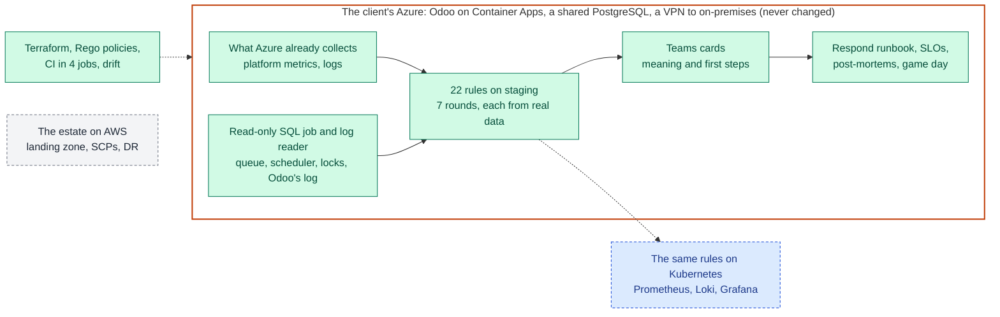
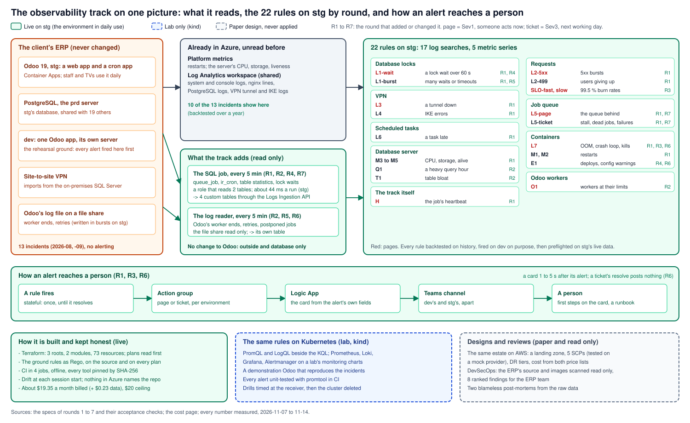
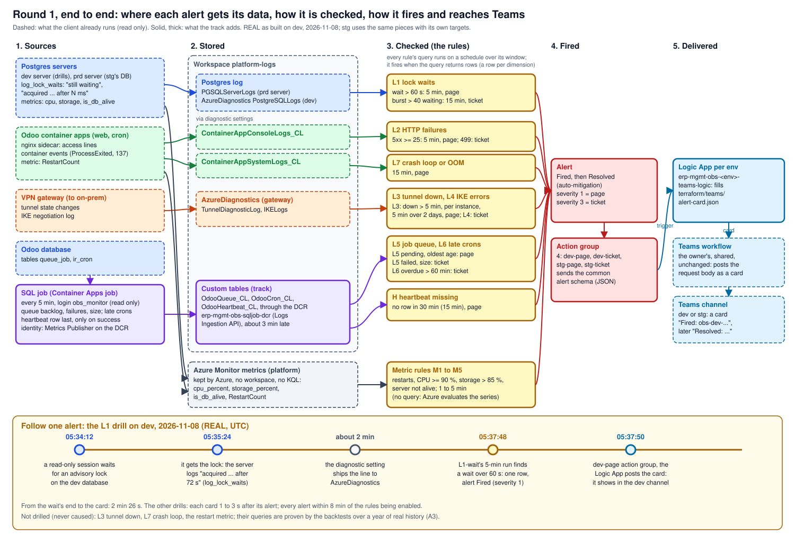

# erp-observability

**Monitoring, SLOs and incident response for a manufacturer's live ERP, built from the system's own 13 incidents,
running on the environment its staff use every day, and never touching the ERP itself.**

Green is live on the client's staging environment; blue ran in a lab on kind; grey is a design on paper. The whole
picture, every rule by round: [the track map](docs/learn/diagrams/track-map.svg).

- **The system:** Odoo 19 on Azure Container Apps for a manufacturer: a web app and a cron app on staging (stg), the
  environment its staff and the factory's TV dashboards use every day; a PostgreSQL server shared with 19 other
  databases; a VPN to an on-premises SQL Server ([the problem](#the-problem)).
- **Who it serves:** the platform team that runs the client's Azure (pages and tickets in Teams, each card with its
  first steps) and the ERP team that owns Odoo (findings and handovers, never a change to their system).
- **Where it runs:** Azure Monitor on the client's own workspace, Terraform applied from the laptop, about $19.35 a
  month billed (plus about $0.23 of workspace data at list price) against a $20 ceiling ([the cost](docs/cost.md)).
- **Built:** 22 rules on stg in seven rounds since 2026-11-08, each backtested on a year of history and fired on purpose
  on dev first; SLOs, incident response, the pipeline; the same rules on Kubernetes (lab); the estate on AWS (paper).
- **Next:** thresholds tuned from real catches only ([the roadmap](#the-roadmap)).

I am the platform engineer on the client's Azure; I designed, built and operate this, every step checked against
acceptance criteria with real output. An anonymized export of the working repo: the client's, its people's and its
resources' names are replaced by roles; every date, count and measurement is real. In the docs, "the track" is this
body of work and "the owner" is me.

## For a reviewer: each skill and where it is proven

Five minutes, one row per skill; every link opens the spec, the code or a command with its real output. IDs such as
A5 or N7 are acceptance checks, each defined in its round's spec.

| Skill | The proof | Measured |
|---|---|---|
| Alerting built from real incidents (Azure Monitor, KQL) | [The signals](docs/specs/round-1.md#signals), [the rules](kql/), [backtests over a year of history](docs/runbooks/backtests.md) | 13 incidents of 2026-08 and 09: 10 visible in sources that already existed, none watched; each rule fires on its incident's dates (91 five-minute bins of 5xx in a year, 75 of them in August) |
| Alerts proven end to end | [Drills on dev](docs/runbooks/drills.md), [the Teams card](terraform/teams/alert-card.json) | 11 rules fired on purpose (one by a real 72 s lock wait); each card in Teams 1 to 3 s after its alert; with the job stopped, the heartbeat rule 35 min 41 s after the last heartbeat ([round 1, A5](docs/reviews/round-1.md#2-what-it-delivered)) |
| SLOs and burn-rate alerts | [The SLO](docs/learn/slo.md), [round 3's spec](docs/specs/round-3.md) | 99.5 % over 30 days per user journey; 90 days of backtest: 12 page episodes, each a real failure |
| Incident response | [A response section per rule](docs/runbooks/respond.md), [two blameless post-mortems](docs/postmortems/README.md), [the game day](docs/runbooks/respond.md#the-game-day-of-2026-11-08) | Every card carries its first steps; game day, responding by the runbook alone: detected 2 min 54 s after the fault, diagnosed 30 s after the alert was seen; the post-mortems corrected the incident record twice and closed an alerting gap |
| Terraform at scale, Policy-as-Code, drift | [3 roots and 2 modules](terraform/), [the Rego policies](policy/terraform/), [the pipeline](docs/specs/pipeline.md) | 73 resources in the teardown preview ([round 7, N7](docs/reviews/round-7.md#2-what-it-delivered)); the ground rules checked on the source at every push and on every plan before apply; drift read at every session start; CI in 4 parallel jobs, 14 steps (SAST, and the job's SQL on a throwaway PostgreSQL), offline, every tool pinned by SHA-256 |
| Least privilege on a shared production database | [The monitoring role](sql/obs_monitor.sql), [roles explained](docs/learn/postgres-roles.md) | The job reads two tables, read only, 10 s statement timeout: 15.9 ms of database time per run on average on the shared server at round 1 ([A8](docs/reviews/round-1.md#2-what-it-delivered)), 44 ms with every round's queries ([round 7, N7](docs/reviews/round-7.md#2-what-it-delivered)) |
| DevSecOps on a client's real code and images | [The scans and their ranking](docs/specs/devsecops.md), [SAST in CI](tools/ci.sh) | stg's ERP image: 3,789 OS findings cut to 3 HIGH OS CVEs with a fix (and 4 in language packages), 85 % and all 15 Critical in one build-only package; 337 SAST findings over 96,625 lines ranked, 8 HTTP calls without a timeout tied to the worker-kill alert; findings to the ERP team, read only |
| Kubernetes observability: Prometheus, Loki, Grafana, Alertmanager | [The mapping](docs/specs/kubernetes-mapping.md), [the rules and their tests](k8s/rules/), [the lab runbook](docs/runbooks/kubernetes-lab.md) | The same rules in PromQL and LogQL on kind, against a demonstration Odoo that reproduces the incidents; 8 PromQL alerts and 2 recording rules, every alert unit-tested with promtool in CI; every drill at the receiver: 5xx burst 43 s, memory kill 32 s, a lock wait paged while it lasted, 71 s before it ended (on Azure, the log-based rule could only page after the wait; round 4 closed that) |
| FinOps | [Estimated and billed](docs/cost.md), [the AWS estimate](docs/specs/aws-migration.md) | Every resource priced from the Azure Retail Prices API before it was built: rounds 1 to 6 about $19.30 a month against a $20 ceiling; Cost Management then billed about $19.35 on the track's resources, plus about $0.23 of workspace data at list price (1.5 % over in all); round 7 adds about $0.10 |
| AWS architecture for a client | [The landing zone and migration design](docs/specs/aws-migration.md), [the SCP module](terraform/aws/) | 5 SCPs tested on a mock provider (6 of 6 tests), 5 ADRs, DR tiers; Azure $611 to $1,064 a month against AWS $1,092 like for like; 43 person-days in waves |
| Governing an AI coding agent | [AGENTS.md](AGENTS.md), [the method](method/METHOD.md), [how I work](docs/how-i-work.md) | Spec before code (a commit hook enforces it); every live change shown as its plan first; nothing in Azure names this repo, checked over 57 resources ([round 6, I7](docs/reviews/round-6.md#2-what-it-delivered)) |

## The problem

**The system.** The client runs Odoo 19 on Azure Container Apps: a web app and a cron app for its staging environment
(stg), which is the one in daily use: its staff work in it and the factory's TV dashboards poll it for data. stg's
database sits on the PostgreSQL Flexible Server named "prd" (the docs call it the prd server), shared with 19 other
databases. Data arrives from an on-premises SQL Server over a
site-to-site VPN. A development environment (dev) runs one Odoo app on its own server.

**Its gaps, measured:**

| # | Gap | Evidence |
|---|---|---|
| P1 | Incidents found by people | 13 operational incidents in 2026-08 and 09 and no operational alert: lock waits behind bursts of up to 207 simultaneous 502s, CPU saturation, a job queue grown to 1.38 million rows, a cron app restarting, a VPN rekey failing for months, a tunnel down 6.7 h |
| P2 | The evidence existed, unread | 10 of the 13 incidents show in a source Azure already collected (platform metrics, the Log Analytics workspace); 3 only partly ([where each shows](docs/specs/round-1.md#signals)) |
| P3 | Four signals live only in Odoo's tables | The job queue's backlog and failures, late scheduled tasks: no Azure service reads them |
| Constraint | A hard constraint | Odoo's code, image, config and deploys belong to the ERP team and are never touched |

## The rules, by ID

The docs name each rule by its ID; the full definitions are in the specs' signal tables.

| IDs | Signal | Round |
|---|---|---|
| L1 | Lock waits on stg's database (page over 60 s; since round 4 also while a wait lasts; since round 5 a ticket for bursts and timeouts) | [1](docs/specs/round-1.md#signals), [4](docs/specs/round-4.md), [5](docs/specs/round-5.md) |
| L2 | HTTP 5xx bursts and 499s on the stg web app | 1 |
| L3, L4 | VPN tunnel down; IKE errors | 1 |
| L5 | Odoo's job queue: a page when the queue is behind (since round 7: 2 or more channels late, or 500 late jobs in one) or over 5,000 jobs pend; tickets for one stalled channel, jobs found dead, failures, size | 1, [7](docs/specs/round-7.md) |
| L6 | Late scheduled tasks | 1 |
| L7 | App terminations: OOM kills, crash loops (exits with restarts, since round 6), repeated probe kills (since round 3) | 1, [3](docs/specs/round-3.md), [6](docs/specs/round-6.md) |
| M1 to M5 | Restarts of the web and cron apps; the prd server's CPU, storage and liveness | 1 |
| H | The SQL job's heartbeat | 1 |
| E1 | A deploy (named by its new revision since round 6) or an entrypoint warning on an Odoo app | [4](docs/specs/round-4.md), [6](docs/specs/round-6.md) |
| Q1, T1, O1, R1 | A heavy query hour; table bloat; Odoo workers at their limits; the dev view refresh over budget | [2](docs/specs/round-2.md) |
| SLO-fast, SLO-slow | Error-budget burn rates, per user journey | [3](docs/specs/round-3.md#slos) |

## The outcomes

| Round | Outcome | Solves | Status |
|---|---|---|---|
| 1 | Alerts on the incidents' signals, a read-only SQL job, cards in Teams | P1, P2, P3 | Live on stg since 2026-11-08; the first 24 h failed on one false page, fixed in round 6, the rerun passed |
| 2 | The slow problems: query cost, table bloat, Odoo's worker limits | P2 | Live 2026-11-08 |
| 3 | SLOs and burn rates; incident response, two post-mortems, a game day | P1 | Live 2026-11-08 |
| 4 | A lock wait paged while it lasts; deploys on the alert channel | P1 | Live 2026-11-08 |
| 5 | Lock-timeout cancellations measured and ticketed | P2 | Live 2026-11-08 (23:52 UTC) |
| 6 | Each rule counts what it means; tickets post no resolve card | P1 | Live 2026-11-10; 24 h with no false page |
| 7 | The queue page only for a queue behind; one stalled channel, one ticket | P3 | Live 2026-11-14; its 24 h read on 11-15 |

**Round 1, alerts on stg** ([review](docs/reviews/round-1.md)): eight log signals (11 rules: a page and a ticket for some), five metric series and a heartbeat;
a read-only SQL job (a Container Apps job every 5 minutes, writing Odoo's queue and scheduler facts to the workspace
through the Logs Ingestion API); Teams cards through a Logic App per environment. Backtested over the workspace's
history, drilled on dev, preflighted on stg's live data, then enabled. The first real catch came 13 minutes after
enabling: Odoo's daily cleanup task 73.4 hours late.

**Round 2, the slow problems** ([review](docs/reviews/round-2.md)): query cost by the hour from Query Store (the 7
heavy hours of 30 days, one query family each), table bloat from the table statistics, Odoo's own log file read by a
second job (worker ends no container event shows), and the dev view refresh over its budget.

**Round 3, SLOs and incident response** ([review](docs/reviews/round-3.md)): an availability SLO per user journey
with two burn-rate rules; every rule's card says what it means and the first steps; a response section per rule; two
blameless post-mortems written from the raw data, which corrected the incident record twice and found that probe kills
paged nobody (the rule now does: 204 more bins in its backtest, all from July to September, none since); a game day
timed from fault to diagnosis.

**Round 4, the post-mortems' items** ([review](docs/reviews/round-4.md)): L1 now pages while a lock wait lasts (the
SQL job reads `pg_locks.waitstart`, readable by every role, so the shared server needed no new grant): on a drill, the
page came 3 min 20 s before the wait ended, where the log-based rule could only page after it; one new ticket rule puts
deploys and the entrypoint's configuration warnings on the alert channel, inside the $20 ceiling.

**Rounds 5 to 7, tuned by the live system** ([5](docs/reviews/round-5.md), [6](docs/reviews/round-6.md),
[7](docs/reviews/round-7.md)): lock-timeout cancellations measured to background jobs and put on the ticket path; the
first 24 h on stg judged alert by alert, one false page (a single restart read as a crash loop) traced and fixed the next
day, and the rerun's 24 h passed with every alert a catch; then the job-queue page taught to tell the whole queue
behind (2 or more channels late) from one channel stalled by an import that died at each attempt, which had paged 14
times in 3 days and is now one ticket.

**The pipeline** ([spec](docs/specs/pipeline.md)): the ground rules as Rego policies, checked on the source by GitHub
Actions at every push and on every Terraform plan before it can be applied; `obs.sh drift` compares code and Azure at
every session start.

**The Azure to AWS design** ([spec](docs/specs/aws-migration.md)): the same estate as a landing zone on AWS, written
as a client deliverable: accounts and OUs, five SCPs tested on a mock provider, the hybrid network, DR tiers with RPO
and RTO, cost from both price lists with a showback by account, the migration in waves with an estimate, five ADRs.

**DevSecOps** ([spec](docs/specs/devsecops.md)): read-only SAST, SCA, secret, configuration and image scans of the
client's ERP source and the images stg runs, with pinned tools; the findings ranked by fixability and by the signals
the track watches, and handed to the ERP team (here: counts only). 3,789 findings in the Odoo image came down to 3
HIGH OS CVEs with a fix, because 85 % and every Critical sat in one package the runtime does not need. Bandit now runs on
this repo's own Python in CI.

**The Kubernetes mapping** ([spec](docs/specs/kubernetes-mapping.md)): the rules translated to PromQL and LogQL and
proven on kind, with a lab's pinned kube-prometheus-stack, Loki and Alloy, against the public Odoo image plus an add-on
that reproduces the incident patterns on request (a lock wait, a 5xx burst, a late task, a memory kill). Each drill's
notification was timed at Alertmanager's receiver; the comparison taught round 4 something: a sampled lock-wait gauge
pages during the wait, where Azure's log-based rule could only page after it.

## The architecture

Round 1's flow in more detail:

The same flow, stage by stage, with one alert followed from a real lock wait to its card:
[learn: alert-flow](docs/learn/alert-flow.md).

| Piece | Where | What it does |
|---|---|---|
| 22 log and metric alert rules | The management subscription, beside the workspace | KQL on the workspace or a platform metric, on a schedule; page or ticket |
| The SQL job and the log reader | Container Apps jobs in the stg environment (dev for drills) | Copy Odoo's queue, scheduler and table facts, and its log file's worker events, into custom tables |
| The data collection rule | The management subscription | The gate into exactly the track's custom tables |
| Action groups and Logic Apps | The management subscription | Turn an alert into an Adaptive Card with its first steps, in the environment's Teams channel |
| `obs_monitor` | The Postgres servers | The job's login: two tables, read only, 10 s |

## How it is built

| Practice | Where |
|---|---|
| A spec before code, with acceptance criteria; a commit to code is refused without its `Spec:` trailer | [specs/](docs/README.md#specs), [the hook](tools/hooks/commit-msg) |
| Proof in three steps: backtests on past incidents, drills on dev, a preflight on stg's live data | [D10](docs/design.md#decisions), [backtests](docs/runbooks/backtests.md), [drills](docs/runbooks/drills.md) |
| Runbooks written as each step first ran, every command with its real output | [runbooks/](docs/runbooks/README.md) |
| Every failure mode met, with its cause and prevention | [known failure modes](docs/known-failure-modes.md) |
| A review at the end of each round | [reviews/](docs/reviews/round-1.md) |
| Concept pages with the system's real values | [learn/](docs/learn/README.md) |

Built with an AI coding agent under the rules of [AGENTS.md](AGENTS.md) and [the method](method/METHOD.md): the agent
writes the spec, the code and the docs; every live change is shown as its plan first; the checks and the hooks hold
the rules ([how I work](docs/how-i-work.md)). The same method runs my lab, [ocr-platform](https://github.com/caokgit/ocr-platform).

## The roadmap

| Next | What |
|---|---|
| A latency SLO | Once a request time exists in the access lines (the nginx format logs none today) |
| The lock reading every minute | The job runs every 5 minutes, so a wait of 1 to 5 minutes is seen in progress only by chance |
| The rest of the mapping | Query cost, table bloat and Odoo's worker limits on Prometheus and Loki |

## Where to read next

1. [docs/design.md](docs/design.md): the context and every decision with its reason
2. The reviews: [round 1](docs/reviews/round-1.md), [round 2](docs/reviews/round-2.md), [round 3](docs/reviews/round-3.md), [round 4](docs/reviews/round-4.md), [round 5](docs/reviews/round-5.md), [round 6](docs/reviews/round-6.md), [round 7](docs/reviews/round-7.md)
3. The post-mortems: [2026-08-20](docs/postmortems/2026-08-20-stg-502-bursts.md), [2026-09-09](docs/postmortems/2026-09-09-stg-cron-memory.md)
4. The specs and runbooks: [docs/README.md](docs/README.md)
