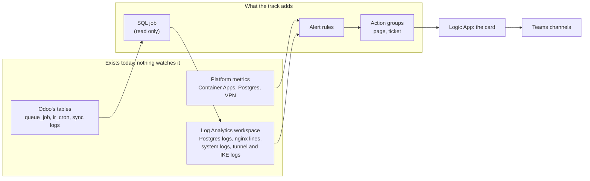
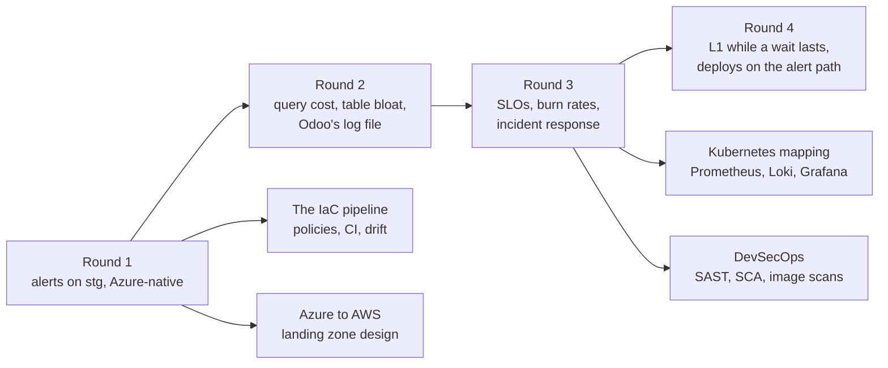

# Design

What the track is for, the decisions that shape it (D#), the decisions still open (O#) and the facts still to verify
(V#). The specs in [specs/](README.md#specs) hold the detail; the [README](../README.md) says what is built and
proven.

## Context

The whole track on one picture, every rule by round: [the track map](learn/diagrams/track-map.svg).

The client, a manufacturer, runs its ERP on **Odoo 19 on Azure Container Apps**: a web app and a cron app for stg (the
environment its staff work in every day), with stg's database on the **prd** PostgreSQL Flexible Server, shared with 19
other databases; dev runs one Odoo app on its own server. Data flows in from an on-premises SQL Server over a
site-to-site VPN. From 2026-08 to 09 the system had **13 operational incidents** (lock waits behind bursts of 502s,
CPU saturation, a `queue_job` table grown to 1.38 million rows, a cron app restarting under a memory misconfiguration,
a VPN rekey failing for months, a tunnel down 6.7 h, ...) and **no operational alerting**.

A read-only discovery and backtests over the Log Analytics workspace (2026-11-07) found that **10 of the 13 show in a
source that exists today and 3 only partly**, and that no rule watched any of them:

The ERP team's rule shapes everything: **Odoo's code, image, config and deploys are never touched**. The track watches
from the outside (platform metrics, logs) and from the database (Odoo's tables, read only).

## Decisions

| ID | Decision | Why |
|---|---|---|
| D1 | **stg is watched; dev is the rehearsal ground.** Alerts point at the stg web and cron apps, stg's database on the prd server, and the VPN gateway; every alert is fired on dev on purpose first and every Postgres change is tried on dev first | stg is where real users work and where the incidents happened |
| D2 | **No change to Odoo**: its code, image, config and deploys are never touched; signals come from the outside (platform metrics, logs) and the database (Odoo's tables, Postgres views) | The ERP team's rule; discovery showed it is enough for 11 of 13 incidents |
| D3 | **Azure-native**: Azure Monitor metric alerts and log alerts on the shared Log Analytics workspace, action groups, workbooks; no Azure Monitor managed Prometheus or Azure Managed Grafana | Everything needed already lands in Azure Monitor; the managed Prometheus and Grafana services were ruled out for their cost |
| D4 | **Round 1: five signals and a heartbeat**: lock waits on stg's Odoo; the job queue (backlog, oldest pending age, failed per model, size); late scheduled tasks; app restarts, OOM kills and 5xx bursts; the VPN tunnel down; a heartbeat from the SQL job | They cover the incidents that cost the most (08-13, 08-20, 08-25, 09-09, 09-19, 09-21) and the three problems live on 2026-11-07 |
| D5 | **The SQL job**: a scheduled Container Apps Job in the existing stg Odoo environment (a second one in dev's for drills) runs light read-only SQL every 5 minutes with a dedicated monitoring role, and writes the rows to the workspace through the Logs Ingestion API | Odoo's tables are the only source of four signals and no Azure service reads them; the stg environment already reaches the prd server, so no network change; billed per run |
| D6 | **Placement**: alert rules, action groups, the data collection rule and the workbook in the management subscription, next to the workspace, in a resource group owned by the track | One place for everything the track owns; cross-subscription scopes are allowed for alert rules |
| D7 | **Terraform for monitoring resources only**, applied from the laptop straight to Azure; existing resources are read as data sources and never managed | The platform's resources stay with their owner; no pipeline is needed for a handful of resources |
| D8 | **New spend at most $20 a month**, on top of the workspace's $31 to $44 a month | The ceiling; each spec checks its estimate against the price list |
| D9 | **The working repo is private**; this public repo is produced from it by an export ([D24](#decisions)) | The working repo names the client's resources; deployments go straight to Azure, so no pipeline needs it |
| D10 | **Proof in three steps**: backtests of each log query over past incidents in the workspace; threshold drills on dev, timed to Teams; real catches on stg | A backtest proves the query against a real incident without causing one; a drill proves the path to Teams; a real catch proves the value |
| D11 | Alerts reach Teams through a **Logic App per environment that posts an Adaptive Card to the environment's Teams workflow** (dev, stg), from four action groups: page and ticket for each environment | The workflows are the default template, shared with other senders, and post the body as a card, so the alert is reshaped before it reaches them, at $0 (built-in actions under 4,000 a month); a channel per environment keeps dev's drills out of stg's channel |
| D12 | The SQL job's image lives in a repository `obs/sql-job` of the **existing stg container registry** | No new registry and no cost; the job's pull assignment is limited to that repository (the registry is in ABAC mode) |
| D13 | Terraform state lives in a **storage account of the track's own** in the management subscription | A few cents a month; nothing shared with the platform's Terraform storage |
| D14 | **The client's application code may be cloned into the private repo**, only the parts a simulation needs; never published | Fixing and testing the issues behind the incidents on a copy is where the track creates value; the production repos and deploys stay untouched |
| D15 | **The Kubernetes demonstration uses the lab's kind platform** ([ocr-platform](https://github.com/caokgit/ocr-platform)): its pinned charts and values, installed by Helm on a kind cluster of its own, to fit Odoo beside them in 7 GiB; this repo owns the mapping and the translated rules ([spec](specs/kubernetes-mapping.md)) | No second platform to design and maintain; the lab proves the platform, this repo proves the rules |
| D16 | **The method is shared with the lab** ([method/](../method/README.md)): the rules for specs, docs, sessions and safety, imported by [AGENTS.md](../AGENTS.md), grown in whichever repo the work happens and synced | One method for two repos, improved by both |
| D17 | **A concept car**: each round is built end to end on dev and stg, proven by backtests, drills and a preflight on stg's live data, and documented; the long acceptance windows (24 h without a false page, the 7-day cost) and the threshold tuning run on after the build, not as gates; the quality bar does not move: every piece keeps its spec, tests, runbook with real output and review | A complete, demonstrable system first, tuned on real catches after; a preflight that runs every rule once on stg's live data shows what would fire before anything is enabled |
| D18 | **The pipeline ([spec](specs/pipeline.md)): the ground rules as Rego policies, checked on the source by GitHub Actions at every push, on the plan by `obs.sh plan` before every apply (a refused plan is deleted), and against Azure by `obs.sh drift` at every session start; CI is offline, with one action pinned by SHA and every tool pinned by version and SHA-256** | A rule kept by memory slips; the source check is early and needs no Azure, the plan check sees the real values; a CI login to Azure would need a federated credential naming the GitHub repo inside the client's tenant, which the ground rules forbid ([learn](learn/policy-as-code.md)) |
| D20 | **The Azure to AWS design is a paper design**: `terraform/aws/` holds the landing zone's guardrails and the cost estimate, tested with a mock provider and never applied ([spec](specs/aws-migration.md)) | A client-grade design (ADRs, guardrails, DR tiers, cost, an estimate) of the real estate without an AWS account or a change to the platform |
| D22 | **An availability SLO for stg's web app**, per journey (the factory TV dashboards, people clicking): requests answered without a 5xx, **99.5 % over 30 days**; two burn-rate rules, **SLO-fast** (1 h and 5 min over 14.4x, page) and **SLO-slow** (6 h and 30 min over 6x, ticket) ([spec](specs/round-3.md)) | stg's own months set the target: August's incidents spent 159 to 174 % of the budget, September and October 9 to 23 %; burn rates page on what users felt, not on a raw count ([learn](learn/slo.md)) |
| D23 | **Incident response: each rule's description in Azure is its meaning and first steps, shown on the card, with no link; a [respond](runbooks/respond.md) section per rule; page and ticket stay the two severities; a blameless post-mortem per real incident ([post-mortems](postmortems/README.md))** | Nothing in Azure names the repo; the first minutes need the steps, not a page to open; two post-mortems written from the raw data corrected the record and closed a gap (L7's probe kills) |
| D24 | **Published, anonymized**: this repo is produced by an export from the private one and never edited on its own; no name of the client, its people, its add-ons or its resources; the incidents' dates, counts and mechanisms kept; one commit, replaced by each export | The work is the evidence; the numbers make it credible, the names are what the client owns |
| D25 | **DevSecOps reads, never changes** ([spec](specs/devsecops.md)): the client's ERP source and the images stg runs are scanned read only with pinned tools; the findings, ranked by fixability and by the signals the track watches, go to the ERP team; this repo shows counts only; this repo's own Python gains SAST in CI | The code and images are the ERP team's; a scan is a read; a ranked short list is what a team acts on, a count of 3,789 is not |
| D26 | **Round 4 ([spec](specs/round-4.md)): L1 also reads the SQL job's reading of lock waits in progress (`pg_locks.waitstart`, readable by every role, so no grant), so it pages while a wait lasts; one new ticket rule E1 puts the apps' deploys and entrypoint warnings on the alert channel; both inside D8's $20** | The game day and both post-mortems left these three to the track; a new grant on the shared prd server and a new DCR stream were both avoidable; one rule for two signals keeps rounds 1 to 4 at about $19.50 |
| D27 | **Round 5 ([spec](specs/round-5.md)): L1-burst also tickets heavy lock-timeout cancellations (more than 12 in 5 min) and any request Odoo failed after its 5 tries; the log reader counts Odoo's retry and failure lines (`odoo.service.model`); no new rule, table or grant** (2026-11-09) | On stg Odoo's role ends every wait at 10 s, so L1-wait never sees Odoo's own waits; a cancellation is one try Odoo repeats, so the server's count measures contention and Odoo's own line measures loss; D8's $20 leaves no room for a new rule |
| D28 | **Round 6 ([spec](specs/round-6.md)): a rule counts the thing it means. L7's crash loop needs 3 or more process exits and 2 or more `main` containers created in 15 min; E1's card names the new revision; the log reader counts queue_job's postponed jobs; a ticket posts no resolve card. A7 stays failed; its rerun (24 h from round 6's stg apply) is the successor check** (2026-11-10) | A7 failed on L7 paging a single restart: one restart writes 3 to 9 exit records, and 11 of L7's 18 bins over its count since 2025-11 were single restarts. Restarts alone fire on every deploy and every probe-kill bin; exits and restarts together fire on exactly the 7 real loops |
| D29 | **Round 7 ([spec](specs/round-7.md)): L5 pages a queue behind, not one late job. L5-page's `behind` needs 2 or more late channels (a ready job waiting over 60 min) or 500 late jobs in one; one late channel is L5-ticket's `stall`, and jobs found dead its `dead`, each kept open 24 h so one cause makes one ticket; a job's wait counts from when it could run (`eta`), not its creation (owner, 2026-11-14). The checks are series of the existing rules, not a new rule (D8's $20)** | A7's rerun: the whole queue 2 h behind and one channel stopped by a job that died at each attempt paged the same, 14 times for the second |

## The incidents

The 13 operational incidents of 2026-08 and 09 that the rules are built from (dates UTC), from the read-only discovery
and corrected by the [post-mortems](postmortems/README.md):

| Date | Where | What happened | Cause | Watched now by |
|---|---|---|---|---|
| 2026-08-03 | stg | Workers died right after start | Odoo's memory guard set below what it measures | L7, M1, M2 |
| 2026-08-04 | stg | CPU 74 to 100 % for about 10 h, burstable credits exhausted | A heavy dashboard view recomputed per page load, and a 1-minute import task (80 % of 1.35 million queue jobs) | Q1 |
| 2026-08-13 | stg | `queue_job` at 1.47 GB, 1.38 million rows | Cancelled rows never cleaned; manual runs bypassed an inactive task | L5 |
| 2026-08-20 | stg | Container kills with bursts of 84 and 113 simultaneous 502s; an afternoon of 502s; after a deploy, every TV dashboard poll answered 500 for 40 minutes | Lock waits behind a synchronous write in the web request ([post-mortem](postmortems/2026-08-20-stg-502-bursts.md)) | L1, L2, L7, SLO-fast |
| 2026-08-24 | stg | Hours of slowness, 3 kills in 1 h | An upload wrote a large attachment inside the request and collided with a file-store cleanup task | L2, L7, M1 |
| 2026-08-25 | stg | 60,696 pending jobs overnight | Backlog plus lock contention | L5 |
| 2026-08-26 | stg | CPU 46 to 97 %, crash loops | Delete detection by full scans every hour (leading hypothesis) | Q1, L7 |
| 2026-09-07 | The prd server | The sync to on-premises fails with connection resets | A datetime bug froze the sync marker and the window grew | Partly (L5's failures) |
| 2026-09-09 | dev | CPU 96 to 99 %, kills | A 5-minute view refresh overlapped itself (up to 28 minutes) | R1 |
| 2026-09-09 | stg cron app | Restarts and probe kills on 09-04, 07 and 11 | The memory guard again, and kills after failed probes ([post-mortem](postmortems/2026-09-09-stg-cron-memory.md)) | L7, M2 |
| 2026-09-11 | The prd server | Connection resets again | A VPN rekey lifetime mismatch, failing every 50 minutes for months | L4 |
| 2026-09-19 | The prd server | 156 failed jobs over 5 nights | A daily bulk update in one change version, amplified by the 1-minute task | L5 |
| 2026-09-21 | The prd server | About 16 sync models and an API failing | Tunnel down 6.7 h, the on-premises peer stopped answering | L3 |

## Roadmap

**One idea: start where the real incidents are (observability on today's Azure stack), then widen the same real system
into the other things platform roles ask for, each a round with its own spec.**

The stages after round 2 were chosen as S1 to S4 (2026-11-08): S1 the SLOs, S2 the pipeline, S3 the AWS design,
S4 incident response; S1 and S4 together are round 3. A second plan the same night named the next ones E (this public
export), D (DevSecOps), K (the Kubernetes mapping) and R4 (round 4).

| Stage | What | State |
|---|---|---|
| Round 1 | Five signals and a heartbeat on stg ([spec](specs/round-1.md)) | Live on stg since 2026-11-08 |
| Round 2 | Query cost by the hour, table bloat, Odoo's own log file, the dev view refresh ([spec](specs/round-2.md)) | Live on stg since 2026-11-08 |
| Round 3 | An SLO per journey and two burn-rate alerts; incident response ([spec](specs/round-3.md)) | Live on stg since 2026-11-08 |
| The IaC pipeline | The ground rules as Rego policies on the source and every plan, CI, drift ([spec](specs/pipeline.md)) | Green on every push |
| Azure to AWS | A landing zone and migration design of the real estate ([spec](specs/aws-migration.md)) | A paper design, its guardrails tested |
| Round 4 | L1 while a wait lasts, E1 for deploys and entrypoint warnings ([spec](specs/round-4.md)) | Live on stg since 2026-11-08 |
| Kubernetes mapping | The same signals on Prometheus, Loki and Grafana, on a demonstration Odoo ([spec](specs/kubernetes-mapping.md)) | Drilled in a lab on kind, 2026-11-08; the rules tested in CI |
| DevSecOps | SAST, SCA, secret, configuration and image scans of the client's own code and images, findings for the ERP team ([spec](specs/devsecops.md)) | Scanned 2026-11-08; SAST in this repo's CI |

| Azure (round 1) | Kubernetes |
|---|---|
| Platform metrics | Prometheus, kube-state-metrics |
| Log Analytics, KQL | Loki, LogQL |
| The SQL job | `sql_exporter`, `postgres_exporter` |
| Availability test | blackbox exporter |
| Alert rules, action groups | PrometheusRule, Alertmanager |
| Workbooks | Grafana |

## Open decisions

| ID | Question | Options | Decided in |
|---|---|---|---|
| O1 to O3 | Routing, the image, the state (open decisions; not the rule O1) | Settled as D11 to D13 | The round 1 spec |
| O4 | Thresholds and severities per signal | First values from backtests in the [spec](specs/round-1.md#signals); tuned on real catches | Running on stg |

## To verify

| ID | What | How |
|---|---|---|
| V1 | What the IKE error codes 13805 and 13885 mean, and whether the 50-minute rekey rhythm shows in the IKE log | Microsoft's docs; a query over 2026-08-09 to 09-11 |
| V2 | Whether the sync's log shows the 2026-09-07 frozen sync | A read-only query on stg |
| V3 | Why Odoo's daily cleanup task ("Base: Auto-vacuum internal data") stopped on 2026-11-04 (stg) and 11-05 (dev); L6 tickets it since 2026-11-08 ([learn](learn/odoo-scheduled-tasks.md#the-daily-cleanup-what-it-is-and-what-happens-when-it-stops)) | Most likely stopped on purpose by the ERP team; L6's alert stays open, one card |
| V4 | The workspace's price per GB: $2.99 per GB after 5 GB free a month; October 2026 reconciles (computed $22.04, billed $22.88), August and September do not | Cost Management by meter and day |
| V5 | ~~Whether the SQL job sends with its managed identity through the Python ingestion library~~: yes, on dev and stg since 2026-11-08 | Done ([deploy](runbooks/deploy.md#8-the-job)) |
| V6 | Whether Azure offers `session_preload_libraries` for `auto_explain` (no restart) | The server's parameter list |
| V7 | Query Store on the Burstable dev and stg servers, against Microsoft's warning ([postgres-query-stats](learn/postgres-query-stats.md#query-store-the-same-totals-in-time-windows)) | Tell the platform team |
