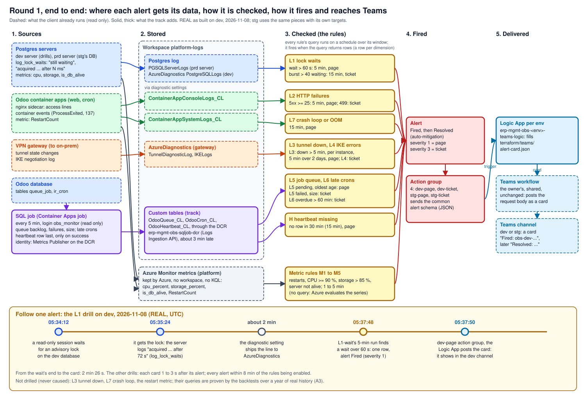
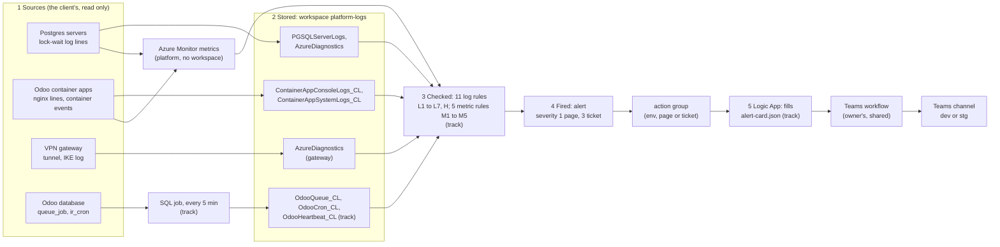
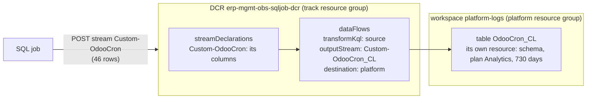

# Round 1 end to end: from the data to the Teams card

The whole path of a round 1 alert on one page: where each rule gets its data, how it is checked, how it fires, and how
the card reaches Teams. The pieces are taught on their own pages: the rules in
[Azure Monitor alerts](azure-monitor-alerts.md), the job's tables in [Logs Ingestion API](logs-ingestion-api.md), the
job in [Container Apps Jobs](container-apps-jobs.md), its login in [Postgres roles](postgres-roles.md).

## The whole flow

**One idea: every alert is a query (or a metric) checked on a schedule against data that the client's resources already send
to Azure, plus the rows our SQL job adds; when the check returns something, Azure creates an alert, and the rest is
delivery: action group, Logic App, Teams workflow, channel.**



The same flow in five stages (**REAL**, as built on dev on 2026-11-08; stg uses the same pieces with its own targets):



| Stage | What happens | Where it is defined |
|---|---|---|
| 1 Sources | The client's resources already send their logs and metrics to Azure; the SQL job reads two Odoo tables every 5 min as `obs_monitor` | [platform](../platform.md#resources-by-role); [job/sql_job.py](../../job/sql_job.py) |
| 2 Stored | Diagnostic settings put the logs in the workspace (about 2 min late, REAL on 2026-11-08); the job's rows enter through the DCR (about 3 min late); metrics stay in Azure Monitor's metric store | [spec, signals](../specs/round-1.md#signals) |
| 3 Checked | Each log rule runs its query from [kql/](../../kql/rules.json) every 5 or 15 min over its window and counts rows; each metric rule compares a series with its threshold | [terraform/modules/alerts](../../terraform/modules/alerts/main.tf) |
| 4 Fired | One alert per rule (per dimension for L5), `Fired`, later `Resolved` when the rows stop (auto-mitigation); severity 1 goes to the page group, 3 to the ticket group | [spec, routing](../specs/round-1.md#routing) |
| 5 Delivered | The action group calls the environment's Logic App with the alert (common alert schema); the Logic App posts the card to the owner's Teams workflow, which posts it in the channel | [D11](../design.md#decisions) |

### Follow one alert: the L1 drill on 2026-11-08

**REAL** (UTC), from the [drills runbook](../runbooks/drills.md#verify-end-to-end):

| Time | Stage | What happened |
|---|---|---|
| 05:34:12 | 1 | A read-only session on the dev database starts waiting for an advisory lock another session holds |
| 05:35:24 | 1 | It gets the lock; the dev server logs `acquired ... after` about 72,000 ms (`log_lock_waits` is on) |
| about 2 min | 2 | The diagnostic setting ships the line to `AzureDiagnostics` (category `PostgreSQLLogs`) |
| 05:37:48 | 3, 4 | L1-wait's 5-min run finds a wait over 60 s: one row, the alert fires with severity 1 |
| 05:37:50 | 5 | The dev page group calls the dev Logic App; the card appears in the dev channel |

From the end of the wait to the card: 2 min 26 s. Each of the other drilled rules' cards followed its alert by 1 to 3 s.

**In our design:** the signals and their rules ([spec](../specs/round-1.md#signals)), the job ([D5](../design.md#decisions)),
the routing ([D11](../design.md#decisions)), the proof in three steps ([D10](../design.md#decisions)).

## The SQL job and the DCR: the two pieces that make data

**One idea: Azure already collects logs and metrics from the client's servers, apps and gateway, but Odoo's job queue and
scheduled tasks exist only as rows in its database, and an alert rule can query only the workspace; the Container Apps
job is the reader that copies those rows out every 5 min, and the data collection rule (DCR) is the gate that lets
them into exactly three tables, where L5, L6 and H read them.**

Without the two, the diagram's purple path is missing: the other rules still work (their data arrives by diagnostic
settings), but a stuck queue, a late scheduled task or a dead job would never fire anything.

Follow one run, the dev job at 05:00:18 UTC on 2026-11-08 (**REAL**, from the job's log line and the tables):

```mermaid
sequenceDiagram
  participant CAJ as Container Apps job<br/>erp-dev-obs-sqljob-caj
  participant DB as Odoo database<br/>erp-dev
  participant DCR as DCR<br/>erp-mgmt-obs-sqljob-dcr
  participant WS as workspace tables
  participant R as rules L5, L6, H
  Note over CAJ: the schedule starts a container<br/>(obs/sql-job, 0.25 vCPU, 0.5 GiB)
  CAJ->>DB: as obs_monitor, read only: 4 queries (15.4 ms)
  DB-->>CAJ: queue backlog and failures, table size, 46 active crons
  CAJ->>DCR: its identity's token; POST Custom-OdooQueue (1 row), Custom-OdooCron (46)
  CAJ->>DCR: POST Custom-OdooHeartbeat (1 row), last, only if all went well
  Note over DCR: checks the identity's role on the DCR,<br/>each row against the stream's columns
  DCR->>WS: OdooQueue_CL, OdooCron_CL, OdooHeartbeat_CL (in 3 min: 05:03:18 to 05:03:28)
  Note over CAJ: the container exits after 31 s;<br/>nothing runs until the next 5 min
  R->>WS: every 5 or 15 min: queue, late crons, a missing heartbeat
```

| | Container Apps job (the reader) | DCR (the gate) |
|---|---|---|
| Why it is needed | No log or metric carries `queue_job` or `ir_cron`, and a log alert queries only the workspace, never Postgres | The Logs Ingestion API takes rows only through a DCR: the program names the DCR and a stream, never a table |
| What it holds | The schedule (`*/5 * * * *`), a 60 s limit, no retry, the image tag, the `obs_monitor` password as a secret, the identity ([module](../../terraform/modules/sql-job/main.tf)) | Three stream declarations (the columns of each), the destination `platform-logs`, the transformation `source` (rows pass as they are) ([tables.tf](../../terraform/envs/shared/tables.tf)) |
| What it may do | Read two tables as `obs_monitor`; pull one image (Repository Reader on `obs/sql-job`); write through this DCR only (Monitoring Metrics Publisher on it) | Nothing by itself: it is what the permission is granted on, so the job can write these three tables and no other |
| If it fails | No heartbeat row: H fires within 30 to 45 min ([A5](../runbooks/drills.md), running 2026-11-08) | The job's send fails, so it writes no heartbeat: H fires the same way |
| Cost | About $1.82 a month on stg (8,640 runs of about 20 s; [learn](container-apps-jobs.md#what-it-costs)) | Free; the rows it lets in, about 73 MB a month measured on dev (8,415 billed bytes a run), about $0.22 ([learn](logs-ingestion-api.md#what-makes-the-jobs-data-a-month)) |

Why a job and not an always-on app: it runs 31 s out of every 300, and is billed only while it runs
([apps and jobs](container-apps-jobs.md#apps-and-jobs-side-by-side-in-the-stg-odoo-environment)). How the pieces of the
ingestion fit (table, DCR, endpoint, role): [Logs Ingestion API](logs-ingestion-api.md#the-pieces).

**In our design:** the SQL job ([D5](../design.md#decisions)), placed with the DCR in `management-sub`
([D6](../design.md#decisions)); the [spec's SQL job](../specs/round-1.md#the-sql-job).

### Who defines the tables: the workspace, not the DCR

**The first half is right, the second not: each table is its own resource inside the workspace, created before any row
is sent; the DCR only declares what arrives (its streams) and names the table each stream goes to.**



| | Declared in | Resource | Holds |
|---|---|---|---|
| The stream `Custom-OdooCron` | The DCR | `Microsoft.Insights/dataCollectionRules`, in `erp-mgmt-obs-rg` | The columns the job may send; the flow to `Custom-OdooCron_CL` in the workspace called `platform` |
| The table `OdooCron_CL` | The workspace | `Microsoft.OperationalInsights/workspaces/tables`, under the workspace in `monitor-rg` | The columns stored, the plan, the retention |

Both column lists come from one list in [tables.tf](../../terraform/envs/shared/tables.tf) (`local.streams`), and the
DCR is created after the tables (`depends_on`): Microsoft's rule is "The target table must exist before you send data"
([Logs Ingestion API](https://learn.microsoft.com/en-us/azure/azure-monitor/logs/logs-ingestion-api-overview),
2026-11-07). A transformation could rename or drop columns between the two; ours is `source`, so they match.

**REAL** proof that they are separate (2026-11-08):
`terraform destroy` of the shared root deleted the DCR, but the three tables stayed (`409 ScopeLocked`: the platform's
lock on the workspace covers its tables); a new DCR was later created and wired to the same tables, which Terraform took
back by `import`.

## What Azure keeps of what the track did, and whether it can be deleted

**One idea: Azure keeps two kinds of record about our work, and neither is ours to rewrite: the Activity Log (who
changed which resource) cannot be deleted at all, and log rows in the platform's workspace can be deleted only by exact
values, irreversibly, by someone with a right on that workspace.**

| Record | Holds (REAL, `obs.sh audit`, 2026-11-08) | Can it be deleted? (DOCS, 2026-11-08) |
|---|---|---|
| Activity Log of `erp-mgmt-obs-rg` | 2 of 247 events (the first `resourcegroups/write`, 04:26 UTC) carry the old tag in their request and response bodies | No: "The system generates these entries, and you can't change or delete them"; "Azure retains activity log events for *90 days* and then deletes them. You aren't charged for entries during this time" ([Activity Log](https://learn.microsoft.com/en-us/azure/azure-monitor/platform/activity-log), 2026-11-08). The two events, of 2026-11-08 04:26 UTC, go on about 2027-02-06. Neither `management-sub` nor `dev-sub` exports the Activity Log (no subscription diagnostic setting, 2026-11-08), so no copy outlives it |
| Postgres log rows in `platform-logs` | 366 lines naming `ml-lab-reader` or `ml-lab-admin` since 2026-10-19: 277 from the dev server (`AzureDiagnostics`), 89 from the prd server (`PGSQLServerLogs`); almost all from the lab sessions | Technically: the [Delete Data API](https://learn.microsoft.com/en-us/azure/azure-monitor/logs/delete-log-data) filters by exact values only ("The supported operators are `==`, `=~`, `in`, `in~`, `>`, `>=`, `<`, `<=`, `between`"), needs `tables/deleteData/action` on the workspace, and "The deletion process is final and irreversible" |

Why the rows stay: they are the platform's record of who connected to its databases (prd included), in the platform's
workspace; deleting them is irreversible and would remove an audit trail, and the words are a session name, not the
GitHub account or the repo. What stops new ones: every session [tools/obs.sh](../../tools/obs.sh) opens names itself
`obs-*`, and so do the lab's psql services since 2026-11-08 (`obs-reader`, `obs-admin`; the owner: "we should name
following this lab"), checked by a session on each kind of service.

**In our design:** the rule in [AGENTS.md](../../AGENTS.md#ground-rules-of-the-track-owner-2026-11-07).

## The card file: still used?

**Yes: [terraform/teams/alert-card.json](../../terraform/teams/alert-card.json) is the body of each Logic App's one
action; Terraform reads it when it plans the shared root and writes it into both Logic Apps, so it is the single place
where the card's look is defined.**

It was first written to be pasted into the Teams workflows; when the workflows turned out to be shared and could not
change, the same file moved into the Logic Apps unchanged, because a Logic App understands the same `@{...}`
expressions as Power Automate. What happens to it (**REAL**, 2026-11-08):

| Step | What reads the card | Seen |
|---|---|---|
| `bash tools/obs.sh plan shared` | Terraform: `jsondecode(file(".../alert-card.json"))` in the `post-card` action of [terraform/envs/shared/main.tf](../../terraform/envs/shared/main.tf) | `azurerm_logic_app_action_custom.post["dev"] will be updated in-place` after the `n/a` change |
| An alert fires | The Logic App fills each `@{triggerBody()?...}` from the alert and posts the result | `Fired: test-logAlertRule-v2`, `Severity Sev4`, `Value 3`, `Condition GreaterThan 0` |
| The card arrives | The Teams workflow posts the body as it is | `Resolved (UTC)` showed a bullet for `-`, so the file uses `n/a` |

To change the card: edit the file, then `bash tools/obs.sh plan shared` and `apply shared`, then
`bash tools/obs.sh ag-test dev page` ([deploy, step 4](../runbooks/deploy.md#4-the-path-to-teams)).

**In our design:** [D11](../design.md#decisions).
