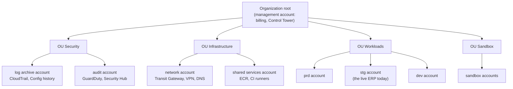
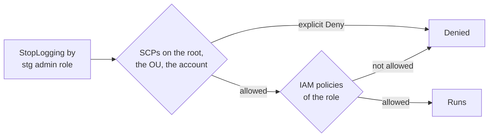

# An AWS landing zone, read from the client's Azure estate

What an AWS landing zone is made of (Organizations, organizational units, Control Tower, service control policies,
account vending, the security baseline, the transit network), each piece set beside the client's Azure piece that does the
same job today. It prepares the [Azure to AWS design](../specs/aws-migration.md) (stage S3 of the plan of 2026-11-08); the estate itself is in [platform](../platform.md).

**One idea: a landing zone is the set of accounts, guardrails and shared services that exists before the first
workload moves in; on Azure, the client already has one in all but name (a subscription per environment, a hub network, one
shared workspace), so the AWS design maps each Azure piece to its AWS twin and adds the one thing Azure's estate lacks:
guardrails that even an account's administrator cannot switch off.**

## The map

| Job | The client's Azure today (REAL, 2026-11-07) | AWS twin (DOCS) |
|---|---|---|
| The top of the hierarchy | The tenant and its management groups | The **organization** and its management account |
| One boundary per environment | A subscription per environment: `dev-sub`, `stg-sub`, `prd-sub` | An **account** per environment |
| Grouping for policy | Management groups | **Organizational units** (OUs) |
| Guardrails | Azure Policy (none assigned by the track) | **Service control policies** (preventive), Config rules (detective), Control Tower controls (both) |
| Creating a new environment | A subscription and its Terraform root (owner's Terraform, about half a day) | **Account vending**: Control Tower's Account Factory, or Account Factory for Terraform (AFT) |
| The hub network | `connectivity-sub`: the hub VNet, the VPN gateway, the DNS resolver | A **network account**: Transit Gateway, the site-to-site VPN, Route 53 Resolver |
| One place for logs | `management-sub`: the shared workspace `platform-logs` | A **log archive account**: the organization's CloudTrail trail, Config history, CloudWatch Logs |
| Security tooling | Microsoft Sentinel started but stalled ([roadmap](../design.md#roadmap)) | A **security (audit) account**: GuardDuty, Security Hub, Config aggregator as delegated administrator |
| Who signs in | Entra ID groups and Azure RBAC | **IAM Identity Center** permission sets, assigned per account |

## Following one action through the guardrails

To see how the pieces work together, follow one API call: an engineer with full administrator rights in the **stg
account** runs `cloudtrail:StopLogging` on the organization's trail (PLANNED: the action the
[protect-security-services](../specs/aws-migration.md#guardrails-the-scps) guardrail exists for).

**Case 1: IAM alone (no SCP).** IAM, AWS's identity and access management, answers "is this principal allowed this
action?" from the policies attached to the user or role. The engineer's role holds `AdministratorAccess`, so IAM says
yes, and the trail stops. Every later action in the account is unrecorded. This is where the client's Azure stands today: an
Owner of `stg-sub` can delete its diagnostic settings and nothing above the subscription prevents it.

**Case 2: with an SCP.** A service control policy is a policy attached to an OU or account in the organization that sets
the **maximum** permissions of every user and role in the accounts below it. AWS's words: "SCPs do not grant
permissions ... An SCP defines a permission guardrail" and "The effective permissions are the logical intersection
between what is allowed by the SCP ... and what is allowed by the identity-based and resource-based policies"
([SCPs](https://docs.aws.amazon.com/organizations/latest/userguide/orgs_manage_policies_scps.html), 2026-11-08). So the
call is evaluated twice: IAM says yes, the SCP's explicit `Deny` says no, and **a deny anywhere wins**. The trail keeps
logging.

**What an SCP does not cover**, so the design does not rely on it there (DOCS, same page, 2026-11-08):

| Not restricted by an SCP | So the design |
|---|---|
| "SCPs don't affect users or roles in the management account" | Runs no workload in the management account; few people sign in there |
| "SCPs do not affect any service-linked role" | Accepts it: AWS services act through those roles |
| Resource-based policies of other accounts | Uses resource control policies or bucket policies where cross-account access matters |

What it **does** cover, and why the design has a root guardrail: "SCPs affect all users and roles in attached accounts,
including the root user". The root user is the account's original owner login, so `deny-root-user` stops it in every
member account.

**Case 3: the guardrail itself.** AWS "strongly recommends that you don't attach SCPs to the root of your organization
without thoroughly testing the impact" (same page): an SCP that is too wide locks every account out at once. So the
design attaches each guardrail to the Sandbox OU first, then to the others
([waves](../specs/aws-migration.md#the-migration-in-waves)), and tests the policy documents themselves before any
account exists ([the module's tests](../../terraform/aws/modules/scp/tests/scp.tftest.hcl)).

| Case | Who decides | Result for `StopLogging` |
|---|---|---|
| IAM only | The account's own administrators | Allowed |
| IAM and an SCP | The organization, above the account | Denied |
| An untested SCP on the root | The organization | Risk: every account locked out of something |

## Control Tower and account vending

**Control Tower** is AWS's managed landing zone. It "orchestrates the capabilities of several other AWS services,
including AWS Organizations, AWS Service Catalog, and AWS IAM Identity Center, to build a landing zone in less than an
hour", with shared log archive and audit accounts, and keeps accounts from drift with **controls**: "Three kinds of
controls exist: preventive, detective, and proactive" (preventive ones are SCPs, detective ones Config rules)
([Control Tower](https://docs.aws.amazon.com/controltower/latest/userguide/what-is-control-tower.html), 2026-11-08).

**Account vending** is creating a new account that is born inside the guardrails: in the right OU, with the baseline
(trail, Config, GuardDuty membership, the network attachment, the Identity Center assignments) already applied.
Control Tower's Account Factory is "a configurable account template" (same page). **Account Factory for Terraform
(AFT)** "sets up a Terraform pipeline to help you provision and customize accounts": "you can initiate account creation
using an input file and a simple `git push` command". It needs "an existing AWS Control Tower landing zone", runs in its
own AFT management account, and "is not intended for use in deploying resources ... that your accounts require to run
your applications" ([AFT](https://docs.aws.amazon.com/controltower/latest/userguide/aft-overview.html), 2026-11-08). So
accounts come from AFT, and each workload's own Terraform builds what runs inside them.

**The client's real equivalent (REAL, 2026-11-07):** a new environment on Azure is a subscription plus a Terraform root, and the
owner's Terraform builds a full environment in about half a day (it took 7 days by hand). AFT is the same idea with the
guardrails inherited by placement in an OU instead of written per subscription.

## The security baseline

Each service has one job, and together they cover "who did what" (CloudTrail), "what changed" (Config), "is something
attacking us" (GuardDuty) and "what is the posture" (Security Hub). Prices are those of ap-southeast-1, from the
[cost estimate](../specs/aws-migration.md#cost) (Price List files of 2026-09 to 2026-11, read 2026-11-08).

| Service | What it records or finds | The client's Azure today | Price driver (REAL, the price list) |
|---|---|---|---|
| CloudTrail organization trail | Every API call in every account, to the log archive account | The Activity Log per subscription (the track's own audit reads it: `obs.sh audit`) | First copy of management events free |
| AWS Config | Each resource's configuration over time; rules that judge it | Azure Resource Graph (no history), Azure Policy | $0.003 per configuration item, $0.001 per rule evaluation |
| GuardDuty | Threats from CloudTrail, VPC flow logs, DNS logs; runtime on Fargate; RDS logins | None (Defender for Cloud not enabled for these) | $1.15 per GB of logs analysed, $1.85 per Fargate vCPU a month, $1.22 per RDS vCPU a month |
| Security Hub | Findings from the others, checks against standards (CIS, AWS Foundational) | None | $0.001 per check |
| KMS | Encryption keys with their own key policies | Platform-managed keys | Not priced (a few dollars) |
| IAM Identity Center | One sign-in, permission sets per account | Entra ID groups, Azure RBAC | Free |

## The transit network

**One idea: on Azure, every spoke VNet peers to the hub and the hub's gateway carries the site-to-site VPN; on AWS, the
transit gateway is that hub, and the VPN attaches to it, so every account's VPC reaches on-prem through one place.**

| Piece | The client's Azure (REAL, 2026-11-07) | AWS design |
|---|---|---|
| The hub | `erp-con-vnet`, peered to five spokes, gateway transit on | A **Transit Gateway** in the network account, shared to the other accounts with Resource Access Manager |
| To on-prem | VPN gateway `VpnGw1AZ`, one site-to-site IPsec connection (IKEv2, no BGP) | A **site-to-site VPN** attached to the transit gateway (two tunnels per connection, BGP possible) |
| To Azure during the move | (none) | A second VPN connection, Azure's VPN gateway to the transit gateway, removed after the last wave |
| DNS | A DNS private resolver in the hub; private zones linked to the hub | Route 53 Resolver endpoints in the network account; private hosted zones shared |
| What sits in between | Nothing: no firewall, no route table, no NSG ([platform](../platform.md#what-connects-them)) | Transit gateway route tables per OU: dev cannot reach prd |

The last row is a choice the AWS design makes that Azure's estate does not: today anything in any client VNet reaches the
prd Postgres server's private endpoint. A transit gateway route table per environment makes the separation a route,
not a convention.

Measured on the current tunnel (REAL, the workspace's tunnel log, 2026-08-09 to 2026-11-07): 2, 2 and 1 drops a month,
the longest 402.1 minutes on 2026-09-21, on a gateway that is not active-active. On AWS, "Each Site-to-Site VPN
connection has two tunnels, with each tunnel using a unique public IP address. It is important to configure both
tunnels for redundancy", and "Each tunnel terminates in a different Availability Zone"
([tunnel options](https://docs.aws.amazon.com/vpn/latest/s2svpn/VPNTunnels.html), 2026-11-08). The redundancy is real
only if the on-prem firewall configures both.

## Disaster recovery strategies

AWS names four strategies, from cheapest to fastest ([DR options](https://docs.aws.amazon.com/whitepapers/latest/disaster-recovery-workloads-on-aws/disaster-recovery-options-in-the-cloud.html),
2026-11-08): **backup and restore** ("suitable ... for mitigating against data loss or corruption"; infrastructure
redeployed from code), **pilot light** (data replicated, core infrastructure provisioned, application servers "switched
off"), **warm standby** ("a scaled down, but fully functional, copy of your production environment"), and
**multi-site active/active** (recovery time "near zero for most disasters"). Two terms: the **RPO** (recovery point
objective) is how much data may be lost, measured back from the failure; the **RTO** (recovery time objective) is how
long the service may be down.

| Strategy | The client today (REAL) | Typical RPO and RTO |
|---|---|---|
| Backup and restore | **This is the client's ERP today**: dumps every 2 to 6 h to storage, a full restore proven at about 3 h (the owner's production work) | Hours and hours |
| Pilot light | None | Minutes of data; tens of minutes to switch on |
| Warm standby | None | Seconds to minutes; minutes |
| Multi-site active/active | None | Near zero |

Inside one region, a database standby in a second availability zone (RDS Multi-AZ) covers the loss of one data centre:
"Amazon RDS automatically provisions and maintains a synchronous standby replica in a different Availability Zone", and
"You can't use a standby replica to serve read traffic"
([Multi-AZ](https://docs.aws.amazon.com/AmazonRDS/latest/UserGuide/Concepts.MultiAZSingleStandby.html), 2026-11-08).
The client's servers run with HA off (REAL, 2026-11-07), so the zone loss is covered today only by the restore.

## In our design

- The accounts, OUs and guardrails: [aws-migration, the organization](../specs/aws-migration.md#the-organization) and
  [the SCPs](../specs/aws-migration.md#guardrails-the-scps), written as Terraform and tested on a mock provider
  ([terraform/aws/modules/scp](../../terraform/aws/modules/scp/main.tf)), never applied ([D20](../design.md#decisions)).
- The network and the DR tiers: [aws-migration, network](../specs/aws-migration.md#the-network) and
  [DR tiers](../specs/aws-migration.md#disaster-recovery-and-availability-tiers).
- What it all costs against Azure: [aws-migration, cost](../specs/aws-migration.md#cost).
