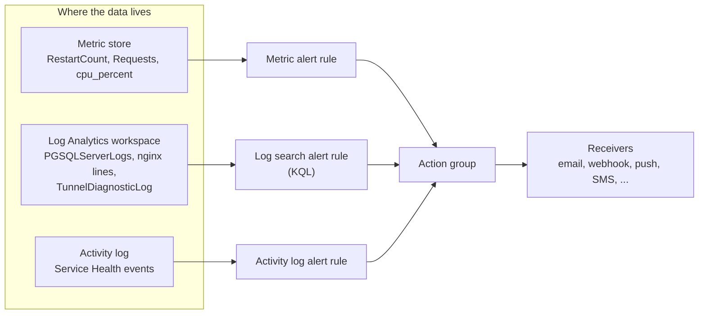
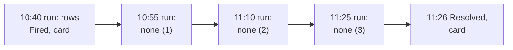
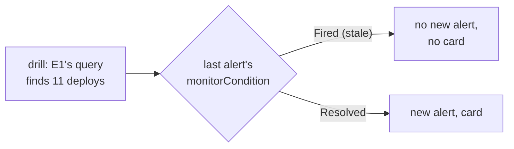
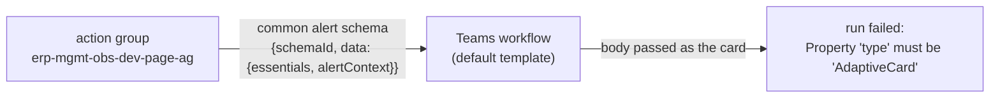
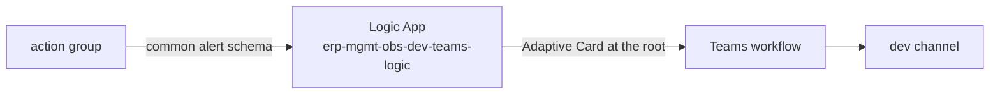

# Azure Monitor alerts: rule types, action groups, and what they cost

The first learn page of the track ([reading order](README.md#reading-order)): what an alert rule is in Azure, which
kind fits which signal of round 1, how a fired alert reaches people, and the price of each piece.

**One idea: an alert rule is a question asked on a schedule about data that already exists, and where that data lives
(the metric store, a Log Analytics workspace, the activity log) decides the kind of rule and its price.**

## The rule types, each on a real client signal

Microsoft's own words: a metric alert is for "data that requires little or no manipulation", a log search alert is
for data "available in logs, or requires advanced logic" using KQL, and an activity log alert fires "when a specific
event happens to a resource" ([alert types](https://learn.microsoft.com/en-us/azure/azure-monitor/alerts/alerts-types),
2026-11-07).

| Type | It evaluates | State | A real the client signal it fits |
|---|---|---|---|
| **Metric alert** | A platform metric, per time series (one series per dimension value), every minute or more | Stateful by default: it fires once, then resolves when the condition is no longer true | `RestartCount` on the stg cron app (1 restart on 7 of the last 30 days, **REAL** 2026-11-07); `Requests` with `statusCodeCategory = 5xx` on the stg web app (488 in 30 days) |
| **Log search alert** | A KQL query over the workspace, at a frequency of 1, 5, 10 or 15 minutes; it counts rows or measures a numeric column, optionally split by dimensions | Stateful or stateless, chosen per rule | Lock waits: "still waiting" lines in `PGSQLServerLogs` (1,187 on one stg table in 7 days, **REAL**); the tunnel log's Disconnected rows (the 402.1-minute drop of 2026-09-21) |
| **Simple log search alert** | Each row on its own, no aggregation | | Every failed job, if each one should alert; billed as a 1-minute rule |
| **Activity log alert** | A new event in the activity log | Stateless: "the alert fires once and its monitor condition is set to Fired" and never resolves by itself | **Exists today**: one Service Health alert per the client subscription (dev, stg, prd), pushing to one person's mobile app (**REAL** 2026-11-07) |

Two sentences from the same page shape round 1:

- Splitting by dimensions: one log search rule can watch "multiple instances of a resource", each "monitored
  individually"; for example one lock-wait rule split by the waiting table.
- Absence of data: "Log search alerts work best when you're trying to detect specific data in the logs, as opposed to
  when you're trying to detect a lack of data in the logs ... consider using metric alerts." The heartbeat of
  [D4](../design.md#decisions) detects a lack of data, so its design has to account for this (a count over a window
  long enough for the workspace's delay, or a metric).

## How long a fired alert takes to resolve

**One idea: a stateful log alert resolves only after several of its own runs in a row find nothing, so the wait is set
by the rule's frequency, not by when the fault ended; and an alert whose rule was disabled while it was open never
resolves, and closing it by hand does not help: its condition stays `Fired`, and the rule never fires again.**

Every log rule of the track is stateful ("Automatically resolve alerts", auto-mitigation in Terraform): it fires once,
then stays `Fired` while the condition holds. Microsoft's rule, quoted from the live page
([create a log search alert rule](https://learn.microsoft.com/en-us/azure/azure-monitor/alerts/alerts-create-log-alert-rule),
2026-11-09): "the alert is resolved when the condition is no longer met for a specific time range. The time range
differs based on the frequency of the alert: **1 minute**: The alert condition isn't met for 10 minutes. **5 to 15
minutes**: The alert condition isn't met for three frequency periods. **15 minutes to 11 hours**: The alert condition
isn't met for two frequency periods."

Followed with one alert (REAL, dev, 2026-11-08, T1's drill; T1 runs every 15 min; fired and resolved times read, the quiet runs' times inferred from the 15-min rhythm):

Every alert the track has resolved (REAL, Resource Graph, `monitorConditionResolvedDateTime`, read 2026-11-09):

| Frequency | Rules | Fired to resolved | So |
|---|---|---|---|
| 15 min | L4, L5-ticket, L2-499, L1-burst, L6 (drills of 2026-11-08 05:35 to 05:46), T1 twice, R1 | **46 min**, every one | The firing run, then three quiet runs: 15 min is the "three periods" case |
| 5 min | L1-wait, O1, SLO-fast | 15 to 16 min; 26 min for L2-5xx, L5-page and one L1-wait (inferred: their condition still held at the next run) | Three quiet runs of 5 min, after the condition ends |
| Metric (1 min) | M3, M4, M5 | 18 to 30 min | Metric alerts follow their own rule |

So for L1-burst and E1 (round 4's deploy rule) after their drill on dev (REAL, 2026-11-08 and 11-09, UTC): L1-burst,
enabled throughout, fired at 23:48:31 and resolved at 00:34:31, **46 min**, as the rule predicts. E1 did not: round 4
had disabled it a minute after its drill alert of 16:59, and enabling it again at its real values at 23:51 did not
resolve that alert (still `Fired` at 00:53, after four quiet runs; its own query `quiet`). It was then closed by hand
(`changestate`), which turned out to be a mistake.

An alert has two fields that sound alike (REAL, dev's E1 alert of 2026-11-08, read 2026-11-10):

| Field | Who changes it | E1's alert |
|---|---|---|
| `alertState`: New, Acknowledged, Closed | People (`changestate`, the portal) | `Closed` (by hand, 2026-11-09 00:54) |
| `monitorCondition`: Fired, Resolved | Only the rule's own runs | Still `Fired` |

The rule decides whether to raise a **new** alert from the condition, not the state. So on 2026-11-10 dev's E1, enabled
with a 2-day window over 11 real deploys (Azure's own run of the rule's query returned 11 rows), raised nothing:

Neither of the two ways out worked: 48 min of quiet runs at real values (three runs) left the condition `Fired`, and
recreating the rule under the same name, so the same resource ID, raised nothing in 45 min either. Azure keeps the
condition by the rule's ID, and no API sets it. A resolved alert sends one more card with `Resolved` (since round 6,
for pages only); a closed one sends nothing and, for a stateful rule, blocks it.

**In our design:** the drills wait for `Resolved` before a rule is disabled, and no track alert is closed by hand
([drills](../runbooks/drills.md#round-6s-rules-i6-i9));
[D11](../design.md#decisions) (the card path that also carries the resolution).

## Action groups: from a fired alert to people

An action group is a reusable list of receivers, attached to any number of rules. The receiver kinds named on the
pricing page are email, push to the Azure mobile app, webhook, secure webhook, SMS, voice and ITSM
([pricing](https://azure.microsoft.com/en-us/pricing/details/monitor/), 2026-11-07, read through a summarising fetch).
**REAL** today: the client has one action group per subscription with one push receiver and nothing else. Round 1's alerts reach
Teams through a Logic App, next section.

### From the alert to a Teams card: why a Logic App sits between

**One idea: the action group can only send Azure's own JSON, and the Teams workflow can only post a card, so something
must turn the one into the other, and a Logic App is the smallest Azure piece that can.**

Follow one alert, the test alert sent on 2026-11-08 (**REAL**):

1. **Without anything between** (04:46 UTC): Azure reported the webhook `Succeeded`, because the workflow accepted the
   request; the workflow's run then failed, because its card step posts the request body as an Adaptive Card, and
   Azure's body is the common alert schema, whose root has `schemaId` and `data`, not `"type": "AdaptiveCard"`.
2. **Editing the workflow** would fix it, but the workflows are shared with other senders, the client's on-prem mail jobs,
   which post a literal card at the root (their copy job's SPEC, "Teams notifications"), so they stay as they are.
3. **A Logic App between** (round 1): a Logic App is an Azure workflow, the same engine and expression language as
   Power Automate. Ours has a request trigger, which the action group calls with the alert, and one HTTP action that
   posts [terraform/teams/alert-card.json](../../terraform/teams/alert-card.json) to the workflow, with its `@{...}`
   expressions filled from the alert, for example `@{triggerBody()?['data']?['essentials']?['alertRule']}` becomes
   `obs-dev-L1-wait`.

| | Action group to workflow | Edit the workflow | Logic App between |
|---|---|---|---|
| Card reaches Teams | No (run fails) | Yes | Yes |
| Touches the shared workflows | No | Yes | No |
| Cost (2026-11-08, Retail Prices API) | $0 | $0 | $0: 2 built-in actions per alert, 4,000 free a month, then $0.000025 |
| Lives in the repo | | No (Power Automate) | Yes (Terraform, the card file) |

**In our design:** [D11](../design.md#decisions); the pieces in the
[spec's routing](../specs/round-1.md#routing).

## What each piece costs

Prices from Azure's Retail Prices API for Southeast Asia, in USD
([API, `serviceName eq 'Azure Monitor'`](https://prices.azure.com/api/retail/prices?currencyCode=USD&$filter=serviceName%20eq%20'Azure%20Monitor'%20and%20armRegionName%20eq%20'southeastasia'),
2026-11-07); free quantities and the billing rules from the
[pricing page](https://azure.microsoft.com/en-us/pricing/details/monitor/) (2026-11-07, summarising fetch):

| Piece | Price | Free | Billing rule |
|---|---|---|---|
| Metric alert | $0.10 per monitored time series a month | The first 10 time series a month | "billed per each time series monitored" |
| Log search alert, every 15 / 10 / 5 / 1 min | $0.50 / $1.00 / $1.50 / $3.00 per rule a month (meter "Alerts System Log Monitored at N Minute Frequency") | | "billed based on the interval at which the log query is evaluated" |
| Each extra time series of a split log alert | $0.05 / $0.10 / $0.15 / $0.30 a month (meter "Alerts Resource Monitored at N Minute Frequency"; the meter-to-rule mapping is inferred from the names) | "First time-series is included in the log alert rule" | "an additional charge for each dimension (time series) that is evaluated" |
| Activity log alert | Free | | "no charge for Activity Log alert rules or other alert rules when they are disabled"; 100 rules per subscription |
| Email | $0.00002 each | 1,000 a month | |
| Push | $0.00002 each | 1,000 a month | |
| Webhook | $0.000006 per 10 | 100,000 a month | |

The data a log alert reads is billed separately, as Analytics logs ingestion: $2.99 per GB after the first 5 GB a month
per billing account, and retention at $0.13 per GB a month past the 31 days included (same API and page). **REAL** check:
October 2026's 12.37 GB gives (12.37 - 5) x 2.99 = $22.04, against $22.88 billed for the workspace.

**PLANNED**, the arithmetic for round 1 (the spec owns the real list): 6 log search rules every 5 minutes cost
6 x $1.50 = $9.00 a month; 4 metric time series (restarts and 5xx on the web and cron apps) fit in the 10 free; emails
and webhooks to two channels stay inside the free quantities. So about **$9 a month** before the SQL job's data, against
the $20 ceiling of [D8](../design.md#decisions). Splitting a rule by a dimension with many values (one series per table,
say 20) adds 19 x $0.15 = $2.85 a month to that rule.

**In our design:** [D3](../design.md#decisions) (Azure-native rules), [D4](../design.md#decisions) (round 1 signals),
[D8](../design.md#decisions) (the ceiling), [O1](../design.md#open-decisions) (Teams), [O4](../design.md#open-decisions)
(thresholds).
