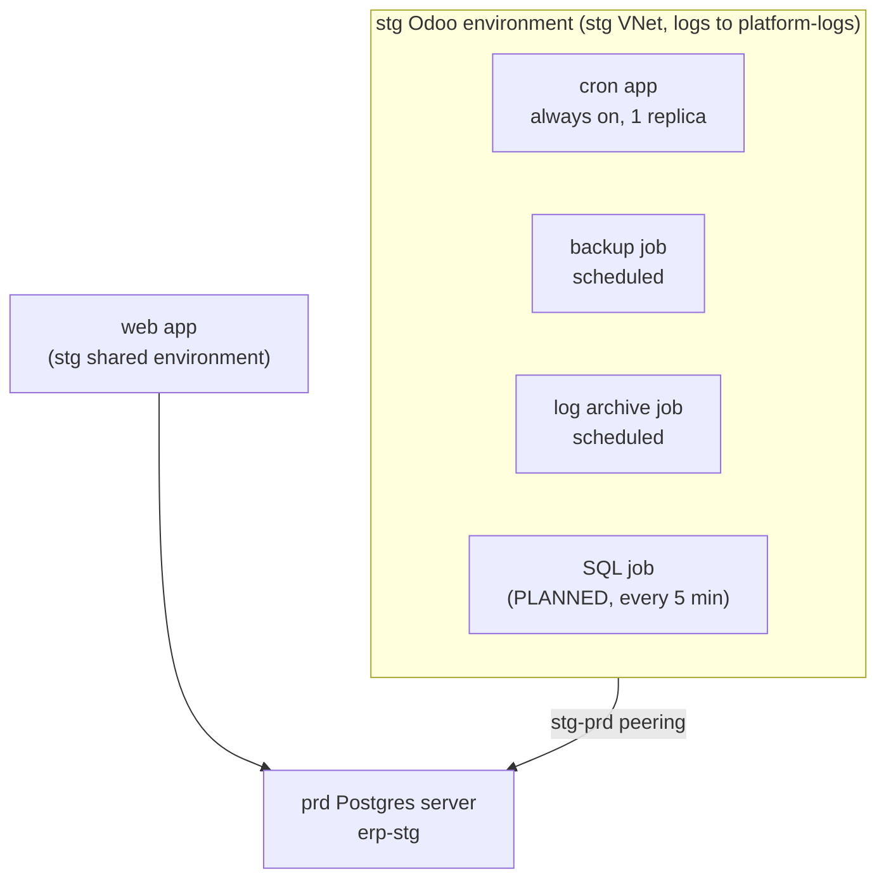
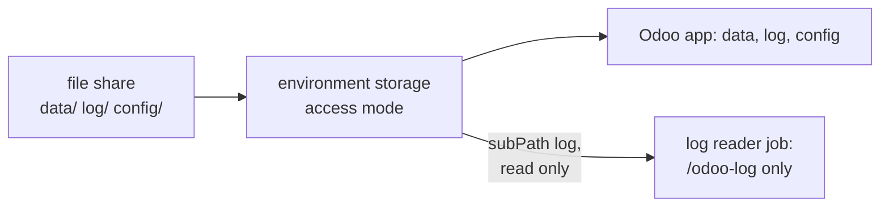

# Container Apps Jobs: a scheduled container next to the stg Odoo apps

Where the SQL job of [D5](../design.md#decisions) runs. Previous: what it sends,
[the Logs Ingestion API](logs-ingestion-api.md); next: what the database can tell it,
[Postgres query statistics](postgres-query-stats.md).

**One idea: a job is a container that starts on a trigger, does one unit of work and stops; it lives in the same
environment as the apps, so it shares their network and their logs, and it costs only while it runs.**

## Apps and jobs, side by side in the stg Odoo environment

"Container apps and jobs run in the same environment, allowing them to share capabilities such as networking and
logging" ([jobs](https://learn.microsoft.com/en-us/azure/container-apps/jobs), 2026-11-07). The stg Odoo environment
already holds both kinds (**REAL**, 2026-11-07):

| | App | Job |
|---|---|---|
| Runs | Continuously; a failed container restarts | For a finite time, then stops |
| Started by | Its scale rules | A trigger: **Manual**, **Schedule** or **Event** |
| Ingress | Yes (the Odoo apps are behind nginx) | None: "Ingress and related features" are not supported |
| The client example | The stg web and cron apps | The backup and log archive jobs (in dev's and stg's Odoo environments); their console lines land in the same workspace |

## A scheduled job, setting by setting

From the same page:

| Setting | Meaning | For the SQL job (**PLANNED**) |
|---|---|---|
| `triggerType: Schedule`, `cronExpression` | Five-field cron; "Cron expressions in scheduled jobs are evaluated in Coordinated Universal Time (UTC)" | `*/5 * * * *` |
| `replicaTimeout` | "The maximum time in seconds to wait for a replica to complete" | Short, so a hung query never overlaps the next run |
| `replicaRetryLimit` | Retries of a failed replica; `0` fails without retry | `0`: the next run comes in 5 minutes anyway |
| `parallelism`, `replicaCompletionCount` | Replicas per execution and how many must succeed | `1` and `1` |
| Execution history | "limited to the most recent 100 successful and failed job executions"; the rest is in the environment's logs | The job's own heartbeat rows are the long record |

**Permissions, a warning from the docs:** the built-in Jobs Contributor and Jobs Operator roles can read the job's
secrets, and "Permission to start a job can provide access to that job's secrets", because a start request can override
the container. So the job keeps no database password a starter could misuse beyond its read-only role, and starting it
is limited to the owner.

## What it costs

Jobs on the Consumption plan are "charged the active rate. Idle charges don't apply to jobs", and request charges do
not apply ([billing](https://learn.microsoft.com/en-us/azure/container-apps/billing), 2026-11-07). Active rates for
Southeast Asia: $0.000034 per vCPU-second and $0.000004 per GiB-second
([Retail Prices API](https://prices.azure.com/api/retail/prices?currencyCode=USD&$filter=serviceName%20eq%20'Azure%20Container%20Apps'%20and%20armRegionName%20eq%20'southeastasia'),
2026-11-07). The free grant, "the first 180,000 vCPU-seconds and 360,000 GiB-seconds in each subscription per calendar
month", is shared with everything else on Consumption in `stg-sub`.

**PLANNED** arithmetic: a run of 20 s at 0.25 vCPU and 0.5 GiB, every 5 minutes, is 8,640 runs a month:

| Meter | Usage a month | Cost if the free grant is used up |
|---|---|---|
| vCPU | 0.25 x 20 s x 8,640 = 43,200 vCPU-s | $1.47 |
| Memory | 0.5 x 20 s x 8,640 = 86,400 GiB-s | $0.35 |

The grant is almost surely used up already: the stg web and cron apps alone hold 2 vCPU each around the clock (**REAL**),
about 5.2 million vCPU-seconds a month each. So count about **$1.82 a month** for the job.

**In our design:** [D5](../design.md#decisions) (the job beside stg Odoo), [O2](../design.md#open-decisions) (its image).

## Reading one folder of a file share

How a job reads Odoo's log file without seeing the rest of the share, for round 2's log reader.

**One idea: an Azure Files share is defined once on the environment, with its access mode, and each app or job mounts it
as a volume; `subPath` narrows the mount to one folder, so the job sees the log folder and nothing else.**

DOCS ([storage mounts](https://learn.microsoft.com/en-us/azure/container-apps/storage-mounts), 2026-11-08): the
environment's storage definition carries the access mode ("Valid values for `--access-mode` are `ReadWrite` and
`ReadOnly`"); a volume mount's "`subPath` is the path in the volume to mount. If you don't specify this value, the volume
root is mounted"; a volume's "`mountOptions` is a comma-separated string of mount options", passed to the SMB mount.

**REAL** (2026-11-08): each Odoo app mounts one share three times by sub path: `data` at `/var/lib/odoo` (the
filestore), `log` at `/var/log/odoo`, `config` at `/etc/config` (Odoo's configuration, with its secrets). dev's environment
defines the share twice, `ReadWrite` and `ReadOnly` (`erp-dev-ro`); stg's only `ReadWrite`.

| | dev | stg |
|---|---|---|
| Read-only storage on the environment | Yes, `erp-dev-ro` | No: only `ReadWrite`; adding one changes the platform's environment and needs the account key |
| What the log reader mounts | The read-only storage, `subPath: log` | The read-write storage, `subPath: log`, with the mount option `ro` (proven on dev first) |

**In our design:** round 2's log reader ([spec](../specs/round-2.md#the-log-reader)).
