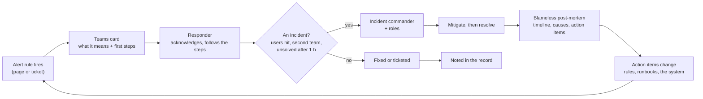

# Incident response: severities, roles, first steps, post-mortems

What happens after an alert fires: how bad it is (severity), who does what (roles), what the person who gets the card
does in the first minutes (first steps), and how the team learns from it afterwards (a blameless post-mortem). It comes
after [slo](slo.md) (which alerts page, and why) and before the [round 3 spec, incident
response](../specs/round-3.md#incident-response) (what we built) and the [respond runbook](../runbooks/respond.md) (one
section per rule). All on the client's real incidents of 2026-08 and 09.

## The map

**One idea: an alert is only worth what the person reading it does next, so every card carries its own first steps,
every page is handled by one person in charge, and every incident ends in a written, blameless account whose action
items change the system, not the people.**

| Term | In one line | Here (REAL, 2026-11-08) |
|---|---|---|
| Severity | How bad and how urgent, chosen from the impact, not the cause | Two levels: **page** (Sev1: someone looks within the hour) and **ticket** (Sev3: the next working day) ([round 1, signals](../specs/round-1.md#signals)) |
| First steps | The few actions a responder takes before knowing anything else | On each rule's card, in its description ([round 3, incident response](../specs/round-3.md#incident-response)) |
| Incident | An event that needs coordinated response, not only a fix | 2026-08-20: 84 and 113 requests got a 502 at once, twice in 12 minutes |
| Incident commander (IC) | The one person who holds the state and makes the calls | The client's teams are small: the first responder is IC until handing over |
| Post-mortem | The written record of an incident: impact, timeline, causes, action items | [2026-08-20](../postmortems/2026-08-20-stg-502-bursts.md), [2026-09-09](../postmortems/2026-09-09-stg-cron-memory.md) |
| Blameless | Causes are looked for in the system, never in a person | "A click held a worker forever" (the system had no lock timeout), not "someone clicked Sync Now" |
| Game day | A planned exercise: a real alert fired on purpose, answered with the runbook alone, timed | On dev, with L1's drill ([respond, game day](../runbooks/respond.md#game-day-on-dev)) |

## Severity: chosen from the impact

**Severity answers one question, "how much is it hurting users now", and sets how fast someone must look; the cause
is found later and never changes the severity in the middle of an incident.**

PagerDuty's public response guide uses five levels ([severity levels](https://response.pagerduty.com/before/severity_levels/),
2026-11-08, DOCS):

| PagerDuty level | Their description (quoted) | Typical response | Our level |
|---|---|---|---|
| SEV-1 | "Critical issue that warrants public notification and liaison with executive teams." | Major incident response | page (none so far at the client needed public notice) |
| SEV-2 | "Critical system issue actively impacting many customers' ability to use the product." | Major incident response | **page** (2026-08-20: every active user got a 502) |
| SEV-3 | "Stability or minor customer-impacting issues that require immediate attention from service owners." | High-urgency page to the service team; "If related to recent deployment, rollback." | **page** (one rule, a short burst) |
| SEV-4 | "Minor issues requiring action, but not affecting customer ability to use the product." | Low-urgency page | **ticket** (L6: a cleanup task 3 days late) |
| SEV-5 | "Cosmetic issues or bugs, not affecting customer ability to use the product." | A ticket | not alerted |

Their rule for doubt is the one to keep: "If you are unsure which level an incident is ... **treat it as the higher
one**", and "During an incident is not the time to discuss or litigate severities" (same page, 2026-11-08).

The track has two levels because an Azure log alert has **one severity per rule** and two people-facing speeds are
enough for two small teams: a page (Azure `Sev1`) is looked at within the hour, a ticket (Azure `Sev3`) the next
working day. Following one real signal through both: L2 pages on 25 or more 5xx in 5 minutes (users are failing now);
its sibling L2-499 tickets on 25 or more requests the users gave up on (pages are slow; nobody is failed yet). On
2026-08-20 at 03:05 UTC both would have fired in the same 5-minute bin: 39 users gave up, then 84 got a 502 (REAL,
backtest 2026-11-08).

**In our design:** the two levels are set per rule in [round 1](../specs/round-1.md#signals) and
[round 3](../specs/round-3.md#slos); the card shows the level as `Sev1` or `Sev3` ([D11](../design.md#decisions)).

## When an alert becomes an incident, and the roles

**Most alerts are handled by the person who reads the card; an alert becomes an incident when it needs coordination,
and then one person takes command so everyone else can work.**

Google's SRE book gives three questions; "if any of the following is true, the event is an incident"
([Managing Incidents](https://sre.google/sre-book/managing-incidents/), 2026-11-08, DOCS):

| Google's question | 2026-08-20 morning (REAL, from the workspace and the infra team's write-up) |
|---|---|
| "Do you need to involve a second team in fixing the problem?" | Yes: the cause was in Odoo's code (the ERP team), the evidence in Postgres (the platform team) |
| "Is the outage visible to customers?" | Yes: 84 and 113 users got a 502 at 03:06 and 03:18 UTC |
| "Is the issue unsolved even after an hour's concentrated analysis?" | Yes: the lock timeout that ended it came 5 days later (2026-08-25) |

The roles, from the same chapter and from PagerDuty's guide
([different roles](https://response.pagerduty.com/before/different_roles/), 2026-11-08, DOCS):

| Role | What it does (quoted) | On a small team like the client's |
|---|---|---|
| Incident commander | "holds the high-level state about the incident" (Google); "the single source of truth of what is currently happening" (PagerDuty) | The first responder, until they hand it over out loud |
| Operations lead, subject matter expert | "applying operational tools to the task at hand" (Google); "a domain expert or designated owner of a component or service" (PagerDuty) | The ERP team for Odoo, the platform team for Azure and Postgres, the on-prem team for SQL Server and the firewall |
| Communications, liaisons | "the public face of the incident response task force" (Google); internal and customer liaisons (PagerDuty) | One message in the business's channel: what users see, what to avoid, when the next update comes |
| Scribe | "documents the timeline of an incident as it progresses" (PagerDuty) | The Teams thread under the card: every action with its time |
| Planning | "supports Ops by dealing with longer-term issues" (Google) | The post-mortem's action items |

Why one commander: during an incident many people can act, and two people restarting, rolling back or killing
sessions at once make it worse. The commander does not fix; they decide, keep the timeline, and say when it is over.
The track's own boundary stays the same during an incident: it **reads**; ending a session, rolling back a deploy or
restarting an app is the owning team's call ([ground rules](../../AGENTS.md#ground-rules-of-the-track-owner-2026-11-07)).

**In our design:** each [respond](../runbooks/respond.md) section names the team to call and when; the first
responder is IC by default ([round 3, incident response](../specs/round-3.md#incident-response)).

## First steps on the card

**The first minutes are lost to "what does this alert mean and where do I look", so the answer travels on the card
itself: one sentence on what it means, then three or four steps.**

Before S4 every card said "Round 1 rule L2-5xx: HTTP 5xx burst": the rule's name, which a responder at night has to
translate. Following L2-5xx's card through the change:

| | Before (REAL, 2026-11-08) | After S4 |
|---|---|---|
| Title | `Fired: obs-stg-L2-5xx` | Same |
| Text | "Round 1 rule L2-5xx: HTTP 5xx burst" | What it means (a 502 burst is a killed backend, a 500 is Odoo's own error, with the 2026-08-20 numbers), then the first steps: which code, where to look, whom to call |
| Where the text lives | The module, the same for every rule | The rule's entry in the code; it is the rule's **description** in Azure, so the portal's alert page shows it too |

Why on the card and not a link: a link to the runbook on GitHub would put the repo's name into Azure, which the track
never does ([ground rules](../../AGENTS.md#ground-rules-of-the-track-owner-2026-11-07)); and a responder on a phone
reads a card faster than a page. The card carries what to do in the first minutes; the
[respond runbook](../runbooks/respond.md) holds the rest (the queries, the past cases, whom to call). Azure allows a
rule description of 4,096 characters for a log rule and 2,048 for the others
([service limits, alerts](https://learn.microsoft.com/en-us/azure/azure-monitor/service-limits), 2026-11-08, DOCS), and
the common alert schema carries it to the Logic App as `essentials.description`
([common alert schema](https://learn.microsoft.com/en-us/azure/azure-monitor/alerts/alerts-common-schema), 2026-11-08,
DOCS).

**In our design:** [round 3, incident response](../specs/round-3.md#incident-response).

## Blameless post-mortems

**A post-mortem asks how the system let this happen and what will change, because people who fear blame hide the
facts the fix needs.**

Google's SRE book: "A postmortem is a written record of an incident, its impact, the actions taken to mitigate or
resolve it, the root cause(s), and the follow-up actions to prevent the incident from recurring"; "For a postmortem to
be truly blameless, it must focus on identifying the contributing causes of the incident without indicting any
individual or team for bad or inappropriate behavior"
([Postmortem Culture](https://sre.google/sre-book/postmortem-culture/), 2026-11-08, DOCS; every quote on this page
checked word for word against the live pages the same day). Its triggers, each checked
against the client's two incidents:

| Trigger (Google, quoted) | 2026-08-20 | 2026-09-09 |
|---|---|---|
| "User-visible downtime or degradation beyond a certain threshold" | Yes: 84 and 113 502s in two bursts; TV dashboards 500 for 40 min the same evening | The web app's 3 kills at 11:26 to 11:42 UTC: yes; the cron app: no user saw it directly |
| "Data loss of any kind" | No | No |
| "On-call engineer intervention (release rollback, rerouting of traffic, etc.)" | A fix deployed on 08-25 (a lock timeout for Odoo's role) | The cron app resized on 09-23 |
| "A resolution time above some threshold" | 5 days to the fix | 14 days from the first sign to the fix |
| "A monitoring failure (which usually implies manual incident discovery)" | Yes: users reported it | Yes: found while investigating something else |

Following one sentence through the blameless rewrite (REAL, 2026-08-20):

| Blaming | Blameless |
|---|---|
| "A user clicked Sync Now during a busy time and crashed the app" | "A write started from the UI waited on a lock with no timeout; each such wait held one of the web app's few Odoo workers; when none was free, the health probe failed and Azure killed the container, so every active user got a 502" |
| Action: "tell people not to click" | Actions: a lock timeout for the app's role (done 08-25), a page on lock waits over 60 s (L1, live 2026-11-08), a page on repeated probe kills (this stage) |

The first version changes nobody's tools; the second changes three things, and none of them depends on someone
remembering.

**A post-mortem is also where monitoring is checked against reality.** Both of the client's post-mortems, written from the
workspace on 2026-11-08, corrected a belief: the backtest had filed the 08-20 evening TV outage as the morning crash, and
the 09-09 write-up's "59 OOM occurrences since 09-09" were 256 container starts since 08-20 counted inside a 14-day
query ([2026-09-09](../postmortems/2026-09-09-stg-cron-memory.md#timeline)).

**In our design:** the post-mortems live in [docs/postmortems/](../postmortems/README.md), on the method's
[post-mortem template](../../method/templates/postmortem.md); their action items are tracked there until closed.

## Game days

**A game day fires a real alert on purpose and answers it with the runbook alone, against the clock, so the first time
the runbook is used is not during a real incident.**

It differs from a drill: a drill proves the path (the alert reaches the card, round 1's A4); a game day proves the
response (a person, given only the card and the runbook, finds the cause). What is timed:

| Measure | From | To |
|---|---|---|
| Time to detect | The fault starts | The alert fires |
| Time to notify | The alert fires | The card is in the channel |
| Time to diagnose | The card is read | The cause is named, by the runbook alone |
| Time to resolve | The fault starts | The `Resolved` card |

**In our design:** one game day on dev with L1's real lock wait
([respond, game day](../runbooks/respond.md#game-day-on-dev)), never on stg ([D1](../design.md#decisions)).

## Study it

| Source | What for |
|---|---|
| [Managing Incidents](https://sre.google/sre-book/managing-incidents/) (Google SRE book, ch. 14; 2026-11-08) | The roles and a worked incident, told twice: unmanaged, then managed |
| [Postmortem Culture](https://sre.google/sre-book/postmortem-culture/) (ch. 15; 2026-11-08) | Triggers, blamelessness, review of post-mortems |
| [PagerDuty Incident Response](https://response.pagerduty.com/) (2026-11-08) | Severity levels, roles, and what to say during a call |
