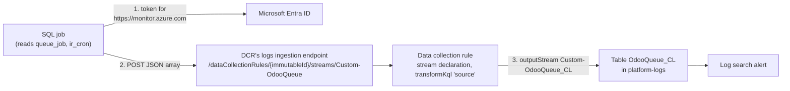

# The Logs Ingestion API: own rows into Log Analytics

How the SQL job of [D5](../design.md#decisions) gets Odoo's numbers (queue sizes, late tasks) into the shared workspace,
where log search alerts ([previous page](azure-monitor-alerts.md)) can read them. Next: where the job runs,
[Container Apps Jobs](container-apps-jobs.md).

**One idea: a program sends a JSON array over HTTPS to an endpoint that belongs to a data collection rule, and the rule
decides which table the rows land in; the program needs a token and one role on that rule, nothing on the workspace.**

The table and stream names in the diagram are **PLANNED**; the spec names them.

## The pieces

From Microsoft's overview ([Logs Ingestion API](https://learn.microsoft.com/en-us/azure/azure-monitor/logs/logs-ingestion-api-overview),
2026-11-07):

| Piece | What it does | Rule from the docs |
|---|---|---|
| **Table** | Where rows land | "The target table must exist before you send data. Custom table names must have the `_CL` suffix." Column names start with a letter, up to 45 characters; `TenantId`, `Type`, `_ResourceId` and a few more are reserved |
| **Data collection rule (DCR)** | Declares the incoming stream (its columns), the destination workspace, and a KQL transformation | "Use the same region for the DCR, Log Analytics workspace, and DCE if you use one"; `transformKql: source` passes rows unchanged |
| **Endpoint** | Where the program sends | A DCR created with `"kind": "Direct"` has its own logs ingestion endpoint; "You only need a DCE when you're connecting to a Log Analytics workspace using private link" or for an older DCR |
| **Identity and role** | Who may send | The caller gets a bearer token for the audience `https://monitor.azure.com`; the identity needs the **Monitoring Metrics Publisher** role on the DCR |
| **Request** | The data | `POST {endpoint}/dataCollectionRules/{dcrImmutableId}/streams/{streamName}?api-version=...`, body "a JSON array with an item structure that matches the format expected by the stream", optional gzip |

The overview's setup table describes an app registration with a secret; the client libraries (Python among them) take
any Azure credential. Whether the job's managed identity is used through the Python library is for the spec to confirm
with Microsoft's sample code ([V5](../design.md#to-verify)).

## On the client's workspace

**REAL** (2026-11-07, discovery):

| Fact | Value | So |
|---|---|---|
| Region | Southeast Asia | The DCR goes in Southeast Asia too |
| Public ingestion | Enabled | No private link, so no DCE: a Direct DCR's endpoint is enough |
| Data collection rules today | None in any subscription | The track's DCR is the first; nothing to coordinate with |
| Tables ending `_CL` today | `ContainerAppConsoleLogs_CL`, `ContainerAppSystemLogs_CL`, written by Container Apps itself | The track's tables sit beside them with their own names |
| Retention | 730 days for every table | The new tables keep 730 days too unless the spec sets a table-level retention |

## What it costs

Rows sent this way are billed as Analytics logs: $2.99 per GB after the first 5 GB a month per billing account
([Retail Prices API](https://prices.azure.com/api/retail/prices?currencyCode=USD&$filter=serviceName%20eq%20'Log%20Analytics'%20and%20armRegionName%20eq%20'southeastasia'),
2026-11-07), and the client's workspace already takes in more than 5 GB a month, so every GB is paid.

### What makes the job's data a month

**Every 5 minutes the job sends one row per active scheduled task, a few queue rows and one heartbeat; the task rows
are most of it.** **REAL**, one dry run on the dev database (2026-11-08, `job/sql_job.py --dry-run`, printed, not sent):

| Table | Rows per run | What makes them |
|---|---|---|
| `OdooCron_CL` | 46 | One per active task in `ir_cron` (46 of 77 on dev) |
| `OdooQueue_CL` | 1 | The table-size row; a backlog adds one row per state and channel, failures one per model and method |
| `OdooHeartbeat_CL` | 1 | The run's own record |
| **Total** | **48 rows, 17,817 bytes as JSON** | |

17.8 KB x 288 runs a day x 30 days = about 154 MB as JSON. **What the workspace bills is less (REAL, 12 runs on dev,
2026-11-08, `_BilledSize`): 8,415 bytes per run, so about 73 MB a month, about $0.22** at $2.99 per GB: the stored row
is smaller than its JSON. stg has 40 active tasks (2026-11-07), so about the same.

**In our design:** [D5](../design.md#decisions) (the SQL job), [D6](../design.md#decisions) (the DCR beside the
workspace), [V5](../design.md#to-verify).
