# Odoo's job queue, and what L5 reads of it

What Odoo's background job queue (the OCA add-on `queue_job`) is, how one job moves through it, and what the rule L5
read of it before round 7 and since. Previous: [Odoo's scheduled tasks](odoo-scheduled-tasks.md), the other kind of
background work; the SQL job that copies the queue's state: [alert-flow](alert-flow.md#the-sql-job-and-the-dcr-the-two-pieces-that-make-data).
Written on 2026-11-14 for round 7 ([spec](../specs/round-7.md)), from A7's rerun.

**One idea: a job's age since it was created is not how long it has waited. A job is retried, postponed and re-run,
and keeps its creation date through all of it; to say "the queue is behind", count how long jobs have been ready to
run and nothing ran them, and how many.**

## The map

Odoo's own code calls `record.with_delay().method()`; instead of running the method, that writes a row in the table
`queue_job`. A separate process, the **job runner**, picks rows and asks an Odoo worker to run each one. Every row moves
through states:

```mermaid
stateDiagram-v2
  [*] --> pending: with_delay() writes the row (date_created)
  pending --> enqueued: the runner picks it (eta passed, channel has room)
  enqueued --> started: a worker begins (date_started, a lock row)
  started --> done: returned (date_done)
  started --> pending: retryable error, postponed (eta = now + delay)
  started --> failed: error, or retries used up
  started --> pending: worker ended mid-job, runner re-queues it (retry + 1)
  started --> failed: worker ended, retry past max_retries (JobFoundDead; the rows here read 7)
```



| Field | Set when | What it tells |
|---|---|---|
| `date_created` | The row is written; **never changed** | How old the job is, not how long it waited |
| `eta` | `postpone()` after a retryable error: now plus the retry delay | The earliest time the runner may pick it |
| `date_started` | Each attempt begins; cleared when it goes back to pending | How long the current attempt has run |
| `retry` | `+1` at each attempt (`-1` again for an `ignore_retry` error); `+1` when re-queued dead | How many attempts it took |
| `channel` | From the job's function settings | Which queue lane, and so which capacity, it shares |

Source: OCA's `queue_job` for Odoo 19, [`job.py`](https://github.com/OCA/queue/blob/19.0/queue_job/job.py)
(`perform`, `postpone`, `set_started`, `set_pending`) and
[`jobrunner/runner.py`](https://github.com/OCA/queue/blob/19.0/queue_job/jobrunner/runner.py)
(`_query_requeue_dead_jobs`), read 2026-11-14 with curl and in the client's copy (`oca-addons/queue_job`, version
19.0, release 2.0.1, the ERP source at `3dd21d93`).

## Channels: the lanes and their capacity

A channel is a lane with a capacity: how many of its jobs may run at once. `root` caps everything below it. On stg
(REAL, read by name from the cron app's settings, 2026-11-14):

| Setting | stg's cron app | What it means |
|---|---|---|
| `QUEUE_JOB_CHANNELS` | `root:4` and four declared channels of capacity 1 or 2 (the inventory report's among them) | At most 4 jobs at once in all; a declared channel at most its own capacity |
| (not declared) | `root.endpoint`, `root.ai_memory` | A channel not in the list gets no capacity of its own: only `root:4` bounds it ([`channels.py`, `get_channel_by_name`](https://github.com/OCA/queue/blob/19.0/queue_job/jobrunner/channels.py)) |
| `LIMIT_TIME_REAL`, `LIMIT_TIME_CPU` | 3600, 1800 | A job runs inline in an HTTP worker, so a job longer than these ends its worker |
| The web app | `root:0` | Runs no jobs: the runner lives in the cron app only |

Only `queue_job` itself is installed on stg; the add-ons that would run jobs from Odoo's scheduler instead are not
(`uninstallable`, read 2026-11-14).

## Following one job: the import that dies mid-run (REAL, 2026-11-11)

The channel `root.endpoint` runs `endpoint.model.import_batch`: an import of one feed's changed records. Until
2026-11-09 it ran 48 a day (every 30 min since 2026-10-14), about 5 min each, every one `done`. After the deploys of
2026-11-10, they come in pairs, and one of each pair never finishes:

```mermaid
sequenceDiagram
  participant Q as queue_job row (created 04:11)
  participant R as job runner
  participant W as Odoo worker
  R->>Q: enqueued, then started (lock row held)
  Q->>W: import_batch
  W--xW: the worker ends mid-job (lock released)
  R->>Q: lock free, so re-queued: pending, retry + 1
  Note over R,Q: attempts from 04:31 to 08:38; each start and each re-queue adds 1 to retry
  R->>Q: retry past max_retries 5: failed, JobFoundDead
```

- From 04:31:45 to 08:38:20 nothing in the channel finished. At every SQL job run a job of the channel read `started`.
- Its twin, created at 05:11:33, recorded its only start at 08:38:18 and was done 2 s later.
- L5-page fired at 06:18 on the twin's age (over 60 min): a catch, since the imports were hours late.
- Jobs found dead on stg, all channels: **0 a day from 11-01 to 11-09, then 4, 6, 4, 9** (11-10 to 11-13) **and 2** (11-14 to 02:30). All 25
  failures of this job since 11-10 are `JobFoundDead`. One pending now reads retry 101 against `max_retries` 5,
  which none of queue_job's own paths above produce: a question for the ERP team.

## The whole queue behind (REAL, 2026-11-10 evening)

A different picture: at 17:55, 865 `sync.model.import_record` jobs were written, in channel `root`. Their first
run (retry 1, no `eta`) came at 20:02, 2 h 7 min later; the 865 `on_actual_imported` jobs they wrote then waited from
20:02 to 22:09; 481 `import_chunk` jobs up to 131 min. Every channel's age climbed together. L5-page fired at 18:58:
a catch.

## What L5 read before round 7, and what it missed

The SQL job ([job/sql_job.py](../../job/sql_job.py), `SQL_BACKLOG`, `SQL_FAILED`) writes per run, per state and
channel: the count and `min(date_created)` as `OldestAgeSec`; and the failed jobs of the last hour per model.

| Measure | Read from | At 18:58 (whole queue) | At 06:18 (one channel) | What it misses |
|---|---|---|---|---|
| `oldest_age` (pending) | `date_created` | 60 min, 883 jobs in 3 channels | 64 min, 2 jobs in 1 channel | Scale: both page the same. A postponed job's wait for its `eta` counts as waiting |
| Age of `started` | `date_created` | 1 job | A job created hours before | It is not how long the attempt has run (a job created 200 min before had started 20 min before) |
| `failed_1h` | `state`, `date_started` | 0 to 1 | 1 to 2 an hour | Why it failed: a worker ending mid-job looks like any error |

## Side by side

| | The queue behind (18:58) | One channel stalled (06:18) | A retry waiting for its `eta` |
|---|---|---|---|
| Jobs old by creation | 883, 3 channels | 2, 1 channel | Any |
| Ready to run and not run | Yes | Yes | No, until `eta` |
| Who acts, how fast | Whoever is paged: imports stopped | The ERP team: a defect in one job | Nobody |
| L5 before round 7 | Page | Page (14 times in 3 days) | Page, once old enough |
| Round 7 (live since 2026-11-14) | Page | Ticket, once per stall, with the dead-job count | Not counted |

**In our design:** L5 is round 1's signal ([round 1 spec](../specs/round-1.md#signals)); round 7 is
[round 7](../specs/round-7.md): the age from when a job could run, a page by scale, a ticket per stalled channel.
Rows found from A7's rerun: [round 6, I8](../specs/round-6.md#acceptance).
