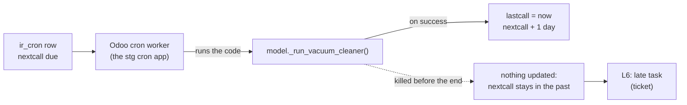

# Odoo's scheduled tasks, and the cleanup that stopped

What Odoo's scheduled tasks are, what the rule L6 reads of them, and the one L6 caught on its first day on stg. Previous:
[the whole alert flow](alert-flow.md); the SQL job that copies the task list: [alert-flow, the SQL job](alert-flow.md#the-sql-job-and-the-dcr-the-two-pieces-that-make-data).

## The daily cleanup: what it is, and what happens when it stops

**One idea: "Base: Auto-vacuum internal data" is Odoo's own housekeeping, not PostgreSQL's autovacuum: once a day it runs
every cleanup method that Odoo's modules declare, and when it stops, nothing breaks at once, but Odoo's bookkeeping
tables keep every row they would have dropped.**

### Scheduled tasks in one paragraph

Odoo keeps its scheduled tasks as rows of the table `ir_cron`: a name, an interval, `lastcall` (when it last ran),
`nextcall` (when it is due), `failure_count`. Odoo's cron worker (on stg, the cron app) picks every active task whose
`nextcall` has passed, runs its Python code, and moves `nextcall` one interval on. Rule L6 reads that table through the
SQL job: a task whose `nextcall` is over 30 min past, by more than 60 min, is late ([spec](../specs/round-1.md#signals)).

### What the task does

Its code is `model._run_vacuum_cleaner()` (**REAL**, `ir_act_server` on stg and dev, 2026-11-08). In Odoo 19 it collects
every method marked `@api.autovacuum` across the installed modules, shuffles them "so one slow method can't always block
the others", runs them one by one, commits after each, logs and skips a method that fails, and has no overall time
limit ([ir_autovacuum.py, Odoo 19](https://github.com/odoo/odoo/blob/19.0/odoo/addons/base/models/ir_autovacuum.py),
2026-11-08, read through a summarising fetch). Each method trims one kind of leftover: old rows of the scheduled tasks'
own progress (`ir_cron_progress`), old bus messages (`bus_bus`), finished wizards, old device and login logs, and similar.

It is **not** PostgreSQL's autovacuum, which reclaims dead row versions inside the database and runs on its own; that one
is round 2's topic. A different Odoo task, "AutoVacuum Job Queue", cleans `queue_job` and kept running (last run
2026-11-07 on both servers).

### What happened on stg and dev (REAL, 2026-11-08)

| | stg | dev |
|---|---|---|
| Last successful run (`lastcall`) | 2026-11-04 07:27 | 2026-11-05 13:57 |
| Due since (`nextcall`) | 2026-11-05 05:34, never moved | 2026-11-06 05:34, never moved |
| `failure_count` | 0 | 0 |
| Other tasks | 16 ran in the last hour; this is the only one late by over 2 h | 19 ran in the last hour; the same |
| L6 | Fired at 07:38:26 UTC, a ticket, its card 1 s later | Fired in the A4 drill |

The worker runs everything else, and the task never counts a failure, so the run likely starts and is cut before it
ends (a worker's time or memory limit stops it mid-way): nothing then updates `lastcall` or `nextcall`. Odoo's own log
file would show it; it is on a file share no rule reads yet, which is round 2's work. The owner's reading (2026-11-08): most likely stopped on purpose by the ERP team, so it is left as it is
([V3](../design.md#to-verify)); L6's alert on it stays open, so it sends one card, not one a day.

What stays behind on stg (**REAL**, 2026-11-08): `ir_cron_progress` keeps about 10,000 rows a day, and its oldest row is
from 2026-11-01, the window the last cleanup left; since then every day adds about 10,000 rows (2026-11-05 10,229,
11-06 10,524, 11-07 10,516) and nothing removes them: 69,906 rows, 22 MB. `bus_bus` holds 455 rows older than a day
that would normally go. Slow growth, not an outage: the reason it is a ticket, not a page.

**In our design:** rule L6 and its severity ([spec](../specs/round-1.md#signals)); the open question
[V3](../design.md#to-verify); the first real catch in the [round 1 review](../reviews/round-1.md#2-what-it-delivered).
