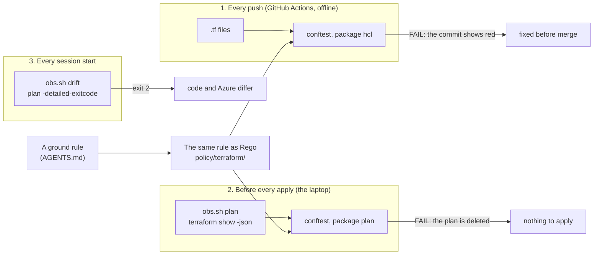

# Policy-as-Code, CI and drift on the track's Terraform

What turns the track's written ground rules ("Terraform creates monitoring resources only", "nothing in Azure names
the repo", every resource tagged `owner = observability-track`) into checks a machine runs on every change, and how
the live resources are compared with the code. Background for the [pipeline spec](../specs/pipeline.md); the commands
are in the [pipeline runbook](../runbooks/pipeline.md). Lab neighbour: the lab's Kyverno policies in its AWS track.

## The map

**One idea: a rule written only in AGENTS.md is kept by whoever remembers it; the same rule written as a policy is
checked three times by a machine: on the source at every push (CI), on the plan before every apply (`obs.sh plan`), and
on the live resources at every session start (`obs.sh drift`).**



| Check | Runs on | When | Sees | Stops |
|---|---|---|---|---|
| CI (`tools/ci.sh`) | The repo's text | Every push and pull request | The source: types, blocks, literal strings; not variable values | A red commit, before anything reaches Azure |
| Plan gate (`obs.sh plan`) | A saved plan's JSON | Before every apply | Every value as it will reach Azure (tags, groups, rendered queries) | The apply: the plan file is deleted |
| Drift (`obs.sh drift`) | The live resources | Each session start | Whatever changed in Azure since the last apply, or code not yet applied | Nothing by itself: it reports |

## Policy-as-Code: a rule as data and code

**Policy-as-Code** means writing a rule in a language a program can evaluate, kept in the repo next to what it
governs, reviewed and tested like code. The engine here is **OPA** (Open Policy Agent), a general policy engine; its
language is **Rego**; **conftest** is a small command line that feeds files (HCL, JSON, YAML) to Rego and prints a
`FAIL` line for each `deny` message ([conftest](https://www.conftest.dev/), 2026-11-08: "HCL and HCL2" among its
parsers).

A Rego rule reads as "this message is in the set `deny` if every line below is true". The track's first rule, REAL
([policy/terraform/plan.rego](../../policy/terraform/plan.rego)):

```rego
deny contains msg if {
	some rc in kept                      # each resource the plan keeps or creates
	not lib.allowed_types[rc.type]       # whose type is not in the allow-list
	msg := sprintf("%s: %s is not a type the track may create (only monitoring resources)", [rc.address, rc.type])
}
```

The allow-list itself is data ([policy/terraform/lib.rego](../../policy/terraform/lib.rego)): the 11 resource types the
three roots create today (action groups, the two alert kinds, the job, its identity and roles, the Logic App and its
steps, the track's own resource groups, the password) plus `azapi_resource` limited to two ARM types (the custom
tables, the DCR). A new type joins the list in the same commit that first creates it, so adding one is a reviewed
change, not a slip.

### Following one resource through the gates

REAL, 2026-11-08: a storage account added to dev's root on purpose (never committed), with no tags.

```hcl
resource "azurerm_storage_account" "broken" {
  name                = "obsbrokentest01"
  resource_group_name = azurerm_resource_group.track.name
  ...
}
```

**Gate 1, the source.** conftest parses each `.tf` file with its `hcl2` parser into JSON
(`input.resource["azurerm_storage_account"]["broken"]`), and the type rule fires:

```text
FAIL - terraform/envs/dev/main.tf - hcl - azurerm_storage_account.broken: azurerm_storage_account is not a type the track may create (only monitoring resources)
147 tests, 146 passed, 0 warnings, 1 failure, 0 exceptions
```

**Gate 2, the plan.** `obs.sh plan dev` made the plan, the repo-trace scan passed (no repo name), and the policies
refused it; the plan file was deleted, so `obs.sh apply` had nothing to apply:

```text
  # azurerm_storage_account.broken will be created
Plan: 1 to add, 0 to change, 0 to destroy.
1960 string(s) scanned, 0 with a trace of the repo
FAIL - - plan - azurerm_storage_account.broken: azurerm_storage_account is not a type the track may create (only monitoring resources)
policy refused the plan (exit 1): nothing to apply
```

**A second break: a missing tag.** Dropping `owner` from dev's `local.tags` changes 22 resources; the source looks
fine (each resource still sets `tags = local.tags`), so only the plan sees it, with the values filled in:

```text
Plan: 0 to add, 22 to change, 0 to destroy.
FAIL - - plan - azurerm_resource_group.track: tag owner is not observability-track
FAIL - - plan - module.alerts.azurerm_monitor_metric_alert.metric["M-restarts-app1"]: tag owner is not observability-track
...
policy refused the plan (exit 1): nothing to apply
```

That is why the policies exist twice: **the source check is early and needs no Azure; the plan check is late and sees
the real values.** Each has its own package (`hcl`, `plan`) sharing one data file.

| Rule (both packages) | Source (`hcl`) checks | Plan (`plan`) checks |
|---|---|---|
| Only monitoring types | The block's type | The resource's type; `azapi_resource`'s ARM type |
| Tags | That a taggable resource sets `tags` at all | `owner = observability-track`, and `env` or `purpose` |
| The track's own groups | (unknown in the source) | `resource_group_name` holds `-obs-`, never a platform group |
| Alerts reach someone | An `action` block with a group | The group's id, or unknown until the group is created |
| No repo name | Any literal string | Any value sent to Azure |

The full repo-path scan (`docs/`, `kql/`, `.md#`) stays in [tools/no-repo-trace.py](../../tools/no-repo-trace.py): the
HCL names its own files (`file("${path.module}/...")`) and those paths never leave the laptop.

### Tested like code

Each rule has a test with a compliant input and one that breaks it
([plan_test.rego](../../policy/terraform/plan_test.rego), [hcl_test.rego](../../policy/terraform/hcl_test.rego)); the
test inputs are written by hand in the shape of `terraform show -json`, never a real plan, because **a real plan's JSON
holds sensitive values in clear**: Terraform only marks them in `after_sensitive`
([JSON output format](https://developer.hashicorp.com/terraform/internals/json-format), 2026-11-08), and the track's
plans hold `obs_monitor`'s password. REAL: `20 tests, 20 passed` (2026-11-08).

## Three places a policy can run

| Engine | Where it runs | Decides on | Here |
|---|---|---|---|
| OPA with conftest | Anywhere: CI, a laptop | Files: HCL, plan JSON | **Used**: the track owns its repo and its plans |
| Kyverno | Inside a Kubernetes cluster, as an admission controller | Each object sent to the cluster's API | the lab: it refused `:latest` images and pods without limits; the client runs no cluster |
| Azure Policy | Inside Azure, at Resource Manager | Each resource request, and existing resources for compliance ([overview](https://learn.microsoft.com/en-us/azure/governance/policy/overview), 2026-11-08: it "evaluates resources and actions in Azure by comparing the properties of those resources to business rules") | Not used: assignments belong to the platform's management groups and subscriptions, which the track does not manage |

**Pipeline gate vs admission control:** a pipeline gate checks what a change *will* do, before it runs, and only for
changes that go through the pipeline; admission control (Kyverno, Azure Policy's `deny`) checks every request at the
door, whoever sends it. A platform team wants both; the track, owning only its own resources and never the door, uses
the pipeline gates.

## Drift: comparing the code with Azure

**Drift** is any difference between what the code says and what exists: someone changed an alert in the portal, a
resource was deleted by hand, or code was merged but not applied. `terraform plan -detailed-exitcode` answers it in its
exit code: "0 = Succeeded with empty diff (no changes), 1 = Error, 2 = Succeeded with non-empty diff (changes present)"
([plan](https://developer.hashicorp.com/terraform/cli/commands/plan), 2026-11-08).

REAL, 2026-11-08 19:23:

```text
$ bash tools/obs.sh drift
shared: no drift
dev: no drift
stg: no drift
exit 0
```

`obs.sh drift` plans with `-lock=false`. HashiCorp does not recommend turning locking off
([state locking](https://developer.hashicorp.com/terraform/language/state/locking), 2026-11-08), because two writers
could corrupt the state; a plan never writes the state, so the lock only guards against a reader, and taking it would
make a running apply in another session fail with `state locked` (the track has seen a lease left behind on the state
blob once: [known failure modes](../known-failure-modes.md)). `obs.sh plan`, which leads to an apply, still locks.

## Why the pipeline never reaches Azure

GitHub Actions can sign in to Azure without a secret through a federated credential (OIDC), whose subject is the
repository's name. That would put the GitHub repo's name into the client's tenant, which the track's ground rules forbid
([AGENTS.md](../../AGENTS.md#ground-rules-of-the-track-owner-2026-11-07)). So CI checks only what the repo holds, and
the plan gate and drift run on the laptop with the owner's logins.

**Pinning what the pipeline runs.** A workflow that runs `uses: some/action@v7` runs whatever that tag points to on
the day; GitHub's advice is to "Pin actions to a full-length commit SHA"
([secure use](https://docs.github.com/en/actions/reference/security/secure-use), 2026-11-08). The workflow uses one
action (`actions/checkout`, pinned by SHA); every tool is downloaded by [tools/ci-tools.sh](../../tools/ci-tools.sh) at
an exact version and checked against a SHA-256 written in the script, so a release replaced upstream fails the check.

**In our design:** [D18](../design.md#decisions) (the pipeline: offline CI, the policies at two gates, drift at each
session start); the ground rules in [AGENTS.md](../../AGENTS.md#ground-rules-of-the-track-owner-2026-11-07);
[D7](../design.md#decisions) (Terraform for monitoring resources only).
