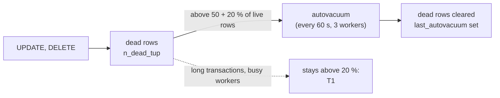

# PostgreSQL's autovacuum: dead rows and who clears them

What PostgreSQL's autovacuum does, when it starts on a table, and what the client's stg database shows today, for round 2's rule
T1. Not to be confused with Odoo's daily cleanup task ([odoo-scheduled-tasks](odoo-scheduled-tasks.md)). Previous:
[Postgres query statistics](postgres-query-stats.md).

**One idea: every UPDATE or DELETE leaves the old row version behind as a dead row; autovacuum clears a table's dead rows
once they pass a share of the table, and a table that stays above that share for long means autovacuum is not keeping
up, which makes the table and its scans grow.**

## When autovacuum starts on a table

DOCS ([routine vacuuming](https://www.postgresql.org/docs/17/routine-vacuuming.html), 2026-11-08, read through a
summarising fetch): "vacuum threshold = vacuum base threshold + vacuum scale factor * number of tuples", the base being
`autovacuum_vacuum_threshold` and the factor `autovacuum_vacuum_scale_factor`. On both the client servers (**REAL**, 2026-11-08):
`autovacuum_vacuum_threshold=50`, `autovacuum=on`,
`autovacuum_vacuum_scale_factor=0.2`, `autovacuum_naptime=60` s, `autovacuum_max_workers=3`; and
`log_autovacuum_min_duration=-1`, so no autovacuum run is logged (0 lines in 7 days).

## What stg shows (REAL, 2026-11-08, `pg_stat_user_tables`)

| Table | Live rows | Dead rows | Dead | Last autovacuum | Autovacuums |
|---|---|---|---|---|---|
| `sync_map` | 1,825,957 | 327,460 | 17.9 % | never | 0 |
| `vision_event` | 577,653 | 89,556 | 15.5 % | 2026-11-05 01:01 | 11 |
| `mail_followers_mail_message_subtype_rel` | 417,381 | 71,968 | 17.2 % | never | 0 |
| `sync_source_line` | 373,303 | 69,733 | 18.7 % | never | 0 |
| `queue_job_lock` | 783,312 | 41,667 | 5.3 % | 2026-11-06 17:07 | 7 |

Several large tables sit just under the 20 % that starts autovacuum, some never vacuumed since the statistics began. That
is normal for a table that grows mostly by INSERT; it becomes a problem when dead rows pass the threshold and stay: then
autovacuum is not keeping up, for example because a long open transaction still needs the old rows (the docs' advice for
those: "End long-running open transactions", found in `pg_stat_activity`), or because its workers are busy elsewhere.

## The statistics for the alert, the log for the why

We do not: autovacuum is already on, on both servers (`autovacuum=on`, above), and round 2 leaves it untouched. What is
off is the **logging** of its runs (`log_autovacuum_min_duration=-1`):

| | Autovacuum | Logging its runs |
|---|---|---|
| What it is | PostgreSQL clearing dead rows, table by table | One entry per run: the table, how long, what it removed |
| On the client (**REAL**, 2026-11-08) | On, 3 workers, every 60 s | Off: 0 lines in 7 days |

Right: the log is cheap. **REAL** (2026-11-08): stg's database ran 17,919 autovacuums and 21,593 autoanalyzes in the
16.7 days since the server's last start, at most about 2,400 runs a day; the prd server already sends 213,541 log lines a
day (53.7 MB) to the workspace.

| `log_autovacuum_min_duration` | Logs | Extra volume (estimate) |
|---|---|---|
| `-1` (today) | Nothing | none |
| `0` | Every run (about 2,400 a day for stg's database alone) | a few MB a day, under $1 a month |
| `10s` | Runs of 10 s or more: the ones worth a look | a handful of lines a day |

So the two answer different questions: the table statistics (`pg_stat_user_tables`), readable by any login in the
database, say **which** table autovacuum is losing, every 5 min through the SQL job, for the alert T1; the log at `10s`
says **why** a run was slow, for the investigation after. The setting is dynamic (no restart) and undone by `-1`.

The owner's decision (2026-11-08): keep the logging off, the default; T1's statistics are enough to alert, and `10s` is
the setting to turn on later if a T1 alert needs its why.

**In our design:** round 2's T1 ([spec](../specs/round-2.md#signals)); the logging kept off ([spec, not in round 2](../specs/round-2.md#not-in-round-2)).
