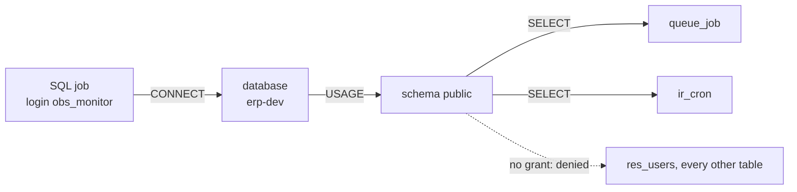

# Postgres roles and grants: what the monitoring role may do

What the SQL job's login, `obs_monitor`, is allowed to do on an Odoo database, and why each line of
[sql/obs_monitor.sql](../../sql/obs_monitor.sql) is there. Previous: what the job reads,
[Postgres query statistics](postgres-query-stats.md); the job itself: [Container Apps Jobs](container-apps-jobs.md).

**One idea: a Postgres session may touch a row only if three doors are open, the database (CONNECT), the schema
(USAGE) and the table (SELECT), and the monitoring role is given the third door for two tables only; its settings then
make every session read-only and short.**



## The GRANTs, door by door

**On the dev server, on 2026-11-08: the three GRANTs below, run by the admin login through
[tools/obs.sh](../../tools/obs.sh) `role` ([deploy, step 6](../runbooks/deploy.md#6-the-monitoring-role)); before that,
on a throwaway local PostgreSQL 17 to test the script. The prd server (stg's database) is next, with round 1 on stg.**

| GRANT in the script | Door | DOCS: what it allows ([privileges](https://www.postgresql.org/docs/17/ddl-priv.html), 2026-11-08) | REAL on dev (2026-11-08) |
|---|---|---|---|
| `GRANT CONNECT ON DATABASE "erp-dev"` | The database | "Allows the grantee to connect to the database. This privilege is checked at connection startup" | PUBLIC already has it (`has_database_privilege('public', ..., 'CONNECT')` is true) |
| `GRANT USAGE ON SCHEMA public` | The schema | "allows access to objects contained in the schema (assuming that the objects' own privilege requirements are also met)" | PUBLIC already has it; PUBLIC has no CREATE there |
| `GRANT SELECT ON TABLE public.queue_job, public.ir_cron` | Two tables | Reading the rows | **The only new right**: PUBLIC has no SELECT on `queue_job` |

Why grant what PUBLIC already has: PostgreSQL gives PUBLIC "CONNECT and TEMPORARY (create temporary tables) privileges
for databases" by default, but "No privileges are granted to PUBLIC by default on tables" (same page), and an owner may
revoke the defaults. The explicit grants keep the role working on a server where they were revoked (the prd server is
checked the same way before stg).

What the local test showed (**REAL**, 2026-11-08, PostgreSQL 17 in Docker, an admin that is not a superuser but a
member of the table owner's role, as on dev):

```text
 table_name | privilege_type
------------+----------------
 ir_cron    | SELECT
 queue_job  | SELECT
NOTICE:  ok: SELECT on res_users denied (permission denied for table res_users)
NOTICE:  ok: UPDATE on ir_cron denied (cannot execute UPDATE in a read-only transaction)
NOTICE:  ok: read only, statement_timeout 10s, lock_timeout 1s
```

## Who may grant on a table they do not own

The dev server's admin login does not own Odoo's tables: `queue_job` is owned by the role `erp-owner-dev`, and the
admin is a member of that role (**REAL**, 2026-11-08). PostgreSQL allows that: "GRANT and REVOKE can also be done by a
role that is not the owner of the affected object, but is a member of the role that owns the object ... In this case
the privileges will be recorded as having been granted by the role that actually owns the object"
([GRANT](https://www.postgresql.org/docs/17/sql-grant.html), 2026-11-08). So the grant on dev shows the owner role as
grantor, not the admin (**REAL**, 2026-11-08: `erp-owner-dev | queue_job | SELECT`). If the admin were not a member, the fallback is the owner's own login, kept in the Odoo app's
secrets ([platform](../platform.md#what-connects-them)).

## The role's settings: what a grant cannot say

A grant says which doors open; the role's settings say how every session behaves once inside:

| Setting | Value | What it prevents |
|---|---|---|
| `default_transaction_read_only` | on | Any write, even if a grant were added by mistake (the test's UPDATE failed on this, before the privilege check) |
| `statement_timeout` | 10 s | A slow query holding the database; the job's queries take milliseconds |
| `lock_timeout` | 1 s | The job queueing behind Odoo's own locks (the waits rule L1 watches) |
| `CONNECTION LIMIT` | 2 | A stuck job piling up sessions |
| `NOINHERIT`, no `pg_read_all_data` | | Reading other tables through a role membership |

What remains open, by PUBLIC's defaults: a session may create temporary tables (TEMPORARY on the database); they live
only as long as the session and touch no Odoo data.

**In our design:** the monitoring role of [D5](../design.md#decisions), specified in the
[round 1 spec](../specs/round-1.md#the-monitoring-role); acceptance A1 runs
[sql/check_obs_monitor.sql](../../sql/check_obs_monitor.sql).
