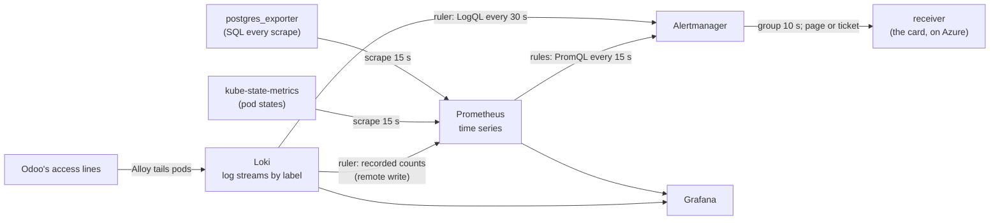

# Prometheus, Loki and Grafana: the track's rules on Kubernetes

How the same alert questions are put to a Kubernetes stack: what Prometheus and Loki each store, how PromQL and
LogQL differ from the KQL of round 1, how a rule becomes a notification, and how to test rules offline. It prepares the
[Kubernetes mapping](../specs/kubernetes-mapping.md) (stage K of the plan of 2026-11-08); the Azure flow it mirrors is
[alert-flow](alert-flow.md). Examples are **REAL** from the lab of 2026-11-08 (kind on the laptop, the public Odoo
image): lab numbers, never the client's.

## The map

**One idea: Prometheus asks "what is the value now?" of numbers it scrapes every 15 s; Loki asks "how many lines
matched?" of logs it indexes only by their labels; an alert rule on either is the same question a KQL rule asks of the
workspace, and the choice of store decides when the question can be answered.**



| | Azure (rounds 1 to 3) | Kubernetes (this lab) |
|---|---|---|
| Numbers | Platform metrics; the SQL job's rows in custom tables | Prometheus series, from exporters and kube-state-metrics |
| Logs | Log Analytics tables, any column searchable | Loki streams: labels indexed, the line itself scanned at query time |
| Query language | KQL, one language for both | PromQL for numbers, LogQL for logs (its metric queries return PromQL-like series) |
| Rule evaluation | Azure Monitor, every 5 or 15 min | Prometheus every 15 s; Loki's ruler every 30 s |
| Routing | Action groups (page, ticket), a Logic App, a card | Alertmanager routes by label (`severity: page` or `ticket`) to receivers |

## Three rules, side by side

The same question in both stores, with the lab's real rule text ([k8s/rules/](../../k8s/rules/erp.rules.yaml)):

| Rule | KQL on Azure | Here |
|---|---|---|
| L1, a lock wait over 60 s | The prd server's log: the `acquired ... after N ms` line, written **when the wait ends** ([kql/L1-lock-waits.kql](../../kql/L1-lock-waits.kql)) | PromQL on a gauge the exporter samples from `pg_locks.waitstart` **while the wait lasts**: `max(erp_lock_wait_max_seconds) > 60` |
| L2, 25 or more 5xx in 5 min | nginx lines in `ContainerAppConsoleLogs_CL`, parsed and counted per 5-min bin | LogQL: `count_over_time({namespace="erp", container="odoo"} \|= "werkzeug" \| regexp ... \| status >= 500 [5m]) >= 25` |
| L6, a task late by more than its interval | The SQL job's `OdooCron_CL` rows every 5 min | The exporter runs the same SQL at every scrape: `erp_cron_overdue_seconds > erp_cron_interval_seconds` |
| Q1, over 90 min of database time in an hour | Query Store's runtime rows, summed per **complete** hour ([kql/Q1-heavy-hour.kql](../../kql/Q1-heavy-hour.kql)) | A counter of `pg_stat_statements`' total time, over a **rolling** hour: `increase(erp_db_time_seconds_total[1h]) / 60 > 90` |
| T1, a quarter of a table's rows dead, autovacuum behind | The SQL job's `OdooTables_CL` rows ([kql/T1-table-bloat.kql](../../kql/T1-table-bloat.kql)) | The same three columns of `pg_stat_user_tables` at every scrape: dead share `>= 0.25`, `>= 100000` dead, no autovacuum for 24 h or never |
| O1, 3 limit lines in 15 min | The log reader's counts of Odoo's own lines in `OdooLog_CL` ([kql/O1-workers-killed.kql](../../kql/O1-workers-killed.kql)) | LogQL on the same lines in Loki: `count_over_time({...} \|~ "<the limit messages>" [15m]) >= 3` |

**What moves as it is:** the threshold, the window, the severity, the first steps. **What changes:** the source. L1 is
the instructive case: a log line exists only after the wait, so Azure's L1 pages after a long wait ends (the game day
of 2026-11-08 found it, [respond](../runbooks/respond.md#the-game-day-of-2026-11-08)); a sampled gauge sees the wait
grow, so the page can come while users are still blocked.

## From a sample to a notification

Each hop adds its interval, so the worst case is their sum. For L1 in this lab: the wait passes 60 s, the exporter's
next scrape sees it (up to 15 s), the next rule evaluation fires (up to 15 s), Alertmanager waits `group_wait` (10 s) to
batch alerts that fire together, then posts to the receiver. About 100 s after the wait began at worst, which is why
the drill holds the lock 150 s. The drills' real times are in [the lab's drills](#the-drills-real-times).

A rule with `for: 2m` (H here) must stay true across evaluations for 2 minutes before it fires: the same role as
Azure's "number of violations" over a window, used for a signal that blips.

## Recording rules: one query feeding another store

The SLO needs two counts per journey (all requests, bad requests) over two windows. They live in Odoo's log lines, so
Loki computes them; the burn-rate comparison is arithmetic on numbers, so Prometheus does it. Loki's ruler **records**
the counts as series (`erp:requests:count5m`, `erp:requests_bad:count1h`, ...) and writes them to Prometheus through
its remote-write receiver; Prometheus divides and alerts. **REAL**: two minutes after Odoo started, Prometheus held
`erp:requests:count5m` interactive 7, tv 24, one series per journey, as the KQL of round 3 splits by a `Journey`
column. On Azure one KQL query does both steps; here the work is split across two systems, which is the usual shape of
an SLO on Prometheus and Loki.

## Exporters: a scrape is a query

postgres_exporter runs SQL at every scrape and turns columns into series: a `GAUGE` column becomes the value, a
`LABEL` column a label ([the queries](../../k8s/manifests/erp.yaml)). **REAL**, first scrape:

```text
erp_cron_overdue_seconds{name="Incident lab: one-minute task"} 13.848198
erp_cron_interval_seconds{name="Incident lab: one-minute task"} 60
erp_lock_wait_max_seconds 0
```

The SQL job on Azure runs every 5 minutes and pays per run; an exporter runs every 15 s, so its query must be cheap
(the same `ir_cron` query: a few rows). kube-state-metrics turns the API server's objects into series: a container's
last termination reason is a label (`reason="OOMKilled"`), where Azure's L7 parses it out of the system log.

## Testing rules offline

`promtool test rules` feeds a rule file synthetic series and checks which alerts fire at which time, with their labels
and annotations ([the tests](../../k8s/rules/erp.rules.test.yaml)): L1 fires at 61 s and not at 45 s, H only after
2 min of silence, SLO-fast on the journey over both windows and not on the other. **REAL**: 8 alerts and 2 recording rules, every test passed
on the first run, and CI runs them on every push. LogQL rules have no such offline runner in this setup; the ruler's
API shows each rule's health once loaded.

## Met in the lab

| Symptom | Cause | Fix |
|---|---|---|
| Loki's ruler lists no rules, with no error | It mounted the ConfigMap's first version (an empty placeholder); a mounted ConfigMap is refreshed by the kubelet with a delay, and the ruler rereads its directory on its own interval | Wait a minute, or create the rules before Loki starts |
| The second lock drill's requests ended with an empty reply after about 155 s | Odoo's own guard: `virtual real time limit (157/120s) reached ... Dumping stacktrace of limit exceeding threads before reloading`: a request over `limit_time_real` (120 s by default) makes Odoo reload; the guard behind round 2's O1 on the client's workers | Hold under 120 s, or count it as the pattern it is: a long lock wait ends in a worker limit |
| `exec: "wget": executable file not found` in the Prometheus pod | The image carries only the binaries it needs | Query through the API server: `kubectl get --raw /api/v1/namespaces/monitoring/services/kps-prometheus:9090/proxy/api/v1/query?query=up` |

## The drills: real times

**REAL**, 2026-11-08 (UTC), from the alert sink's log ([the lab runbook](../runbooks/kubernetes-lab.md#4-drills)): each
drill made its pattern happen in the demonstration Odoo, and the sink logged the notification's arrival.

| Drill | The fault | Alert (receiver) | At the sink | From the fault |
|---|---|---|---|---|
| lock (first, `query_start`) | A wait 16:08:37 to 16:11:20 (148.3 s) | L1LockWait (page) | 16:10:09 | 92 s, **71 s before the wait ended** |
| lock (again, `pg_locks.waitstart`) | A wait from 16:32:39, ended by Odoo's 120 s limit at 16:35:15 | L1LockWait (page) | 16:34:22 | 103 s, during the wait |
| http5xx | 40 answers 500, 16:14:04 to 16:14:17 | L2Http5xxBurst (page), from Loki | 16:14:47 | 43 s |
| | | SLOFast (page), interactive journey only | 16:15:01 | 57 s |
| oom | A request touching 1,200 MiB, limit 1 GiB, 16:19:45 | L7Killed (page), M1Restarts (ticket) | 16:20:17 | 32 s |
| cron | The one-minute task asked to sleep 200 s, 16:17:01 | L6LateTask (ticket) | 16:20:23 | 3 min 22 s (the oom drill's kill at 16:19:47 overlapped it) |
| exporter | The exporter stopped 16:22:32 to 16:26:55 | HExporterSilent (page) | 16:25:40; resolved 16:27:51 | 3 min 8 s (2 min of `for` included) |
| bloat (2026-11-08, round 5) | 120,000 rows updated in a table with autovacuum off, 23:46:33 | T1TableBloat (ticket) | 23:46:51 | 18 s |
| heavy | 16 statements of 360 s, ended 23:53:39 | Q1HeavyHour (ticket) | 23:54:05 | 26 s after they ended |
| limit | A 240 s lock hold and three waiters; Odoo's four limit lines at 23:56:50 | O1WorkerLimits (page), from Loki | 23:57:59 | 69 s after the lines |

Q1 shows the one real difference of its source: `pg_stat_statements` adds a statement's time **when it ends**, so the
hour's total jumped at 23:53:39, not as the statements ran.
The limit drill needs a hold past one of the threaded server's checks, which run every 60 s: a 150 s hold missed it.

Unplanned: at 16:06:10 L6 ticketed the one-minute task 2 min late, after the lab restarted Odoo to load a file: no
scheduler ran for two minutes, a true reading of a restart.

**In our design:** [D15](../design.md#decisions) (the lab's platform, refined for memory), [the mapping](../specs/kubernetes-mapping.md#the-rules).
