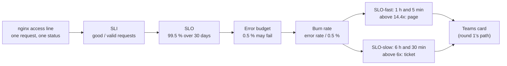
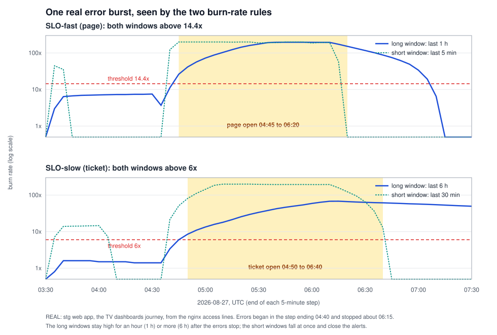

# SLOs, error budgets and burn-rate alerts

What a service level objective is, why it exists, and how round 3 turns one into two alerts on stg's web app, all on
the real traffic of 2026-08 to 11. It comes after [alert-flow](alert-flow.md) (how any alert reaches Teams) and before
the [round 3 spec](../specs/round-3.md#slos) (what we built). New to SLOs: read it top to bottom once, then use
[study it](#study-it) at the end.

## The map

**One idea: decide in advance how many failed requests the users can live with in 30 days (the error budget), then
alert not on each failure but on how fast the budget is being spent (the burn rate), over a long window to be sure and
a short window to be current.**



| Term | In one line | On stg (REAL, 2026-11-08) |
|---|---|---|
| SLI (indicator) | A ratio measured from the users' side: good events over valid events | Requests answered without a 5xx, over all answered requests, per journey |
| SLO (objective) | The target for the SLI over a window | 99.5 % over 30 rolling days |
| Error budget | 1 minus the SLO: the failures the target allows | 0.5 %: in October about 849 bad interactive requests, 2,014 bad TV requests |
| Burn rate | How fast the budget is spent, relative to spending it evenly over 30 days | 1x spends it in exactly 30 days; 14.4x spends 2 % of it in 1 h |
| SLA (agreement) | A promise to a customer with a penalty; looser than the SLO | None at the client: the SLO is internal |

The terms come from Google's SRE book, chapter 4 ([Service Level Objectives](https://sre.google/sre-book/service-level-objectives/),
2026-11-08) and the SRE workbook ([Implementing SLOs](https://sre.google/workbook/implementing-slos/),
[Alerting on SLOs](https://sre.google/workbook/alerting-on-slos/), 2026-11-08).

## Why an SLO, when round 1 already alerts on 5xx

Round 1's [L2](../specs/round-1.md#signals) pages when 25 or more 5xx answers land in 5 minutes. It caught August's
incidents, but it has two blind spots, both seen in stg's data:

| Question | L2 (a count in 5 min) | An SLO burn-rate alert |
|---|---|---|
| 20 failures in 5 min at night, when 25 requests came in | Silent (under 25) | Fires: 80 % of requests failed |
| 30 failures in 5 min at the 14:00 peak, 3,000 requests | Pages | Silent: 1 %, a small dent in the budget |
| 8 failures every 5 min for 6 hours (a slow leak) | Silent every time | Fires (SLO-slow): the budget burns at 6x and more |
| How bad was August, in one number? | No answer | 174 % of the interactive budget spent in 23 days |

**The purpose:** an SLO turns "is this bad?" into arithmetic the team agreed on beforehand. The error budget then
becomes a tool for decisions: while budget is left, changes ship; when it is spent, reliability work comes first
([SRE workbook, error budget policy](https://sre.google/workbook/error-budget-policy/), 2026-11-08).

## Follow one request

One real request of stg's web app, from the factory TV dashboards, on **2026-08-27 at about 05:50 UTC** (REAL):

```text
[27/Aug/2026:05:50 +0000] "GET /erp/tv/<token>/data HTTP/1.1" 500 2754
```

(Trimmed from the nginx access line in `ContainerAppConsoleLogs_CL`; the address, the browser and the TV's access token
removed.) Each step below adds one idea.

### 1. Is this request good, bad, or not counted?

The SLI counts what the user experienced, so first decide which lines are requests a user waited for:

| Line (REAL examples, 2026-08-27 05:00 to 06:20 UTC) | Counted? | Why |
|---|---|---|
| `GET /erp/tv/<token>/data` **500**, 1,794 of them | Valid, **bad** | The server failed to answer |
| `GET /erp/tv/<token>` **200**, 470 | Valid, good | The page was served |
| `POST /web/dataset/call_kw` **400**, 1 | Valid, good | A 4xx is the server correctly refusing a wrong request; it says nothing about availability |
| `GET /websocket?version=19.0-2` **101**, 34 | Not counted | A long-lived upgrade, not a request and an answer |
| `POST /api/v1/mcp` **499**, 3 | Not counted | The client left before any answer; nothing to judge (round 1's L2-499 watches these) |
| An nginx line that is not an access line (the cron app's 9,416 lines) | Not counted | No status in it |

So the request we follow is **valid and bad**.

### 2. The SLI: good over valid, per journey

**SLI = good requests / valid requests**, over a window. stg's traffic has two very different users, so the SLI is
measured per **journey** (a group of requests one kind of user makes):

- **tv**: the factory TV dashboards polling `/erp/tv/...` every few seconds: about 70 % of the requests in October (402,831 of 572,561);
- **interactive**: everything else, people clicking in Odoo.

Measured together, the TVs would hide the people: a broken form for every user is a rounding error next to 400,000
polls. Measured apart, each has its own budget (REAL, from the nginx lines, measured 2026-11-08):

| Journey | Month | Valid requests | Bad (5xx) | SLI |
|---|---|---|---|---|
| interactive | August (from the 9th, 23 days) | 347,460 | 3,022 | 99.130 % |
| interactive | September | 185,896 | 142 | 99.924 % |
| interactive | October | 169,730 | 110 | 99.935 % |
| tv | August (22 days) | 420,027 | 3,344 | 99.204 % |
| tv | September | 251,940 | 111 | 99.956 % |
| tv | October | 402,831 | 459 | 99.886 % |

### 3. The SLO: picking the target from the data

The SLO is the SLI's target over a fixed window (30 rolling days here). Too strict and every bad hour pages; too loose
and August looks fine. The same months at three targets (REAL; "spent" is the share of that month's budget the bad
requests used):

| Target | Budget | interactive Aug / Sep / Oct spent | tv Aug / Sep / Oct spent |
|---|---|---|---|
| 99 % | 1 % | 87 % / 8 % / 6 % | 80 % / 4 % / 11 % |
| **99.5 %** | **0.5 %** | **174 % / 15 % / 13 %** | **159 % / 9 % / 23 %** |
| 99.9 % | 0.1 % | 870 % / 76 % / 65 % | 796 % / 44 % / 114 % |

99 % calls August, the month of the incidents, acceptable. 99.9 % calls an ordinary October broken for the TVs. **99.5 %
separates them**: August blew the budget, September and October used a sixth of it. The SRE workbook's advice is the
same: start from what the service achieves when users are content, and tighten later
([Implementing SLOs](https://sre.google/workbook/implementing-slos/), 2026-11-08).

**The budget in requests** (October's traffic): 0.5 % of 169,730 is **849** bad interactive requests in 30 days, about
28 a day; for the TVs, **2,014**.

### 4. The burn rate: how fast the budget goes

> "Burn rate is how fast, relative to the SLO, the service consumes the error budget."
> ([Alerting on SLOs](https://sre.google/workbook/alerting-on-slos/), 2026-11-08)

**Burn rate = the error rate over a window / the budget's rate (1 - SLO).** At 1x the budget lasts exactly 30 days; at
2x, 15 days; at 30x, one day.

Our request's window: in the hour ending 05:55, 1,257 of 1,278 TV requests failed. Error rate 98.4 %, divided by 0.5 %:
a **burn rate of 196.7** (REAL). At that pace the whole 30-day budget is gone in 30 days / 196.7 = **3.7 hours**.

| Burn rate | Budget lasts | Share of the budget spent in 1 h |
|---|---|---|
| 1 | 30 days | 0.14 % |
| 6 | 5 days | 0.8 % (5 % in 6 h) |
| 14.4 | 50 hours | **2 %** |
| 196.7 (2026-08-27 05:55, tv) | 3.7 hours | 27 % |

### 5. Why two windows, and why two rules

An alert has to answer two questions: **is it serious?** (enough budget is gone to be worth a person) and **is it still
happening?** (so the alert ends when the errors end). One window cannot answer both:

- a **long window** (1 h) is serious: 14.4x over an hour means 2 % of the month's budget is gone; but it remembers: an
  hour after the errors stop, the hour still holds them;
- a **short window** (5 min, 1/12 of the long one: "A good guideline is to make the short window 1/12 the duration of
  the long window", [Alerting on SLOs](https://sre.google/workbook/alerting-on-slos/), 2026-11-08) reacts at once, and
  falls at once.

The rule fires only while **both** are above the threshold. Here is our request's burst, as both rules saw it (REAL,
drawn from the nginx lines with [kql/SLO-burn-rate.kql](../../kql/SLO-burn-rate.kql)):



| UTC, 2026-08-27 (end of the 5-min step) | 1 h burn | 5 min burn | SLO-fast | 6 h burn | 30 min burn | SLO-slow |
|---|---|---|---|---|---|---|
| 04:40 (the errors begin) | 11.2 | 123.3 | quiet: 1 h under 14.4 | 3.4 | 21.6 | quiet |
| 04:45 | 26.2 | 200.0 | **fires** | 6.0 | 51.0 | quiet: 6 h at 6.0, not above |
| 04:50 | 41.4 | 200.0 | firing | 8.5 | 81.1 | **fires** |
| 06:15 (the errors stop) | 173.2 | 57.7 | firing | 68.0 | 157.5 | firing |
| 06:20 | 151.6 | **0.0** | **condition clears** | 66.3 | 123.0 | firing |
| 06:45 | 74.9 | 0.0 | clear | 60.3 | **0.0** | **condition clears** |

Without the short window, SLO-fast would have stayed on until 07:05 and SLO-slow past noon (its 6 h burn was still 7.5
at 12:00), long after the fix. The Azure alert itself closes a little after the condition clears: a stateful log alert at a 5 to 15 minute
frequency is resolved when "the alert condition isn't met for three frequency periods"
([Create log search alert rules](https://learn.microsoft.com/en-us/azure/azure-monitor/alerts/alerts-create-log-alert-rule),
2026-11-08), so about 15 minutes later for SLO-fast.

The workbook recommends three pairs; we use the first two, as a page and a ticket (an Azure log alert has one severity,
so each pair is its own rule, as round 1 learned):

| Budget spent | Long window | Short window | Burn rate | Workbook | Ours (DOCS: workbook table 5-8, for a 99.9 % SLO; burn rates do not depend on the target) |
|---|---|---|---|---|---|
| 2 % | 1 h | 5 min | 14.4 | page | **SLO-fast, page** |
| 5 % | 6 h | 30 min | 6 | page | **SLO-slow, ticket** (stg is not staffed at night; a slow leak waits for the day) |
| 10 % | 3 days | 6 h | 1 | ticket | Not built: an Azure log alert reads at most 2 days |

### 6. Quiet hours: the guard

At night, the interactive journey sees a few dozen requests an hour, and 3 failures out of 30 is a 10 % error rate,
burn rate 20. The workbook warns that burn rates "can cause problems for systems that receive a low rate of requests".
Our guard: the long window must hold **at least 10 bad requests** (`MinBad`). In the backtest the smallest firing hour
had 25 bad requests (2026-08-27 13:50, tv), so the guard cost no real catch.

### 7. From the query to the card

The rule's query ([kql/SLO-burn-rate.kql](../../kql/SLO-burn-rate.kql)) does in KQL what the steps above did by hand:

| Step | KQL | Why this way |
|---|---|---|
| Parse each line, drop what is not counted | `extract` of the status and path; `where Status != 499 ...` | The same parsing as round 1's L2 |
| Count good and bad per 5 min, per journey | `make-series ... step BinSize by Journey` | A series has a value for every step, even an empty one |
| Trailing sums over 1 h and 5 min | `series_fir(Total, repeat(1, 12), false, false)` | A moving sum: the last 12 steps, not centred ([series_fir](https://learn.microsoft.com/en-us/kusto/query/series-fir-function), 2026-11-08) |
| Burn = (bad / total) / (1 - Slo) | `extend BurnLong = ...` | Step 4 |
| Keep only the last steps, or every step | `where Step >= max_of(Start + LongWindow - BinSize, End - ReportWindow)` | The alert reports its last 10 min; a backtest sets `ReportWindow` to 1000 days and gets every step from one file |
| Fire on both windows and the guard | `where BurnLong > Factor and BurnShort > Factor and BadLong >= MinBad` | Steps 5 and 6 |

The rule splits by `Journey` (a **dimension**: "the alert rule groups the query results by the dimension values and
evaluates the results of each group separately", [Create log search alert rules](https://learn.microsoft.com/en-us/azure/azure-monitor/alerts/alerts-create-log-alert-rule),
2026-11-08), so a TV outage and an interactive outage are two alerts and two cards. The query time range has to cover
the long window: SLO-fast reads 75 minutes inside a 2-hour range, SLO-slow 375 minutes inside one day. From there the
alert follows round 1's path: action group, Logic App, card ([alert-flow](alert-flow.md#the-whole-flow)).

## What 90 days of backtest show

Both rules over stg's history since 2026-08-09 (REAL, measured 2026-11-08 with `kql/backtest.py`; an "episode" is a
run of firing steps with gaps of at most 15 minutes):

| Rule | Episodes | August | September | October | November |
|---|---|---|---|---|---|
| SLO-fast (page) | 12 | 8 (the 20th, 24th, 26th, 27th) | 2 (09-09, 09-17) | 2 (10-10, 10-26) | 0 |
| SLO-slow (ticket) | 14 | 12 | 0 | 2 (10-10, 10-26) | 0 |
| Round 1's L2, for comparison | 91 firing bins | 75 bins | 4 | 12 | 0 |

The pages, judged against what is known about each day:

| SLO-fast episode (UTC) | Journey | Max burn | What it was |
|---|---|---|---|
| 08-20 10:30 to 11:05 | tv | 133 | Every TV poll answered 500 for 40 minutes after a deploy at 10:23, the evening of the 2026-08-20 incident; the morning's two kills (197 502s in two minutes) were too short to burn 2 % of the budget in an hour, and L2 pages them ([post-mortem](../postmortems/2026-08-20-stg-502-bursts.md)) |
| 08-24 02:00, 02:20, 09:50 | interactive | 19, 16, 14.4 | The 2026-08-24 incident |
| 08-26 17:20 to 18:35 | interactive | 34 | Not in the incident list; the evening before stg's database moved to the prd server (2026-08-27) |
| 08-27 04:45 to 06:15, 13:50 | tv | 197, 24 | Our request's burst, the day of the database move: the TV data polls failing while the pages loaded |
| 09-09 11:45 | tv | 16 | The web app killed three times by failed health probes (11:26 to 11:42), not the cron app's memory problem ([post-mortem](../postmortems/2026-09-09-stg-cron-memory.md)) |
| 09-17 08:10 | interactive | 27 | The burst round 1's backtest found, not in the incident list |
| 10-10 09:15 | interactive | 25 | 45 bad requests; the web app's slowest hours of October include 10-10 09:00 (2.8 s average) |
| 10-26 11:35 to 11:55 | tv | 75 | 269 bad TV polls in 20 minutes; not in the incident list |

So in the quiet months the page would have rung about once a month, each time on real failures users saw.

## Why there is no latency SLO yet

A latency SLI counts requests answered faster than a threshold ("good = under 1 s"); it needs each request's time.
Neither source has it (REAL, 2026-11-08):

- stg's nginx log format has the status and the bytes, **no request time**, and Odoo's config is never changed
  ([D2](../design.md#decisions));
- Container Apps' metric `ResponseTime` ("Average Response Time (Preview)",
  [Container Apps metrics](https://learn.microsoft.com/en-us/azure/container-apps/metrics), 2026-11-08) is an **average**:
  over the last 30 days the hourly average was 143 ms at the median, 434 ms at the 95th percentile, and 8,027 ms in the
  worst hour (2026-10-27 13:00). An average cannot say how many requests were slow: one 240 s timeout and a thousand
  fast requests average to a fine-looking number.

The 499s (users giving up) are the closest thing to a latency signal we have; round 1's L2-499 watches them.

## Study it

1. Read [the map](#the-map) and say the one idea in your own words.
2. Follow the request again with the numbers: why is it valid? why bad? what is its hour's burn rate?
3. Answer from the page: why is the 3-day pair not built? Why does the short window end the alert? Why per journey?
4. Rerun the backtest yourself (read only, the workspace):

   ```bash
   python3 kql/backtest.py SLO-fast --start 2026-08-09            # every firing step since August
   python3 kql/backtest.py SLO-fast --alert                       # once, as the alert runs now
   python3 kql/backtest.py SLO-fast --print                       # the rendered query, for the portal
   python3 kql/backtest.py SLO-fast --start 2026-08-09 --param Slo=0.999   # what 99.9 % would page on
   ```

5. Change one number and predict before you run: `--param MinBad=50` (which catches go?), `--param Factor=6`.

**In our design:** [D22](../design.md#decisions) sets the SLO (availability per journey, 99.5 % over 30 days) and its two
burn-rate rules; the [round 3 spec](../specs/round-3.md#slos) holds the contract, the drill and the acceptance.
