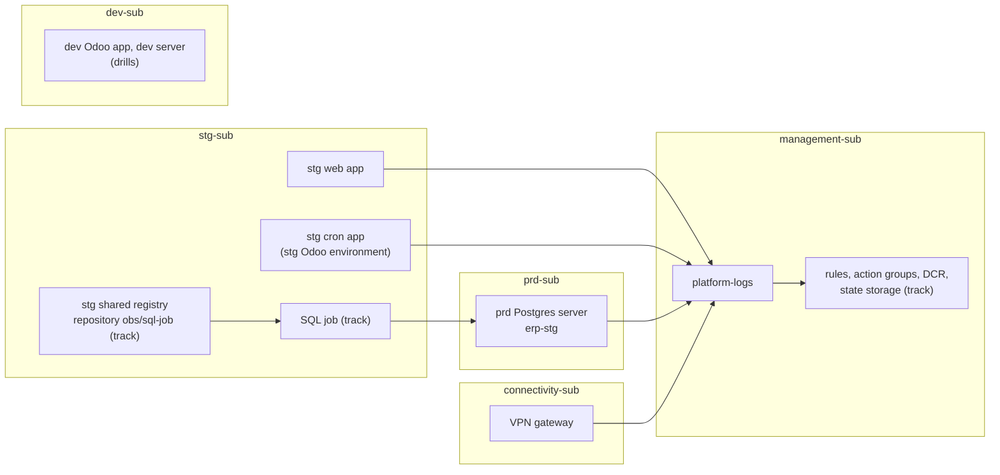

# The platform the track watches

What the client's platform holds for this track: every resource the round 1 rules read or the track adds to, by role, with
the signal that uses it. Facts from the read-only discovery of 2026-11-07.
Servers and apps are named by role ([AGENTS.md](../AGENTS.md#writing)); the logins are in
[AGENTS.md](../AGENTS.md#sessions-and-logins).

**One idea: the track reads from four subscriptions and writes into two, and every client network reaches the prd
Postgres server, so the SQL job can sit beside the stg Odoo apps.**

## Resources by role

| Role | Subscription | Resource group | What the track reads or adds | Used by |
|---|---|---|---|---|
| stg web app (Odoo, 2 vCPU / 4 GiB, 1 to 2 replicas, nginx sidecar) | `stg-sub` | `erp-stg-rg` | `Requests`, `RestartCount` metrics; nginx lines in `ContainerAppConsoleLogs_CL`; system log | L2, L7, M1 |
| stg cron app (every scheduled task and queue job, 2 vCPU / 4 GiB) | `stg-sub` | `erp-stg-rg` | `RestartCount`; system log | L7, M2 |
| stg Odoo environment (hosts the cron app) | `stg-sub` | `erp-stg-rg` | **Adds** the SQL job, in a track resource group | [D5](design.md#decisions) |
| stg shared container registry | `stg-sub` | `shared-stg-rg` | **Adds** the repository `obs/sql-job` and a Repository Reader assignment limited to it (the registry is in ABAC mode, `AbacRepositoryPermissions`, 2026-11-08) | [D12](design.md#decisions) |
| prd Postgres server (General Purpose D2ds_v5, PG 17; 20 databases, among them `erp-stg`; `erp-prd` not in use) | `prd-sub` | `database-prd-rg` | `PGSQLServerLogs`; metrics; `queue_job` and `ir_cron` through the monitoring role (**adds** the role) | L1, L5, L6, M3 to M5 |
| VPN gateway and its site-to-site connection (IKEv2, Azure's default policy) | `connectivity-sub` | `network-rg` | `TunnelDiagnosticLog`, `IKEDiagnosticLog` | L3, L4 |
| Shared Log Analytics workspace (pay-as-you-go, 730 days, no cap) | `management-sub` | `monitor-rg` | Every log rule; **adds** three custom tables | All log rules |
| The track's own resources | `management-sub` | A track resource group | **Adds** rules, action groups, the Logic Apps, the DCR, the state storage | [D6](design.md#decisions), [D13](design.md#decisions) |
| dev Odoo app (1 vCPU / 2 GiB), dev shared environment, dev Postgres server (Burstable B1ms) | `dev-sub` | `erp-dev-rg`, `shared-dev-rg`, `database-dev-rg` | The same signals, for drills; **adds** the dev SQL job and the role | [D1](design.md#decisions) |

## What the track has added

`bash tools/obs.sh inventory` lists it live, from Resource Graph and the workspace; the removal of each piece is the
[spec's teardown inventory](specs/round-1.md#teardown). **REAL**, 2026-11-08 (round 1 live on stg since 07:25 UTC, round 2 since 10:42 UTC; dev idle but R1):

| Subscription | Resource group | What | Names |
|---|---|---|---|
| `management-sub` | `erp-mgmt-obs-rg` (the track's) | The group itself; the state storage account | `obstfstate` (container `tfstate`) |
| `management-sub` | `erp-mgmt-obs-rg` | 4 action groups | `erp-mgmt-obs-{dev,stg}-{page,ticket}-ag` |
| `management-sub` | `erp-mgmt-obs-rg` | 2 Logic Apps (the Teams card) | `erp-mgmt-obs-{dev,stg}-teams-logic` |
| `management-sub` | `erp-mgmt-obs-rg` | The data collection rule | `erp-mgmt-obs-sqljob-dcr` |
| `management-sub` | `erp-mgmt-obs-rg` | dev's 16 log rules and 4 metric rules (disabled outside drills, but R1, the dev view refresh) | `obs-dev-L1-wait` ... `obs-dev-H`, round 3's `obs-dev-SLO-fast`, `-SLO-slow`, `obs-dev-M3` to `M5`, `obs-dev-M-restarts-app1` |
| `management-sub` | `erp-mgmt-obs-rg` | stg's 16 log rules and 5 metric rules (**enabled**) | `obs-stg-L1-wait` ... `obs-stg-H`, round 2's `obs-stg-Q1`, `-T1`, `-O1`, round 3's `obs-stg-SLO-fast`, `-SLO-slow`; `obs-stg-M3` to `M5`, `obs-stg-M-restarts-app1`, `-app2` |
| `management-sub` | `monitor-rg` (the platform's workspace) | 5 custom tables, Analytics plan, the workspace's 730-day retention | `OdooQueue_CL`, `OdooCron_CL`, `OdooHeartbeat_CL`, round 2's `OdooTables_CL`, `OdooLog_CL` |
| `dev-sub` | `erp-dev-obs-rg` (the track's) | The group; the SQL job and the log reader (manual trigger: drills only); their identity | `erp-dev-obs-sqljob-caj`, `erp-dev-obs-logscan-caj` (the share's `log` folder, read-only storage), `erp-dev-obs-sqljob-uami` |
| `stg-sub` | `erp-stg-obs-rg` (the track's) | The group; the SQL job and the log reader (every 5 min); their identity | `erp-stg-obs-sqljob-caj`, `erp-stg-obs-logscan-caj` (the share's `log` folder, mount option `ro`), `erp-stg-obs-sqljob-uami` |
| `stg-sub` | `shared-stg-rg` (the platform's registry) | The image repository | `obs/sql-job:r2e-20261108` only, the image all four jobs run (the unused `r1` to `r2d` deleted 2026-11-08) |

Role assignments the track made:

| Subscription | Role | On | To |
|---|---|---|---|
| `management-sub` | Storage Blob Data Contributor | the state account | the owner's login (Terraform state) |
| `management-sub` | Monitoring Metrics Publisher | the DCR | each job's identity (dev, stg) |
| `stg-sub` | Container Registry Repository Reader, conditioned to `obs/sql-job` | the stg registry | each job's identity (dev, stg) |

Outside Azure's resources: the role `obs_monitor` on the dev server and on the prd server, with `SELECT` on `queue_job`
and `ir_cron` in `erp-dev` and `erp-stg` ([learn](learn/postgres-roles.md)). Still held by Azure after a delete: the first state account,
`obstfstate`, soft-deleted with clean tags until about 2026-11-22.

## What connects them

| Fact (2026-11-07) | So |
|---|---|
| A hub VNet in `connectivity-sub` peers with every environment's VNet, and the prd VNet also peers directly with stg, dev, management and shared; no firewall, route table or NSG in between | The stg Odoo environment reaches the prd server's private endpoint |
| Every VNet resolves through the hub's DNS resolver; the Postgres private DNS zone lives in the hub | The job uses the server's normal name |
| The Postgres servers also allow a few single public addresses (the office) | The owner's laptop reaches them from the office without the VPN |
| The admin login of each Postgres server is a secret in the platform's Terraform key vaults (dev and stg in `erp-mgmt-terraform-rg`, prd in `terraform-rg`); the Odoo database owner's login is in each Odoo app's secrets (owner, 2026-11-08). On dev, the admin is a member of the owner's role (2026-11-08) | `sql/` runs as the admin; the owner's login is a fallback, read only with the owner's go, since the app's secrets hold other plain values |
| stg's database moved to the prd server on 2026-08-27; lock-wait logging began 2026-08-25 (stg server) and 2026-08-27 (prd server) | Backtests read the stg server's rows before that date and the prd server's after |

## What exists today for alerting

One Service Health activity-log alert per subscription (dev, stg, prd), pushing to one person's Azure mobile app; no
metric alert, log alert, workbook or data collection rule anywhere (2026-11-07).
