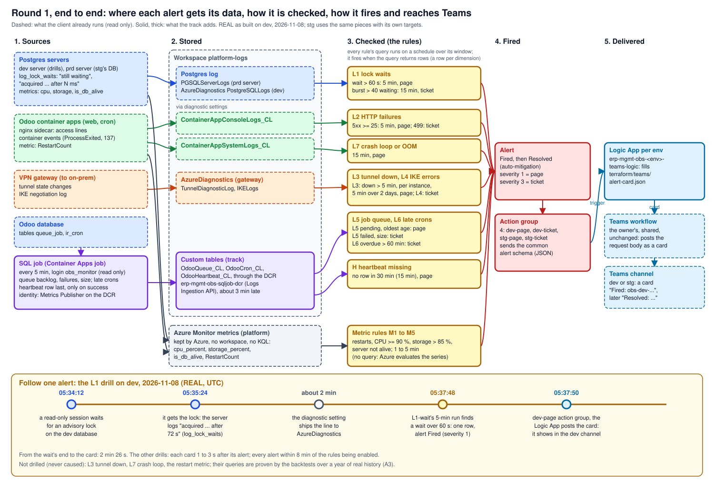

# Round 1: alerts on the client's live ERP

The story of round 1 in one read: what it built, the proof, what it cost, what it taught. It links to the
[spec](../specs/round-1.md), the [runbooks](../runbooks/README.md)
and the [learn pages](../learn/README.md), and copies none of them. Written 2026-11-08, the day round 1 went live on stg.

## 1. Round 1 in one picture

**One idea: the client's ERP already sent most of what its 13 incidents left behind to Azure, and nothing read it; round 1 adds
the reading (16 rules on stg, one small read-only SQL job for what lives only in Odoo's tables) and the delivery (a
Teams card a few seconds after an alert), proven on a year of history, on drills, and on stg's live data.**

The same flow, stage by stage, with one alert followed from a real lock wait to its card:
[learn: alert-flow](../learn/alert-flow.md#the-whole-flow).

## 2. What it delivered

| Check ([spec](../specs/round-1.md#acceptance)) | Evidence (REAL, 2026-11-08 unless dated) | Where |
|---|---|---|
| A1 the monitoring role | On dev and on the prd server: SELECT on `queue_job` (103,955 and 781,658 rows) and `ir_cron` only; writes and other tables refused; read only, 10 s, 1 s; granted by the tables' owner role | [deploy, step 6 and S3](../runbooks/deploy.md#6-the-monitoring-role) |
| A2 the dev job | 12 runs, all `Succeeded`; database time 50.6 ms average, 89.4 ms at most; 8,415 billed bytes a run (about 73 MB a month, half the estimate); accepted by the owner on these runs ([D17](../design.md#decisions)) | |
| A3 backtests | Each rule file, over the workspace's history (2025-11 to 2026-11), fires on the incidents' dates: 91 bins of 5xx (August 75), 23 tunnel outages, the August lock waits | [backtests](../runbooks/backtests.md#verify-end-to-end) |
| A4 drills | 11 rules made to fire on dev (lowered values; L1 by a real 72 s advisory-lock wait); 11 cards, each 1 to 3 s after its alert; 5-min rules within 8 min, 15-min rules within 16 | [drills](../runbooks/drills.md#verify-end-to-end) |
| A5 heartbeat | The dev job stopped: H fired 35 min 41 s after the last heartbeat, its card 3 s later | [drills](../runbooks/drills.md) |
| A6 Terraform boundary | Every plan lists only the track's resources; second plans read `No changes` (dev, stg, shared) | [deploy](../runbooks/deploy.md#verify-end-to-end) |
| A7 stg | The role, the job and the 16 rules live since 07:25 UTC; a preflight on stg's live data before enabling: every page rule quiet, L6 a known ticket (below); the 24 h run on after the build ([D17](../design.md#decisions)). **Fails** on one false page (the 24 h to 2026-11-09 07:25 UTC, read at 09:30, rules `obs-stg-*`, now 22 with rounds 2 to 5): 7 alerts. L6's ticket at 07:38 (Odoo's Auto-vacuum task stopped, still open), a catch; quiet until 2026-11-09 02:15, when the cron app's probes timed out and Azure killed it: `M-restarts` ticketed it at 02:19, a catch, and **L7 paged at 02:23, a false page**: the restart's 9 exit records in 13 s passed L7's crash-loop count (3); the ERP team then deployed both apps three times (02:32, 02:58, 04:41): E1 ticketed at 02:37 and 04:52 (the 02:58 deploy fell inside the open alert), catches; 585 sync jobs failed from 03:00 to 03:10, after the second deploy: L5-ticket at 03:08, a catch. Every card 2 to 5 s after its alert. At 15 h 31 min the reading had seen only L6. **The rerun passes** after [round 6](round-6.md) fixed L7 (24 h from 2026-11-10 07:46 UTC, read 2026-11-14): 10 alerts, each a catch; its 3 pages were L7 on a deploy's crash loop and L5-page twice on a queue running hours behind | [deploy, On stg](../runbooks/deploy.md#on-stg), rerun |
| A8 load | The stg job's first 7 runs: 15.9 ms of database time on average, 23.2 ms at most, on the shared prd server (the budget: 1 s) | [deploy, On stg](../runbooks/deploy.md#on-stg) |
| A9 cost | Estimated about $12 a month against $20 ([spec](../specs/round-1.md#cost)); the 7-day Cost Management check runs on | |
| A10 teardown | `plan -destroy` of the three roots lists all 57 Terraform rows; the role, the image repository and the state storage have their own steps; the three tables wait for the platform's lock | [spec, teardown](../specs/round-1.md#teardown) |

**The first real catch:** the preflight found stg's "Base: Auto-vacuum internal data", Odoo's daily cleanup, 73.4 h
late (dev's, 47.8 h); once enabled, L6 ticketed it at 07:38:26 UTC and its card reached the stg channel 1 s later.
Nothing else fired in the first 27 min on stg, and the job ran 7 times, all `Succeeded`, at 15.9 ms of database time on
average (23.2 ms at most).

## 3. What runs, and who installed it

| What | Where | Installed by |
|---|---|---|
| 4 action groups, 2 Logic Apps, the DCR, the state storage | `erp-mgmt-obs-rg`, `management-sub` | `terraform/envs/shared`, `terraform/state-storage.sh` |
| 3 custom tables | The platform's workspace `platform-logs` | `terraform/envs/shared` |
| 16 stg rules (enabled), 15 dev rules (disabled) | `erp-mgmt-obs-rg` | `terraform/envs/stg`, `terraform/envs/dev` |
| The SQL job and its identity, per environment | `erp-stg-obs-rg` (every 5 min), `erp-dev-obs-rg` (drills only) | the same roots |
| The image `obs/sql-job:r1-20261108` | The stg shared registry | `bash tools/obs.sh push` |
| The role `obs_monitor` | The dev server and the prd server | `bash tools/obs.sh role` |

Live list: `bash tools/obs.sh inventory` ([platform](../platform.md#what-the-track-has-added)).

## 4. Who does what

| Piece | Its job | Learn |
|---|---|---|
| Log search rules | Run a KQL file on a schedule; fire on rows | [azure-monitor-alerts](../learn/azure-monitor-alerts.md) |
| Metric rules | Compare a platform metric with a threshold | [azure-monitor-alerts](../learn/azure-monitor-alerts.md#the-rule-types-each-on-a-real-client-signal) |
| The SQL job (Container Apps job) | Copy `queue_job` and `ir_cron` facts into the workspace every 5 min; a heartbeat when all went well | [alert-flow](../learn/alert-flow.md#the-sql-job-and-the-dcr-the-two-pieces-that-make-data), [container-apps-jobs](../learn/container-apps-jobs.md) |
| The DCR | The gate into exactly three tables | [logs-ingestion-api](../learn/logs-ingestion-api.md) |
| `obs_monitor` | The job's login: two tables, read only, short | [postgres-roles](../learn/postgres-roles.md) |
| Action groups and Logic Apps | Turn an alert into an Adaptive Card for the owner's Teams workflows | [azure-monitor-alerts](../learn/azure-monitor-alerts.md#from-the-alert-to-a-teams-card-why-a-logic-app-sits-between) |
| `tools/obs.sh` | Every live operation as one command; `audit` for the no-GitHub rule | [runbooks](../runbooks/README.md#the-operations-script-toolsobssh) |

## 5. The decisions that shaped it

| Decision | The reason that mattered |
|---|---|
| [D1](../design.md#decisions) stg watched, dev rehearsed | Every rule fired on dev first; stg's rules went on only after a preflight |
| [D2](../design.md#decisions) no change to Odoo | Every signal from outside: logs, metrics, a read-only SQL login |
| [D5](../design.md#decisions) the SQL job | The queue and the scheduled tasks exist only as rows in Odoo's database |
| [D10](../design.md#decisions) proof in three steps | A backtest proves the query, a drill the path, a real catch the value |
| [D11](../design.md#decisions) a Logic App per environment | The owner's Teams workflows are shared and post the body as a card |
| [D12](../design.md#decisions) the image in the stg registry | No new registry; the registry's ABAC mode set the pull role |
| [D17](../design.md#decisions) a concept car | Built, proven and documented end to end; the long windows run on; the quality bar does not move |

## 6. What we learned

| Lesson | Row |
|---|---|
| Strip a value before deleting the resource: a soft-deleted storage account kept the repo's tag; check every place a value was written (the method's new rule) | [known-failure-modes](../known-failure-modes.md) |
| A failed plan must not leave the previous plan to apply | same |
| An ABAC-mode registry ignores AcrPull | same |
| A Teams webhook workflow wants an Adaptive Card, not Azure's JSON; `-` renders as a bullet | same |
| An apply can leave the state blob's lease behind | same |
| A `:` in a password breaks `pgpass` unless escaped | same |
| A log alert accepts no 20-min window (H became 30); the platform's workspace lock keeps our tables | same |
| A count of events is not a count of incidents: one container restart logs 3 to 9 `ProcessExited`, so L7's crash-loop count paged a single restart (A7's false page; 11 of its 18 bins over the count were one restart) | A7's final reading | [row](../known-failure-modes.md) |

## 7. What the next round inherits

- Live: 16 rules on stg, the job every 5 min, cards in the stg channel; dev idle for drills.
- Running on (D17): A9's 7-day cost, O4's threshold tuning from real catches. A7's rerun passed (2026-11-14) after
  [round 6](round-6.md) fixed L7's condition, which counted exit records where it meant restarts.
- Tools: `obs.sh` (plan with the repo-trace scan, audit, drills, inventory), `kql/backtest.py --param` for drills.
- Round 2's ground ([roadmap](../design.md#roadmap)): query cost, autovacuum logging, Odoo's own log file (the
  2026-09-09 OOM loop that left no trace), then the Kubernetes mapping and the case study.

## 8. Catch up in order

1. [design: context and decisions](../design.md) and [D17](../design.md#decisions)
2. [learn: alert-flow](../learn/alert-flow.md), the whole picture
3. [spec: round 1](../specs/round-1.md), signals to acceptance
4. [runbooks: deploy](../runbooks/deploy.md), [drills](../runbooks/drills.md), [backtests](../runbooks/backtests.md)
5. [platform: what the track has added](../platform.md#what-the-track-has-added)
