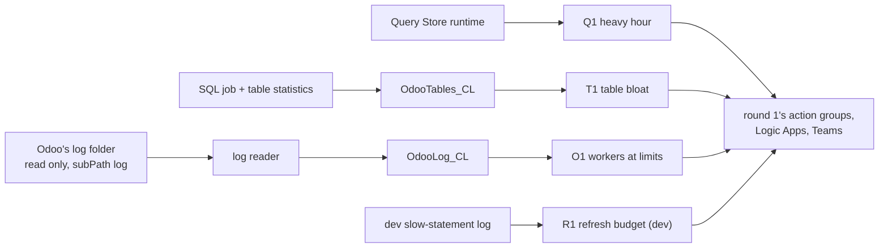

# Round 2: query cost, table bloat, Odoo's own log

The story of round 2 in one read: what it added to round 1, the proof, what the real data corrected, and what is left
open. It links to the [spec](../specs/round-2.md), the [runbooks](../runbooks/deploy.md#round-2) and the learn pages, and copies none of them. Written 2026-11-08, the day
round 2 was specified, built and enabled on stg ([D17](../design.md#decisions)). Before it: [round 1](round-1.md).

## 1. Round 2 in one picture

**One idea: round 1 read what the client's platform already logs; round 2 reads three things nothing read: what each hour of
queries costs stg's database (already in the workspace), which tables autovacuum is losing (one more query in the SQL
job), and what Odoo itself writes when a worker hits a limit (a read-only reader of Odoo's log folder); and on the way the
real data corrected the design twice.**

The whole flow, round 1 included: [learn: alert-flow](../learn/alert-flow.md#the-whole-flow).

## 2. What it delivered

| Check ([spec](../specs/round-2.md#acceptance)) | Evidence (REAL, 2026-11-08) |
|---|---|
| B1 learn and spec | Four learn pages and sections; the spec approved as written, then corrected twice by the data (below) |
| B2 table statistics | 20 table rows a run on dev and stg as `obs_monitor`, no new grant |
| B3 read only | `write refused (OSError: Read-only file system)` on dev (read-only storage, and read-write storage with `ro`) and on stg; only `log/` visible |
| B4 O1 backtest | stg's files from 2026-10-31: 0 bins; dev's 3.9 GB: 0 bins of stated limits (21 of inferred kills, not alerted); 2026-09-09 predates both |
| B5 Q1, R1 backtests | Q1: the 7 heavy hours of 30 days, each one query family (the 14:00 batch); R1: 2026-11-05 03:30, 1,712 s |
| B6 drills on dev | T1 10:40:06 (2 tables), R1 10:44:36, O1 10:45:47 (its path); each card 1 to 2 s later |
| B7 stg | Q1, T1, O1 quiet on stg's live data, enabled at 10:42 UTC; `obs.sh audit` clean over 51 resources |
| B8 teardown | `plan -destroy`: 67 Terraform rows (stg 26, dev 25, shared 16), every round 2 row among them |

**Findings for the ERP team, from round 2's data:** one query family uses about 3 hours of database time a day on stg
(`-2426753535470534697`, 17,023 calls at 4.6 s); stg's Odoo log has been **empty since its rotation at 05:00 UTC
today** (the file handler does not reopen; discovery saw `reopenIfNeeded` errors), so O1 is blind on stg until Odoo
writes again (it did from 17:20 that day, in bursts: handover); `sync_map` carries 327,460 dead rows and was never autovacuumed (17.9 %, under T1's 25 %).

## 3. What runs, and who installed it

Round 1's pieces ([round 1, section 3](round-1.md#3-what-runs-and-who-installed-it)) plus: the tables `OdooTables_CL` and
`OdooLog_CL` and their streams (`envs/shared`); the log reader jobs `erp-dev-obs-logscan-caj` (manual) and
`erp-stg-obs-logscan-caj` (every 5 min) beside the SQL jobs (the `sql-job` module); Q1, T1, O1 on stg, R1 on dev (the
alerts module, rules per environment); the image `obs/sql-job:r2e-20261108`. Live list: `bash tools/obs.sh inventory`.

## 4. Who does what

| Piece | Its job | Learn |
|---|---|---|
| Query Store's runtime rows | Cost per query and hour, already in the workspace | [postgres-query-stats](../learn/postgres-query-stats.md#the-stg-database-hour-by-hour) |
| `pg_stat_user_tables` | Dead rows and the last autovacuum per table | [postgres-autovacuum](../learn/postgres-autovacuum.md) |
| The log reader | Reads the last 5 min of Odoo's log, counts worker ends, sends counts | [odoo-logs](../learn/odoo-logs.md), [one folder of a share](../learn/container-apps-jobs.md#reading-one-folder-of-a-file-share) |

## 5. The decisions that shaped it

| Decision | The reason that mattered |
|---|---|
| Query cost from Query Store, no `pg_read_all_stats` | The runtime is already in the workspace; the SQL text stays on the server |
| Table statistics, not the autovacuum log (owner) | They say which table is losing; the log stays off, the default |
| The log reader mounts `log/` only, read only | Never the share's `config/` with Odoo's secrets; proven read only before stg |
| R1 the one rule on in dev | The view refresh exists only on dev |
| O1 pages only on limits Odoo states | The data showed an `unregistered` worker is not proof of a kill (below) |

## 6. What we learned

| Lesson | Where |
|---|---|
| A changed DCR's new streams are rejected for a while (`InvalidStream`, 10 to 31 min): test one dev run before deploying the writers; stg's SQL job was rolled back in time, no page | [known-failure-modes](../known-failure-modes.md) |
| Odoo's graceful shutdown unregisters every worker without their exit: 200 false "kill" bins on dev until excluded | [odoo-logs](../learn/odoo-logs.md#what-a-workers-end-looks-like) |
| Even then, an `unregistered` worker kept logging: inferred kills are counted, not alerted, until understood | same |
| `az containerapp job start` with a command override drops the job's environment, and takes leading dashes as its own options | [known-failure-modes](../known-failure-modes.md) |
| Chaining plan and apply is stopped by the safety check: each plan shown, then applied | |
| Reading a storage account key to peek at files is credential exploration: the reader's own read-only mount answered instead | same |

## 7. What the next round inherits

- O1's inferred kills, for the ERP team's reading; stg's empty log after rotation, for the ERP team to fix; then the
  2026-09-09-style silent kill can be alerted.
- Q1's culprit query family and T1's near-threshold tables, for tuning (O4) with real catches.
- The roadmap's next stages ([design](../design.md#roadmap)): the Kubernetes mapping, the public case study, DevSecOps,
  Azure to AWS.

## 8. Catch up in order

1. [round 1 review](round-1.md), then this page
2. [spec: round 2](../specs/round-2.md)
3. [learn: Query Store by the hour](../learn/postgres-query-stats.md#the-stg-database-hour-by-hour), [autovacuum](../learn/postgres-autovacuum.md), [Odoo's logs](../learn/odoo-logs.md)
4. [runbook: deploy, round 2](../runbooks/deploy.md#round-2), [drills, round 2](../runbooks/drills.md#round-2s-rules-b6)
