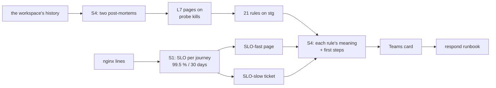

# Round 3: SLOs and incident response

The story of round 3 in one read: S1 measured stg's web app the way its users feel it (an SLO and two burn-rate
alerts); S4 made every alert say what to do, and checked the whole system against two real incidents. It links to the
[spec](../specs/round-3.md), the [runbooks](../runbooks/respond.md), the
[post-mortems](../postmortems/README.md) and the learn pages, and copies none of them. Written 2026-11-08, the day both
stages were built and enabled on stg ([D17](../design.md#decisions)). Before it: [round 2](round-2.md).

## 1. Round 3 in one picture

**One idea: rounds 1 and 2 made the system say when something breaks; round 3 makes it say how much users felt it
(the error budget) and what the person reading the card should do next, then writes up two real incidents from the raw
data, which corrected the record and closed a gap no backtest had shown.**

## 2. What it delivered

| Check ([spec](../specs/round-3.md#acceptance)) | Evidence (REAL, 2026-11-08) |
|---|---|
| C1 to C5 (S1) | The SLO and its two rules live on stg since 12:35 UTC: the backtest's 12 page episodes in 90 days, each a real failure; quiet preflight; the dev drill's two cards 2 s after the alert ([slo](../learn/slo.md), [drills](../runbooks/drills.md#round-3s-rules-c4)) |
| C6 teardown | `plan -destroy` (14:14 UTC): 71 rows, shared 16, dev 27, stg 28, the 4 SLO rules among them (round 2's 67 plus these 4) |
| C7 learn and spec | [incident-response](../learn/incident-response.md): severities, roles, first steps, blameless post-mortems, game days, with Google's and PagerDuty's texts checked live; the spec's [incident response](../specs/round-3.md#incident-response) |
| C8 the cards | stg's 21 rules and dev's 20 carry their meaning and first steps (read back from Azure, none says "Round 1", at most 687 of 2,048 or 4,096 characters); dev's card posted with the text during the game day and seen by the owner in dev's channel, the first steps as a numbered list; stg's first new card comes with its next alert |
| C9 the runbook | [respond](../runbooks/respond.md): 16 sections for the 21 rules enabled on stg, each query run once with its real output |
| C10 post-mortems | [2026-08-20](../postmortems/2026-08-20-stg-502-bursts.md) and [2026-09-09](../postmortems/2026-09-09-stg-cron-memory.md), on the method's new template (the lab `90cff8d`) |
| C11 L7's action item | Backtest since 2026-07-11: 204 new bins, all July to September, none since 2026-10-01; as the alert on stg: `quiet` (13:58 UTC) |
| C12 game day | On dev with L1's real 72 s wait: detect 2 min 54 s, notify 3 s, diagnose 30 s from the alert, resolve 18 min 54 s; it found that the log names no lock holder (the runbook now has the live query) and that L1 pages only after a wait ends ([record](../runbooks/respond.md#the-game-day-of-2026-11-08)) |
| C13 stg live | Applied 14:06:54 UTC (21 rules: descriptions, and L7's query); `obs.sh drift` 0 on the three roots; `obs.sh audit` clean over 55 resources; C6's teardown rows unchanged: S4 added no resource |

## 3. What runs, and who installed it

Round 1 and 2's pieces ([round 1](round-1.md#3-what-runs-and-who-installed-it), [round 2](round-2.md#3-what-runs-and-who-installed-it))
plus, from round 3: the rules `obs-<env>-SLO-fast` and `SLO-slow` (the alerts module, both environments; on dev off
outside drills). S4 added no resource: it changed every rule's description (the card's text) and L7's query, and dev's
and stg's Logic App actions (the card file). Live list: `bash tools/obs.sh inventory`.

## 4. Who does what

| Piece | Its job | Learn |
|---|---|---|
| The SLO query | Good and valid requests per journey in 5-min steps, the burn over two windows | [slo](../learn/slo.md#the-map) |
| A rule's description | What the rule means and its first steps; Azure shows it in the portal and the Logic App puts it on the card | [incident-response](../learn/incident-response.md#first-steps-on-the-card) |
| The respond runbook | Everything after the first steps: the queries (`obs.sh kq-env`), past cases, whom to call | [respond](../runbooks/respond.md) |
| A post-mortem | The incident as the data shows it, its contributing causes, the action items | [incident-response](../learn/incident-response.md#blameless-post-mortems) |

## 5. The decisions that shaped it

| Decision | The reason that mattered |
|---|---|
| 99.5 % over 30 days, per journey ([D22](../design.md#decisions)) | August spent 159 to 174 % of that budget, September and October 9 to 23 %; the TVs make 70 % of the requests and would hide people's failures |
| First steps in the rule's description, no link (owner) | Nothing in Azure names the repo; a responder on a phone reads a card faster than a page |
| Post-mortems from the workspace, not from the earlier write-ups | The write-ups were made during the incidents with partial queries; the raw data is still there (since 2026-07-11) |
| L7 pages at 2 probe kills in 15 min, not 1 | Single kills already ticket through M1 and M2; with 1, October alone would have paged 9 times |

## 6. What we learned

| Lesson | Where |
|---|---|
| A burn-rate SLO misses short total outages: the 2026-08-20 morning (197 502s in two minutes) burned 2.7x, under 14.4; L2's raw count pages it, so the two kinds of rule complement each other | [post-mortem](../postmortems/2026-08-20-stg-502-bursts.md#what-the-monitoring-saw-and-would-see-today) |
| A backtest's episode needs a check against the raw lines before it gets a name: the 08-20 TV episode was a different failure from the one it was filed under | [slo](../learn/slo.md#what-90-days-of-backtest-show) |
| A count's start date can be the query's edge: "since 09-09" was `ago(14d)` on 09-23 | [post-mortem](../postmortems/2026-09-09-stg-cron-memory.md#corrections) |
| A warning printed at every start counts starts, not failures; check what a line means before counting it | same |
| Kills after failed probes were invisible to L7: the cause most of the client's kills had | [round 1, L7](../specs/round-1.md#signals) |
| `sync-method.sh push` failed silently on a new file (`git show` of a missing path under `pipefail`) | |
| `-target` through `TF_CLI_ARGS_plan` needs the quotes escaped (`post[\"dev\"]`) | |

## 7. What the next round inherits

- The post-mortems' open action items ([post-mortems](../postmortems/README.md)): for the ERP team, the Sync write out
  of the web request, the 08-20 afternoon and evening explained, stg's Odoo log restored, probe kills against sync
  failures; for the track, a ticket rule on the entrypoint's warnings and deploys on the alert path.
- A7's 24 hours (to 2026-11-09 07:25 UTC), A9's 7 days and O4's tuning, still running on stg.
- The SLO's latency half, once a request time exists ([slo](../learn/slo.md#why-there-is-no-latency-slo-yet)).

## 8. Catch up in order

1. [round 2 review](round-2.md), then this page
2. [learn: slo](../learn/slo.md), [learn: incident-response](../learn/incident-response.md)
3. [spec: round 3](../specs/round-3.md)
4. [post-mortems](../postmortems/README.md): 2026-08-20, then 2026-09-09
5. [runbook: respond](../runbooks/respond.md), [drills, round 3](../runbooks/drills.md#round-3s-rules-c4)
