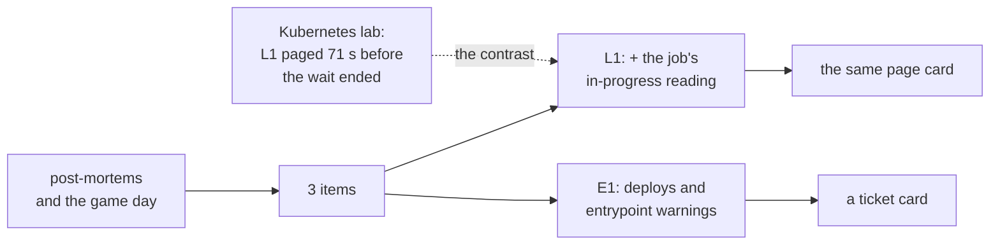

# Round 4: the post-mortems' items, and the same rules on Kubernetes

The story of round 4 in one read: it closed the three action items the post-mortems and the game day left to the track,
and, through the Kubernetes mapping built the same night, showed why one of them mattered. It links to the
[spec](../specs/round-4.md), the [mapping](../specs/kubernetes-mapping.md), the runbooks
([deploy](../runbooks/deploy.md#round-4), [drills](../runbooks/drills.md#round-4s-rules-f4-f5),
[respond](../runbooks/respond.md#e1-a-deploy-or-an-entrypoint-warning), [the lab](../runbooks/kubernetes-lab.md)) and the learn pages, and copies none of them. Written
2026-11-09, after stg went live. Before it: [round 3](round-3.md).

## 1. Round 4 in one picture

**One idea: Azure's L1 learned of a lock wait only from the log line written when it ends; the same rule on Prometheus
paged during the wait because it samples the state, so round 4 gave Azure a sample too (the SQL job reads
`pg_locks.waitstart` every 5 minutes, with no new grant), and put deploys and the entrypoint's warnings on the alert
channel with one new rule.**

## 2. What it delivered

| Check ([spec](../specs/round-4.md#acceptance)) | Evidence (REAL, 2026-11-08, UTC) |
|---|---|
| F1 spec | Approved under the plan of 2026-11-08; changed twice before its code, each in its own commit: L1's window to 10 min (the job's rows land after the run), and F5's drill by a window override (Azure runs a log alert's query only over its window) |
| F2 the job reads waits in progress | A dry run as `obs_monitor` during a held lock on dev: `lock_wait` Count 1, 73.7 s; no grant changed |
| F3 E1's backtest | stg, 90 days: the entrypoint warning from 2026-08-20 to 09-23 and every deploy; one card per bin, 32 in October (about one deploy a day); quiet as the alert |
| F4 L1 during the wait, on dev | A 418 s wait: the page at 16:28:10, **3 min 20 s before the wait ended**, its card 9 s later |
| F5 E1 on dev | Fired at 16:59:26 on dev's last real deploy through the 2-day drill window; card 1 s later |
| F6 stg live | Applied 17:01:40 to 17:02:13; stg's next run `JobVersion` 3, 28.2 ms of database time; drift 0; audit clean over 57 resources |
| F7 teardown | `plan -destroy`: 73 rows (round 3's 71, plus E1 on dev and stg) |
| On stg since (read 2026-11-08 22:56) | 70 runs of `JobVersion` 3, every `lock_wait` row `Count` 0, 166.9 ms of database time at most; the log's waits in the same hours: three 5-min bins (16:00, 17:15, 17:20), each ended at 10 s or less by Odoo's role's `lock_timeout`, under L1's 60 s; L1-wait and L1-burst quiet; E1 quiet, with nothing to see: stg's last deploy was 2026-11-06 09:25, and no entrypoint warning; the stg Logic App's last run L6's card at 07:38 |

## 3. What runs, and who installed it

Rounds 1 to 3's pieces ([round 3](round-3.md#3-what-runs-and-who-installed-it)), plus: the job image `r4-20261108`
(both jobs), the rule `obs-<env>-E1` (the alerts module, both environments; off on dev outside drills), and L1-wait's
new query and 10-minute window. No grant, setting, table or stream was added. Live list: `bash tools/obs.sh inventory`.

## 4. Who does what

| Piece | Its job | Learn |
|---|---|---|
| The job's `pg_locks` query | The longest wait in progress in its own database, every run | [prometheus-loki](../learn/prometheus-loki.md#three-rules-side-by-side) |
| L1-wait | Pages on a finished wait (the log) or a wait in progress (the job), the same card | [respond, L1](../runbooks/respond.md#l1-wait-and-l1-burst-lock-waits) |
| E1 | A deploy or an entrypoint warning, one ticket card per 15 minutes | [respond, E1](../runbooks/respond.md#e1-a-deploy-or-an-entrypoint-warning) |

## 5. The decisions that shaped it

| Decision ([D26](../design.md#decisions)) | The reason that mattered |
|---|---|
| `pg_locks.waitstart`, not `pg_stat_activity`'s wait columns | The second hides other users' waits from a role without `pg_read_all_stats`; the first is readable by every role, so the shared prd server needed no new grant |
| The queue table's generic columns | A new stream is refused for up to 31 minutes after a DCR change (round 2's incident) |
| L1 extended, E1 shared by deploys and warnings | D8's $20: rounds 1 to 3 cost about $19; round 4 adds $0.50 |
| A drill override of a rule's window | The real events (a deploy, a restart) are the ERP team's to make; the override reaches a real past one |

## 6. What we learned

| Lesson | Where |
|---|---|
| Azure runs a log alert's query only over the rule's window: a lookback inside the query cannot see further | [drills, round 4](../runbooks/drills.md#round-4s-rules-f4-f5) |
| A rule on rows a job writes needs a window longer than the job's interval plus its ingestion delay (L5 had it, L1 did not) | [spec](../specs/round-4.md#1-l1-while-the-wait-lasts) |
| Sampling a state pages during an incident; reading an event pages after it. The Kubernetes lab made the difference visible | [mapping](../specs/kubernetes-mapping.md#the-rules) |
| Odoo's own `limit_time_real` (120 s) ended the lab's longest lock wait: a long wait becomes a worker limit, the pattern behind O1 | [learn](../learn/prometheus-loki.md#met-in-the-lab) |
| An apply can change Azure and fail to save the state; the network to the state's storage dropped twice that night | [known failure modes](../known-failure-modes.md) |
| An exported variable (`PGPASSWORD`) overrides a service's password file for every psql the script starts | [deploy, R4-1](../runbooks/deploy.md#r4-1-the-image-and-a-dry-run-as-the-role) |
| On stg, Odoo's role cannot wait past 10 s (`lock_timeout`): a wait becomes a cancelled try, which Odoo retries up to 5 times before the request fails; no rule counts them; the in-progress reading pages only another session's wait (read 2026-11-09) | [spec](../specs/round-4.md#1-l1-while-the-wait-lasts) |

## 7. What the next round inherits

- The ERP team's open items from the post-mortems and the DevSecOps findings.
- A wait of 1 to 5 minutes is still seen by the job only by chance (it runs every 5 minutes); the log still pages it
  when it ends. On stg this matters less than it looked: Odoo's role's waits end at 10 s.
- The lock-timeout cancellations on stg (4,672 in 30 days, up to 674 a day), watched by no rule.
- E1's first real deploy on stg, and its card, still to come.
- A7's 24 hours (closing 2026-11-09 07:25 UTC), A9's 7 days and O4's tuning, still running on stg.

## 8. Catch up in order

1. [round 3 review](round-3.md), then this page
2. [spec: round 4](../specs/round-4.md), [spec: Kubernetes mapping](../specs/kubernetes-mapping.md)
3. [learn: prometheus-loki](../learn/prometheus-loki.md)
4. [runbooks: deploy, round 4](../runbooks/deploy.md#round-4), [drills, round 4](../runbooks/drills.md#round-4s-rules-f4-f5), [the lab](../runbooks/kubernetes-lab.md)
