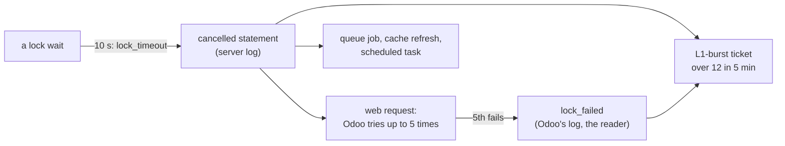

# Round 5: lock timeouts, and round 2's rules on Kubernetes

The story of round 5 in one read: a reading after round 4 showed that stg's lock waits never reach L1's 60 s, because
Postgres cancels them at 10 s, and nothing watched the cancellations; this round put them on the alert path, found out
what they cost, and the same night finished the Kubernetes mapping with round 2's three rules. It links to the
[spec](../specs/round-5.md), the [mapping](../specs/kubernetes-mapping.md), the runbooks
([deploy](../runbooks/deploy.md#round-5), [drills](../runbooks/drills.md#round-5s-rule-g3),
[respond](../runbooks/respond.md#l1-wait-and-l1-burst-lock-waits), [the lab](../runbooks/kubernetes-lab.md)) and the learn pages, and copies none of them. Written
2026-11-09. Before it: [round 4](round-4.md).

## 1. Round 5 in one picture

**One idea: a lock problem on stg shows up as statements Postgres cancels at 10 s, not as long waits; the first
guess (each one a user's lost save) was wrong twice over, and measuring it (Odoo's retry code, Odoo's own log, a probe
by logger) showed they are mostly queue jobs rescheduled and a cache refresh cancelled; so the ticket counts them as
contention and pages nobody, and a request a user really lost is its own count.**

## 2. What it delivered

| Check ([spec](../specs/round-5.md#acceptance), [mapping](../specs/kubernetes-mapping.md#acceptance)) | Evidence (REAL, 2026-11-08 and the first minutes of 11-09, UTC) |
|---|---|
| G1 spec | Approved before the build; corrected twice before stg by what the data showed (below) |
| G2 backtest | L1-burst over the workspace's history on stg (from 2025-11-01; the cancellations begin 2026-08-27): the old condition 0 bins (40 waiting lines in 5 min never happened); the new 10 bins on 5 days, 5 of them on 2026-10-10, the peak day (674 cancellations); L1-wait unchanged at A3's 3 bins |
| G3 drill on dev | Fired 23:48:31 on dev's real cancellations of 11-07 through a 2-day window; card 2 s later |
| G4 stg preflight | L1-burst and L1-wait as the alert: `quiet` |
| G5 stg live | Applied 23:52:13 to 23:52:56; both jobs ran on the new image at 23:55 and 00:00 (heartbeat 39 ms at most) |
| G6 teardown | `plan -destroy`: 16 + 28 + 29 = 73 rows, unchanged from round 4 |
| G7 the reader's kinds | 3 unit tests in CI; `retries` over stg's rotated files (10-31 to 11-07): 0 of every kind; dev since 10-01: 23 lock retries, 35 others, none failed |
| K8 Q1 in the lab | 16 statements of 360 s: the ticket 26 s after they ended (105 min in the hour) |
| K9 T1 in the lab | 120,000 dead rows: the ticket 18 s after |
| K10 O1 in the lab | A 240 s lock hold and three waiters: Odoo's four limit lines, the page 69 s after; Grafana's 10 panels, open for the owner on `localhost:3300` |

## 3. What runs, and who installed it

Round 4's pieces ([round 4](round-4.md#3-what-runs-and-who-installed-it)), with the job image `r5-20261109` (both jobs)
and L1's new query and card. No grant, setting, table, stream or rule was added. On dev, L1-burst and E1 were left
enabled at their real values only until their drill alerts resolved, then disabled. Live list: `bash tools/obs.sh
inventory`.

## 4. Who does what

| Piece | Its job | Learn |
|---|---|---|
| L1-burst's new count | Statements cancelled by the 10 s lock timeout, more than 12 in 5 min: heavy contention, a ticket | [postgres-locks](../learn/postgres-locks.md#the-map) |
| The reader's four kinds | Odoo's retry and failure lines, from `odoo.service.model` only | [postgres-locks](../learn/postgres-locks.md#what-odoo-does-with-the-cancellation) |
| L1-burst's `Failed` | Any request Odoo gave up after 5 tries: a user saw an error | [respond](../runbooks/respond.md#l1-wait-and-l1-burst-lock-waits) |
| Q1, T1, O1 on Kubernetes | Round 2's rules on Prometheus and Loki, drilled to the sink | [prometheus-loki](../learn/prometheus-loki.md#three-rules-side-by-side) |

## 5. The decisions that shaped it

| Decision ([D27](../design.md#decisions)) | The reason that mattered |
|---|---|
| Into L1-burst, no new rule | D8's $20 had $0.50 left; one rule, card and runbook section for lock trouble |
| A ticket, not a page | A cancellation stalls work; on stg it is almost never a user's save |
| The reader counts Odoo's own retry lines | The server's log cannot say whether a user lost anything; Odoo's can |
| A faster lock reading dropped | Odoo's own waits cannot pass 10 s on stg |

## 6. What we learned

| Lesson | Where |
|---|---|
| A count is not a cost: 4,672 cancellations read as "4,672 failed writes" until Odoo's retry code and its own log said otherwise | [postgres-locks](../learn/postgres-locks.md#web-requests-or-background-work-real-2026-11-09) |
| An empty count is a finding too: no retry line in a DEBUG log means the statements were not web requests | [postgres-locks](../learn/postgres-locks.md#web-requests-or-background-work-real-2026-11-09) |
| A disabled rule never resolves its alert, not even once enabled again: bring a drilled rule back to its real values while enabled, wait for `Resolved`, then disable | [drills, round 5](../runbooks/drills.md#round-5s-rule-g3), [learn](../learn/azure-monitor-alerts.md#how-long-a-fired-alert-takes-to-resolve) |
| Tracking a private file put its name in the exported `.gitignore`; the export's search stopped it | [known failure modes](../known-failure-modes.md) |
| A drill must outlast the system's own check: Odoo's threaded server checks its limits every 60 s | [the lab](../runbooks/kubernetes-lab.md#4-drills) |
| `az` parses a leading-dash value as its own option; `"-c<code>"` passes it whole | [deploy, R5-1](../runbooks/deploy.md#r5-1-the-image-and-the-retries-on-the-share) |

## 7. What the next round inherits

- For the ERP team: the hot rows of the add-on's spreadsheet change log, which its own code calls insert only but also
  prunes; the cache refresh cancelled at 10 s; queue jobs postponed about 100 times a day.
- The reader could count queue_job's `postponed` lines too (background work's own retry).
- stg's Odoo log was empty from 2026-11-08 05:00 to 17:20 and is written in bursts since: until fixed, `lock_failed`
  and O1 see only part of stg's lines.
- Round 1's last checks ([acceptance](../specs/round-1.md#acceptance)): A7, 24 h on stg without a false page, failed on
  one (L7 paged a single restart, 2026-11-09 02:23 UTC); A9, the cost after 7 days; and O4, thresholds tuned from real
  catches.

## 8. Catch up in order

1. [round 4 review](round-4.md), then this page
2. [learn: postgres-locks](../learn/postgres-locks.md), [spec: round 5](../specs/round-5.md)
3. [learn: prometheus-loki](../learn/prometheus-loki.md#the-drills-real-times), [spec: Kubernetes mapping](../specs/kubernetes-mapping.md)
4. [runbooks: deploy, round 5](../runbooks/deploy.md#round-5), [drills](../runbooks/drills.md#round-5s-rule-g3), [the lab](../runbooks/kubernetes-lab.md)
