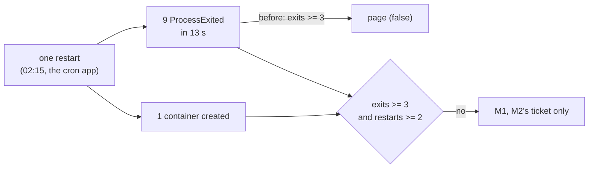

# Round 6: count restarts, not exit records

The story of round 6 in one read. Round 1's 24 h check (A7) failed on one false page, and this round fixed the rule
behind it the next day. On the way it found that the log reader missed every line of stg's file, and that the advice
for a stuck alert was wrong. It links to the [spec](../specs/round-6.md), the runbooks
([deploy](../runbooks/deploy.md#round-6), [drills](../runbooks/drills.md#round-6s-rules-i6-i9),
[respond](../runbooks/respond.md#l7-app-terminations)) and the learn pages, and copies none of them. Written
2026-11-10. Before it: [round 5](round-5.md).

## 1. Round 6 in one picture

**One idea: a rule must count the thing it means. L7 meant "the app keeps restarting" but counted exit records, and
one restart writes 3 to 9 of them; so it paged a single restart on stg (2026-11-09 02:23 UTC). Now the crash loop also
needs 2 restarts, which fires on exactly the 7 real loops of a year.**

## 2. What it delivered

| Check ([spec](../specs/round-6.md#acceptance)) | Evidence (REAL, 2026-11-10 UTC) |
|---|---|
| I1 spec | Revised after the owner asked for a check of the live alerts and a review (the resolve cards added), then approved |
| I2 L7's backtest | Since 2025-11-01: the crash-loop part fires on the 7 loops (3 to 20 restarts each), none of the 11 single restarts; the probe-kill part's 204 bins unchanged |
| I3 A7's replay | The failed 24 h with the new condition: 0 rows |
| I4 E1's revision | 35 deploy bins since 10-10, each naming the new revision (2980, 2981, 2982, 2996), 2 `replacing <old>` |
| I5 the reader's `postponed` | stg 1,010 against a probe's 1,012 lines on the same files (2 glued lines); dev 458. First 0: see section 6 |
| I6 drill on dev | **In part**: L7 paged at 05:54:15, card 2 s later. E1 could not fire on dev (section 6); its query is proven instead by Azure's own run of it (11 rows, then 13 as dev deployed again), I4, and stg's next deploy |
| I7 stg live | Applied 07:45:52 to 07:46:44 (4 changes); the filter on for stg 07:47:49; drift 0; audit clean over 57 resources; teardown 73 rows |
| I8 A7's rerun | **Passes** (read 2026-11-14 over 11-10 07:46 to 11-11 07:46): 10 stg alerts, each a catch. Pages: L7 16:23 on revision 3012's crash loop (cron 7 restarts and 26 exits, web 8 and 26, until 3013 at 16:50); L5-page 18:58, 865 sync jobs created 17:55 first run at 20:02; L5-page 06:18, `root.endpoint` finished nothing from 04:31 to 08:38 while one job died at each of its 7 attempts (`JobFoundDead`); a job created 05:11 waited 3 h 27 min for its first run. Tickets: E1 ×5 (deploys), `M-restarts` on both apps (the 3012 loop) |
| I9 fewer cards | **On dev**: L7's page posted at fire and resolve (06:55:25); T1's ticket at fire only, its resolves at 07:10 ran with `post=Skipped`. **On stg** (A7's rerun window): 8 tickets' resolves `post=Skipped`, the 2 pages' resolves posted, 20 runs `Succeeded` |

## 3. What runs, and who installed it

Round 5's pieces ([round 5](round-5.md#3-what-runs-and-who-installed-it)), with the job image `r6b-20261110` on both
environments, L7's and E1's new queries, and an `If` in each Logic App's card action (`quiet_resolves`: dev and stg).
No rule, table, grant or setting added. dev left idle. Live list: `bash tools/obs.sh inventory`.

## 4. Who does what

| Piece | Its job | Learn |
|---|---|---|
| L7's `Restarts` | Containers `main` created in the bin; with 3 exits, a crash loop | [respond, L7](../runbooks/respond.md#l7-app-terminations) |
| E1's `Revision` | The revision whose image was pulled, not the one replaced | [respond, E1](../runbooks/respond.md#e1-a-deploy-or-an-entrypoint-warning) |
| The reader's `postponed` | queue_job putting a job back after a retryable error | [postgres-locks](../learn/postgres-locks.md#web-requests-or-background-work-real-2026-11-09) |
| The card filter | A ticket's resolve posts nothing; a page's does | [alerts](../learn/azure-monitor-alerts.md#how-long-a-fired-alert-takes-to-resolve) |

## 5. The decisions that shaped it

| Decision ([D28](../design.md#decisions)) | The reason that mattered |
|---|---|
| Exits and restarts, not restarts alone | Restarts alone fire on every deploy (2 to 5 containers) and every probe-kill bin |
| No deploy exclusion | The worst loop on record (2026-07-22, 20 restarts) ran during 3 deploys |
| A7 stays failed; a rerun follows | A check that failed is not rewritten; the fix earns its own 24 h |
| Tickets post no resolve card | stg's 7 alerts made 14 cards; whoever is paged still sees the page end |

## 6. What we learned

| Lesson | Where |
|---|---|
| A count of events is not a count of incidents: one restart is 3 to 9 exit records | [known failure modes](../known-failure-modes.md), [round 1](round-1.md#6-what-we-learned) |
| Probe the real line before writing a pattern: stg's file ends every line with a space, so the new kind counted 0, and round 5's failure count would have read a lost request as a retry | [known failure modes](../known-failure-modes.md), [deploy, R6-2](../runbooks/deploy.md#r6-2-the-image-and-the-retries-on-the-share) |
| Never close a track alert by hand: the state changes, the condition stays `Fired`, and the rule never fires again, even recreated under its name | [learn](../learn/azure-monitor-alerts.md#how-long-a-fired-alert-takes-to-resolve), [drills](../runbooks/drills.md#round-6s-rules-i6-i9) |
| A doc can go stale while it is written: stg's Odoo log "empty since its rotation" had been written again since 17:20 that day | [respond, O1](../runbooks/respond.md#o1-odoo-workers-at-their-limits) |
| Docker Desktop's credential helper can drop out of WSL: a scratch `DOCKER_CONFIG` pushes anyway | [deploy, R6-2](../runbooks/deploy.md#r6-2-the-image-and-the-retries-on-the-share) |

## 7. What the next round inherits

- A7's rerun passed (2026-11-14). L5-page then paged 13 more times to 11-14 02:30 UTC, every 5 to 6 h: 10 with a job created
  5 to 7 h before in state `started` in `root.endpoint` (06:18's pattern), 3 on 11-13 not judged. Real, but one cause paged again
  and again: for O4 and the ERP team's handover.
- dev's E1 cannot fire (its hand-closed alert); a renamed rule would be a new ID, if a drill of E1 is ever needed.
- For the ERP team: stg's log file written unreliably, 585 failed sync jobs after a deploy, the cron app's probe kill,
  round 5's three, the heavy query, the open post-mortem items.
- A9 (the cost after 7 days, from 2026-11-15) and O4.

## 8. Catch up in order

1. [round 1 review](round-1.md#2-what-it-delivered) (A7), then this page
2. [spec: round 6](../specs/round-6.md), [learn: alerts that resolve](../learn/azure-monitor-alerts.md#how-long-a-fired-alert-takes-to-resolve)
3. [runbooks: deploy, round 6](../runbooks/deploy.md#round-6), [drills](../runbooks/drills.md#round-6s-rules-i6-i9), [respond](../runbooks/respond.md#l7-app-terminations)
