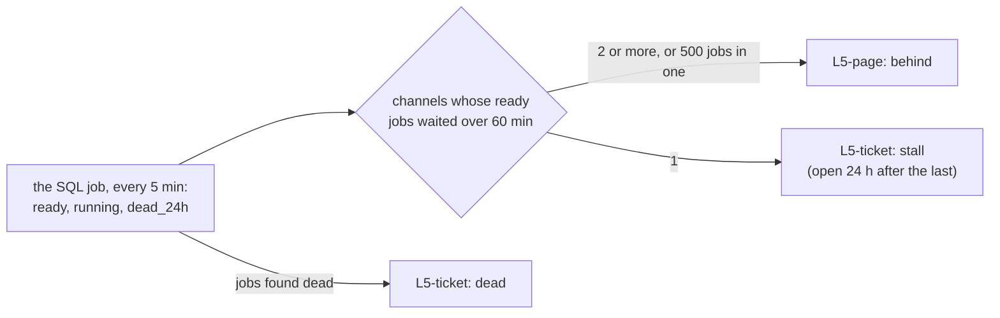

# Round 7: page when the queue is behind, not when one job is late

The story of round 7 in one read. A7's rerun passed, and the same reading showed L5-page paging one cause 14 times in
3 days; this round taught L5 to tell a queue behind from one channel stopped, and to say why the channel stopped. It
links to the [spec](../specs/round-7.md), the runbooks ([deploy](../runbooks/deploy.md#round-7),
[drills](../runbooks/drills.md#round-7s-checks-n6), [respond](../runbooks/respond.md#l5-page-and-l5-ticket-the-job-queue)) and the [learn page](../learn/odoo-queue-job.md), and copies none of
them. Written 2026-11-14, before N8's 24 h closed. Before it: [round 6](round-6.md).

## 1. Round 7 in one picture

**One idea: a job's age since it was created is not how long it has waited. L5-page paged on the oldest job, so one
import that kept dying in one channel paged like the whole queue 2 h behind. Now the page needs 2 or more channels
late, one late channel is a ticket that stays open while it recurs, and the jobs that die are counted.**

## 2. What it delivered

| Check ([spec](../specs/round-7.md#acceptance)) | Evidence (REAL, 2026-11-14 UTC) |
|---|---|
| N1 spec | Written from a read of the queue's own table on stg (states, `eta`, the dead jobs), approved the same day; before the code, the query tests moved to a real PostgreSQL (a CI step) |
| N2 the job's rows | 7 tests: 3 on the rows, 4 on the queries in a throwaway PostgreSQL 17; the SQL mutated (no `eta` filter, `running` from creation) fails 2 |
| N3 the queries on stg | The dry run against a hand query at the same minute: `running` the same in both (2 in one channel, 1 in another), `dead_24h` 12 in both; on the server `ready` 1.6 ms, `dead` 3.0 ms |
| N4 L5-page's backtest | `behind` in 58 consecutive bins, 11-10 18:50 to 11-11 04:20 (one page), none in the stall (on `pending` rows, the history having no `ready`) |
| N5 L5-ticket's backtest | `stall` one alert from the run of 11-11 04:35 (its 04:30 bin), where L5-page paged 14 times; `failed` the same 4 bins as before |
| N6 drill on dev | `behind` 03:49:30, `dead` 03:59:26 and `stall` 03:59:27, each card within 4 s; each resolved on its own (04:20, 04:45), the page with a resolve card, the tickets without; dev idle |
| N7 stg live | Applied 04:08:31 to 04:09:12: only L5-page, L5-ticket and the jobs' image; drift 0, audit clean, teardown 73; the job's database time 44.2 ms (38.8 and 46.7 before) |
| N8 24 h on stg | Opened 04:09:12; read after 2026-11-15 04:09 UTC. First alert: `dead` at 04:23:29, a catch (13 endpoint imports found dead in 24 h) |
| N9 cards and runbook | Both cards rewritten (708 and 908 characters); the respond runbook's L5 section by check |

## 3. What runs, and who installed it

Round 6's pieces ([round 6](round-6.md#3-what-runs-and-who-installed-it)), with the job image `r7-20261114` on both
environments, L5's new query and checks, and L5-ticket's window of 24 h. No rule, table, stream or grant added; dev's
grants re-applied (section 6). dev left idle. Live list: `bash tools/obs.sh inventory`; cost: [about $19.60 a
month](../cost.md).

## 4. Who does what

| Piece | Its job | Learn |
|---|---|---|
| `ready` rows | Per channel, jobs that may run now and their wait since they could (`eta` respected) | [odoo-queue-job](../learn/odoo-queue-job.md#what-l5-read-before-round-7-and-what-it-missed) |
| `running` rows | Per channel, the current attempt's length, not the job's age | The same |
| `dead_24h` rows | Jobs whose worker ended mid-run (`JobFoundDead`) | [the import that dies](../learn/odoo-queue-job.md#following-one-job-the-import-that-dies-mid-run-real-2026-11-11) |
| L5-page `behind` | The queue as a whole behind: a page | [respond, L5](../runbooks/respond.md#l5-page-and-l5-ticket-the-job-queue) |
| L5-ticket `stall`, `dead` | One channel stopped, jobs dying: one ticket each, open while it recurs | The same |
| CI step `sql` | The job's own SQL on a throwaway PostgreSQL | [pipeline spec](../specs/pipeline.md#the-workflow) |

## 5. The decisions that shaped it

| Decision ([D29](../design.md#decisions)) | The reason that mattered |
|---|---|
| 2 or more late channels page | Every run of the one real episode of a queue behind had 2 to 5; every run of the stall had 1 |
| A stall is a ticket with a 24 h memory | A defect in one job stops its channel every few hours; one cause, one ticket |
| Count the jobs found dead | The stall's cause sits in the queue itself: 0 a day before 11-10, 4 to 9 a day since |
| Checks of the existing rules, not a new rule | $0.05 a series against $0.50 a rule, under D8's $20 |
| New `State` values, no new column | No change to the table or the DCR (round 2's DCR incident) |

## 6. What we learned

| Lesson | Where |
|---|---|
| A measure named "age" can mean the wrong age: the backlog's `started` age was since creation, and it was read as "started for hours" in the first write-up; corrected the same day | [learn](../learn/odoo-queue-job.md#what-l5-read-before-round-7-and-what-it-missed) |
| A test of SQL needs a database: the rows built in Python cannot show what a `WHERE` leaves out | [spec, section 5](../specs/round-7.md#5-the-queries-tested-on-a-real-postgresql) |
| A shipped file cites a source by name, never by its code host's URL: the image scan refused the push | [known failure modes](../known-failure-modes.md) (2026-11-14, `obs.sh push`) |
| Grants can vanish when another team changes the database: check the role before a drill | [drills](../runbooks/drills.md#round-7s-checks-n6), [known failure modes](../known-failure-modes.md) (2026-11-14, dev's SQL job) |
| A throwaway container is not gone until its volume is: `docker rm -f` without `-v` left one per CI run | |
| A preflight on stand-in rows is a guess: it predicted `stall` on stg, but the late job had started by the apply | |

## 7. What the next round inherits

- N8: 24 h on stg from 2026-11-14 04:09 UTC with no false page, and `root.endpoint`'s next stall a ticket.
- A9: Cost Management after 7 days, from 2026-11-15 ([cost](../cost.md)).
- For the ERP team: the endpoint imports dying since 11-10, and the queue 2 h behind on 11-10.
- `MinLateJobs` 500 is a judgment inside a gap (no run on record between 3 and 869 late jobs in one channel): O4.

## 8. Catch up in order

1. [learn: odoo-queue-job](../learn/odoo-queue-job.md), then this page
2. [spec: round 7](../specs/round-7.md)
3. [runbooks: deploy, round 7](../runbooks/deploy.md#round-7), [drills](../runbooks/drills.md#round-7s-checks-n6), [respond](../runbooks/respond.md#l5-page-and-l5-ticket-the-job-queue)
