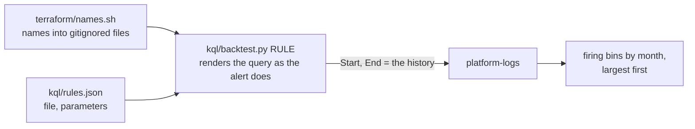

# Backtest a rule over the workspace's history

Stage 1 of the [map](README.md): run a round 1 log rule's own query file over past months, to see when it would have
fired, before it is deployed or after its query or threshold changes (acceptance A3,
[proof in three steps](../design.md#decisions), D10). Read-only.
Last verified: 2026-11-08.

## Overview



The query is the deployed text: [kql/backtest.py](../../kql/backtest.py) renders the targets, the time range and the
rule's parameters as `let` statements in front of the function and rule files, exactly as the alerts module does; only
`Start` and `End` become dates instead of `ago(lookback)` and `now()`. Rules on the Postgres log follow stg's database
across servers (the stg server until 2026-08-27, then the prd server).

## Prerequisites

| Needs | Check | If not |
|---|---|---|
| Where and mode: anywhere with the Azure control plane (the VPN may be on); **Auto** (read-only) | | |
| az signed in to the client's tenant with the lab's folder | `AZURE_CONFIG_DIR=$HOME/lab/.scratch_az az account show --query name -o tsv` prints a subscription | Sign in with device code ([AGENTS.md](../../AGENTS.md#sessions-and-logins)) |
| The names files | `ls terraform/envs/stg/names.auto.tfvars.json` | Step 1 |

## Steps

### 1. Write the names

Why: the queries take server, app and gateway names as parameters, and no committed file holds them.

```bash
AZURE_CONFIG_DIR=$HOME/lab/.scratch_az bash terraform/names.sh
```

Output (REAL, 2026-11-08):

```text
wrote terraform/envs/shared/names.auto.tfvars.json, terraform/envs/dev/names.auto.tfvars.json, terraform/envs/stg/names.auto.tfvars.json and .scratch_mask/mask-words
{'shared': {'apps': 0, 'job_environment': False}, 'dev': {'apps': 1, 'job_environment': True}, 'stg': {'apps': 2, 'job_environment': True}}
```

Check: dev has 1 Odoo app, stg 2 (web and cron); `git status` does not list the files.
If you see `expected one ... found`: a resource group gained or lost a resource of that kind; the script finds each by
its role ([terraform/names.sh](../../terraform/names.sh)), so fix the rule there, never write a name.

### 2. Run a rule over history

Why: the firing bins are what the rule would have sent; compare them with the incidents.

```bash
python3 kql/backtest.py L2-5xx | python3 tools/mask.py          # default: stg, 2025-11-01 to now
python3 kql/backtest.py L4 --start 2026-08-01 --rows 20 | python3 tools/mask.py
```

Output (REAL, 2026-11-08, each rule takes 10 to 60 s):

```text
L2-5xx backtest, stg, 2025-11-01 to 2026-11-08 01:07: 91 firing bin(s)
by month: 2026-08 75, 2026-09 4, 2026-10 12
  {"App": "<name>", "Bin": "2026-09-17T08:05:00Z", "Codes": "[502]", "Requests": "134"}
  ...
L4 backtest, stg, 2026-08-01 to 2026-11-08 01:08: 5 firing bin(s)
by month: 2026-08 2, 2026-09 2, 2026-10 1
  {"Bin": "2026-08-17T07:00:00Z", "Codes": "[13805]", "Errors": "3"}
  {"Bin": "2026-09-11T08:30:00Z", "Codes": "[13885]", "Errors": "3"}
  ...
```

Check: the months and dates match the rule's row in the [spec's signals](../specs/round-1.md#signals).
If you see `Failed to resolve table or column expression named 'OdooQueue_CL'`: L5, L6 and H read the SQL job's tables,
which exist only after `envs/shared` is applied; they have no history to backtest.

L5 since round 7 reads `ready` rows, which exist only from the SQL job's version 4. Over older runs, give it the
`pending` rows instead (those jobs had no `eta`, so they stand in), and say so beside the numbers:

```bash
python3 kql/backtest.py L5-page --start 2026-11-08 --param 'ReadyState="pending"' | python3 tools/mask.py
python3 kql/backtest.py L5-ticket --start 2026-11-08 --param 'ReadyState="pending"' | python3 tools/mask.py
```

Output (REAL, 2026-11-14 03:30 UTC, trimmed; [round 7's N4, N5](../specs/round-7.md#acceptance)):

```text
L5-page backtest, stg, 2026-11-08 to 2026-11-14 03:26: 58 firing bin(s)
  {"Bin": "2026-11-10T23:40:00Z", "Check": "behind", "Detail": "root: 3 ready, 92 min; root.mirror_inventory_report: 38 ready, 216 min; root.ai_memory: 1 ready, 354 min", "Threshold": "2", "Value": "3"}
L5-ticket: failed 4 bins 11-09 03:00 to 03:45 (sync.model); stall 284 bins 11-11 04:30 to 11-14 03:15, one alert
```

Check: `behind` only from 11-10 18:50 to 11-11 04:20, in consecutive bins; `stall` one unbroken run of bins.

### 3. Run a rule once, as the alert would

Why: proves the rendered query runs over the rule's own window (and shows the text pasted into the portal with
`--print`).

```bash
python3 kql/backtest.py L7 --alert | python3 tools/mask.py
python3 kql/backtest.py L3 --print > /tmp/l3.kql
```

Output (REAL, 2026-11-08 01:10 UTC):

```text
L7 as the alert, stg: 0 row(s) -> quiet
L3 as the alert, stg: 0 row(s) -> quiet
L1-wait as the alert, stg: 0 row(s) -> quiet
L2-5xx as the alert, stg: 0 row(s) -> quiet
L4 as the alert, stg: 0 row(s) -> quiet
```

Check: each line ends `quiet`, or `FIRES` followed by the rows that would be sent.

## Verify end to end

A3 on 2026-11-08, every rule file against the spec (REAL):

| Rule | Firing bins | Against the spec |
|---|---|---|
| L1-wait | 2026-08-25 (2 bins, 4 waits of 127 to 256 s), 09-18 (129 s) | Matches: 4 waits in August, 1 in September |
| L1-burst | none | Matches: the 5-min maximum is 37, under 40 |
| L2-5xx | August 75, September 4, October 12 | Matches; July's 16 were on the earlier web app, replaced in 2026-08 |
| L2-499 | August 32, September 1, October 2 | Matches (August 33 counted the earlier app's bin too) |
| L3 | 23 outages over 5 min: 2025-11 1, 12 2, 2026-02 7, 03 3, 04 6, 05 1, 07 1, 09 1, 10 1 | Matches month by month, the 112-hour drop of 2026-02-26 included |
| L4 | Since 2026-08: 08-14, 08-17, 09-11, 09-21, 10-27 | Matches; the log reaches back to 2025-11, with 137 bins over the year (64 in 2026-03) |
| L7 | 17 bins from 2026-07 to 11-07, 3 to 26 `ProcessExited` in 15 min | None on 2026-09-09, as the spec expects; 10 of them (2026-11-09's count, with today's) are a single restart, not a loop ([spec](../specs/round-1.md#signals)) |

## Roll back

Nothing to undo: the backtest only reads. The names files and mask words are gitignored and can be deleted.
