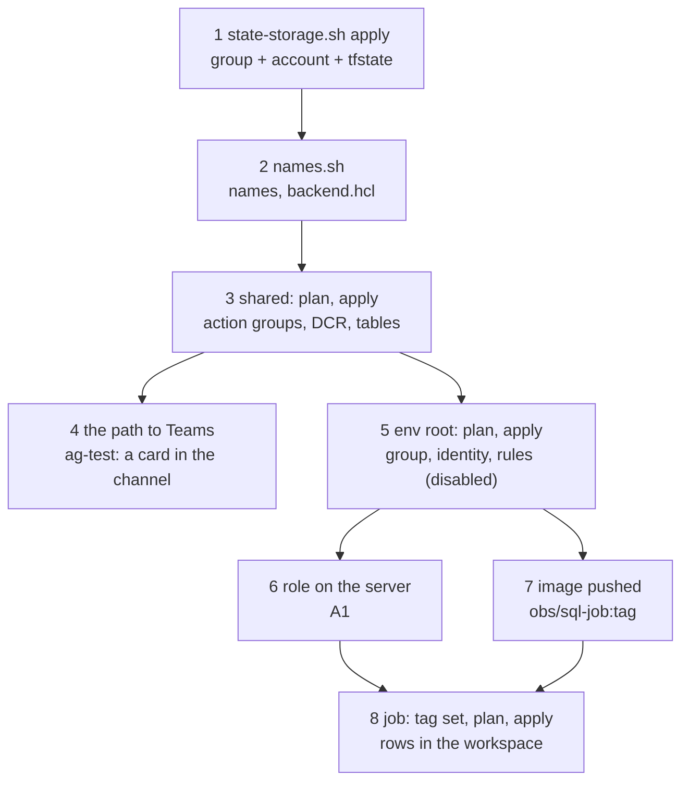

# Deploy round 1 to an environment

Stage 2 of the [map](README.md): build what [the round 1 spec](../specs/round-1.md) adds, from nothing to rows arriving
in the workspace and the rules in place: the state storage, the shared root (with the Logic Apps that post to Teams), the environment's root,
the monitoring role, the image and the SQL job. Every step runs on **dev** first ([D1](../design.md#decisions)); stg
repeats steps 5 to 8 with `stg` and its admin service.
Last verified: 2026-11-08 on dev.

## Overview



Every command is a subcommand of [tools/obs.sh](../../tools/obs.sh): it sets the logins of
[AGENTS.md](../../AGENTS.md#sessions-and-logins), reads the names files, never prints a secret and masks its output.
Every plan is scanned by [tools/no-repo-trace.py](../../tools/no-repo-trace.py) before it is applied: nothing in Azure
names the GitHub repo ([AGENTS.md](../../AGENTS.md#ground-rules-of-the-track-owner-2026-11-07)).

## Prerequisites

| Needs | Check | If not |
|---|---|---|
| Where and mode: office, or home with the client's VPN on (step 6 reaches the Postgres server); a live change, so the owner watches each step ([AGENTS.md](../../AGENTS.md#which-mode-a-session-runs-in)) | | |
| az, the login that creates resources | `AZURE_CONFIG_DIR=$HOME/lab/.scratch_az_write az account show --query name -o tsv` prints `management-sub` | `az login --use-device-code --tenant client.example` with that folder, then `az account set -s management-sub` (the login's default was `prd-sub`) |
| az, the read login (names, KQL) | the same with `.scratch_az` | Device code, as in AGENTS.md |
| Terraform 1.17 and Docker | `$HOME/lab/.toolchain/bin/terraform version`; `docker version` | The lab's toolchain |
| The admin's psql service for the server (dev: `odoo-admin`) | `psql service=odoo-admin -X -At -c 'select current_database()'` prints the Odoo database | [platform](../platform.md#what-connects-them): the admin logins are in the platform's key vaults |

## Steps

### 1. The state storage

Why: Terraform's state needs a home before `terraform init`; it is the track's own, Entra ID auth only
([spec](../specs/round-1.md#terraform)).

```bash
bash terraform/state-storage.sh plan     # what it would create
bash terraform/state-storage.sh apply
```

Output (REAL, 2026-11-08 04:43 UTC, 38 s):

```text
resource group exists: true
account name available: true
terraform reads and writes state through the data role, which takes up to a few minutes to apply
```

Check: `az storage account show ... -n obstfstate` shows `Standard_LRS`, shared keys off, TLS 1.2, versioning
on, and a container `tfstate`; `bash tools/obs.sh trace-live` reports 0 traces.
If you see `account name available: true` for a name deleted in the last 14 days: it is still held (soft delete);
take the next number ([row](../known-failure-modes.md)).

### 2. The names and backends

Why: the roots read every server, app, registry and subscription name from files written by discovery, and the backend
from `backend.hcl`; all are committed (private repo, [AGENTS.md](../../AGENTS.md#writing)).

```bash
AZURE_CONFIG_DIR=$HOME/lab/.scratch_az bash terraform/names.sh
```

Output (REAL, 2026-11-08):

```text
{'shared': {'apps': 0, 'job_environment': False}, 'dev': {'apps': 1, 'job_environment': True}, 'stg': {'apps': 2, 'job_environment': True}}
wrote terraform/envs/{shared,dev,stg}/backend.hcl
```

Check: `git diff` shows only expected changes (the account name in `backend.hcl` and the `state` entry); commit them.

### 3. The shared root

Why: the four action groups, the two Logic Apps, the DCR and the three tables are shared by dev and stg.

```bash
bash tools/obs.sh tf shared init -backend-config=backend.hcl -reconfigure -input=false
bash tools/obs.sh plan shared
bash tools/obs.sh apply shared
```

Output (REAL, 2026-11-08 04:45 UTC, after the tables were imported, see below):

```text
  # azapi_resource.dcr will be created
  # azurerm_monitor_action_group.this["dev-page"] will be created
  ...
Plan: 5 to add, 0 to change, 0 to destroy.
3606 string(s) scanned, 0 with a trace of the repo
azurerm_monitor_action_group.this["dev-page"]: Creation complete after 3s
azapi_resource.dcr: Creation complete after 6s
Apply complete! Resources: 5 added, 0 changed, 0 destroyed.
```

Check: the plan's scan line reads `0 with a trace of the repo` before you apply.
If you see `azapi_resource.table[...]: ... already exists` on a new state: the tables outlive a destroy (the workspace's
lock), so import them, one per table:

```bash
ws=$(AZURE_CONFIG_DIR=$HOME/lab/.scratch_az_write az monitor log-analytics workspace show \
  --subscription management-sub -g monitor-rg -n platform-logs --query id -o tsv)
bash tools/obs.sh tf shared import -input=false 'azapi_resource.table["OdooCron"]' "$ws/tables/OdooCron_CL?api-version=2022-10-01"
```

Output (REAL, 2026-11-08): `Import successful!` for each of `OdooCron`, `OdooHeartbeat`, `OdooQueue`.

### 4. The path to Teams

Why: the action groups call each environment's Logic App, which posts
[terraform/teams/alert-card.json](../../terraform/teams/alert-card.json) to the owner's Teams workflow; the workflows are
shared and stay unchanged ([D11](../design.md#decisions),
[learn](../learn/azure-monitor-alerts.md#from-the-alert-to-a-teams-card-why-a-logic-app-sits-between)). Step 3 created
them; this step proves the path with Azure's test alert.

```bash
bash tools/obs.sh ag-test dev page
```

Output (REAL, 2026-11-08 05:25 UTC):

```text
{ "details": [ { "MechanismType": "LogicApp", "Name": "teams-dev", "SendTime": "2026-11-08T05:25:16.7194642+00:00", "Status": "Succeeded" } ], "state": "Complete" }
Start                         Status
2026-11-08T05:25:16.4882139Z  Succeeded
```

Check: the dev channel shows a card `Fired: test-logAlertRule-v2` with Severity `Sev4`, the fired time, Value `3`,
Condition `GreaterThan 0`, the dimensions and an **Open in Azure** button (REAL, 2026-11-08, seen by the owner).
If you see the workflow's run fail with `Property 'type' must be 'AdaptiveCard'`: something posted Azure's own JSON
to the workflow; the action group must have the Logic App receiver, not a webhook ([row](../known-failure-modes.md)).
If you see a bullet `∘` in a fact: a value was a bare `-`, which Teams renders as a list item; the card uses `n/a`.
If you see `ActionOrReceiverNotExistedInActionGroup`: a test must repeat the stored receiver exactly; `obs.sh ag-test`
reads it from the action group.

### 5. The environment's root

Why: the environment's resource group, the job's identity with its two roles, the obs_monitor password, and the rules
(disabled on dev outside drills).

```bash
bash tools/obs.sh tf dev init -backend-config=backend.hcl -reconfigure -input=false
bash tools/obs.sh plan dev
bash tools/obs.sh apply dev
```

Output (REAL, 2026-11-08 04:50 UTC, `job_image_tag` still empty, so no job yet):

```text
Plan: 20 to add, 0 to change, 0 to destroy.
901 string(s) scanned, 0 with a trace of the repo
Apply complete! Resources: 20 added, 0 changed, 0 destroyed.
```

Check: the 15 rules show `enabled = false` in the plan.
If you see `expected window_duration to be one of [... PT15M PT30M ...], got PT20M`: a rule's window in
[kql/rules.json](../../kql/rules.json) is not one a log alert accepts.
If you see `Error: Failed to save state` after an apply: the changes are in Azure and the new state is in
`terraform/envs/<root>/errored.tfstate`, with its secrets: `chmod 600` it, `bash tools/obs.sh tf <root> state push errored.tfstate`,
then `obs.sh plan <root>` must read `No changes`; delete the file ([row](../known-failure-modes.md)).

### 6. The monitoring role

Why: the job's own login, read-only, two tables ([spec](../specs/round-1.md#the-monitoring-role),
[learn](../learn/postgres-roles.md)). Needs the VPN at home.

```bash
bash tools/obs.sh role dev odoo-admin
bash tools/obs.sh role-check dev odoo-admin      # acceptance A1
```

Output (REAL, 2026-11-08 04:54 UTC):

```text
CREATE ROLE
ALTER ROLE  (x3)
GRANT       (x3)
 obs_monitor | t | f | 2 | {default_transaction_read_only=on,statement_timeout=10s,lock_timeout=1s}
 ir_cron    | SELECT
 queue_job  | SELECT
NOTICE:  ok: SELECT on queue_job (103955 rows)
NOTICE:  ok: SELECT on ir_cron (77 rows)
NOTICE:  ok: SELECT on res_users denied (permission denied for table res_users)
NOTICE:  ok: UPDATE on ir_cron denied (cannot execute UPDATE in a read-only transaction)
NOTICE:  ok: read only, statement_timeout 10s, lock_timeout 1s
NOTICE:  ok: no pg_read_all_data, no pg_read_all_stats
 erp-owner-dev | ir_cron    | SELECT
 erp-owner-dev | queue_job  | SELECT
```

Check: every A1 line starts `ok:`; the grantor is the tables' owner role.
If you see `cannot execute CREATE ROLE in a read-only transaction`: the admin service sets
`default_transaction_read_only=on`; `obs.sh role` lifts it for its own connection only, so run it through `obs.sh`.
The refused statement is logged with its text, which holds only the SCRAM verifier, never the password.

### 7. The image

Why: the job runs `obs/sql-job` from the stg registry ([D12](../design.md#decisions)); the image is checked for traces
of the repo before the push.

```bash
bash tools/obs.sh push r1-20261108
```

Output (REAL, 2026-11-08 04:55 UTC):

```text
15 string(s) scanned, 0 with a trace of the repo
18 string(s) scanned, 0 with a trace of the repo
167 string(s) scanned, 0 with a trace of the repo
Login Succeeded
<name>.azurecr.io/obs/sql-job:r1-20261108
r1-20261108
```

Check: the three scans read 0; the tag is listed.

### 8. The job

Why: set the image tag in [deploy.auto.tfvars.json](../../terraform/envs/dev/deploy.auto.tfvars.json), commit it, and
apply; the job then runs every 5 min.

```bash
bash tools/obs.sh plan dev
bash tools/obs.sh apply dev
bash tools/obs.sh job dev start
bash tools/obs.sh job dev list
```

Output (REAL, 2026-11-08 04:59 to 05:01 UTC):

```text
  # module.sql_job.azurerm_container_app_job.sql[0] will be created
  # module.sql_job.azurerm_role_assignment.pull must be replaced
Plan: 2 to add, 0 to change, 1 to destroy.
module.sql_job.azurerm_container_app_job.sql[0]: Creation complete after 20s
erp-dev-obs-sqljob-caj-fxrmmd9   Succeeded  2026-11-08T05:00:18+00:00  2026-11-08T05:00:49+00:00
erp-dev-obs-sqljob-caj-29901900  Succeeded  2026-11-08T05:00:00+00:00  2026-11-08T05:00:33+00:00
```

Check: runs `Succeeded`; the job's log line reads `ok env=dev ... queue_rows=1 cron_rows=46`.
If you see `InvalidParameterValueInContainerTemplate ... UNAUTHORIZED` on the image: the registry is in ABAC mode,
where AcrPull is not honored; the pull role is Repository Reader limited to `obs/sql-job`
([spec](../specs/round-1.md#the-sql-job), [row](../known-failure-modes.md)).

## On stg

stg runs steps 5 to 8 with `stg`, plus what dev did not need: an admin service for the **prd server** (stg's database
lives there), a preflight before any rule is enabled, and the apply in passes so that nothing pages falsely
([D17](../design.md#decisions)). Last verified: 2026-11-08.

### S1. The prd server's admin service

Why: the role is created by the server's admin, whose password is the secret `kv-psql-password-erpadmin` in the key vault
`platform-tf-kv` ([platform](../platform.md#what-connects-them)). The service `stg-odoo-admin` goes into the lab's
`pg_service.conf` (database `erp-stg`, `application_name=obs-admin`, read-only by default like `odoo-admin`),
its password into `pgpass`, read from the vault into a variable and never printed; both files mode 600.

Check: `psql service=stg-odoo-admin -X -At -c "select current_database(), current_setting('application_name'),
pg_has_role(current_user,'erp-owner-stg','MEMBER')"` prints `erp-stg|obs-admin|t` (REAL, 2026-11-08).
If you see `password authentication failed` with a password just copied from the vault: `pgpass` splits fields at `:`,
so a `:` (or `\`) in the password must be written `\:` (`\\`) ([row](../known-failure-modes.md)).

### S2. Preflight: what would fire

Why: on stg every rule pages for real; each is run once as its alert on today's data before it is enabled.

```bash
for r in L1-wait L1-burst L2-5xx L2-499 L3 L4 L7; do python3 kql/backtest.py $r --env stg --alert; done
PGSERVICE=stg-odoo-reader OBS_ENV=stg .venv/bin/python job/sql_job.py --dry-run     # L5, L6 against their thresholds
```

Output (REAL, 2026-11-08 06:55 UTC):

```text
L1-wait ... L7 as the alert, stg: 0 row(s) -> quiet          (all seven)
rows: queue 1, cron 40, heartbeat 1; db_ms 340.0
L5 pending 0 (page > 5000); oldest 0 min (page > 60); failed in 1 h 0 (ticket > 10); queue_job size 1.81 GB (ticket > 2.5)
L6 late crons: [('Base: Auto-vacuum internal data', 73.4)]        -> a ticket at once: a real catch
M3: 15-min averages >= 90 % over 7 days: 0; M4 storage max 32.6 %; M5 alive; app restarts 24 h: 0
```

Check: every page rule quiet; anything that would fire is understood before enabling.

### S3. The root, in passes

```bash
bash tools/obs.sh tf stg init -backend-config=backend.hcl -reconfigure -input=false
# pass 1, deploy.auto.tfvars.json: job_image_tag "", rules_enabled false
bash tools/obs.sh plan stg && bash tools/obs.sh apply stg
bash tools/obs.sh role stg stg-odoo-admin && bash tools/obs.sh role-check stg stg-odoo-admin     # A1 on the prd server
# pass 2a: job_image_tag set, rules_enabled false; then wait for the first stg heartbeat (Verify below)
bash tools/obs.sh plan stg && bash tools/obs.sh apply stg && bash tools/obs.sh job stg start
# pass 2b: rules_enabled true
bash tools/obs.sh plan stg && bash tools/obs.sh apply stg
```

Output (REAL, 2026-11-08): pass 1 `22 added`; the role `CREATE ROLE`, `GRANT` x3, then A1:

```text
NOTICE:  ok: SELECT on queue_job (781658 rows)
NOTICE:  ok: SELECT on ir_cron (75 rows)
NOTICE:  ok: SELECT on res_users denied (permission denied for table res_users)
NOTICE:  ok: UPDATE on ir_cron denied (cannot execute UPDATE in a read-only transaction)
NOTICE:  ok: read only, statement_timeout 10s, lock_timeout 1s
NOTICE:  ok: no pg_read_all_data, no pg_read_all_stats
 erp-owner-stg | ir_cron    | SELECT
 erp-owner-stg | queue_job  | SELECT
```

Check: why passes: H fires on "no heartbeat in 30 min", true of stg until the job's first rows land; and the job's
first runs fail until the role exists. If you see the stg job's log `password authentication failed for user
"obs_monitor"`: the role is missing on the prd server (S3's `role`).
If you see `obs.sh plan` fail: it leaves no plan, and `obs.sh apply` refuses to run ([row](../known-failure-modes.md)).

## Round 2

What round 2 adds to the steps above ([spec](../specs/round-2.md)): the table statistics in the SQL job, the log reader
job, two tables and their streams, Q1, T1, O1, R1. Last verified: 2026-11-08.

### R2-1. The shared root: two tables, two streams

```bash
bash tools/obs.sh plan shared        # 2 to add (OdooTables_CL, OdooLog_CL), 2 to change (the DCR, the heartbeat table)
bash tools/obs.sh apply shared
```

Check: the DCR lists `Custom-OdooTables` and `Custom-OdooLog` (`az resource show ... --query "keys(properties.streamDeclarations)"`).
If you see `InvalidStream: The stream Custom-OdooTables was not configured in the data collection rule` although the DCR
lists it: the ingestion endpoint still serves the DCR's older copy (REAL, 2026-11-08: rejected 10 to 16 min after the
change, accepted 31 min after). **Wait for it before deploying the writers:** run the SQL job once on dev
(`bash tools/obs.sh job dev start`) until its line reads `table_rows=20` ([row](../known-failure-modes.md)).

### R2-2. The image and the jobs

```bash
bash tools/obs.sh push <tag>        # the image carries sql_job.py and log_scan.py; three scans, then the push
```

Set `job_image_tag` and `log_storage` in each root's `deploy.auto.tfvars.json`: dev `{"name": "erp-dev-ro"}`
(the read-only storage), stg `{"name": "erp-stg", "mount_options": "ro"}`; stg also `pg_database_id`. Then
`plan` and `apply` the root, each plan shown before its apply.

### R2-3. Prove the reader is read only, and look at the log (B3)

The reader's modes run as a one-off start of its job; a start with a command override drops the job's environment, which
`check`, `backfill` and `trace` do not need (a normal run does: start it with `bash tools/obs.sh job <env> start log`):

```bash
az containerapp job start -g erp-<env>-obs-rg -n erp-<env>-obs-logscan-caj --container-name log-scan \
  --image <registry>/obs/sql-job:<tag> --command python3 /app/log_scan.py check
```

Output (REAL, 2026-11-08, in `ContainerAppConsoleLogs_CL`):

```text
dev: file odoo.log 3905428585 bytes, modified 2026-11-07T11:21:59Z
dev: ok: write refused (OSError: Read-only file system)          (read-only storage, and read-write storage with ro)
stg: file odoo.log.2026-10-31 ... odoo.log.2026-11-07 (55 to 300 MB each), file odoo.log 0 bytes, modified 2026-11-08T05:00:24Z
stg: ok: write refused (OSError: Read-only file system)
```

Check: `write refused` on both; only `log/` is visible.
If you see `unrecognized arguments: --check`: `az` takes a leading-dash word as its own option; the reader also takes
plain words (`check`, `backfill <date>`, `trace <date>`).

### R2-4. Backfill and trace (B4)

`backfill <date>` prints the 15-min bins O1 would have fired on; `trace <date>` prints the server's own lines before a
counted kill (no request or user content). With `--cpu 1 --memory 2Gi` on the start, dev's 3.9 GB file reads in about
3 min.

## Round 3

What round 3 adds ([spec](../specs/round-3.md)): two log rules, `SLO-fast` and `SLO-slow`, per environment, from
[kql/SLO-burn-rate.kql](../../kql/SLO-burn-rate.kql) and their entries in [kql/rules.json](../../kql/rules.json); no new
data, table, job or grant. Why they exist and how to read them: [learn: slo](../learn/slo.md). Last verified:
2026-11-08.

### R3-1. Backtest and preflight

Why: the backtest shows what the rules would have paged on (acceptance C2); the preflight that they are quiet on stg's
live data before they are enabled (C3).

```bash
python3 kql/backtest.py SLO-fast --start 2026-08-09 --rows 3 | python3 tools/mask.py
python3 kql/backtest.py SLO-fast --alert | python3 tools/mask.py
python3 kql/backtest.py SLO-slow --alert | python3 tools/mask.py
```

Output (REAL, 2026-11-08 12:18 to 12:27 UTC, trimmed):

```text
SLO-fast backtest, stg, 2026-08-09 to 2026-11-08 12:18: 50 firing bin(s)
by month: 2026-08 42, 2026-09 2, 2026-10 6
  {"BadLong": "1592", "BadShort": "152", "Bin": "2026-08-27T06:10:00Z", "BurnLong": "194.5", "BurnShort": "193.6", "Journey": "tv", ...}
SLO-fast as the alert, stg: 0 row(s) -> quiet
SLO-slow as the alert, stg: 0 row(s) -> quiet
```

Check: the backtest has bins on 2026-08-20, 08-24 and 08-27 and none in November; both alert runs print `quiet`. The 12
episodes behind the 50 bins are judged in [learn: slo](../learn/slo.md#what-90-days-of-backtest-show).

If you see `quiet` and want to know the query sees data at all: `--param Factor=-1 --param MinBad=0` makes every
journey with traffic fire (2026-11-08 12:27 UTC, a Sunday evening: 4 interactive requests in the hour, no TV traffic).

### R3-2. The rules, disabled on stg

Why: Terraform creates the rules on stg disabled (`rule_overrides` in
[deploy.auto.tfvars.json](../../terraform/envs/stg/deploy.auto.tfvars.json)), so nothing can page before the preflight
and the drill; dev's are off by `rules_enabled`.

```bash
bash tools/obs.sh plan stg       # then read it
bash tools/obs.sh apply stg
```

Output (REAL, 2026-11-08 12:30 UTC, trimmed):

```text
  # module.alerts.azurerm_monitor_scheduled_query_rules_alert_v2.log["SLO-fast"] will be created
  # module.alerts.azurerm_monitor_scheduled_query_rules_alert_v2.log["SLO-slow"] will be created
Plan: 2 to add, 0 to change, 0 to destroy.
2094 string(s) scanned, 0 with a trace of the repo
Apply complete! Resources: 2 added, 0 changed, 0 destroyed.
```

Check: `bash tools/obs.sh tf stg show -json <plan>` lists both with `enabled = false` and the dimension `Journey`.

If you see `Error: listing secrets for Job` in a plan: a transient failure while Terraform reads the SQL job; the plan
wrapper deletes the plan file (nothing to apply); run the plan again (2026-11-08, once on dev).

### R3-3. Drill on dev, then enable on stg

The drill: [drills, round 3](drills.md#round-3s-rules-c4). Then remove the two `rule_overrides` entries from stg's
`deploy.auto.tfvars.json`, plan (2 to change: `enabled` false to true), apply.

Check: `bash tools/obs.sh plan stg` reads `No changes`; `bash tools/obs.sh audit` is clean.

## Round 4

What round 4 adds ([spec](../specs/round-4.md)): the job's image `r4` (one more query, `pg_locks`, no grant),
L1-wait's query reading the job's `lock_wait` rows over 10 minutes, and one log rule `E1`
([kql/E1-changes.kql](../../kql/E1-changes.kql)). Dev first, then stg. Last verified: 2026-11-08.

### R4-1. The image, and a dry run as the role

```bash
bash tools/obs.sh push r4-20261108
```

Output (REAL, 2026-11-08 16:20 UTC): the image's config, history and files scanned (15, 18 and 489 strings, `0 with a
trace of the repo`), then `<name>.azurecr.io/obs/sql-job:r4-20261108` pushed. Then the job as `obs_monitor` during
`obs.sh drill-lock odoo-reader 100` on dev, with `--dry-run`:

```text
{'stream': 'Custom-OdooQueue', 'Check': 'lock_wait', 'Count': 1, 'OldestAgeSec': 73.7}
{'stream': 'Custom-OdooHeartbeat', 'JobVersion': '3', 'DbMs': 321.3}
```

Check: the row's age matches the wait's (the waiter began 73 s before). If you see `password authentication failed`
for the reader during the drill: a `PGPASSWORD` exported for `obs_monitor` overrides the reader's password file; run
the drill with `env -u PGPASSWORD ...`.

### R4-2. Preflight, then dev, then stg

```bash
for r in L1-wait L1-burst E1; do python3 kql/backtest.py $r --env stg --alert; done
bash tools/obs.sh plan dev       # read the plan, then:
bash tools/obs.sh apply dev
bash tools/obs.sh plan stg       # read the plan, then:
bash tools/obs.sh apply stg
```

Output (REAL, 2026-11-08): the three rules `quiet` on stg; each root's plan `1 to add, 4 to change, 0 to destroy`
(E1 created; L1-wait and L1-burst, which share the query file; the SQL job and the log reader, which share the image:
only `image ... r2e-20261108 -> ... r4-20261108`), `0 with a trace of the repo`, the plan policies' `8 tests, 8 passed`; stg applied
17:01:40 to 17:02:13 UTC. stg's next run: `JobVersion` 3, 28.2 ms of database time, its `lock_wait` row `Count 0`.

Check: `obs.sh drift` reads `no drift` on the three roots; `obs.sh audit` over 57 resources, `0 with a trace` but the
Activity Log's 2 known events (the first group write of 2026-11-08 04:26, with the repo's old tag, which the Activity
Log keeps). If you see `Error: Failed to save state`:
[the recovery](#5-the-environments-root).

## Round 5

What round 5 adds ([spec](../specs/round-5.md)): the job's image `r5` (the log reader's four retry kinds and its
`retries` mode; the SQL job unchanged), L1's query counting lock-timeout cancellations and the reader's `lock_failed`
rows, L1-burst's new card. No rule, table, stream or grant. Dev first, then stg. Last verified: 2026-11-09.

### R5-1. The image, and the retries on the share

```bash
bash tools/obs.sh push r5-20261109
```

Output (REAL, 2026-11-08 23:30 UTC): `15`, `18` and `534 string(s) scanned, 0 with a trace of the repo`, then
`<name>.azurecr.io/obs/sql-job:r5-20261109`. Then `retries <date>` as a one-off start of each log reader with that image
(the start command of [R2-3](#r2-3-prove-the-reader-is-read-only-and-look-at-the-log-b3), its last words `retries
2026-10-01`; `--cpu 1 --memory 2Gi` for dev's 3.9 GB file). Output (REAL, 23:32 to 23:33 UTC, in
`ContainerAppConsoleLogs_CL`):

```text
stg: retries since 2026-10-01: lock_retry 0, lock_failed 0, concurrency_retry 0, concurrency_failed 0
dev: retries since 2026-10-01: lock_retry 23, lock_failed 0, concurrency_retry 35, concurrency_failed 0
dev:   2026-11-04 lock_retry=8   (one line per day with any)
```

Check: a line per environment. If you see `unrecognized arguments: -c` when starting your own `python3 -c` probe: `az`
takes a leading-dash word as its option; pass `-c` and the code as one argument (`"-c<code>"`).

### R5-2. Backtest, then dev, then stg

```bash
python3 kql/backtest.py L1-wait | python3 tools/mask.py      # must stay as A3: 3 bins
python3 kql/backtest.py L1-burst --rows 10 | python3 tools/mask.py
bash tools/obs.sh plan dev       # read the plan, then:
bash tools/obs.sh apply dev
```

Output (REAL, 2026-11-08 23:28 to 23:32 UTC): L1-wait `3 firing bin(s)` (Aug 2, Sep 1); L1-burst `10 firing bin(s)`, by
month `2026-09 1, 2026-10 9`; plan dev `0 to add, 4 to change, 0 to destroy` (L1-burst: title, description, query; with
the drill, `enabled` and the window; L1-wait: its query; the two jobs: the image), `2134 string(s) scanned, 0 with a
trace`, policies `8 tests, 8 passed`.

Check: L1-wait unchanged; dev's plan touches nothing else.

## Round 6

What round 6 adds ([spec](../specs/round-6.md)): L7's crash loop needs restarts beside exits, E1's card names the new
revision, the job's image `r6b` (the log reader's `postponed` kind, and every message stripped of its trailing space),
and a ticket's resolve posts no card (the shared Logic Apps, per environment). No rule, table, stream or grant. Dev
first, then stg. Last verified: 2026-11-10.

### R6-1. Backtests

```bash
python3 kql/backtest.py L7 --rows 400 | python3 tools/mask.py
python3 kql/backtest.py L7 --start 2026-11-08T07:25:00Z --end 2026-11-09T07:25:00Z | python3 tools/mask.py
python3 kql/backtest.py E1 --start 2026-10-10 --rows 40 | python3 tools/mask.py
```

Output (REAL, 2026-11-10 05:36 to 05:40 UTC): L7 `211 firing bin(s)`, of them 7 through the crash-loop part (the
07-22, 07-27, 08-27 twice, 09-12, 10-07 and 10-22 loops, 3 to 20 restarts each) and 204 through the probe-kill part;
A7's 24 h `0 firing bin(s)`; E1 `35 firing bin(s)`, each naming the new revision (2980, 2981, 2982 and 2996 for
2026-11-09 and 10), 2 `replacing <old>` where nothing was pulled in the bin.

Check: no single-restart bin among L7's rows (each crash-loop row has `Restarts` 2 or more).

### R6-2. The image, and the retries on the share

```bash
bash tools/obs.sh push r6b-20261110
```

Then `retries <date>` as a one-off start of each log reader with that image, as in [R5-1](#r5-1-the-image-and-the-retries-on-the-share).
Output (REAL, 2026-11-10 05:59 and 06:01 UTC, in `ContainerAppConsoleLogs_CL`):

```text
stg: retries since 2026-10-01: lock_retry 0, lock_failed 0, concurrency_retry 0, concurrency_failed 0, postponed 1010
dev: retries since 2026-10-01: lock_retry 24, lock_failed 0, concurrency_retry 37, concurrency_failed 0, postponed 458
```

Check: stg's `postponed` close to a count of queue_job's `<Job ...> postponed` lines on the same files (1,012; the 2
missing are two records glued on one line). If you see `postponed 0` on stg: the pattern does not strip the trailing
space stg's file ends each line with ([row](../known-failure-modes.md)). If you see `error getting credentials` at
the image's `FROM` line: Docker Desktop's credential helper is out of reach from WSL; run the push with
`DOCKER_CONFIG` set to a new scratch folder holding `{}`, then delete the folder ([row](../known-failure-modes.md)).

### R6-3. The card filter, then dev, then stg

The filter is on for the environments in `quiet_resolves` ([terraform/envs/shared/variables.tf](../../terraform/envs/shared/variables.tf)):
`["dev"]` first, `["dev", "stg"]` once dev passed I9.

```bash
bash tools/obs.sh plan shared    # read the plan: only that environment's post-card action
bash tools/obs.sh apply shared
bash tools/obs.sh plan dev       # then stg the same way
bash tools/obs.sh apply dev
```

Output (REAL, 2026-11-10 05:44 to 05:46 UTC): plan shared `0 to add, 1 to change, 0 to destroy` (dev's `post-card`;
the body hides behind the route's sensitive value, so read it from `tf shared show -json` with the route redacted: an
`If` whose `post` runs unless `monitorCondition` is `Resolved` and `severity` is `Sev3`), `1371 string(s) scanned, 0 with
a trace`, policies `8 tests, 8 passed`; plan dev `0 to add, 4 to change` (L7, E1, the two jobs' image).

Check: each plan touches only these resources. If you see `Inconsistent conditional result types`: the two branches of
the action's body must each be encoded to JSON, as the code does.

## Round 7

What round 7 adds ([spec](../specs/round-7.md)): the job's image `r7` (version 4: `ready` and `running` rows per
channel, `dead_24h` rows), L5-page's `behind` in place of `oldest_age`, L5-ticket's `stall` and `dead` with a 24 h
window. No rule, table, stream or grant. Dev first, then stg. Last verified: 2026-11-14.

### R7-1. Tests and backtests

```bash
bash tools/ci.sh unit sql      # the job's rows, and its queries on a throwaway PostgreSQL
```

Then L5's backtests on `pending` rows ([backtests](backtests.md#2-run-a-rule-over-history)). Output (REAL,
2026-11-14 03:20 to 03:30 UTC): `unit pass`, `sql pass` (7 tests); L5-page 58 bins, all `behind`, 11-10 18:50 to 11-11
04:20; L5-ticket `failed` 4 bins on 11-09, `stall` one unbroken run from the 04:30 bin of 11-11 (its run at 04:35).

Check: `behind` in no bin after 11-11 04:20. If you see `sql fail` with `no container`: Docker is not reachable from
this shell; start Docker Desktop (or the runner's Docker) and rerun.

### R7-2. The image

```bash
bash tools/obs.sh push r7-20261114
```

Output (REAL, 2026-11-14 03:33 UTC, masked): the three scans (the image's config, its history, its files) `15`, `18` and
`572 string(s) scanned, 0 with a trace of the repo`,
`Login Succeeded`, the tags ending `r6b-20261110 r7-20261114`.

Check: the new tag listed. If you see `trace: line <n>: github`: a shipped file cites a source by its URL; name the
source without it and push again ([row](../known-failure-modes.md)).

### R7-3. dev

```bash
# terraform/envs/dev/deploy.auto.tfvars.json: "job_image_tag": "r7-20261114"
bash tools/obs.sh plan dev     # read it: only L5-page, L5-ticket and the two jobs' image
bash tools/obs.sh apply dev
bash tools/obs.sh job dev start
```

Output (REAL, 2026-11-14 03:34 to 03:35 UTC): `Plan: 0 to add, 4 to change, 0 to destroy`: L5-page (query, card),
L5-ticket (query, card, name, window `PT15M -> P1D`), both jobs' image `r6b-20261110 -> r7-20261114`;
`2134 string(s) scanned, 0 with a trace`; policies `8 passed`; apply `0 added, 4 changed`.

Check: the plan names no other resource. The plan summary prints no attribute; read them from
`obs.sh tf dev show -json` with a filter that prints names only, since the JSON holds the job's secret.

### R7-4. stg

After dev's drill ([drills](drills.md#round-7s-checks-n6)): a preflight, each rule once as its alert on stg's live data
(before the image, `pending` rows stand in for `ready`), then the same change for stg (its tags file).

```bash
for r in L5-page L5-ticket; do python3 kql/backtest.py $r --env stg --alert --param 'ReadyState="pending"'; done
# terraform/envs/stg/deploy.auto.tfvars.json: "job_image_tag": "r7-20261114"
bash tools/obs.sh plan stg     # read it: only L5-page, L5-ticket and the two jobs' image
bash tools/obs.sh apply stg
```

Output (REAL, 2026-11-14 04:08 to 04:25 UTC): preflight L5-page `quiet`, L5-ticket `stall` on `root.endpoint` (a real catch at its run; the job had started by
the apply, so no `stall` followed); `Plan: 0 to add, 4 to change, 0 to destroy`, `2186 string(s) scanned, 0 with a trace`, policies `8 passed`;
apply `0 added, 4 changed` at 04:08:31 to 04:09:12; the first version 4 run at 04:10:21, 44.2 ms of database time
(version 3: 38.8 and 46.7); the first ticket, `dead`, at 04:23:29, its card 2 s later.

Check: `obs.sh drift` 0, `obs.sh audit` clean, the teardown preview 73 rows; `ready`, `running` and `dead_24h` rows in
`OdooQueue_CL` within 10 min.

## Verify end to end

The rows reach the three tables, about 3 min after the run (REAL, 2026-11-08):

```bash
bash tools/obs.sh kq 'union withsource=T OdooQueue_CL, OdooCron_CL, OdooHeartbeat_CL
  | summarize Rows=count(), First=min(TimeGenerated), Ingested=min(ingestion_time()) by T'
```

```text
First                       Ingested                      Rows    T
2026-11-08T05:00:20.95524Z  2026-11-08T05:03:28.4546799Z  2       OdooHeartbeat_CL
2026-11-08T05:00:20.95524Z  2026-11-08T05:03:18.3635982Z  2       OdooQueue_CL
2026-11-08T05:00:20.95524Z  2026-11-08T05:03:18.2827416Z  92      OdooCron_CL
```

Then A6: `bash tools/obs.sh plan dev` and `plan shared` read `No changes.`, and `bash tools/obs.sh trace-live` reads
`0 with a trace of the repo` (REAL, 2026-11-08 05:03: 1534 strings).

## Roll back

In reverse, as the [teardown inventory](../specs/round-1.md#teardown) lists: `job_image_tag` back to `""` and apply
(the job goes); `bash tools/obs.sh tf dev destroy`; the role with [sql/obs_monitor_teardown.sql](../../sql/obs_monitor_teardown.sql)
(`-v drop=1` on the last database); `az acr repository delete` of `obs/sql-job`; `bash tools/obs.sh tf shared destroy`
(the tables stay while the workspace's lock stands); last, `bash terraform/state-storage.sh destroy`. Before deleting
anything that must not keep a value (a tag), edit it in place first: soft-deleted copies keep what they had.
