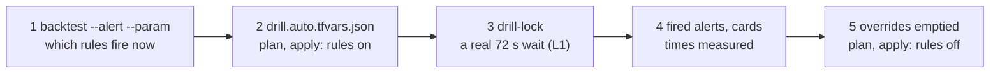

# Drill the rules on dev

Stage 3 of the [map](README.md): prove that each rule's card reaches dev's Teams channel, by making the rule fire on
today's data with a lowered value, or on a real event that touches no data (acceptance A4 and A5,
[proof in three steps](../design.md#decisions), D10). dev's rules are disabled outside drills.
Last verified: 2026-11-08.

## Overview



The drill's values sit in [terraform/envs/dev/drill.auto.tfvars.json](../../terraform/envs/dev/drill.auto.tfvars.json),
read by the alerts module's `overrides`; which rule is drilled how is in the
[spec's A4](../specs/round-1.md#acceptance).

## Prerequisites

| Needs | Check | If not |
|---|---|---|
| Where and mode: home with the client's VPN on, or the office (step 3 reaches the dev server); the owner watches the dev channel | | |
| Round 1 deployed on dev, the job running | [deploy](deploy.md), its "Verify end to end" | Deploy first |
| The reader service for the dev server | `psql service=odoo-reader -X -At -c 'show default_transaction_read_only'` prints `on` | The lab's service file |

## Steps

### 1. Find what fires on today's data

Why: a drill lowers a value only as far as today's data needs, so the rule fires on real rows.

```bash
python3 kql/backtest.py L5-page --env dev --alert --param MaxPending=-1 | python3 tools/mask.py
```

Output (REAL, 2026-11-08 05:28 UTC; one line per rule, the values of the drill file):

```text
L2-5xx as the alert, dev: 1 row(s) -> FIRES        (Class "", MinCount 1: 7 requests, all 200)
L4 as the alert, dev: 1 row(s) -> FIRES            (IgnoreCodes []: 1 cleanup with code 0)
L5-ticket as the alert, dev: 2 row(s) -> FIRES     (failed 0 > -1)
L6 as the alert, dev: 1 row(s) -> FIRES            (Auto-vacuum 47.8 h late)
L1-wait as the alert, dev: 0 row(s) -> quiet       (no lock wait on dev: step 3 makes one)
L3, L7: quiet                                      (no tunnel event in 2 days, no container event: not drilled)
```

Check: every rule in the drill file fires, or has an event planned (L1).

### 2. Turn the rules on

```bash
bash tools/obs.sh plan dev
bash tools/obs.sh apply dev
```

Output (REAL, 2026-11-08 05:30 to 05:34 UTC):

```text
Plan: 0 to add, 11 to change, 0 to destroy.
1401 string(s) scanned, 0 with a trace of the repo
```

Check: `az graph query` on `microsoft.insights/scheduledqueryrules` and `metricalerts` named `obs-dev-*` lists the 11
drilled rules `enabled: true`, the others `false`.
If you see `Error acquiring the state lock ... blob metadata "terraformlockid" was empty` on the next command: the
apply wrote the state but left the blob's lease; with no terraform running, break it:
`az storage blob lease break --account-name obstfstate -c tfstate -b dev.tfstate --auth-mode login`
([row](../known-failure-modes.md)).

### 3. A real lock wait (L1)

Why: L1 reads the server's lock-wait log lines; two read-only sessions contending for an advisory lock make one, over
L1's real 60 s threshold, without touching any table.

```bash
bash tools/obs.sh drill-lock odoo-reader 75
```

Output (REAL, 2026-11-08):

```text
holder starts 05:34:09
waiter starts 05:34:12
waiter got the lock 05:35:24
```

Check: the waiter waited over 60 s.

### 4. Watch the alerts and the cards

```bash
az graph query -q "alertsmanagementresources | where properties.essentials.alertRule has 'obs-dev' ..."
```

The full query, and the Logic App's runs (one per card), are in the measured table below; each card was seen by the
owner in the dev channel.

### 5. Let the alerts resolve, then turn the rules off

Why: an alert resolves only when its rule runs again and finds nothing, so the rules first go back to their real
values while still enabled; once every alert reads `Resolved` (each with a `Resolved` card), the overrides are emptied
and dev's rules are disabled again (they cost nothing then).

```bash
# 1. drill.auto.tfvars.json: each drilled rule { "enabled": true } with no params or threshold
bash tools/obs.sh plan dev && bash tools/obs.sh apply dev
# 2. when every alert is Resolved: { "rule_overrides": {} }
bash tools/obs.sh plan dev && bash tools/obs.sh apply dev
```

Check: Resource Graph shows each drilled alert `Resolved`; the last plan sets the 11 rules back to `enabled = false`.

## Verify end to end

A4 on 2026-11-08 (REAL): rules enabled between 05:30:46 and 05:34:09 UTC; the card time is the dev Logic App's run.

| Rule | Drill | Fired (UTC) | Card (UTC) | Within |
|---|---|---|---|---|
| M5 is alive | threshold 2 | 05:32:56 | 05:32:59 | yes |
| M3 CPU | threshold 0 | 05:32:57 | 05:33:00 | yes |
| M4 storage | threshold 0 | 05:33:52 | 05:33:54 | yes |
| L4 IKE | code 0 counted | 05:35:01 | 05:35:03 | yes |
| L5-page | pending > -1 | 05:35:46 | 05:35:48 | yes |
| L5-ticket | failed > -1 | 05:36:41 | 05:36:44 | yes |
| L2-5xx | every status | 05:37:28 | 05:37:29 | yes |
| L2-499 | every status | 05:37:42 | 05:37:44 | yes |
| L1-wait | a real 72 s wait ending 05:35:24 | 05:37:48 | 05:37:50 | yes: 2 min 26 s after the wait |
| L1-burst | waiting > 0 (the waiter's `still waiting` line, 05:34:13) | 05:44:52 | 05:44:53 | yes: 10 min 40 s (a 15-min rule) |
| L6 | late > 0 min | 05:46:29 | 05:46:30 | yes: 15 min 43 s after the apply's start (a 15-min rule) |

All 11 fired and all 11 cards arrived (the Logic App's 11 runs `Succeeded`). Each card followed its alert by 1 to 3 s;
the 5-min rules fired within 8 min of the apply's start, the 15-min rules within 16 min, inside A4's 10 and 20 min.

## Round 2's rules (B6)

The same steps with round 2's values in [drill.auto.tfvars.json](../../terraform/envs/dev/drill.auto.tfvars.json); the
rows come from one run of each job (`bash tools/obs.sh job dev start` and `bash tools/obs.sh job dev start log`):

| Rule | Drill | Data | Fired (UTC) | Card |
|---|---|---|---|---|
| T1 | `MinDeadPct` 100, `MinDeadRows` 2000 | the SQL job's table rows of 10:35 | 10:40:06 (2 tables) | 10:40:07, 10:40:08 |
| R1 | `BudgetSec` 5 (dev's refreshes stayed under 10 s for 3 h) | dev's refresh lines | 10:44:36 | 10:44:37 |
| O1 | `Kinds` the reader's own `scan` row, `MinKills` 0: the path from the reader to the card; the counting is proven by the toy log and the backfills | the reader's rows of 10:38 and 10:41 | see | |

Q1 is stg's only (dev's Query Store goes elsewhere): proven by its backtest, the 7 heavy hours of 30 days.

## Round 3's rules (C4)

The same steps for the SLO rules ([spec](../specs/round-3.md#terraform)). dev's web app has little traffic and no
failures, so a lowered target cannot make it burn; the drill instead makes any traffic "burn": in
[drill.auto.tfvars.json](../../terraform/envs/dev/drill.auto.tfvars.json), `SLO-fast` with
`{ "enabled": true, "params": { "Factor": "-1", "MinBad": "0" } }`.

```bash
python3 kql/backtest.py SLO-fast --env dev --alert --param Factor=-1 --param MinBad=0 | python3 tools/mask.py
bash tools/obs.sh plan dev        # 2 to add the first time (SLO-fast, SLO-slow), then read it
bash tools/obs.sh apply dev
# a few ordinary page loads on dev's web app (its hostname from az containerapp show, never written down)
```

Output of the query (REAL, 2026-11-08 12:31 UTC, trimmed): both journeys fire, one row per journey and step:

```text
SLO-fast as the alert, dev: 4 row(s) -> FIRES
  {"BadLong": "0", ..., "Journey": "tv", "TotalLong": "60", "TotalShort": "5"}
  {"BadLong": "0", ..., "Journey": "interactive", "TotalLong": "26", "TotalShort": "8"}
```

| Rule | Drill | Applied (UTC) | Fired (UTC) | Card (UTC, the Logic App's runs) |
|---|---|---|---|---|
| SLO-fast | `Factor` -1, `MinBad` 0; five page loads at 12:28:59 | 12:28:35 | 12:32:47, two alerts (tv, interactive) | 12:32:49 to 12:32:50, both `Succeeded` |

Check: two alerts `obs-dev-SLO-fast` in Resource Graph, one per journey (the `Journey` dimension), and two cards: 4 min
12 s from the apply, 2 s from alert to card. SLO-slow is the same query with other values; its path is the same rule
type and action groups, so it is proven by its backtest.

Then step 5: `SLO-fast` back to `{ "enabled": true }` (real values: dev has no failures, so both alerts resolve), and once
they read `Resolved`, `{ "rule_overrides": {} }`. On 2026-11-08 (REAL): back to real values at 12:34 UTC, both alerts `Resolved` at 12:48:47, overrides emptied
and applied at 12:50; `plan dev` then read `No changes`.

If you see `Error while loading schemas for plugin components: Failed to obtain provider` on `apply`: a transient failure
before anything changed (2026-11-08 12:34 UTC, while another Terraform run was active); the saved plan is still there
and `apply` again applies it.

## Round 4's rules (F4, F5)

The steps above for L1-wait's in-progress reading and E1 ([spec](../specs/round-4.md#acceptance)), with
[drill.auto.tfvars.json](../../terraform/envs/dev/drill.auto.tfvars.json):

```json
{ "rule_overrides": {
    "L1-wait": { "enabled": true },
    "E1": { "enabled": true, "window": "P2D", "lookback": "2d" }
} }
```

E1 cannot be drilled by making its event (a deploy or a restart of an Odoo app is the ERP team's), and Azure runs a
log alert's query only over the rule's window, so the drill widens E1's window and lookback to 2 days (Azure's
maximum), back to dev's last real deploy. L1: a 420 s wait, the dev job started 70 s and 250 s into it.

```bash
bash tools/obs.sh drill-lock odoo-reader 420 &
sleep 70; bash tools/obs.sh job dev start; sleep 180; bash tools/obs.sh job dev start; wait
```

Output (REAL, 2026-11-08, UTC):

```text
holder starts 16:24:29
waiter starts 16:24:32
waiter got the lock 16:31:30
```

| Rule | Fault | Alert fired | Card's run | Note |
|---|---|---|---|---|
| L1-wait | The wait 16:24:32 to 16:31:30; the job's rows at 16:26:13 (99.5 s) and 16:29:32 (298.6 s), each in the workspace within 7 s | 16:28:10 | 16:28:19 `Succeeded` | **3 min 20 s before the wait ended**; resolved 16:54:16 |
| E1 | dev's deploy of 2026-11-07 04:08 inside the 2-day window | 16:59:26 | 16:59:27 `Succeeded` | The rule's first evaluation after the override |

Then `{ "rule_overrides": {} }`, `plan dev` (2 to change), `apply dev`: both off on dev again (17:00 UTC).

## Round 5's rule (G3)

L1-burst's new conditions ([spec](../specs/round-5.md#acceptance)): a lock-timeout cancellation cannot be made on dev
without holding a lock in Odoo's database as Odoo's role, so the drill reaches dev's **real** cancellations of the last
2 days with the window override of round 4 and `MinCancelled` 0, in
[drill.auto.tfvars.json](../../terraform/envs/dev/drill.auto.tfvars.json):

```json
{ "rule_overrides": {
    "L1-burst": { "enabled": true, "window": "P2D", "lookback": "2d", "params": { "MinCancelled": "0" } }
} }
```

Output (REAL, 2026-11-08, UTC): what the override reaches, `python3 kql/backtest.py L1-burst --env dev --start
2026-11-06T23:00:00Z --param MinCancelled=0`: `8 firing bin(s)` on 11-07, 1 to 3 cancellations each.

| Rule | Fault | Alert fired | Card's run | Note |
|---|---|---|---|---|
| L1-burst | dev's real cancellations of 2026-11-07 inside the 2-day window | 23:48:31 | 23:48:33 `Succeeded` | The first evaluation after the apply (23:32:50) |

Then back to idle **with no alert left open**: a disabled rule never runs again, so an alert it fired stays `Fired`,
and enabling the rule later does not bring it back (round 4's E1: re-enabled at 23:51, still `Fired` at 00:53 after
four quiet runs). **Never close it by hand**: that changes the alert's state, not its condition, and the rule never
fires again ([round 6](#round-6s-rules-i6-i9), [learn](../learn/azure-monitor-alerts.md#how-long-a-fired-alert-takes-to-resolve)).
So the drilled rules go back to their real values **while still enabled**:

```json
{ "rule_overrides": { "L1-burst": { "enabled": true }, "E1": { "enabled": true } } }
```

`plan dev` (2 to change), `apply dev`; when Resource Graph shows the drilled alert `Resolved` (L1-burst: 00:34:31, 46 min
after it fired), `{ "rule_overrides": {} }`, `plan dev` (2 to change: `enabled` to false), `apply dev` (00:55:56). Check: no `Fired` alert from a rule `obs-dev-*` that is disabled.

## Round 6's rules (I6, I9)

L7's new crash-loop condition and the card filter ([spec](../specs/round-6.md#acceptance)), on dev, in three applies
of [drill.auto.tfvars.json](../../terraform/envs/dev/drill.auto.tfvars.json). dev logged no process exit in the 2 days
before, but 11 deploys, so L7 is drilled on their new containers (`MinExited` 0, `MinRestarts` 1). T1 is drilled as in
round 2, on one run of dev's SQL job (`bash tools/obs.sh job dev start`).

```json
{ "rule_overrides": {
    "L7": { "enabled": true, "window": "P2D", "lookback": "2d", "params": { "MinExited": "0", "MinRestarts": "1" } },
    "E1": { "enabled": true, "window": "P2D", "lookback": "2d" } } }
```

Then L7 back to real values while enabled, with T1 drilled (`MinDeadPct` 100, `MinDeadRows` 2000, 2-day window); then T1
back to real values while enabled; then `{ "rule_overrides": {} }` once every drilled alert reads `Resolved`.

Output (REAL, 2026-11-10, UTC; cards: the Logic App's runs and their `post` action, read with `az rest` on
`.../runs/<run>/actions`):

| Rule | Kind | Fired | Card | Resolved | Resolve card |
|---|---|---|---|---|---|
| L7 | page (Sev1) | 05:54:15 | 05:54:17 `post=Succeeded` | 06:55:17 | 06:55:25 `post=Succeeded` |
| T1, two tables | ticket (Sev3) | 06:24:14 | 06:24:16 twice, `post=Succeeded` | 07:10:16, 07:10:17 | none: runs at 07:10:18 and 07:10:19, `post=Skipped` |
| E1 | ticket | did not fire | | | |

Check: a page posts at both ends, a ticket only when it fires; no `obs-dev-*` alert left `Fired`.

If you see a drilled rule that does not fire though its query returns rows (run the rule's own query from
`az monitor scheduled-query show`): look at its last alert in Resource Graph. If it reads `monitorCondition` `Fired`
and `alertState` `Closed`, it was closed by hand and the rule is blocked. dev's E1 has been since 2026-11-09:
48 min of quiet runs and recreating the rule under the same name did not clear it. No recovery is known; E1's new query
was proven by Azure's own run, the backtest and stg's deploys instead ([row](../known-failure-modes.md)).

## Round 7's checks (N6)

L5's `behind`, `stall` and `dead` ([spec](../specs/round-7.md#acceptance)) on dev, in three applies of
[drill.auto.tfvars.json](../../terraform/envs/dev/drill.auto.tfvars.json). dev's job runs by hand while dev is idle, so
each rule reads its whole window as one bin (`BinSize`) and its last run decides. First, the job once
(`bash tools/obs.sh job dev start`), and each rule as the alert with the drill's values (`kql/backtest.py <rule> --env
dev --alert --param ...`) to see that it fires.

```json
{ "rule_overrides": {
    "L5-page": { "enabled": true, "window": "P2D", "lookback": "2d", "params": { "MaxReadyAgeMin": "0", "BinSize": "2d" } },
    "L5-ticket": { "enabled": true, "params": { "MaxReadyAgeMin": "0", "MinLateChannels": "100", "MinLateJobs": "100000", "BinSize": "1d" } } } }
```

`MaxReadyAgeMin` 0 makes every channel with a ready job late, so dev's 3 channels with ready jobs make `behind`; with the page's scale out of
reach, L5-ticket reads them as a `stall`. `dead` needs no lowering when dev's endpoint imports die (12 in 24 h on
2026-11-14). Then both rules back to real values while enabled (`{ "L5-page": { "enabled": true }, "L5-ticket": {
"enabled": true } }`): with no job run in the last bin, neither returns a row and each alert resolves. Then
`{ "rule_overrides": {} }` once every drilled alert reads `Resolved`.

Output (REAL, 2026-11-14, UTC):

| Check | Kind | Fired | Card | Resolved | Resolve card |
|---|---|---|---|---|---|
| L5-page `behind` | page (Sev1) | 03:49:30 | 03:49:33 `post=Succeeded` | 04:20:28 | 04:20:31 `post=Succeeded` |
| L5-ticket `dead` | ticket (Sev3) | 03:59:26 | 03:59:28 `post=Succeeded` | 04:45:27 | none: `post=Skipped` |
| L5-ticket `stall` | ticket (Sev3) | 03:59:27 | 03:59:31 `post=Succeeded` | 04:45:27 | none: `post=Skipped` |

Check: three alerts, each card within 4 s; the page posts at both ends, the tickets only when they fire; dev idle after
(`obs.sh drift` 0; no `obs-dev-*` alert `Fired` except E1's and H's, which were closed by hand on 2026-11-08 and stay so). If you see the job fail
with `permission denied for table queue_job`: dev's grants are gone after a change of its database; run round 1's role
SQL again (`obs.sh role dev <admin service>`, then `role-check`) ([row](../known-failure-modes.md)).

## Roll back

Step 5. A drill changes nothing but the rules' `enabled` and their parameters; the advisory lock ends with its session.
