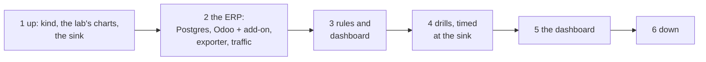

# The Kubernetes lab

Bring up the Kubernetes mapping's lab on the laptop, drill each translated rule, and take it down
([spec](../specs/kubernetes-mapping.md), [D15](../design.md#decisions), [learn](../learn/prometheus-loki.md)). Lab
only: nothing reaches the client's Azure, and its numbers are never the client's.

## Overview



## Prerequisites

| Needs | Check | If not |
|---|---|---|
| Auto mode; anywhere (the charts and images come from the internet) | | |
| Docker running; about 4 GB of memory free | `free -m` shows about 4,000 available | Stop other clusters (the lab repo's `ocr-lab`) |
| The lab repo's toolchain and values | `ls ~/lab/.toolchain/bin/kind ~/lab/infra/platform/values/loki/common.yaml` | Clone the lab repo beside this one |

## Steps

### 1. The cluster and monitoring

```bash
bash k8s/lab.sh platform
```

Output (REAL, 2026-11-08; the time is UTC):

```text
16:03:01 monitoring up
```

6 min 29 s from `kind create`, the image pulls included. Check: `kubectl -n monitoring get pods` (with
`KUBECONFIG=.scratch_kube/obs-lab.yaml`) shows every pod `Running`, `loki-0` 2/2.

### 2. The ERP

```bash
bash k8s/lab.sh erp
```

Output (REAL, 2026-11-08):

```text
16:03:56 erp up
```

Check: Odoo's log shows `Module incident_lab loaded`, and the exporter's metrics hold `erp_lock_wait_max_seconds` and
`erp_cron_overdue_seconds{name="Incident lab: one-minute task"}`. After a change to the add-on, roll Odoo
(`kubectl -n erp rollout restart deploy/odoo`): a mounted ConfigMap is not reread.

### 3. Rules and the dashboard

```bash
bash k8s/lab.sh rules
```

Check (through the API server: the Prometheus image has no `wget`):

```bash
kubectl get --raw "/api/v1/namespaces/monitoring/services/kps-prometheus:9090/proxy/api/v1/rules"     # 10 erp rules, health ok
kubectl get --raw "/api/v1/namespaces/monitoring/services/loki:3100/proxy/prometheus/api/v1/rules"    # 5 rules, health ok
```

Output (REAL, 2026-11-08 16:06): Prometheus `HExporterSilent, M5DatabaseDown, L1LockWait, L1LockBurst, L6LateTask,
L7Killed, M1Restarts, erp:slo_bad_ratio:5m, erp:slo_bad_ratio:1h, SLOFast`, all `ok`; Loki `L2Http5xxBurst` and the
four recording rules, all `ok`; a minute later Prometheus held `erp:requests:count5m` interactive 7, tv 24.
If you see Loki's ruler list no rules: it mounted an earlier version of the `loki-rules` ConfigMap; wait a minute for
the kubelet to refresh it.

### 4. Drills

```bash
for d in lock http5xx cron oom exporter; do bash k8s/lab.sh drill $d; sleep 150; done
bash k8s/lab.sh sink
```

Output (REAL, 2026-11-08, the sink's log, UTC):

```text
16:10:09 page   firing   L1LockWait since=16:09:54 A lock wait in progress for 1m 5s
16:12:20 page   resolved L1LockWait since=16:09:54 A lock wait in progress for 2m 26s
16:14:47 page   firing   L2Http5xxBurst since=16:14:34 25 or more 5xx answers in 5 min
16:15:01 page   firing   SLOFast since=16:14:42 Journey interactive burns its 30-day budget at over 14.4x
16:20:17 page   firing   L7Killed since=16:20:04 odoo in <pod> killed for memory
16:20:17 ticket firing   M1Restarts since=16:20:04 odoo in <pod> restarted in the last 15 min
16:20:23 ticket firing   L6LateTask since=16:20:10 Scheduled task Incident lab: one-minute task 2m 13s late
16:25:40 page   firing   HExporterSilent since=16:25:28 No scrape of Odoo's database for 2 min: L1 and L6 are blind
16:27:51 page   resolved HExporterSilent since=16:25:28 No scrape of Odoo's database for 2 min: L1 and L6 are blind
```

The lock drill also prints `waited 148.3 s` and `16:11:20 the waiter returned`: the page came 71 s before the wait
ended. Check: each drilled rule fires once, with its receiver (page or ticket). Each drill's time from fault to sink:
[learn, the drills](../learn/prometheus-loki.md#the-drills-real-times).
If you see the lock drill's requests end with an empty reply: Odoo's `limit_time_real` (120 s) reloaded the server
(its log: `virtual real time limit ... reached`); the page has still come during the wait.
If you see L6 fire with the cron drill and an oom drill close together: space them more than the task's 200 s sleep.

Round 2's rules (K8 to K10): `bloat`, then `heavy` and `limit` (they can run together):

```bash
bash k8s/lab.sh drill bloat; bash k8s/lab.sh drill heavy & bash k8s/lab.sh drill limit & wait
bash k8s/lab.sh sink
```

Output (REAL, 2026-11-08, UTC; `bloat` 23:46:32 to 23:46:33, `heavy` 23:47:04 to 23:53:39, `limit` with its 240 s hold
from about 23:55 to 23:59:07):

```text
23:46:51 ticket firing   T1TableBloat since=23:46:35 Table lab_bloat: 50% of its rows dead, autovacuum behind
23:54:05 ticket firing   Q1HeavyHour since=23:53:50 105 min of database time in the last hour
23:56:07 page   firing   L1LockWait since=23:55:57 A lock wait in progress for 1m 2s
23:57:59 page   firing   O1WorkerLimits since=23:57:45 3 or more of Odoo's limit lines in 15 min: requests in flight on those workers fail
23:59:12 ticket firing   L6LateTask since=23:58:57 Scheduled task Incident lab: one-minute task 2m 6s late
```

T1 18 s after the update; Q1 26 s after the 16 statements ended (a statement counts when it ends, so the hour's total
jumps then; 105 min: the sleeps' 94 plus Odoo's own queries); O1 69 s after Odoo's four `virtual real time limit` lines of 23:56:50 (one per thread, at one check). The
limit drill's held lock also pages L1, and the server's reload after the limit leaves the one-minute task late (L6),
both as in the first lock drill above. Check: T1, Q1 and O1 each fire once.
If you see O1 not fire and no limit line in Odoo's log: the hold was too short for the threaded server's check, which
runs every 60 s; the drill holds 240 s for that (a 150 s hold missed it on 2026-11-08).

### 5. The dashboard

```bash
bash k8s/lab.sh check
```

In a browser: keep a forward open, then open `http://localhost:3300` (WSL forwards it to
Windows), user `admin`, the dashboard "ERP: the track's signals on Kubernetes". The password is the Grafana Helm
chart's, read from its Secret `kps-grafana` and never written down (with the `PATH` and `KUBECONFIG` of the
prerequisites above):

```bash
kubectl -n monitoring port-forward svc/kps-grafana 3300:80 &
kubectl -n monitoring get secret kps-grafana -o jsonpath='{.data.admin-password}' | base64 -d; echo
```


Output (REAL, 2026-11-08 16:37, the panels' queries over the last 40 minutes, through Grafana):

```text
ERP: the track's signals on Kubernetes - 7 panels
max_over_time(max(erp_lock_wait_max_seconds)[40m:15s])       [('', 157.169)]
max_over_time(sum(erp:requests_bad:count5m)[40m:15s])        [('', 40.0)]
max_over_time(erp:slo_bad_ratio:5m[40m:15s])                 [('interactive', 0.597)]
max(max_over_time(erp_cron_overdue_seconds{name="Incident la [('', 181.868)]
max(max_over_time(kube_pod_container_status_restarts_total{n [('', 1.0)]
```

Loki, the same 40 minutes: 40 lines answered 5xx. Check: every panel's series shows its drill.

Output (REAL, 2026-11-09 00:00 UTC, after round 2's drills; no 5xx drill this time, so its two series are empty):

```text
ERP: the track's signals on Kubernetes - 10 panels
max_over_time(max(erp_lock_wait_max_seconds)[40m:15s])       [('', 262.374)]
max(max_over_time(erp_cron_overdue_seconds{name="Incident la [('', 211.141)]
max_over_time((sum(increase(erp_db_time_seconds_total[1h]))  [('', 121.656)]
max(max_over_time(erp_table_dead_rows{table="lab_bloat"}[40m [('', 120000.0)]
```

If you see `kill: ... No such process` at the end: a forward on 3300 was already open (yours, for the browser);
`check` used it.

### 6. Down

```bash
bash k8s/lab.sh down
```

Output (REAL, 2026-11-08 16:52 UTC):

```text
Deleting cluster "obs-lab" ...
Deleted nodes: ["obs-lab-control-plane"]
```

Check: `kind get clusters` prints `No kind clusters found.`; `docker ps` shows no `obs-lab-control-plane`; about
5.8 GB of memory free again (from 3.3 GB with the lab up).

## Roll back

`bash k8s/lab.sh down` removes everything the lab made; `rm -rf .scratch_kube` removes the kubeconfig and Helm's
cache.
