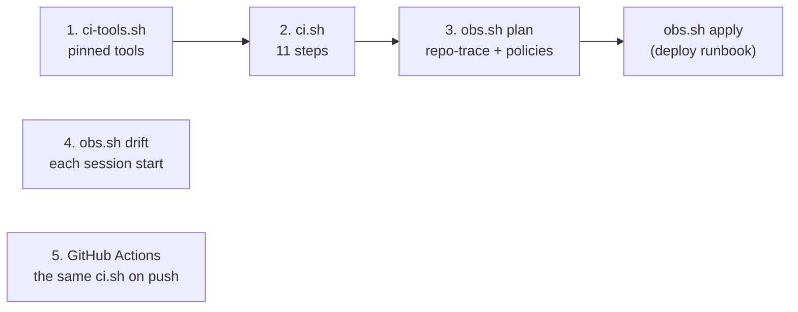

# The pipeline: CI, the policy gates, drift

On the [map](README.md): the checks of the [pipeline spec](../specs/pipeline.md) ([D18](../design.md#decisions)), run on
the laptop exactly as GitHub Actions runs them, the policy gate inside `obs.sh plan`, and the drift reading at a session
start. Background: [policy-as-code](../learn/policy-as-code.md).
Last verified: 2026-11-08.

## Overview



## Prerequisites

| Needs | Check | If not |
|---|---|---|
| Where and mode: anywhere, Auto (steps 1, 2, 5 read the repo only); steps 3 and 4 read Azure with the write login, no change | | |
| Python 3.11 or later (`tomllib`) and `curl` | `python3 --version` | |
| For steps 3 and 4: the roots initialised and the write login | `bash tools/obs.sh tf dev validate` | [deploy, prerequisites](deploy.md) |

## Steps

### 1. The tools

Why: the same versions on the laptop and in CI, each download checked against the SHA-256 pinned in the script.

```bash
bash tools/ci-tools.sh
```

Output (REAL, 2026-11-08):

```text
Terraform v1.17.1
TFLint version 0.65.0
trivy Version: 0.76.1
gitleaks 8.30.1
Conftest: 0.71.1
opa Version: 1.21.3
```

Check: six versions printed, exit 0; a second run downloads nothing.
If you see `checksum mismatch`: the release changed upstream after it was pinned; do not edit the sum to match, find
out why first.
If you see exit 141: a `head` closed a pipe under `pipefail` ([row](../known-failure-modes.md)).

### 2. Every CI step

Why: what GitHub runs on a push, run first where it is quick to fix.

```bash
bash tools/ci.sh            # all eleven steps; or name some: bash tools/ci.sh fmt policy
```

Output (REAL, 2026-11-08, trimmed):

```text
::group::validate
-- terraform/envs/shared
Success! The configuration is valid.
... (dev, stg, modules/alerts, modules/sql-job the same)
::group::trivy_config
│ envs/dev    │ terraform │         0         │
│ envs/shared │ terraform │         0         │
│ envs/stg    │ terraform │         0         │
::group::trivy_deps
│ requirements.txt │ pip  │        0        │
::group::policy
20 tests, 20 passed, 0 warnings, 0 failures, 0 exceptions, 0 skipped
147 tests, 147 passed, 0 warnings, 0 failures, 0 exceptions
::group::repo_trace
28 rendered queries scanned
terraform/envs/shared/routes.auto.tfvars.json: 11 string(s) scanned, 0 with a trace of the repo
... (7 more JSON files, 0 traces)
== summary
fmt           pass
validate      pass
tflint        pass
trivy_config  pass
trivy_deps    pass
docs          pass
policy        pass
repo_trace    pass
```

That run named eight steps: `gitleaks` reads the history with `gitleaks git`, which the git worktree S2 was built in
refused to run; it ran in CI ([step 5](#5-on-github)), and `gitleaks dir` over each tracked folder found no leaks.

Check: every line of the summary reads `pass`, exit 0. `policy`'s 147 is conftest's count: 7 rules on 21 `.tf` files.
If you see a module's `.terraform.lock.hcl` appear: `validate` creates one per module and removes it again; an older
`ci.sh` left them behind ([row](../known-failure-modes.md)).
If you see `tflint` warn about unused variables or `required_version`: the config is not loaded; `ci.sh` passes it by
absolute path ([terraform/.tflint.hcl](../../terraform/.tflint.hcl) says why both rules are off).

### 3. The plan gate

Why: the policies see every value as it will reach Azure only in the plan. `obs.sh plan` runs them after the repo-trace
scan and deletes the plan if either refuses.

```bash
bash tools/obs.sh plan dev
```

Output (REAL, 2026-11-08, run with `TF_CLI_ARGS_plan=-lock=false` while another session was applying):

```text
No changes. Your infrastructure matches the configuration.
1912 string(s) scanned, 0 with a trace of the repo
8 tests, 8 passed, 0 warnings, 0 failures, 0 exceptions
```

Check: the last line has `0 failures`, and `.scratch_tf/dev/dev.tfplan` exists for `obs.sh apply`.
If you see `policy refused the plan`: read the `FAIL` lines; a new resource type is added to
[lib.rego](../../policy/terraform/lib.rego) in the same commit, with its reason in the stage's spec; a tag or a group
is fixed in the code. Output of a refused plan (REAL, a storage account added on purpose, never committed):

```text
  # azurerm_storage_account.broken will be created
Plan: 1 to add, 0 to change, 0 to destroy.
1960 string(s) scanned, 0 with a trace of the repo
FAIL - - plan - azurerm_storage_account.broken: azurerm_storage_account is not a type the track may create (only monitoring resources)
8 tests, 7 passed, 0 warnings, 1 failure, 0 exceptions
policy refused the plan (exit 1): nothing to apply
```

### 4. Drift

Why: code and Azure compared at a session start, without a lock (a plan writes no state) and without a plan file.

```bash
bash tools/obs.sh drift; echo "exit $?"
```

Output (REAL, 2026-11-08 19:23):

```text
shared: no drift
dev: no drift
stg: no drift
exit 0
```

Check: exit 0. Exit 2 lists each root's changes: code not yet applied (expected while a stage is being built), or a
change made in Azure outside Terraform (apply the code back, or adopt the change into the code). Exit 1: a plan failed;
its error lines are shown.

### 5. On GitHub

Why: every push and pull request runs [ci.yml](../../.github/workflows/ci.yml): the same two scripts, read-only
permissions, no secret.

```bash
gh run list --workflow ci.yml --limit 3
```

Check: the run on the latest commit reads `completed success`; a failed run's log is grouped by step (`::group::`).

## Verify end to end

`bash tools/ci-tools.sh && bash tools/ci.sh` exits 0; `bash tools/obs.sh drift` exits 0; the workflow on the latest
commit of `main` succeeded.

## Roll back

The stage changes nothing in Azure. To take the gate out of `obs.sh plan`, revert the four policy lines in
[tools/obs.sh](../../tools/obs.sh); to stop CI, delete `.github/workflows/ci.yml` (or disable the workflow on GitHub).
