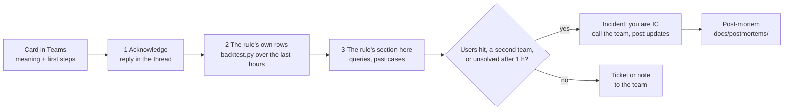

# Respond to an alert

What to do when a card arrives: the steps every card shares, then one section per signal enabled on stg (16 sections,
21 rules), each with what it means, the card's first steps, the queries that follow with real output, the past cases,
and when to call whom. The concepts (severity, roles, blameless post-mortems): [incident-response](../learn/incident-response.md);
the design: [round 3, incident response](../specs/round-3.md#incident-response). Last verified: 2026-11-08.

## Overview

**The card holds the first minutes (what it means, three or four steps); this page holds the rest. The track reads
only: ending a session, rolling back a deploy, restarting or resizing an app is the owning team's call, also during an
incident.**



Where each rule's card text lives (the source of the first steps quoted below): log rules in
[kql/rules.json](../../kql/rules.json) (`about`, `first_steps`), metric rules in
[the alerts module](../../terraform/modules/alerts/main.tf) (`metric_rules`). The card's other facts: the severity
(`Sev1` page, `Sev3` ticket), the times, the value, the dimensions, and "Open in Azure" (the rule's rows in the portal).

| Team | Owns | Call them for |
|---|---|---|
| ERP team | Odoo: code, config, deploys, its database sessions and scheduled tasks | Anything Odoo does or stops doing; a rollback; ending a session |
| Platform team | Azure: the Postgres servers, the Container Apps environments, the VPN gateway, the workspace | A server, a gateway, a resize, a server setting |
| On-prem team | The SQL Server and the firewall at the other end of the tunnel | The tunnel's far side |

## Prerequisites

| Needs | Check | If not |
|---|---|---|
| Where and mode: anywhere for the workspace queries (Auto); the client's VPN or the office for `psql` | | |
| The read login (`.scratch_az`) | `bash tools/obs.sh kq 'print 1'` prints a table | `az login` per [AGENTS.md](../../AGENTS.md#sessions-and-logins) |
| The names files | `terraform/envs/stg/names.auto.tfvars.json` exists | `bash terraform/names.sh` (read only) |

## Every card

A ticket (Sev3) posts one card, when it fires; a page (Sev1) posts a second when it resolves (since round 6). To see
whether a ticket has ended, read its alert in Azure ([alerts](../learn/azure-monitor-alerts.md#how-long-a-fired-alert-takes-to-resolve)).
Never close a track alert by hand: its rule would never fire again ([row](../known-failure-modes.md)).

### 1. Acknowledge

Why: the first reply in the card's thread says someone has it, so nobody else starts the same work. Write the time and
what you are checking. From then on the thread is the incident's timeline.

### 2. The rule's own rows over the last hours

Why: the rule's query, run as a backtest, shows every bin that fired and its values, not only the last one.

```bash
python3 kql/backtest.py L6 --start "$(date -u -d '-1 hour' +%Y-%m-%dT%H:%M:%SZ)" --rows 3 | python3 tools/mask.py
```

Output (REAL, 2026-11-08 13:48 UTC; stg's one open alert, the stopped cleanup task):

```text
L6 backtest, stg, 2026-11-08 to 2026-11-08 13:48: 4 firing bin(s)
  {"Bin": "2026-11-08T13:03:58Z", "CronId": "1", "CronName": "Base: Auto-vacuum internal data", "IntervalSec": "86400",
   "LastCall": "2026-11-04T07:27:06Z", "NextCall": "2026-11-05T05:34:42Z", "OverdueHours": "79.7"}
```

Check: the rows match the card's value. Replace `L6` with the card's rule (the part after `obs-stg-`); `--env dev` for a
dev card.

### 3. Any query, without names

Why: the follow-up queries below need the apps, the server and the gateway, which the docs never name;
`obs.sh kq-env` prepends them as `Apps`, `Web`, `Cron`, `Servers`, `Gateway`, and `role(app)` turns an app's name
into `web` or `cron`.

```bash
bash tools/obs.sh kq-env stg 'ContainerAppSystemLogs_CL | where ContainerAppName_s in~ (Apps) and Reason_s == "ContainerTerminated"
| summarize Kills = count() by App = role(ContainerAppName_s), Reason = extract(@"reason .(\w+)", 1, Log_s)' P7D
```

Output (REAL, 2026-11-08):

```text
App    Kills    Reason
-----  -------  ------------------
cron   2        ProbeFailure
web    2        ProcessExited
web    1        VolumeMountFailure
cron   1        ProcessExited
```

### 4. Decide: an incident or not

It is an incident when users are failing, a second team is needed, or it is unsolved after an hour
([learn](../learn/incident-response.md#when-an-alert-becomes-an-incident-and-the-roles)). Then the responder is
incident commander: one message to the owning team with the rule, the times and the evidence; one message to the
business channel (what users see, what to avoid, the next update's time); every action in the card's thread. In doubt,
treat it as the higher severity. After: a post-mortem in [docs/postmortems/](../postmortems/README.md).

## L1-wait and L1-burst: lock waits

Page (`L1-wait`): a statement waited over 60 s for a lock. Ticket (`L1-burst`): over 40 waits in one 5-minute bin (or, since round 5, lock timeouts, below). Why it
matters: each waiting web request holds one Odoo worker; when all are held, the probe fails and the container is
killed ([2026-08-20](../postmortems/2026-08-20-stg-502-bursts.md)). Card: `L1-wait`, `L1-burst` in `kql/rules.json`.

Then: the server's lock lines name the waiter, the holder and the statements (`log_lock_waits` is on):

```bash
bash tools/obs.sh kq-env stg 'union isfuzzy=true (PGSQLServerLogs | where LogicalServerName in~ (Servers) | project TimeGenerated, Message),
  (AzureDiagnostics | where Category == "PostgreSQLLogs" and LogicalServerName_s in~ (Servers) | project TimeGenerated, Message)
| where Message has_any ("still waiting for", "acquired", "Process holding the lock") | project TimeGenerated, Message = substring(Message, 0, 160)
| order by TimeGenerated asc' PT1H
```

Output (REAL, 2026-11-08, the [game day](#the-game-day-of-2026-11-08) on dev):

```text
2026-11-08 13:56:49 UTC-...-LOG:  process 1726158 still waiting for ExclusiveLock on advisory lock [579659,0,424242,1] after 1000.159 ms
2026-11-08 13:58:00 UTC-...-LOG:  process 1726158 acquired ExclusiveLock on advisory lock [579659,0,424242,1] after 71830.585 ms
```

The log names the **waiter** and the lock, not the holder: these servers write no `DETAIL` line with it (found by the
game day). The waiter's session is its connection lines (the same prefix): query the seconds before with
`where TimeGenerated between (...)`. While the wait lasts, the holder is named live by a reader service (the VPN or
the office; `odoo-reader` on dev, the lab's `obs-reader` on the prd server):

```bash
psql "service=odoo-reader application_name=obs-respond" -X -c "select w.pid as waiting_pid, w.application_name as waiting_app,
  now() - w.query_start as waiting_for, b.pid as holding_pid, b.application_name as holding_app, b.state as holding_state,
  left(b.query, 60) as holding_query from pg_stat_activity w cross join lateral unnest(pg_blocking_pids(w.pid)) as h(pid)
  join pg_stat_activity b on b.pid = h.pid"
```

Output (REAL, 2026-11-08 14:01 UTC, a 20 s wait made for this check on dev):

```text
 waiting_pid | waiting_app |   waiting_for   | holding_pid | holding_app | holding_state | holding_query
     1726471 | obs-drill   | 00:00:05.390995 |     1726467 | obs-drill   | active        | select pg_advisory_lock(424242), pg_sleep(20), ...
```

Check: a holding pid and its application. Another role's statement and state read `<insufficient privilege>` to a
reader (the track has no `pg_read_all_stats`): give the ERP team the pids and the application, they read the rest.
Escalate: the ERP team at once if waits continue or the web app shows 502s; ending a session is theirs. Past:
2026-08-25 and 09-18 (waits over 60 s); none since. Background: 6 to 7 waits per 5 minutes
([round 1, signals](../specs/round-1.md#signals)).

Since round 4 the card can also name `<database> (in progress)` as its server: the SQL job saw the wait **still going**
at its last run ([round 4](../specs/round-4.md#1-l1-while-the-wait-lasts)). Then the log has no line for it yet; find the
waiter and its holder live, read only, with `pg_blocking_pids()` (the live query above), and call the ERP team while users
are still waiting.

Since round 5 L1-burst also tickets **lock timeouts** ([round 5](../specs/round-5.md)): the card's row names the server
with `Cancelled` (statements Postgres ended at Odoo's role's 10 s `lock_timeout`, more than 12 in 5 minutes) or the
server `Odoo (requests failed)` with `Failed` (requests Odoo gave up after its 5 tries: a user saw an error). Why the
two differ: Odoo retries a web request's lock timeout itself, so a cancellation is a slow request, not yet a failed one;
on stg the cancelled statements are mostly background work (queue jobs, scheduled tasks), which Odoo's own log shows
no retry for ([learn](../learn/postgres-locks.md)). Then: group the cancellations by what they waited on, the `still
waiting` lines just before each (the relation's number, or a transaction):

```bash
bash tools/obs.sh kq-env stg 'union isfuzzy=true (PGSQLServerLogs | where LogicalServerName in~ (Servers) | project TimeGenerated, Message),
  (AzureDiagnostics | where Category == "PostgreSQLLogs" and LogicalServerName_s in~ (Servers) | project TimeGenerated, Message)
| where Message has "still waiting for"
| extend Target = iff(Message has " of relation ", strcat("relation ", extract(@"of relation (\d+)", 1, Message)), "a transaction")
| summarize Lines = count() by Target | order by Lines desc' PT1H
```

Output (REAL, stg, the 30 days to 2026-11-08): `a transaction` 8,513 lines; `relation 217413` over 550 (most on its
first row). Name a relation with a reader service, read only:
`select relname from pg_class where oid = 217413` gives
`spreadsheet_change_log` (2026-11-09). Check: one relation or one window of time dominates. Escalate: the ERP
team, next working day, with the relation and the times; at once if `Failed` is above 0 for several bins. Past: 10
bins on 5 days since 2026-08-27 (when stg's database moved and the cancellations begin), 5 of them on 2026-10-10 (13 to 16 cancellations each; whether any request failed cannot be read: stg's Odoo log on the share reaches back to 2026-10-31 only).

## L2-5xx and L2-499: failed and abandoned requests

Page (`L2-5xx`): 25 or more 5xx in 5 minutes. Ticket (`L2-499`): 25 or more requests the users gave up on. The code
decides the path: **502** is a missing backend (a container killed or starting), **500** is Odoo's own error (often a
deploy). Card: `L2-5xx`, `L2-499`.

Then: codes and paths of the last hours:

```bash
bash tools/obs.sh kq-env stg 'ContainerAppConsoleLogs_CL | where ContainerAppName_s in~ (Web) and ContainerName_s == "nginx"
| extend Status = toint(extract(@"\] ""[^""]*"" ([0-9]{3}) ", 1, Log_s)), Path = extract(@"\] ""[A-Z]+ (/[^?/ ]*/?[^?/ ]*)", 1, Log_s)
| where Status >= 500 | summarize Requests = count() by Status, Path | top 5 by Requests' P1D
```

Output (REAL, 2026-11-08 13:49 UTC): empty, no 5xx in the last day. On 2026-08-20 the same query by minute showed 84
and 113 502s at 03:06 and 03:18, and 500 on every `/erp/tv` poll from 10:24 to 11:04
([post-mortem](../postmortems/2026-08-20-stg-502-bursts.md#timeline)). For a 502 go on to [L7](#l7-app-terminations);
for a 500, check the web app's revisions for a deploy in the last hour. Escalate: the ERP team with the codes, the paths
and the deploy time.

## L7: app terminations

Page: an app's container killed out of memory (exit 137), a crash loop (3 or more process exits **and** 2 or more
restarts in 15 minutes, since round 6), or 2 or more kills after failed health probes (`ProbeFailure`, since
2026-11-08). A single restart is M1, M2's ticket. Card: `L7`. Then: the system log around the kills:

```bash
bash tools/obs.sh kq-env stg 'ContainerAppSystemLogs_CL | where ContainerAppName_s in~ (Apps)
| where Reason_s in ("ContainerTerminated", "ProcessExited", "RevisionCreation")
| project TimeGenerated, App = role(ContainerAppName_s), Reason_s, Log = substring(Log_s, 0, 70) | top 5 by TimeGenerated desc' P2D
```

Output (REAL, 2026-11-08 13:49 UTC):

```text
App    Log                                                 Reason_s       TimeGenerated
web    Container 'main' was terminated with exit code '1'  ProcessExited  2026-11-07T01:08:31Z
web    Container 'main' was terminated with exit code '1'  ProcessExited  2026-11-07T01:08:29Z
web    Container 'main' was terminated with exit code '1'  ProcessExited  2026-11-07T01:08:27Z
```

Check: probe kills follow worker exhaustion; look at lock waits (L1) and long requests just before. A `RevisionCreation`
is a deploy. Escalate: the ERP team with the app, the times and the last console lines. Past: the cron app's probe-kill
loops of 2026-09-04, 07 and 11; the web app on 09-09 ([post-mortem](../postmortems/2026-09-09-stg-cron-memory.md)).

Why the restarts count: one restart logs 3 to 9 `ProcessExited` within about 15 s, so the exits alone paged a single
restart on 2026-11-09 02:23 UTC (the cron app after one probe kill, [known failure mode](../known-failure-modes.md)).
The card's `Restarts` says how many times the container came back in the 15 minutes.

## E1: a deploy or an entrypoint warning

Ticket (`E1`): in 15 minutes, a new revision of an Odoo app (a deploy), or a container start whose entrypoint printed
`WARNING` (a configuration check that failed). Why it matters: a deploy explains the pages that follow it (the
2026-08-20 TV failures came 1 minute after one, [post-mortem](../postmortems/2026-08-20-stg-502-bursts.md)); a warning is
a misconfiguration nobody reads otherwise (34 days in 2026, [post-mortem](../postmortems/2026-09-09-stg-cron-memory.md)).
Card: `E1` in `kql/rules.json`.

```bash
python3 kql/backtest.py E1 --start 2026-10-01 --end 2026-11-01 --rows 2 | python3 tools/mask.py
```

Output (REAL, 2026-11-08):

```text
E1 backtest, stg, 2026-10-01 to 2026-11-01 00:00: 32 firing bin(s)
by month: 2026-10 32
```

About one deploy a day. A deploy card alone needs nothing; a page in the next hour is read against it. A warning card
goes to the ERP team with its line.

If you see one E1 card in an hour of several deploys: a deploy while E1's alert is still open (about 45 min after it
fired) sends no card, so read the system log's `RevisionCreation` rows for the hour (2026-11-09: three deploys, two cards,
the one at 02:58 UTC inside the alert of 02:37). The card names the **new** revision (since round 6), or
`replacing <old>` when the image was not pulled in the same 15 minutes.

## M1, M2: an app restarted

Ticket (`M-restarts-app1`, `M-restarts-app2`, one per app): `RestartCount` above 0 in 15 minutes. Card text: the
module's `metric_rules`. Then: the same system log query as [L7](#l7-app-terminations); a revision change explains a
restart, a `ProbeFailure` points to busy workers. Escalate: the next working day, unless several in an hour (then L7
pages).

## SLO-fast and SLO-slow: the error budget burning

Page (`SLO-fast`): a journey burns its 30-day budget over 14.4 times too fast, in the last hour and the last 5 minutes.
Ticket (`SLO-slow`): over 6 times, in 6 hours and 30 minutes. The terms: [slo](../learn/slo.md). Card: `SLO-fast`,
`SLO-slow` (the `Journey` dimension says `tv` or `interactive`). Then: the journey's last hour, good and bad:

```bash
bash tools/obs.sh kq-env stg 'ContainerAppConsoleLogs_CL | where ContainerAppName_s in~ (Web) and ContainerName_s == "nginx"
| extend Status = toint(extract(@"\] ""[^""]*"" ([0-9]{3}) ", 1, Log_s)), Path = extract(@"\] ""[A-Z]+ (/[^? ]*)", 1, Log_s)
| where isnotnull(Status) and Status != 499 and Status != 101 and not(Path startswith "/websocket")
| summarize Total = count(), Bad = countif(Status >= 500) by Journey = iff(Path startswith "/erp/tv/", "tv", "interactive")' PT1H
```

Output (REAL, 2026-11-08 13:49 UTC, a Sunday evening: the TVs are off):

```text
Bad    Journey      Total
0      interactive  82
```

Then the L2 query for the failing paths. Escalate: the ERP team at once for SLO-fast; tell the business channel if a
journey is blocked. Past: 12 page episodes in 90 days, each a real failure ([slo](../learn/slo.md#what-90-days-of-backtest-show)).

## L3: VPN tunnel down

Page: a gateway instance's tunnel has been down over 5 minutes and still is. Card: `L3`. Then: each instance's last
state change, and the IKE codes around it:

```bash
bash tools/obs.sh kq-env stg 'AzureDiagnostics | where Category == "TunnelDiagnosticLog" and Resource =~ Gateway
| summarize arg_max(TimeGenerated, status_s) by instance_s' P2D
```

Output (REAL, 2026-11-08): empty: no state change in 2 days. Escalate: the platform team at once; the far side is the
on-prem team's. Expect failed sync jobs (L5-ticket). Past: 6.7 h down on 2026-09-21; 115 h in 2026-02.

## L4: IKE errors

Ticket: an IKE negotiation ended with an error code other than 0. Card: `L4`. Then: the codes of the last week:

```bash
bash tools/obs.sh kq-env stg 'AzureDiagnostics | where Category == "IKEDiagnosticLog" and Resource =~ Gateway
| extend Code = extract(@"error (\d+)", 1, Message) | where isnotempty(Code) | summarize n = count(), Last = max(TimeGenerated) by Code' P7D
```

Output (REAL, 2026-11-08 13:49 UTC):

```text
Code    Last                          n
13004   2026-11-08T13:45:30Z          176
0       2026-11-08T13:15:33Z          420
13885   2026-11-08T09:37:16Z          25
```

Check: L4 counts only quick-mode cleanups with a code, so not every line here fires it; a new code or an hourly rhythm
matters more than the count ([V1](../design.md#to-verify)). Escalate: the next working day, the platform team.

## L5-page and L5-ticket: the job queue

What each check means (since round 7, [spec](../specs/round-7.md), live on stg 2026-11-14 04:09 UTC; the concepts:
[learn: odoo-queue-job](../learn/odoo-queue-job.md)):

| Rule, `Check` | Fires when | Who acts |
|---|---|---|
| L5-page `behind` | Jobs ready to run waited over 60 min in 2 or more channels, or 500 such jobs in one | Whoever is paged: the queue as a whole is behind |
| L5-page `pending` | Over 5,000 jobs pending | The same |
| L5-ticket `stall` | One channel's ready jobs waited over 60 min at some run of the last 24 h | The ERP team, next working day: one job type is stuck |
| L5-ticket `dead` | Jobs found dead (`JobFoundDead`: the worker ended mid-run) in the last 24 h | The ERP team: a job that kills its worker |
| L5-ticket `failed`, `size` | Over 10 failed for one model in an hour; `queue_job` over 2.5 GB | The ERP team |

`stall` and `dead` stay open a day after the last case, so one cause is one ticket. Then: the job's last run, by
channel; `ready` is the wait since a job could run, `running` the current attempt's length:

```bash
bash tools/obs.sh kq-env stg 'OdooQueue_CL | where Env == "stg" and TimeGenerated > ago(10m)
| where State in ("ready", "running") or Check in ("dead_24h", "failed_1h")
| summarize arg_max(TimeGenerated, *) by Check, State, Channel, Model
| project TimeGenerated, Check, State, Channel, Model, Count, Min = round(OldestAgeSec / 60, 1)' PT1H
```

Output (REAL, 2026-11-14 04:10 UTC, trimmed):

```text
Channel                       Check     Count  Min   Model                 State
root.mirror_inventory_report  backlog   10     1                           ready
root.endpoint                 backlog   1      2.4                         running
                              dead_24h  13     None  endpoint.model
```

Check, in order:

1. **`behind`: is the cron app running its jobs?** Its restarts (M2), kills ([L7](#l7-app-terminations)) and worker ends
   (O1); is the tunnel up ([L3](#l3-vpn-tunnel-down))? Seen 2026-11-10 18:58 (REAL): 865 sync jobs created at 17:55
   first ran at 20:02, 2 to 5 channels late.
2. **`stall`: which channel, and is its running job dying?** In Odoo (Queue Jobs), filter on the channel: a `started`
   job whose `retry` climbs, and `JobFoundDead` failures beside it, is a job whose worker ends mid-run and is re-run.
   Seen 2026-11-11 (REAL): `root.endpoint` finished nothing from 04:31 to 08:38 while one `import_batch` job died at
   each of its 7 attempts.
3. **`dead`: which model.** The card's results name it; read the failed jobs' `exc_info` in Odoo.
4. **A retry is not a wait:** a job postponed to its `eta` is not `ready` until then, so it never makes `behind` or
   `stall`; its age since creation can be hours (`endpoint.model` jobs retried up to 170 times, the last created 2026-11-14).

Escalate: `behind` and `pending` to the ERP team at once; `stall`, `dead`, `failed`, `size` the next working day, with
the check, the channel or model and since when. Past: 60,696 pending on 2026-08-25; 156 failed over 5 nights in 2026-09;
`root.endpoint`'s imports dying since 2026-11-10.

## L6: late scheduled tasks

Ticket: an active scheduled task overdue by its interval plus 30 minutes (at least 60). Card: `L6`. Then: [step 2](#2-the-rules-own-rows-over-the-last-hours)
names the task, how late, its last and next run. Escalate: the next working day, the ERP team (a task may be stopped on
purpose). Open now: `Base: Auto-vacuum internal data`, 80 h late, likely stopped on purpose ([V3](../design.md#to-verify)).

## H: SQL job heartbeat missing

Page: no heartbeat in 30 minutes; L5, L6 and T1 are blind while it lasts. The job is the track's own. Then:

```bash
bash tools/obs.sh job stg list
bash tools/obs.sh kq-env stg 'OdooHeartbeat_CL | where Env == "stg" | summarize Beats = count(), Last = max(TimeGenerated)' PT1H
```

Output of the second (REAL, 2026-11-08 13:45 UTC): `12` beats in the hour, the last at 13:45:15. Check: a failed run's
console log says database, network or ingestion. Fix it yourself; tell the platform team if the server is down
([M5](#m5-postgres-server-not-alive)). Past: the DCR's new streams refused on 2026-11-08 (2 failed runs,
[row](../known-failure-modes.md)).

## Q1: a heavy hour on the Odoo database

Ticket: stg's database used over 90 minutes of query time in one hour; the row names the 3 costliest query ids. Then
[step 2](#2-the-rules-own-rows-over-the-last-hours) over a week:

```bash
python3 kql/backtest.py Q1 --start "$(date -u -d '-7 days' +%Y-%m-%dT%H:%M:%SZ)" --rows 3 | python3 tools/mask.py
```

Output (REAL, 2026-11-08):

```text
Q1 backtest, stg, 2026-11-01 to 2026-11-08 13:49: 2 firing bin(s)
  {"Bin": "2026-11-03T14:00:00Z", "DbMin": "106", "Top3": "[\"-2426753535470534697: 102.3 min\", ...]"}
  {"Bin": "2026-11-06T04:00:00Z", "DbMin": "90.8", "Top3": "[\"8154879398987666799: 73.9 min\", ...]"}
```

Then the query's text from Query Store on the server (a reader service, VPN): [postgres-query-stats](../learn/postgres-query-stats.md#query-store-the-same-totals-in-time-windows).
Escalate: the next working day, the ERP team with the id, its text and the hour.

## M3: Postgres CPU

Ticket: the server's CPU averaged 90 % or more over 15 minutes. The server is shared with other databases. Then: the
hour's costliest queries ([Q1](#q1-a-heavy-hour-on-the-odoo-database) for Odoo's; Query Store for the rest). Escalate:
the next working day, the platform team, and the ERP team if Odoo's queries lead.

## M4: Postgres storage

Ticket: storage over 85 %. Autogrow is on, but a full disk stops every database on the server. Then: the largest tables
and their growth; that cleanups run ([L6](#l6-late-scheduled-tasks)) and dead rows are vacuumed
([T1](#t1-table-bloat-autovacuum-is-losing)). Escalate: the next working day, the platform team.

## M5: Postgres server not alive

Page: `is_db_alive` below 1 for 5 minutes: Odoo and every other database on the server are down. Then: the server's
Resource Health and the region's status page; expect L2 and H to follow. Escalate: the platform team at once; tell the
business channel. Never seen so far.

## T1: table bloat autovacuum is losing

Ticket: a table with 25 % or more dead rows, at least 100,000, and no autovacuum for 24 hours. Then the job's last
table rows:

```bash
bash tools/obs.sh kq-env stg 'OdooTables_CL | where Env == "stg" | summarize arg_max(TimeGenerated, *) by TableName
| top 3 by DeadPct desc | project TableName, DeadPct, DeadRows, LastAutovacuum' PT30M
```

Output (REAL, 2026-11-08 13:45 UTC):

```text
DeadPct    DeadRows    LastAutovacuum               TableName
1672.8     11927       None                         mail_followers
20.6       12614       2026-10-19T03:03:00Z         mail_notification
18.7       69733       None                         sync_source_line
```

Check: the first row is over 25 % but under 100,000 dead rows (a small table rewritten often): quiet, as designed. Then
long-open transactions on the server ([autovacuum](../learn/postgres-autovacuum.md)). Escalate: the next working day,
the platform team (vacuum settings) and the ERP team (the writer).

## O1: Odoo workers at their limits

Page: Odoo stated 3 or more worker ends in 15 minutes (memory or CPU limit, timeout, critical error). Then the log
reader's last rows:

```bash
bash tools/obs.sh kq-env stg 'OdooLog_CL | where Env == "stg" | summarize n = sum(Count), Last = max(TimeGenerated) by Kind' P1D
```

Output (REAL, 2026-11-08 13:49 UTC): only `scan 0`: the reader runs, but stg's log file has been empty since its
05:00 UTC rotation. It is written again since 17:20 that day, but in bursts, so O1 sees only part of stg's lines
until the ERP team fixes the file logging.
Escalate: the ERP team with the kinds, the times and the requests the workers ran
([odoo-logs](../learn/odoo-logs.md#what-a-workers-end-looks-like)).

## Game day on dev

Why: a drill proves the path to the card; a game day proves the response: given only the card and this page, find the
cause, against the clock ([learn](../learn/incident-response.md#game-days)). dev only ([D1](../design.md#decisions)).

| Step | How |
|---|---|
| 1. The fault | L1's real lock wait: `bash tools/obs.sh drill-lock odoo-reader 75` ([drills, step 3](drills.md#3-a-real-lock-wait-l1)), with dev's `L1-wait` enabled at its real values in `terraform/envs/dev/drill.auto.tfvars.json` |
| 2. The response | From the card alone: acknowledge, [step 2](#2-the-rules-own-rows-over-the-last-hours), then [L1](#l1-wait-and-l1-burst-lock-waits)'s query, until the waiter, the holder and the statement are named |
| 3. Times | Detect (fault start to alert), notify (alert to card), diagnose (card to cause named), resolve (fault start to the `Resolved` card) |
| 4. Back | `L1-wait` disabled again once `Resolved` (`{ "rule_overrides": {} }`, plan, apply) |

The run of 2026-11-08 and its times: [below](#the-game-day-of-2026-11-08).

### The game day of 2026-11-08

The fault, the card and the response (REAL, dev, all times UTC); the responder was the AI agent running the session, working only from the
card's text and this page:

```bash
bash tools/obs.sh drill-lock odoo-reader 75
```

```text
holder starts 13:56:43
waiter starts 13:56:46
waiter got the lock 13:57:58
```

| Measure | From | To | Time |
|---|---|---|---|
| Detect | The wait starts, 13:56:46 | `obs-dev-L1-wait` fires, 13:59:40 | 2 min 54 s (1 min 40 s after the `acquired` line at 13:58:00) |
| Notify | The alert, 13:59:40 | dev's Logic App posts the card, 13:59:43 (`Succeeded`) | 3 s |
| Diagnose | The alert seen, 14:00:26 | The waiter (process 1726158), the lock (advisory 424242) and the waiter's session (`obs-drill`) named from the log, 14:00:56 | 30 s (1 min 13 s from the card) |
| Resolve | The wait starts, 13:56:46 | The alert `Resolved`, 14:15:40 | 18 min 54 s (16 min after it fired); `L1-wait` off again at 14:17:09 |

What the game day changed:

| Found | Changed |
|---|---|
| The server's log names the waiter, not the holder (no `DETAIL` line) | The live holder query in [L1](#l1-wait-and-l1-burst-lock-waits), tested on a 20 s wait the same minute |
| L1-wait pages only after a wait **ends**: it reads the `acquired ... after` line; a wait still going shows only as one `still waiting` line, which L1-burst counts in bulk; and on stg Odoo's role ends its own waits at 10 s (`lock_timeout`) without that line | Done by round 4: the SQL job reads the longest lock wait still in progress (`pg_locks.waitstart`), so a wait pages while it lasts ([round 4](../specs/round-4.md#1-l1-while-the-wait-lasts)) |
| An alert stays `Fired` about 15 minutes after its condition clears (here and in round 3's drill) | Step 4's wait before turning the rule off |

## Roll back

Nothing here changes a system: the queries read; a game day's rule goes back to disabled as in its step 4.
