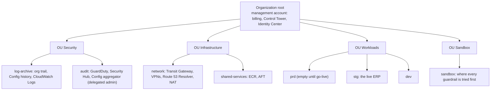
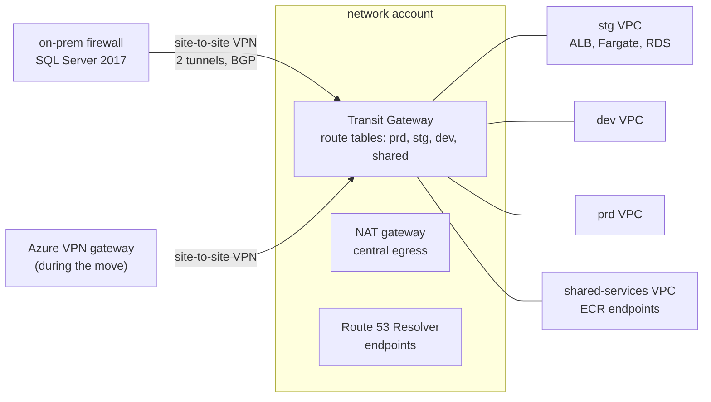

# Azure to AWS: the landing zone and migration design for the client's ERP

A solution design for moving the client's ERP (Odoo, its PostgreSQL databases, the link to on-prem) from Azure to AWS,
written as for the client: the estate today, the target landing zone, five architecture decisions, the DR tiers, the
cost against today's Azure bill, and the migration in waves with an estimate. Stage S3 of the plan of 2026-11-08
([roadmap](../design.md#roadmap)). The concepts: [aws-landing-zone](../learn/aws-landing-zone.md).
Status: **a paper design** (2026-11-08): priced from both public price lists, its guardrails written as Terraform and
tested on a mock provider, nothing applied anywhere ([D20](../design.md#decisions)).

**One idea: the client's Azure estate is already a landing zone in shape (a subscription per environment, a hub with the VPN,
one log workspace), so the move keeps the shape and changes three things: guardrails that an account cannot switch off
(SCPs), environments separated by routes instead of by convention, and a live database that survives the loss of a
data centre; at list prices it costs about what Azure costs, plus the price of the HA that Azure does not have today.**

## The estate today

By role, from the read-only discovery of 2026-11-07 ([platform](../platform.md), the lab's
azure-data and
odoo-platform). All REAL.

| Role | Azure today | Facts that shape the design |
|---|---|---|
| The live ERP (stg) | Two Container Apps, web and cron, 2 vCPU / 4 GiB each, an nginx sidecar (0.25 vCPU / 0.5 GiB) in front of Odoo; the web app 1 to 2 replicas | Real users work on stg; prd Odoo is stopped and its database unused |
| dev | One Container App, 1 vCPU / 2 GiB, one replica | A crash is an outage; drills run here ([D1](../design.md#decisions)) |
| The live database | The server named prd: General Purpose D2ds_v5, PostgreSQL 17, 128 GB, HA off; it holds stg's Odoo database (`queue_job` 781,658 rows) and 19 other databases | Shared by 20 databases; reachable from every client VNet |
| dev's database | Burstable B1ms, 128 GB, HA off, about 20 databases | |
| Odoo's files | Azure Files shares per environment: the filestore, the log, the config | Mounted into the apps |
| The hub | `connectivity-sub`: hub VNet, VPN gateway `VpnGw1AZ` (not active-active, no BGP), one site-to-site IPsec connection to on-prem, a DNS private resolver | No firewall, route table or NSG between spokes; tunnel drops 2, 2, 1 a month (Aug to Oct 2026), the longest 402.1 min |
| On-prem integration | SQL Server 2017 on-prem; Odoo polls it every minute over the tunnel; a nightly SQL Agent job writes into the prd Postgres through a linked server | Both directions cross the VPN |
| Logs and alerts | One workspace, about 12.4 GB a month, $31 to $44 a month; the track's 21 rules live on stg (2026-11-08) ([round 1](../reviews/round-1.md), [round 2](../reviews/round-2.md)) | |
| Recovery | Dumps every 2 to 6 h to storage; a full restore proven at about 3 h | Today's RPO 2 to 6 h, RTO about 3 h, no zone redundancy |

**Scope:** the ERP: the three Odoo apps, the live and dev databases, the files, the on-prem link, the monitoring.
**Out of scope:** the other applications and the 19 other databases on the prd server (they move in their own
plan, or stay on Azure behind the VPN to Azure).

## The organization

[ADR-1](#adr-1-an-account-per-environment-under-control-tower) sets the shape: one AWS organization under Control Tower,
an account per environment, Account Factory for Terraform for every new account.

| Azure today | AWS target | Who signs in |
|---|---|---|
| `dev-sub`, `stg-sub`, `prd-sub` | Accounts `dev`, `stg`, `prd` in OU Workloads | Identity Center permission sets: read-only, operator, admin (the tiered Entra groups of today, mapped one to one) |
| `connectivity-sub` | Account `network` in OU Infrastructure | Network admins |
| `management-sub` (the workspace) | Accounts `log-archive` and `audit` in OU Security | Security team, read-only for the rest |
| Management groups | OUs | |

**Account vending:** AFT, one account request file per account in a Git repository; the baseline every new account gets:
the org trail, Config, GuardDuty and Security Hub membership, a VPC attached to the transit gateway on its
environment's route table, the Identity Center assignments, the cost allocation tags.

## Guardrails: the SCPs

Five preventive guardrails, written in [terraform/aws/modules/scp](../../terraform/aws/modules/scp/main.tf) (the policy
documents) and tested in [its tests](../../terraform/aws/modules/scp/tests/scp.tftest.hcl). How an SCP combines with IAM:
[learn](../learn/aws-landing-zone.md#following-one-action-through-the-guardrails).

| Guardrail | Denies | Why, for the client | Attached to |
|---|---|---|---|
| `deny-outside-regions` | Every regional action outside `ap-southeast-1` (and `us-east-1`, where global services answer); the landing zone's admin roles exempt | Data stays in Singapore, as it stays in Southeast Asia on Azure today; a stray resource in another region is not billed unseen | OU Workloads, OU Infrastructure |
| `protect-security-services` | Stopping or deleting the trail, Config, GuardDuty, Security Hub | Today an Owner of a subscription can delete its diagnostic settings; the audit trail must outlive an account's administrators | The root (after the sandbox) |
| `deny-leave-organization` | An account leaving the organization | A leaving account takes itself out of every guardrail | The root |
| `deny-root-user` | Every action by an account's root user | The root login is the one IAM cannot limit; SCPs can ("including the root user", [SCPs](https://docs.aws.amazon.com/organizations/latest/userguide/orgs_manage_policies_scps.html), 2026-11-08) | Every OU |
| `require-tags` | Creating the main billable resources without `env`, `app`, `cost-center` | The showback ([cost](#cost)) needs every dollar tagged | OU Workloads |

Rollout follows AWS's warning against untested root SCPs: each guardrail goes on the Sandbox OU first, then its targets
([wave 0](#the-migration-in-waves)).

## The network

[ADR-4](#adr-4-a-transit-gateway-as-the-hub) puts a transit gateway where the Azure hub is.

| Concern | Design | What changes from Azure |
|---|---|---|
| Separation | A transit gateway route table per environment: dev reaches shared services and on-prem, never stg or prd | Today every VNet reaches the prd server's private endpoint |
| On-prem | One VPN connection, both tunnels configured on the client's firewall, BGP | Today one tunnel effectively (gateway not active-active, no BGP); drops of up to 402.1 min |
| Azure during the move | A second VPN connection to Azure's VPN gateway, so stg on AWS still reaches what stays on Azure; removed after wave 4 | New, temporary |
| DNS | Route 53 Resolver inbound and outbound endpoints; forwarding rules to on-prem and to Azure's resolver during the move | The DNS private resolver's role |
| Egress | One NAT gateway in the network account | |
| Ingress | An Application Load Balancer per environment, TLS at the balancer | Container Apps' ingress |

## Compute, data and files

| Piece | Design | Decided in |
|---|---|---|
| Odoo web and cron | ECS on Fargate: a service per app, the same image the ERP team builds today, pushed also to ECR | [ADR-2](#adr-2-odoo-on-ecs-fargate-not-eks) |
| The nginx sidecar | Dropped: the ALB sends `/websocket` to Odoo's gevent port and the rest to the HTTP port | [ADR-5](#adr-5-the-load-balancer-replaces-the-nginx-sidecar) |
| The live database | RDS for PostgreSQL 17, `db.m7g.large` (2 vCPU, 8 GiB: the D2ds_v5's shape), Multi-AZ, gp3 | [ADR-3](#adr-3-rds-for-postgresql-one-instance-per-environment) |
| dev's database | RDS for PostgreSQL, `db.t4g.small`, Single-AZ | ADR-3 |
| Odoo's files | Amazon EFS mounted at the filestore path (the same mount Odoo sees today) | Odoo unchanged ([D2](../design.md#decisions) holds on AWS too) |
| Secrets | Secrets Manager, injected into the task as environment variables, as Container Apps secrets are today | |
| Images | ECR in shared-services, pulled through VPC endpoints | Today a private ACR mirror |

## Observability on AWS

Every signal of rounds 1 and 2 keeps its meaning; only the source changes. The rules' logic lives in
[kql/](../../kql/rules.json) today and would be translated, not redesigned.

| Signal ([round 1](round-1.md#signals), [round 2](round-2.md#signals)) | Source on Azure | On AWS |
|---|---|---|
| L1 lock waits, R1 slow refresh | Postgres log in the workspace | RDS log exported to CloudWatch Logs; a metric filter and an alarm |
| L2 HTTP 5xx bursts | nginx lines in the workspace | ALB metrics `HTTPCode_Target_5XX_Count` and access logs |
| L3, L4 tunnel down, IKE errors | Gateway diagnostic logs | VPN metric `TunnelState`, tunnel logs to CloudWatch Logs |
| L5, L6, T1 the queue, late tasks, bloat; H the heartbeat | The SQL job's rows in custom tables | The same job as an ECS scheduled task (EventBridge Scheduler), writing metrics in embedded metric format; H as an alarm on missing data |
| L7 restarts and OOM kills | Container Apps system log | ECS task state change events (EventBridge), `StoppedReason` |
| O1 workers at limits | The log reader over the share | The same reader as a scheduled task over EFS, or Odoo's log shipped by the awslogs driver |
| Q1 heavy hour | Query Store in the workspace | CloudWatch Database Insights (Performance Insights) |
| M rules (CPU, memory, storage) | Platform metrics | CloudWatch metrics of RDS and ECS |
| The Teams card | Action group, Logic App | SNS topic, a Lambda function posting the same Adaptive Card to the same Teams workflow |
| Dashboards | Workbooks | Amazon Managed Grafana over CloudWatch |

## Disaster recovery and availability tiers

The strategies and terms: [learn](../learn/aws-landing-zone.md#disaster-recovery-strategies). RPO is how much data may be
lost; RTO how long the service may be down. Today's numbers are measured; the targets are what each tier is built for
and are proven in the waves' drills (M5).

| Tier | For | Strategy | RPO | RTO | What it costs a month |
|---|---|---|---|---|---|
| Today (Azure) | stg and dev | Backup and restore, one zone, HA off | 2 to 6 h (REAL: the dump interval) | about 3 h (REAL: a full restore) | (in Azure's bill) |
| T0 | dev | Backup and restore: RDS automated backups with point-in-time restore, Single-AZ | Minutes (point-in-time restore) | Hours (a restore) | Included in the RDS line |
| T1 | stg, the live ERP | Multi-AZ RDS (a synchronous standby in a second zone) and Fargate tasks in two zones; backups copied to a second region by AWS Backup | Zero for a zone loss (synchronous); hours for a region loss (the copy's schedule) | Minutes for a zone loss (automatic failover, measured in the wave 3 drill); hours for a region loss (redeploy from Terraform, restore the copy) | +$188 (Multi-AZ, [cost](#cost)) |
| T2 (option) | prd, if the client needs a region loss covered in under an hour | Pilot light: a cross-region read replica and the infrastructure as code, tasks at zero | Seconds to minutes (replica lag) | Under 1 h (promote, scale out) | A second database instance and storage: about the T1 database line again |

A zone loss today means a restore of about 3 h and up to 6 h of lost data; T1 makes it an automatic failover. That is
the HA part of the bill, and the reason it is a decision for the client, not a default.

## Cost

Both sides from their public price lists, on the same footprint, at list prices (no commitment, no free grant):
[terraform/aws/cost/estimate.py](../../terraform/aws/cost/estimate.py) (prices change; rerun it before quoting). AWS:
the Price List bulk files for `ap-southeast-1`; Azure: the Retail Prices API for `southeastasia`. **REAL, read
2026-11-08**; usage marked ASSUMED in the script.

### Unit prices (REAL, 2026-11-08)

| Item | USD | Source (Price List version, or API) |
|---|---|---|
| Fargate, per vCPU-hour / per GB-hour | 0.05056 / 0.00553 | AmazonECS `20261019224317` |
| ALB, per hour / per LCU-hour | 0.0252 / 0.008 | AWSELB `20261105220241` |
| Transit gateway attachment, per hour; data, per GB | 0.07; 0.02 | AmazonVPC `20261105181945` |
| Site-to-site VPN connection, per hour | 0.05 | AmazonVPC `20261105181945` |
| RDS PostgreSQL `db.m7g.large` Single-AZ / Multi-AZ, per hour | 0.234 / 0.468 | AmazonRDS `20261029070635` |
| RDS PostgreSQL `db.t4g.small` Single-AZ, per hour | 0.051 | AmazonRDS `20261029070635` |
| Aurora PostgreSQL `db.r7g.large`, per hour | 0.333 | AmazonRDS `20261029070635` |
| RDS gp3, per GB-month, Single-AZ / Multi-AZ | 0.138 / 0.276 | AmazonRDS `20261029070635` |
| NAT gateway, per hour / per GB | 0.059 / 0.059 | AmazonEC2 `20261029175634` (read by the lab, 2026-11-04) |
| CloudWatch Logs ingested, per GB; stored, per GB-month; alarm, per month | 0.70; 0.03; 0.10 | AmazonCloudWatch `20261104213532` |
| Config item; rule evaluation | 0.003; 0.001 | AWSConfig `20260911124534` |
| GuardDuty logs per GB; Fargate vCPU-month; RDS vCPU-month | 1.15; 1.85; 1.22 | AmazonGuardDuty `20261030005614` |
| Security Hub check | 0.001 | AWSSecurityHub `20261029222727` |
| Azure Container Apps, active: per vCPU-second / per GiB-second | 0.000034 / 0.000004 | Retail Prices API |
| Azure Container Apps, idle: per vCPU-second / per GiB-second | 0.000004 / 0.000004 | Retail Prices API |
| Azure PostgreSQL D2ds_v5 / B1ms, per hour; storage per GB-month | 0.244 / 0.026; 0.138 | Retail Prices API |
| Azure VPN gateway VpnGw1AZ, per hour | 0.21 | Retail Prices API |

### The totals

| Estate (USD a month, list prices) | Total |
|---|---|
| Azure today, apps at the idle rate (lower bound) | **611.06** |
| Azure today, apps at the active rate (upper bound) | **1,064.39** |
| AWS design, every database Single-AZ (like for like) | **1,091.76** |
| AWS design, the live database Multi-AZ (the design, T1) | **1,280.24** |

Container Apps bill each replica at the active rate while it serves and at the idle rate otherwise, so Azure's real
ERP bill sits between the two bounds; Fargate bills the full task size all the time. The workspace line is REAL ($44 a
month at most, Cost Management, August to October 2026); the other lines are list prices. For scale: the client's whole Azure
spend is about USD 3,400 a month (owner, 2026-11), of which the ERP is a part.

### The design by account (the live database Multi-AZ)

| Account | Line | USD a month |
|---|---|---|
| stg | Fargate web (2 vCPU, 4 GiB) | 89.97 |
| stg | Fargate cron (2 vCPU, 4 GiB) | 89.97 |
| stg | Application Load Balancer | 24.24 |
| stg | RDS PostgreSQL `db.m7g.large` Multi-AZ + 128 GB gp3 | 376.97 |
| dev | Fargate odoo (1 vCPU, 2 GiB) | 44.98 |
| dev | Application Load Balancer | 24.24 |
| dev | RDS PostgreSQL `db.t4g.small` Single-AZ + 128 GB gp3 | 54.89 |
| network | Transit gateway: 5 VPC attachments | 255.50 |
| network | Site-to-site VPN: 2 connections and their transit gateway attachments | 175.20 |
| network | Transit gateway data, 100 GB (ASSUMED) | 2.00 |
| network | NAT gateway + 50 GB (ASSUMED) | 46.02 |
| log-archive | CloudWatch Logs: 12.4 GB ingested (REAL volume, October 2026) | 8.68 |
| log-archive | CloudWatch Logs: 149 GB stored (one year hot, ASSUMED) | 4.46 |
| log-archive | 20 alarms | 2.00 |
| security | Config: 3,000 items, 20,000 evaluations (ASSUMED) | 29.00 |
| security | GuardDuty: 20 GB logs (ASSUMED), 5 Fargate vCPU, 4 RDS vCPU | 37.13 |
| security | Security Hub: 15,000 checks (ASSUMED) | 15.00 |
| **Total** | | **1,280.24** |

What the comparison shows:

| Finding | Number |
|---|---|
| Compute is cheaper on AWS for always-on tasks than Azure's active rate, dearer than its idle rate | stg's two apps: $179.94 on Fargate against $141.92 to $496.70 on Container Apps |
| The database is priced alike | `db.m7g.large` Single-AZ $170.82 a month against D2ds_v5 $178.12 (compute) |
| HA is the main new cost | Multi-AZ adds $188.49 to the live database |
| The hub costs three times Azure's | network account $478.72 against the VPN gateway's $153.30; the VPN to Azure ($87.60) ends with the move, and the shared-services attachment can fold into the network VPC ($51.10) |
| Aurora is dearer at this size | `db.r7g.large` $243.09 a month for one instance, before a second for failover |

### Showback and chargeback by account

**Showback** shows each environment its cost; **chargeback** bills it. The account is the first key (every dollar of
the stg account is stg's); tags (`env`, `app`, `cost-center`, required by the `require-tags` guardrail) split an account
shared by several apps; the shared accounts (network, log-archive, security) are split by each environment's share of
direct spend. Cost categories in Billing hold the rule, so the split shows in Cost Explorer without a spreadsheet.

| Environment | Direct (its account) | Share of shared ($574.99) | Charged |
|---|---|---|---|
| stg | 581.15 | 82.4 % = 473.81 | **1,054.96** |
| dev | 124.11 | 17.6 % = 101.18 | **225.29** |
| **Total** | 705.26 | 574.99 | **1,280.25** (rounding) |

Not priced on either side: the files (Azure Files against EFS; sizes not measured), backups, data transfer out of Azure
during the move, support plans.

## The migration in waves

A pre-sales estimate: person-days of one platform engineer, with the assumptions and risks that move it. The ERP
team's work (pushing the image to ECR, the cutover test) and the client's network team's (the firewall's VPN) are theirs and
counted apart.

| Wave | What | Proves | Person-days |
|---|---|---|---|
| 0 Foundations | Control Tower landing zone; OUs; Identity Center permission sets; AFT; log-archive and audit; the five SCPs on Sandbox, then on their targets | M3, M7; a denied `StopLogging` in a sandbox account | 8 |
| 1 Network | Transit gateway and route tables; the VPN to on-prem (both tunnels, BGP) and to Azure; Resolver rules; NAT | dev cannot reach stg (a test); on-prem reaches stg | 6 |
| 2 dev | ECR, ECS services, ALB with the `/websocket` rule, EFS, RDS dev; the database by dump and restore; the monitoring ported and drilled ([D10](../design.md#decisions): drills first) | Odoo works on dev; every rule drilled to Teams | 8 |
| 3 stg (live) | RDS Multi-AZ; the data by logical replication to a short write gap (the lab measured 9.5 s for PostgreSQL 16 to 17); the cutover in an agreed window; Azure kept warm two weeks as the rollback; the on-prem sync both ways checked; a failover drill | M5: the zone failover measured | 10 |
| 4 prd and close | The prd account for go-live; the VPN to Azure removed; Azure's ERP resources torn down after the rollback window | The bill by account matches the showback | 5 |
| Workshops, reviews, handover | Design sessions with the client's IT, the ERP team and the platform team; runbooks | | 6 |
| **Total** | | | **43**, plus a 20 % buffer: **about 52** |

| Assumption | If wrong |
|---|---|
| Odoo runs unchanged on Fargate with EFS for files ([D2](../design.md#decisions)) | A filestore on S3 needs an Odoo module: the ERP team's work, +5 days |
| The other 19 databases stay on Azure or move in their own plan | Each moved with the ERP adds a database instance and its cutover |
| The client's firewall supports two tunnels and BGP | Static routes, one tunnel: the redundancy is lost, not the move |

| Risk | Mitigation |
|---|---|
| The nightly on-prem job writes into the live database over the tunnel | Its linked server repointed and tested in wave 3 before cutover |
| Odoo's minute-by-minute import from on-prem pauses during the cutover | Cutover outside working hours; the import catches up from its stored marker (Change Tracking) |
| The network's cost surprises the client | Shown here: $478.72 a month, $391.12 after the move |

## Architecture decisions

Each in the same shape: context, options, decision, consequences.

### ADR-1: an account per environment under Control Tower

- **Context:** the client separates environments by subscription today, but an Owner of a subscription can remove its own
  audit settings; the target needs guardrails no account can remove, and new environments created the same way every
  time.
- **Options:** (a) one account, a VPC per environment; (b) an account per environment, hand-built organization;
  (c) an account per environment under Control Tower, accounts vended by AFT.
- **Decision:** (c).
- **Consequences:** the blast radius of a credential is one environment; SCPs apply per OU; Control Tower's mandatory
  controls and its two shared accounts come with it; AFT needs its own management account and pipeline (wave 0). Cost:
  Control Tower itself is free; its Config and trail are in the security lines.

### ADR-2: Odoo on ECS Fargate, not EKS

- **Context:** three Odoo containers today on Container Apps, a serverless container service; no Kubernetes in the client's
  production; the ERP team owns the image.
- **Options:** (a) ECS on Fargate; (b) EKS with managed nodes or Karpenter; (c) EC2 with Docker.
- **Decision:** (a): the nearest twin of Container Apps (a task per replica, no nodes to patch).
- **Consequences:** no cluster to upgrade; Fargate's fixed task sizes (2 vCPU takes 4 to 16 GB, 4 vCPU 8 to 30 GB,
  [task sizes](https://docs.aws.amazon.com/AmazonECS/latest/developerguide/fargate-tasks-services.html), 2026-11-08)
  shape [ADR-5](#adr-5-the-load-balancer-replaces-the-nginx-sidecar). EKS is revisited when the other applications move too and the platform runs tens of services, where a cluster's fixed cost and skills pay back.

### ADR-3: RDS for PostgreSQL, one instance per environment

- **Context:** stg's Odoo database shares a server with 19 others; a lock storm or a heavy hour on one hits all
  ([Q1's 3 hours a day](../reviews/round-2.md#2-what-it-delivered)); HA is off.
- **Options:** (a) one shared RDS instance as today; (b) RDS for PostgreSQL per environment; (c) Aurora PostgreSQL.
- **Decision:** (b), Multi-AZ for the live environment.
- **Consequences:** the live ERP's database is its own; Multi-AZ gives a synchronous standby in a second zone ("You
  can't use a standby replica to serve read traffic", [Multi-AZ](https://docs.aws.amazon.com/AmazonRDS/latest/UserGuide/Concepts.MultiAZSingleStandby.html),
  2026-11-08); Aurora ($243.09 a month for one `db.r7g.large`) is kept for when read replicas or a global database are
  needed (T2).

### ADR-4: a transit gateway as the hub

- **Context:** on-prem must reach every environment; Azure must be reachable during the move; today's flat network lets
  dev reach the live database.
- **Options:** (a) VPC peering, VPN on one VPC (peering is not transitive: on-prem could not reach the others);
  (b) one shared VPC owned by the network account, subnets shared with Resource Access Manager, a VPN on its virtual
  private gateway (cheapest: no attachments); (c) a transit gateway with a route table per environment.
- **Decision:** (c).
- **Consequences:** separation becomes a route; the VPN to Azure attaches without touching the workload VPCs; it is the
  dearest line of the design ($255.50 a month of VPC attachments). Option (b) saves about $360 a month (the VPC
  attachments, the two VPN attachments at $51.10 each, the transit data) and is the lever if the client accepts separation by
  security groups inside one VPC.

### ADR-5: the load balancer replaces the nginx sidecar

- **Context:** each Odoo app runs nginx (0.25 vCPU, 0.5 GiB) to send `/websocket` to Odoo's gevent port and the rest to
  its HTTP port. On Fargate the task's size is the sum of its containers, and 2.25 vCPU is not a size: the next one is 4
  vCPU with at least 8 GB.
- **Options:** (a) keep the sidecar in a 4 vCPU / 8 GB task; (b) the ALB routes by path to two target groups on the same
  task.
- **Decision:** (b).
- **Consequences:** each stg task stays at 2 vCPU / 4 GB ($89.97 a month instead of $179.94 for 4 vCPU / 8 GB); the
  routing moves into Terraform; nginx's own settings (body size, timeouts) become ALB attributes, checked in wave 2.

## Acceptance

| ID | Check | Evidence |
|---|---|---|
| M1 | Each ADR names its options, the decision and its consequences | The five ADRs above |
| M2 | Every price carries its source and the date read; the estimate reruns from the public price lists with no account | `python3 terraform/aws/cost/estimate.py` ([runbook](../runbooks/aws-design.md#rerun-the-cost-estimate)) |
| M3 | The SCP module's tests pass on a mock provider, with no AWS credentials | `terraform test`: 6 passed ([runbook](../runbooks/aws-design.md#test-the-guardrails)) |
| M4 | Every signal of rounds 1 and 2 has its AWS source | [Observability on AWS](#observability-on-aws) |
| M5 | Each DR tier states its RPO and RTO against today's measured baseline; the zone failover is measured in wave 3 | [DR tiers](#disaster-recovery-and-availability-tiers); the measurement is wave 3's |
| M6 | The showback by environment sums to the design's total | [Showback](#showback-and-chargeback-by-account) |
| M7 | Nothing is applied: no AWS account, organization or credential is used ([D20](../design.md#decisions)) | The module has no backend and no provider credentials; the tests use `mock_provider` |

## Teardown

Nothing exists outside the repo: no AWS resource, no Azure resource, no Postgres change. The price files are cached in
the gitignored `.scratch_tf/pricing/`; deleting the folder is the whole teardown.
