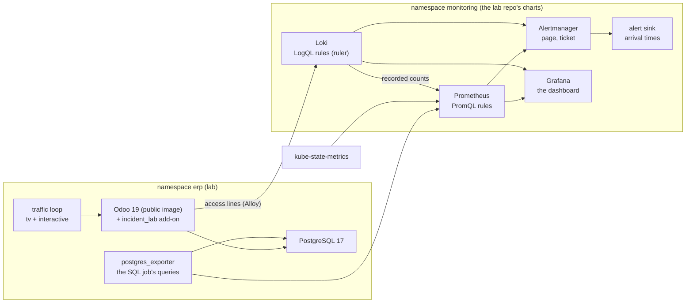

# The Kubernetes mapping: the track's rules on Prometheus, Loki and Grafana

Stage K of the plan of 2026-11-08 ([roadmap](../design.md#roadmap), [D15](../design.md#decisions)): the rules built on Azure from
the client's incidents, translated to PromQL and LogQL and proven on a demonstration Odoo on kind that reproduces the
incident patterns on request. Learn first: [prometheus-loki](../learn/prometheus-loki.md). Status: built and drilled on 2026-11-08. **Every number from this lab is a lab number, never the client's.**

## The idea

**One idea: a rule is a question about a signal; the question stays and only the source changes. On Azure the source
is a log table or a platform metric; on Kubernetes it is a metric an exporter samples or a log line Loki indexes. The
translation shows which rules move as they are, which improve, and which have no source on a cluster.**

## The cluster

D15 put the demonstration on the lab repo's kind platform. Refined here: the same pieces at the same pinned versions
and with the lab's own values files, read from the lab repo by path (kube-prometheus-stack 92.17.1, Loki 7.5.0 single
binary, Alloy 1.15.0, the lab's alert sink), installed by Helm on a one-node kind cluster `obs-lab` of their own,
**without Argo CD and the lab's other services**: the laptop has 7 GiB, and Odoo must fit beside the monitoring. This
repo's overrides are in [k8s/values/](../../k8s/values/kps.yaml): the remote-write receiver, page and ticket receivers,
Loki's ruler and its rules, the dashboard. [k8s/lab.sh](../../k8s/lab.sh) brings it up and down; the cluster lives only
while the lab runs.

## The workload

The public `odoo:19.0` image and `postgres:17-alpine`, with an add-on, [incident_lab](../../k8s/addons/incident_lab/__manifest__.py),
that reproduces the incident patterns on request; nothing of the client's code ([D14](../design.md#decisions): a remake, not a
copy):

| Pattern | The client's incident | How the add-on makes it |
|---|---|---|
| A lock wait | 2026-08-20, 08-25 (lock waits behind 502s) | One request holds an advisory lock 150 s, a second waits for it (as round 1's drill on dev) |
| A 5xx burst | 2026-08-20, 08-24 | A route answers the status asked for |
| A late scheduled task | 2026-11-04 (the daily cleanup stopped), 2026-09-19 | The one-minute task sleeps 200 s once, so its next run falls behind |
| A memory kill | 2026-08-03, 2026-09-09 | A route touches more memory than the container's 1 GiB limit |
| A silent reader | Round 1's heartbeat (H) | The exporter scaled to 0 for 4 min |
| A heavy hour | Q1's 7 heavy hours of 30 days (round 2) | 16 sessions in `pg_sleep(360)` at once: about 96 min of database time in 6 minutes, a stand-in for a heavy query family |
| Table bloat | stg's tables with autovacuum behind (round 2, T1) | A table with autovacuum off: 120,000 rows inserted, then all updated (120,000 dead rows, half the table) |
| Workers at their limits | O1; the lab's own lock drill ended both requests at Odoo's 120 s real-time limit (2026-11-08) | One request holds a lock 240 s while three wait: the threaded server checks its threads every 60 s (`SLEEP_INTERVAL` in `server.py`), so a 240 s hold puts at least one check past the 120 s limit, where it logs each thread over it, then reloads |

A traffic loop polls the TV route every 2 s and a page every 10 s, so the SLO has good requests to weigh.

## The rules

PromQL rules in [k8s/rules/erp.rules.yaml](../../k8s/rules/erp.rules.yaml), tested with `promtool` in
[erp.rules.test.yaml](../../k8s/rules/erp.rules.test.yaml); LogQL rules in [loki-rules.yaml](../../k8s/rules/loki-rules.yaml),
run by Loki's ruler.

| Azure rule ([round 1](round-1.md#signals), [2](round-2.md), [3](round-3.md#slos)) | Kubernetes source | Translation | What changes |
|---|---|---|---|
| L1 lock waits (page over 60 s) | `pg_locks.waitstart` through postgres_exporter (round 4's query) | `max(erp_lock_wait_max_seconds) > 60` | **Fires while the wait lasts**: Azure's rule reads the log line written when a wait ends (the game day's finding, [respond](../runbooks/respond.md#the-game-day-of-2026-11-08)) |
| L1 burst (ticket) | The same | `max_over_time(erp_lock_wait_waiting[15m]) >= 5` | Sessions waiting at once instead of "still waiting" log lines |
| L2 5xx bursts (page at 25 in 5 min) | Odoo's access lines in Loki | A LogQL alert: `count_over_time(... status >= 500 [5m]) >= 25` | The same question; Odoo's own line instead of nginx's |
| L3, L4 VPN | None on a cluster | Not translated | A blackbox probe of the on-premises peer would be the source |
| L5 job queue | `queue_job` (an OCA add-on, not in the public image) | Not translated in the lab | The same SQL as the job, as one more exporter query |
| L6 late tasks (ticket) | `ir_cron` through the exporter, the SQL job's query | `overdue > interval and overdue > 120 s` | None |
| L7 terminations (page) | kube-state-metrics | A restart in 15 min **and** last terminated `OOMKilled` | The reason is a label, not a parsed log line |
| M1, M2 restarts (ticket) | kube-state-metrics | `increase(restarts[15m]) > 0` | None |
| M3, M4 the server's CPU and storage | The managed server's metrics | Not translated (no managed server in the lab) | |
| M5 the server alive (page) | postgres_exporter | `pg_up == 0` for 1 min | |
| H heartbeat (page) | The exporter's scrape | `absent(up{job="postgres-exporter"} == 1)` for 2 min | The reader is a scrape target, so Prometheus knows it is gone |
| Q1 heavy hour (ticket over 90 min of database time in an hour) | `pg_stat_statements` in the lab's Postgres (`shared_preload_libraries`, the extension created by `lab.sh`), its total execution time through the exporter as a counter | `increase(erp_db_time_seconds_total[1h]) / 60 > 90` | A rolling hour instead of Query Store's complete hours; no query ids in the alert (the dashboard's panel is the total) |
| T1 table bloat (ticket) | `pg_stat_user_tables` through the exporter: dead and live rows, the last autovacuum, per table | dead share `>= 0.25`, dead rows `>= 100000`, no autovacuum for 24 h (or never) | None: the SQL job's same three columns |
| O1 workers at their limits (page at 3 in 15 min) | Odoo's own lines in Loki | `count_over_time(... \|~ "<the limit messages>" [15m]) >= 3` | The lab's Odoo runs threaded, whose real-time limit line is `Thread ... virtual real time limit ... reached`; the client's prefork workers log `... timeout after ...s`: the rule matches both, from Odoo 19's [server.py](https://github.com/odoo/odoo/blob/19.0/odoo/service/server.py) (read with curl 2026-11-09) |
| R1 the dev view refresh | A dev-only report refresh of the client's | Not in the lab | The client's own code |
| SLO-fast (page) | Odoo's access lines | Loki records good and bad counts per journey (5 min, 1 h) and writes them to Prometheus; a PromQL alert on both windows over 14.4 x 0.5 % | Recording rules across two systems instead of one KQL query |
| SLO-slow (ticket) | The same | Not in the lab: its 6 h window outlasts a drill | |

**Routing:** Alertmanager sends `severity: page` and `severity: ticket` to two receivers, as the two action groups per
environment ([D11](../design.md#decisions)); the lab's sink logs each notification with its arrival time and receiver,
where Azure posts a card. The chart's own rules use other severities and reach no receiver.

**Grafana:** one dashboard ([k8s/dashboards/erp.json](../../k8s/dashboards/erp.json)): the lock wait, the 5xx count, the
SLO ratio per journey, late tasks, restarts, firing alerts, Odoo's 5xx lines from Loki, and (round 5) the database
time per hour, the dead share per table, and Odoo's limit lines. It opens in a browser through a port
forward ([runbook](../runbooks/kubernetes-lab.md)).

## In CI

`tools/ci.sh` gains a step `promtool`: `promtool check rules` and `promtool test rules` on the PromQL rules, offline,
with promtool 3.15.1 pinned by SHA-256 in `tools/ci-tools.sh`. The LogQL rules are checked live (Loki's ruler loads
them or logs the error).

## Acceptance

| # | Check | How |
|---|---|---|
| K1 | Learn page and this spec | Written with the lab's real values |
| K2 | The PromQL rules' tests | `promtool test rules` passes on the laptop and in GitHub's CI |
| K3 | The lab fits | Every pod `Running`; the node's memory read with everything up |
| K4 | Each drill fires its rule | lock (L1), http5xx (L2, SLO-fast), cron (L6), oom (L7, M1), exporter (H): each alert at the sink, with its receiver and time |
| K5 | L1 pages during the wait | The sink's line for L1 arrives before the waiting request returns |
| K6 | The dashboard | Grafana shows the drills' series |
| K8 | Q1 in the lab | `promtool` tests pass; the `heavy` drill fires Q1 at the sink |
| K9 | T1 in the lab | `promtool` tests pass; the `bloat` drill fires T1 at the sink |
| K10 | O1 in the lab, and the browser | The `limit` drill fires O1 at the sink; a browser shows the drills' panels in Grafana in a browser |
| K7 | Teardown | `bash k8s/lab.sh down`: the cluster gone, nothing left in Docker but the kind images' cache |

## Teardown

Nothing in Azure or on a server. `bash k8s/lab.sh down` deletes the cluster; `.scratch_kube/` holds the kubeconfig and
Helm's cache, deleted with `rm -rf .scratch_kube`.
