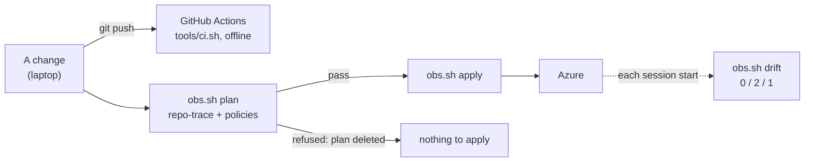

# S2: the IaC pipeline

Stage S2 of the [roadmap](../design.md#roadmap): for Policy-as-Code,
compliance gates, drift detection and pipeline-as-code. Status:
**approved with the plan of 2026-11-08 (owner, 2026-11-08: each stage run to its end in Auto mode)**. Learn first: [policy-as-code](../learn/policy-as-code.md). How to run
it: [runbook](../runbooks/pipeline.md).

**One idea: the ground rules the track keeps by hand become policies checked by a machine at three moments: the source
at every push (GitHub Actions, offline), the plan before every apply (`obs.sh plan`), the live resources at every session
start (`obs.sh drift`); nothing in this stage touches Azure.**

## The workflow

[.github/workflows/ci.yml](../../.github/workflows/ci.yml) runs on every push and pull request, every Monday, and by
hand, with read-only permissions and no secret. It calls the same two scripts as the laptop:
[tools/ci-tools.sh](../../tools/ci-tools.sh) (the tools at pinned versions, each checked against a SHA-256 in the
script) and [tools/ci.sh](../../tools/ci.sh) (the steps), split into four jobs that run side by side (since 2026-11-14,
after the lab's CI):

| Job | `tools/ci.sh` steps | Runs its steps when the change touches |
|---|---|---|
| `terraform` | `fmt`, `validate`, `tflint`, `trivy_config`, `policy`, `aws_test`, `repo_trace` | `terraform/`, `policy/`, `kql/` (the rendered queries), the scripts those steps run |
| `python` | `trivy_deps`, `bandit`, `unit`, `sql` | `job/`, `kql/`, `sql/`, `tools/` (Python), `terraform/aws/cost/` |
| `kubernetes` | `promtool` | `k8s/rules/` |
| `docs-and-secrets` | `docs`, `gitleaks` | Always |

**The path question** (`tools/ci-paths.sh`): on a pull request, what the pull request brings in;
on a push, the pushed range. A change to the workflow, `ci.sh`, `ci-tools.sh` or the script itself runs every job.
A job whose paths are untouched says so in a step and skips its checks. **When the range cannot be read, every check
runs**: a publish to the public repo force-pushes one amended commit, whose "before" is no longer in the history; a
doubt never becomes a skip. The weekly and the manual runs check everything (a pinned download or a tool's site that
broke outside the repo).

| Step | What it checks | Fails on |
|---|---|---|
| `fmt` | `terraform fmt` over `terraform/` | Any file not formatted |
| `validate` | Each root and module, `init -backend=false` then `validate` | An invalid configuration |
| `tflint` | The terraform ruleset's recommended preset ([terraform/.tflint.hcl](../../terraform/.tflint.hcl): two rules off, each with its reason) | Any issue |
| `trivy_config` | Misconfigurations in the Terraform | HIGH or CRITICAL |
| `trivy_deps` | Known vulnerabilities in the job's pinned packages (`job/requirements.txt`) | HIGH or CRITICAL |
| `bandit` | SAST on the track's Python (`job/`, `kql/`, `sql/`, `tools/`, `terraform/aws/cost/`), added by stage D | MEDIUM severity and confidence or above |
| `unit` | The log reader's counting on Odoo 19's own lines ([job/test_log_scan.py](../../job/test_log_scan.py)), added by round 5 ([G7](round-5.md#acceptance)) | Any failed test |
| `sql` | The SQL job's queries on a throwaway PostgreSQL 17 container (an image pinned by digest, started and removed by the step), against a `queue_job` table with known rows ([job/test_sql_job.py](../../job/test_sql_job.py)), added by round 7 ([N2](round-7.md#acceptance)) | A wrong count or age, or no container |
| `promtool` | The Kubernetes mapping's rules: `promtool check rules` and `promtool test rules` ([K2](kubernetes-mapping.md#acceptance)) | An invalid rule or a failed test |
| `gitleaks` | Secrets in every commit of the history | Any finding, except one read by hand and listed by fingerprint in `.gitleaksignore` with its reason (2026-11-08: a lab's placeholder password in an old commit) |
| `docs` | `tools/check-docs.py` | Any problem |
| `policy` | The policies' tests, then every `.tf` file under `terraform/envs` and `terraform/modules` (package `hcl`: what is applied to Azure; `terraform/aws` is a paper design, never applied, [D20](../design.md#decisions)), `opa check --strict`, `opa fmt` | Any test or rule |
| `aws_test` | `terraform test` of the AWS design's guardrail module (`terraform/aws/modules/scp`, a mock provider, no credentials) | Any failed run |
| `repo_trace` | `tools/no-repo-trace.py` over every rendered query (`kql/backtest.py --print`, each rule and environment) and every JSON file the roots read | A trace of the repo |

Design choices:

- **Offline.** No Azure login: a federated credential's subject would name the GitHub repo inside the client's tenant
  ([learn](../learn/policy-as-code.md#why-the-pipeline-never-reaches-azure)). Plans and applies stay on the laptop.
  No the client server either: the `sql` step's PostgreSQL is a container of its own, gone when the step ends.
- **One third-party action**, `actions/checkout`, pinned by its commit SHA; no marketplace action for the tools.
- **The same script everywhere:** what CI runs is what `bash tools/ci.sh` runs on the laptop, step by step; a job runs
  a named subset (`bash tools/ci.sh fmt validate ...`).
- **Parallel jobs, not one:** each area's result shows on its own, a failure names its area, and a change to the docs
  waits for no Terraform check.

## The policies

[policy/terraform/](../../policy/terraform/lib.rego): one data file and two packages, run by
[tools/policy.sh](../../tools/policy.sh).

| Rule | Package `hcl` (source, CI) | Package `plan` (`obs.sh plan`) |
|---|---|---|
| Only monitoring types: the allow-list of the types the roots create on 2026-11-08, `azapi_resource` limited to the custom tables and the DCR | Yes | Yes |
| Tags: `owner = observability-track`, and `env` or `purpose` | `tags` set on a taggable type | The values |
| Only the track's own resource groups (`-obs-`) | No (a variable) | Yes |
| Every alert rule has an action group | Yes | Yes (unknown until created is accepted) |
| No GitHub account or repo name in any value | Literal strings | Every value |

- **Contract:** a new resource type joins `allowed_types` (and `taggable_types` if it has tags) in the commit that
  first creates it, with its reason in that stage's spec. Deleting a resource is never refused.
- **Fail closed:** `obs.sh plan` deletes the saved plan when the policies refuse it, like the repo-trace scan
  ([the method's rule](../../method/METHOD.md#safety-basics)).
- **Tests** never use a real plan: its JSON holds `obs_monitor`'s password in clear.

## Drift

`bash tools/obs.sh drift` plans the three roots against the live resources with `-detailed-exitcode`, `-lock=false` and
no plan file; it prints one line per root and exits 0 (all match), 2 (a root differs, with its changes listed) or 1 (a
plan failed). It runs at every session start (the next session setup's first checks)
and after every apply. A drift is either code not yet applied (expected while a stage is being built) or a change made
outside Terraform (to be applied back or adopted into the code).

## Dependencies

[.github/dependabot.yml](../../.github/dependabot.yml) opens pull requests weekly for the job's Python packages and the
workflow's action; each runs the workflow before a merge. The pipeline's own tools are bumped by hand in
`tools/ci-tools.sh`, the version and its SHA-256 together.

## Acceptance

| ID | Check | How |
|---|---|---|
| P1 | The policies' tests pass, one compliant and one breaking case per rule | `bash tools/policy.sh` |
| P2 | Today's Terraform passes every policy, at the source and on the three plans | `bash tools/policy.sh`; `obs.sh plan` on each root |
| P3 | A forbidden type is refused at the source and at the plan; the plan file is deleted | A deliberate break on a working copy, never committed |
| P4 | A missing `owner` tag is refused at the plan | Same |
| P5 | Every step of `tools/ci.sh` passes on the laptop | `bash tools/ci-tools.sh && bash tools/ci.sh` |
| P6 | The workflow passes on GitHub on the merge commit | The run's summary on GitHub |
| P8 | Each job runs its steps when its paths change and skips them otherwise; a range it cannot read runs everything | `tools/ci-paths.sh` on real ranges on the laptop; a docs-only push on GitHub: `terraform`, `python`, `kubernetes` skipped |
| P7 | `obs.sh drift` reads 0 on shared, dev and stg | `bash tools/obs.sh drift` |

## Teardown

Nothing in Azure or on a Postgres server: the stage adds files to the repo, a workflow on GitHub and tools under
`.scratch_tf/` (gitignored). Removing it: delete `.github/`, `policy/`, `tools/ci.sh`, `tools/ci-tools.sh`,
`tools/policy.sh`, `terraform/.tflint.hcl`, and the policy lines in `tools/obs.sh`.

## Not in this stage

- SAST (SonarQube, Semgrep) and DAST on the client's application code: the plan of 2026-11-08 offers it as a swap for S4.
- A drift check on a schedule: it needs an Azure login outside the laptop, which the offline rule excludes; it runs
  at each session start instead.
- Branch protection on GitHub (required checks): not in this private repo, where `main` takes direct pushes; the public
  repo shows it (owner, 2026-11-08).
