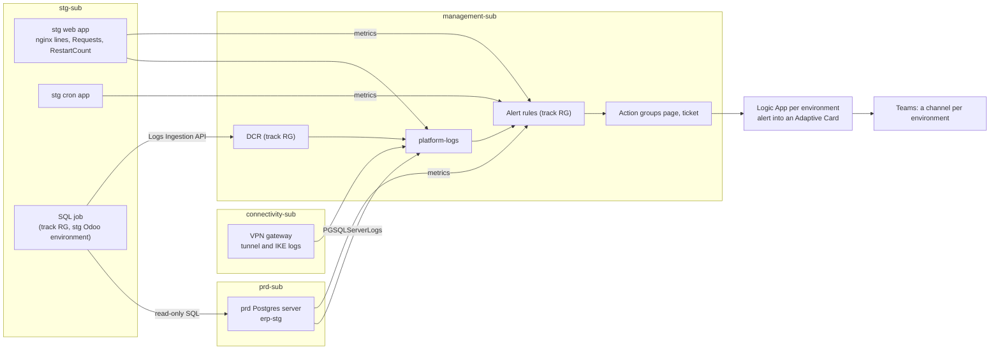

# Spec: round 1, alerts on the stg Odoo

The design of round 1: which signals, how each rule decides, the SQL job, the monitoring role, the Terraform boundary,
routing, cost, acceptance and teardown. It settles [O1 to O4](../design.md#open-decisions). Status: **approved by the
owner** as written (2026-11-08). The concepts: [learn pages](../learn/README.md#reading-order). The code (KQL in `kql/`,
Terraform in `terraform/`, the job in `job/`, the role in `sql/`) owns every query, threshold value and setting; this
page owns the logic and the numbers that justify it.

## The round in one picture

**One idea: watch what already lands in Azure with a few log and metric rules, and add one small job for the only
source Azure cannot read, Odoo's own tables; prove each rule on history first, on dev second, on stg for real.**

## Signals

Eight log signals, five metric time series, one heartbeat. Severity: **page** means someone looks within the hour;
**ticket** means it is looked at the next working day. Backtests ran on 2026-11-07 over the workspace's whole history, and again on 2026-11-08 with the rule
files themselves (A3, [runbook](../runbooks/backtests.md)).

| ID | Signal | Source | Rule logic | Severity | Backtest (what it would have done) |
|---|---|---|---|---|---|
| L1 | **Lock waits** on stg's Odoo | `PGSQLServerLogs` (prd server); one KQL function also covering dev's `AzureDiagnostics` rows for drills | In 5-min bins: any wait that lasted over **60 s** (page, every 5 min), or more than **40** "still waiting" lines (ticket, every 15 min) | page (wait over 60 s), ticket (burst) | Waits run as background noise: 5-min bins p50 6 to 7, p99 24 to 25, max 37 since logging began (stg server 2026-08-25, prd server 2026-08-27). Waits over 60 s: 4 in August (two 5-min bins on 2026-08-25), 1 in September (09-18), 0 since; the burst rule never fires. The 2026-08-20 incident predates the logging; its 502s are caught by L2 |
| L2 | **HTTP failures** on the stg web app | nginx access lines in `ContainerAppConsoleLogs_CL` | In 5-min bins, by class: **any 5xx** (`status >= 500`, so a new code cannot slip through) at **25** or more (page, every 5 min); **499** (the user gave up) at **25** or more (ticket, every 15 min) | page (5xx), ticket (499) | Only 500 and 502 ever appeared, no 503 or 504 (2026-06 to 11). 5-min bins with 25 or more 5xx: July 16, **August 75**, September 4, October 12, November 0; the worst minutes are the incidents (113 x 502 at 2026-08-20 03:18, 149 on 08-24) plus an uncatalogued burst (134 on 2026-09-17 08:05). 499 bins at 25 or more: August 33, other months 0 to 2. 4xx are client-side and not alerted (a workbook tile). The rule follows today's web app, which replaced an earlier one in 2026-08, so its own backtest starts there: 5xx August 75, September 4, October 12; 499 August 32, September 1, October 2 |
| L3 | **VPN tunnel down** | `TunnelDiagnosticLog` | Every 5 min: a gateway instance's last tunnel state is Disconnected and has stayed so for more than **5 min**. The log records only state changes, so the rule looks back 2 days (the most a log alert allows) for each of the two instances (active-active) | page | Since 2025-11-13: drops over 5 min per month 1, 2, 0, **7**, 3, 6, 1, 0, 1, 0, 1, 1; hours down 19.1 (2025-11), 20 (12), **115.2 (2026-02, one drop of 4.7 days)**, 8.1, 3.6, ... 6.7 (09-21). Short drops of 2 min (DPD) are ignored by the 5-min rule |
| L4 | **IKE errors** | `IKEDiagnosticLog` | Every 15 min: a quick-mode cleanup with an error code other than 0 | ticket | Codes 13805 (2026-08-14 to 17, 09-21) and 13885 (09-11, 10-27); what they mean is [V1](../design.md#to-verify). The IKE log reaches back to 2025-11: 137 15-min bins over the year, **64 in 2026-03** (the month of 72 tunnel drops), with codes 4320 and 13821 too |
| L5 | **Job queue** | `OdooQueue_CL` (SQL job) | On the job's last run, split by check: pending over **5,000** and oldest pending older than **60 min** (page, every 5 min); failed in the last hour over **10** for one model and `queue_job` over **2.5 GB** (ticket, every 15 min) | page (pending, age), ticket (failed, size) | No history in the workspace. Today (2026-11-07): 1 pending, 36 failed in 14 days, 1,727 MB (done rows kept 30 days, about 26,000 jobs a day). The incidents: 60,696 pending (08-25), 156 failed over 5 nights (09-19), 1.38M rows (08-13) |
| L6 | **Late scheduled tasks** | `OdooCron_CL` (SQL job) | Every 15 min: an active task whose next run is overdue by more than its interval plus 30 min (at least 60 min) | ticket | Would fire today: `Base: Auto-vacuum internal data` 57 h late on stg |
| L7 | **App terminations** | `ContainerAppSystemLogs_CL` | Every 15 min: a container of the stg web or cron app terminated with exit code 137, or 3 or more `ProcessExited` in 15 min, or (since 2026-11-08, a [post-mortem](../postmortems/2026-09-09-stg-cron-memory.md#action-items) action item) 2 or more containers killed by Azure after failed health probes (`ProbeFailure`) in 15 min; a single probe kill stays a ticket through M1, M2; the exits count only with 2 or more restarts since [round 6](round-6.md#1-l7-counts-restarts) | page | 30 days: exit 1 on web x 29 and cron x 22, exit 255 x 10, no 137. Bins with 3 or more `ProcessExited`: 17 from 2026-07 to 11-07 (6 in October), about one page a week; re-read on 2026-11-09 with the restarts in each bin, only 7 are crash loops (3 to 20 restarts over 69 to 403 s) and 10 are a **single restart**, whose exit records (3 to 9 within 14 s) pass the count alone, so half of those pages are false ([A7](#acceptance)). Probe kills (2026-11-08, since 2026-07-11): 204 more bins, all July to September (the cron app's loops on 09-04, 09-07, 09-11; the web app on 09-09 11:30), none since 2026-10-01. The 2026-09-09 cron app's memory misconfiguration left no OOM trace here; its restarts and probe kills did ([post-mortem](../postmortems/2026-09-09-stg-cron-memory.md)) |
| H | **Heartbeat** | `OdooHeartbeat_CL` (SQL job) | Every 15 min over 30 min: no heartbeat row (the job writes one only when the whole run succeeded, so a database or ingestion failure also fires it) | page | Microsoft advises metric alerts for "a lack of data" ([learn](../learn/azure-monitor-alerts.md#the-rule-types-each-on-a-real-client-signal)); a 30-min window over a 5-min job (6 runs) leaves room for ingestion delay; 20 min, first planned, is not a window a log alert accepts (`PT15M` or `PT30M`, the provider's check, 2026-11-08); the drill measures the real delay |
| M1, M2 | **Restarts** of the web and cron apps | `RestartCount` metric | Total over 15 min above 0 | ticket | 1 a day on 6 (web) and 7 (cron) of the last 30 days |
| M3 | **prd server CPU** | `cpu_percent` | Average over 15 min at or above 90% | ticket | 171 hours with a maximum at or above 90% in the last 30 days: the threshold is on the 15-min average, and the backtest on dev settles it ([O4](../design.md#open-decisions)) |
| M4 | **prd server storage** | `storage_percent` | Above 85% | ticket | 28.2% average, autogrow on |
| M5 | **prd server alive** | `is_db_alive` | Below 1 for 5 min | page | Always 1 in the last 2 days read |

**How the rules are cut.** An Azure log alert rule has one severity and one set of action groups, so a signal with a
page part and a ticket part is two rules over the same query: L1, L2 and L5 each make a page rule every 5 min and a ticket
rule every 15 min (the ticket rule reads the last 15 min in the same 5-min bins, so its threshold means the same and it
answers at most 10 minutes later, well inside "the next working day"). That is 11 log rules for 8 signals. Each signal's
query is **one file** in `kql/` that runs as the alert over its last window and, unchanged, as the backtest over history
in the same bins (A3 tests the deployed text); server and app names, thresholds and the time range are parameters
prepended at deploy and backtest time, so no file holds a name.

Not in round 1, and why: the dev materialized-view refresh (dev only, [D1](../design.md#decisions)); query cost by
family (needs `pg_read_all_stats`, later); Odoo's own log file (the 2026-09-09 loop; reading the share is a later
round); the memory-limit check of 2026-08-03 (a static check: `LIMIT_MEMORY_HARD` times `WORKERS` against the container,
done by hand in a runbook, because reading the app's configuration also shows its plain-value secrets).

## The SQL job

| Item | Design |
|---|---|
| What | A scheduled Container Apps Job, `*/5 * * * *` (UTC), one replica, `replicaTimeout` 60 s, no retry ([learn](../learn/container-apps-jobs.md#a-scheduled-job-setting-by-setting)) |
| Where | stg: the stg Odoo environment (it reaches the prd server's private endpoint through the stg-prd peering); dev: the dev shared environment, enabled only for drills. Each job in a track resource group in its environment's subscription |
| Reads | `queue_job`: rows in `pending`, `enqueued`, `started`, `wait_dependencies` by state and channel with the oldest creation time; `failed` since the last hour by model and method; the table's estimated rows and total size from the catalog. `ir_cron`: active tasks with interval, last and next run. All index scans or catalog reads: planner costs 9.8, 81.8 and 9.8 on stg (2026-11-07, `EXPLAIN` only) |
| Writes | Three custom tables through one Direct DCR in `management-sub`: `OdooQueue_CL` (one row per check value), `OdooCron_CL` (one row per active task), `OdooHeartbeat_CL` (one row per run, with the run's duration and row counts) ([learn](../learn/logs-ingestion-api.md#the-pieces)) |
| Identity | A user-assigned managed identity with **Monitoring Metrics Publisher** on the DCR only, and **Container Registry Repository Reader** on the image's registry, conditioned to the repository `obs/sql-job` (the registry is in ABAC mode, `AbacRepositoryPermissions`, where AcrPull is not honored: [Microsoft Learn](https://learn.microsoft.com/en-us/azure/container-registry/container-registry-rbac-abac-repository-permissions), 2026-11-08, "the `AcrPull`, `AcrPush`, and `AcrDelete` roles aren't honored in an ABAC-enabled registry"); no other role ([V5](../design.md#to-verify) confirms the Python library with it) |
| Database login | The monitoring role (next section); its password is generated by Terraform and kept as a job secret |
| Image | A small Python image, in a repository `obs/sql-job` of the **existing stg container registry** ([O2](../design.md#open-decisions) settled): no new registry, no cost; the one addition to a platform resource besides the role assignment, both in the teardown |
| Load budget | Under 1 s of database time per run; the heartbeat row records it |

## The monitoring role

One login role, `obs_monitor`, created by `sql/` on dev first, then on the prd server, in each Odoo database: `CONNECT`,
`USAGE` on `public`, `SELECT` on `queue_job` and `ir_cron` only; `default_transaction_read_only` on,
`statement_timeout` 10 s, `lock_timeout` 1 s, a connection limit of 2. No `pg_read_all_stats` in round 1. No server
parameter changes, so no restart. The password reaches the server only as its SCRAM verifier, computed on the laptop: a
failed `CREATE ROLE` is logged with its statement (`log_min_error_statement`), and the server's log lands in the shared
workspace.

## Terraform

| Item | Design |
|---|---|
| Boundary | Creates only the resources in the [teardown inventory](#teardown); reads the workspace, the Container Apps environments and apps, the Postgres servers, the VPN gateway and the registry as **data sources**; never imports or changes them ([D7](../design.md#decisions)) |
| Layout | `terraform/modules/` (alerts, sql-job); `terraform/envs/shared` (the track's `management-sub` resource group: action groups, the DCR, the three tables, used by both environments), `terraform/envs/dev` and `terraform/envs/stg` (the job, its identity, the rules); one provider alias per subscription |
| Names | Server, app and registry names and subscription ids sit in files written by a read-only discovery script ([terraform/names.sh](../../terraform/names.sh)), never in the code; the files are committed, the repo being private, and left out of the public export ([AGENTS.md](../../AGENTS.md#writing)) |
| No trace of the repo | Tags, names, descriptions and query text name neither the GitHub account nor the repo nor a path in it ([AGENTS.md](../../AGENTS.md#ground-rules-of-the-track-owner-2026-11-07)): tags `owner` and `env` (or `purpose`), the rendered queries without the KQL files' comment lines; `terraform show -json` of each plan passes [tools/no-repo-trace.py](../../tools/no-repo-trace.py) before apply, and [`obs.sh audit`](../../tools/obs.sh) checks every place after |
| State | A storage account of the track's own in its `management-sub` resource group, versioning on, Entra ID auth only (no shared keys), created with that resource group once by [terraform/state-storage.sh](../../terraform/state-storage.sh) before the first `terraform init` ([O3](../design.md#open-decisions) settled): a few cents a month, and nothing shared with the platform's Terraform storage. One state per root (`shared`, `dev`, `stg`); `dev` and `stg` read `shared`'s outputs |
| Applied | From the laptop, `plan` shown to the owner, `apply` in Manual mode; dev first |

## Routing

Four action groups in the track's `management-sub` resource group: **page** and **ticket** for each environment.
Each sends the alert (the common alert schema: the rule, its severity, the value, the threshold, a link to the query) to
its environment's **Logic App**, which turns it into an Adaptive Card and posts it to the environment's **Teams
workflow** webhook, one for dev and one for stg ([D11](../design.md#decisions), owner 2026-11-08).

Why a Logic App between them: the owner's Teams workflows are the default template, shared with other senders, and
pass the request body straight to Teams, so the body must be **a literal Adaptive Card at its root**; Azure Monitor's payload is fixed
and cannot be reshaped, and the workflows are not changed. The card is
[terraform/teams/alert-card.json](../../terraform/teams/alert-card.json): its `@{...}` expressions read the alert
(`triggerBody()`), and quotes are stripped from free text so the card stays valid JSON.

| Piece | What | Where |
|---|---|---|
| Action group | `erp-mgmt-obs-<env>-<page\|ticket>-ag`: a Logic App receiver, common alert schema | Track resource group, `envs/shared` |
| Logic App (Consumption) | `erp-mgmt-obs-<env>-teams-logic`: a request trigger, one HTTP action posting the card | Track resource group, `envs/shared` |
| Teams workflow | The owner's, one per environment, unchanged | Power Automate; its URL in the shared root's routes file ([AGENTS.md](../../AGENTS.md#writing)) |

Page and ticket differ by the rule's severity (1 or 3) shown on the card, and stay separate groups so either can gain a
receiver (an email, an SMS) without touching a rule. dev's rules are **disabled outside drills** (disabled rules cost
nothing).

## Cost

Prices: [learn pages](../learn/azure-monitor-alerts.md#what-each-piece-costs) (Retail Prices API, Southeast Asia,
2026-11-07).

| Piece | Count | A month |
|---|---|---|
| Log rules every 5 min, page (L1 wait, L2 5xx, L3, L5 pending and age with 2 series) | 4 rules, 1 extra series | 4 x $1.50 + $0.15 = $6.15 |
| Log rules every 15 min (L1 burst, L2 499, L4, L5 failed and size with 2 series, L6, L7, H) | 7 rules, 1 extra series | 7 x $0.50 + $0.05 = $3.55 |
| Metric series (M1 to M5) | 5 | $0 (10 free) |
| SQL job runs (stg) | 8,640 runs of about 20 s at 0.25 vCPU, 0.5 GiB | $1.82 |
| SQL job data | about 73 MB (8,415 billed bytes a run, measured on dev 2026-11-08) | $0.22, plus retention past 31 days (the tables keep the workspace's 730) |
| Logic Apps (2 built-in actions per alert: the trigger and the post) | well under the 4,000 free a month ([Retail Prices API](https://prices.azure.com/api/retail/prices?$filter=serviceName%20eq%20'Logic%20Apps'%20and%20armRegionName%20eq%20'southeastasia'), 2026-11-08: Consumption Built-in Actions $0 to 4,000, then $0.000025) | $0 |
| State storage, registry repository | | cents |
| **Total** | | **about $12** against $20 ([D8](../design.md#decisions)); dev's copies cost nothing while disabled |

Acceptance A9 checks it against Cost Management after a week.

## Acceptance

| ID | Check | Pass |
|---|---|---|
| A1 | The monitoring role on dev | `SELECT` on `queue_job` and `ir_cron` works; a write, and a `SELECT` on any other table, fail |
| A2 | The dev job | Runs every 5 min for 24 h; each run under 1 s of database time; rows in the three tables. Accepted by the owner on 12 runs (2026-11-08): the 24 h move to stg's A7 |
| A3 | Backtests | Each log query of L1 to L4 and L7, run over the workspace's history, fires on the dates in [Signals](#signals) |
| A4 | Drills on dev, one per rule that can be made to fire without harm | Each rule enabled with its threshold lowered to today's value (L2 counts every status, L4 the code 0, L5 and L6 their current values, M3 to M5 past today's value), or, for L1, a real lock wait on the dev database: two read-only sessions contend for an advisory lock over 60 s, touching no data (`log_lock_waits` on, `deadlock_timeout` 1 s, 2026-11-08). Each card reaches dev's Teams channel within 10 min for a 5-min rule, 20 min for a 15-min rule; the measured times are recorded. L3, L7 and the restart metric need a tunnel drop or an Odoo crash, never caused: A3's backtests prove their queries, the drills the path |
| A5 | Heartbeat | The dev job disabled: the heartbeat alert arrives; the measured time is recorded |
| A6 | Terraform boundary | `terraform plan` lists only inventory resources; a second `plan` after `apply` shows no change |
| A7 | stg | The role on the prd server, the stg job, the rules enabled; 24 h with no false page. Under [D17](../design.md#decisions): a preflight before enabling (each rule run once as its alert on stg's live data, the metrics' last 7 days) replaces the wait; the 24 h run on after the build. **Fails** (read 2026-11-09 09:30 UTC, the 24 h closed at 07:25): 7 stg alerts; 6 tickets, each a catch (L6's stopped Auto-vacuum task; the cron app killed after failed probes, `M-restarts`; three deploys, E1 twice; 585 failed sync jobs after one of them, L5-ticket); **one false page**, L7 at 02:23 UTC on that single restart, its 9 exit records in 13 s counted as a crash loop. The fault is L7's condition (exit records, not restarts), not stg ([review](../reviews/round-1.md#2-what-it-delivered)). Fixed by [round 6](round-6.md) (the failed 24 h replayed: no page); its rerun, 24 h from round 6's stg apply (2026-11-10 07:46 UTC), **passes** (read 2026-11-14): 10 alerts, 3 pages and 7 tickets, each a catch, no false page ([round 6's I8](round-6.md#acceptance)) |
| A8 | Load | The job's database time per run on stg stays under 1 s (its heartbeat rows) |
| A9 | Cost | After 7 days on stg, Cost Management for the track's resource groups plus the new tables' ingestion projects under $20 a month |
| A10 | Teardown | The teardown preview lists every inventory row. Passed 2026-11-08: the three roots' `plan -destroy` list all 57 Terraform rows ([review](../reviews/round-1.md#2-what-it-delivered)) |

## Teardown

Everything round 1 adds, and how it goes away (in reverse order of creation):

| What | Where | Removed by |
|---|---|---|
| Alert rules | Track resource group, `management-sub` | `terraform destroy` (stg, then dev) |
| Action groups, the Logic Apps, the DCR | Track resource group, `management-sub` | `terraform destroy` of `envs/shared`, after stg and dev |
| Custom tables `OdooQueue_CL`, `OdooCron_CL`, `OdooHeartbeat_CL` | The platform's workspace | `terraform destroy` of `envs/shared` (the tables are Terraform resources); refused while the platform's `CanNotDelete` lock on the workspace stands (`ScopeLocked`, 2026-11-08), so the platform team lifts the lock for the delete, or the tables stay, receiving nothing once the jobs are gone |
| SQL jobs, managed identities, their role assignments | Track resource groups, `stg-sub` and `dev-sub` | `terraform destroy` |
| Repository Reader assignment (conditioned to `obs/sql-job`) on the stg registry | The platform's registry | `terraform destroy` |
| Repository `obs/sql-job` | The platform's registry | `az acr repository delete`, in the teardown runbook |
| Role `obs_monitor` | dev server, prd server | `sql/` teardown script (`REVOKE`, `DROP ROLE`) |
| The track's dev and stg resource groups | `dev-sub`, `stg-sub` | `terraform destroy`, then a check that each is empty |
| State storage account, its role assignment for the owner, and the track's `management-sub` resource group | `management-sub` | Last, after the destroys: `terraform/state-storage.sh destroy`; a deleted account keeps its name for 14 days (soft delete), so a re-create in that time takes a new name |
