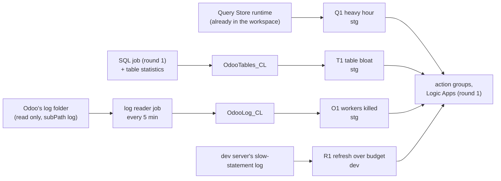

# Round 2: query cost, table health, Odoo's log, the view refresh

Round 2 of the [roadmap](../design.md#roadmap): the signals round 1 left out ([round 1, "Not in round 1"](round-1.md#signals)),
built on round 1's pieces (the SQL job, the DCR, the alerts module, the Logic Apps) and the same proof
([D10](../design.md#decisions)) ([D17](../design.md#decisions)). Status: **approved by the owner as written
(2026-11-08)**; built and live on stg the same day ([review](../reviews/round-2.md)). The learn pages: [Query Store by the hour](../learn/postgres-query-stats.md#the-stg-database-hour-by-hour),
[autovacuum](../learn/postgres-autovacuum.md), [Odoo's log](../learn/odoo-logs.md),
[one folder of a share](../learn/container-apps-jobs.md#reading-one-folder-of-a-file-share).

**One idea: round 1 watches what the client's platform already logs and what Odoo's queue tables hold; round 2 adds three things
nothing reads today: what each hour of queries costs stg's database, which tables autovacuum is losing, and what Odoo
itself writes when its workers die (the kills a container event never shows, [2026-09-09](../postmortems/2026-09-09-stg-cron-memory.md)), plus the dev view refresh that overran its schedule.**

## Signals

| ID | Signal | Source | Condition | Severity | Evidence (REAL, 2026-11-08) |
|---|---|---|---|---|---|
| Q1 | **A heavy hour** on stg's database | `PGSQLQueryStoreRuntime`, stg's `DatabaseId` | Every hour, the last complete hour: stg's database used **over 90 min** of database time; the row names the 3 costliest query ids | ticket | 30 days: 7 hours over 90 min, on 6 days; max 106 min; p95 69 min ([learn](../learn/postgres-query-stats.md#the-stg-database-hour-by-hour)) |
| T1 | **Table bloat** autovacuum is losing | `OdooTables_CL` (the SQL job) | Every 15 min, per table on the job's last run: **dead rows at or over 25 %**, at least **100,000** dead rows, and no autovacuum for 24 h | ticket | stg today: the worst at 18.7 % (`sync_map` 17.9 %, 327,460 dead, never vacuumed): quiet ([learn](../learn/postgres-autovacuum.md)) |
| O1 | **Odoo workers at their limits** | `OdooLog_CL` (the log reader) | Every 5 min over 15 min: **3 or more** worker ends Odoo states itself: a memory or CPU limit reached, a timeout, a critical worker error. Workers `unregistered` with no exit before them (`killed`) are counted but **not alerted**: on dev's real log they also follow ends that are not kills (REAL, 2026-11-08: 21 such bins in 30 days after shutdowns were excluded; a worker unregistered and then still logging), so they wait for the ERP team's reading | page | A worker killed inside a running container leaves no platform trace ([learn](../learn/odoo-logs.md)); the 2026-09-09 cron app's memory guard could not fire for 34 days ([post-mortem](../postmortems/2026-09-09-stg-cron-memory.md)); the backtest is the reader's backfill (acceptance B4) |
| R1 | **The dev view refresh over its budget** | dev server's slow-statement log (`PgLogs`) | Every 15 min: a refresh of `lot_stock_view` over **300 s**, its 5-minute schedule | ticket | 30 days: 5,732 refreshes, p95 12.5 s, max 1,712 s on 2026-11-05: 1 bin |

Q1, T1 and O1 watch stg and are drilled on dev (Q1 has no dev source: dev's Query Store goes to `AzureDiagnostics` and dev
is Burstable; Q1 is backtested). R1 watches a workload that exists only on dev, so **R1 is the one rule enabled on dev**
([D1](../design.md#decisions) keeps every other dev rule off outside drills).

## The SQL job: table statistics

The job adds a fourth query: the 20 tables of its database with the most dead rows, from `pg_stat_user_tables` (live and
dead rows, last autovacuum, autovacuum count) and `pg_total_relation_size`, sent as the stream `Custom-OdooTables` to a
new table `OdooTables_CL`. The statistics views need no grant beyond round 1's `CONNECT` (to be proven on dev as
`obs_monitor`: B2). The heartbeat still goes last; its row gains `TableRows`.

## The log reader

A second job per environment, beside the SQL job, from the same image (`obs/sql-job`, a second entry point), with the
same identity (Metrics Publisher on the DCR, Repository Reader on `obs/sql-job`):

| Setting | Value |
|---|---|
| Mount | The environment's storage of the Odoo share, `subPath: log`, at `/odoo-log`: dev through its **read-only** storage (`erp-dev-ro`); stg through its read-write one with the mount option `ro`, proven read-only on dev first (B3). Never the share's root, so never `config/` with its secrets |
| Schedule | Every 5 min, no retry, 0.25 vCPU, 0.5 GiB; a 600 s timeout so the one-off backfill (B4) can read the whole history with the same job (a normal run takes seconds) |
| Reading | For each log file written to in the last window, from its end backwards until the lines are older than the window: the last complete 5 minutes, aligned to the schedule, so runs read back-to-back windows with no overlap and no state; no full read of a 12 GB file |
| Rows | Per run, per file and kind: `memory_limit`, `cpu_limit`, `timeout`, `critical`, `unregistered`, `exiting`, `error` (ERROR lines), with counts, first and last time, and one sample line for the four limit kinds (Odoo's fixed text with a pid) |
| Stream | `Custom-OdooLog` to a new table `OdooLog_CL` |
| Backfill | `--backfill --since <date>`: reads the files' history and prints the 15-min bins O1 would have fired on; nothing is sent (B4) |

What the reader never does: write to the share, read outside `log/`, send a log line's free text other than the four
limit kinds' fixed messages.

## Terraform

| Piece | Where |
|---|---|
| Two tables, two streams | `envs/shared` (`tables.tf`): `OdooTables`, `OdooLog` beside round 1's three |
| The log reader job | The `sql-job` module: a second `azurerm_container_app_job`, created when `log_storage_name` is set; its volume `subPath: log`, read only |
| Q1, T1, O1, R1 | `kql/rules.json` and its query files, through the same alerts module; Q1 takes stg's database id as a target; R1 `enabled` by default on dev |
| Names | The storages' names and stg's database id in the committed names or deploy files, never in the code |

Every plan passes the repo-trace scan, every apply is followed by `obs.sh audit` ([AGENTS.md](../../AGENTS.md#ground-rules-of-the-track-owner-2026-11-07)).

## Cost

Prices as round 1 ([round 1, cost](round-1.md#cost)); a month, for stg (dev's rules off except R1):

| Piece | Count | A month |
|---|---|---|
| Q1 (hourly) | 1 rule | about $0.50 |
| T1, R1 (15 min) | 2 rules | 2 x $0.50 = $1.00 |
| O1 (5 min, page) | 1 rule | $1.50 |
| The log reader on stg | 8,640 runs of about 20 s | about $1.82 |
| New data (tables and log rows) | a few MB | under $0.10 |
| **Round 2** | | **about $5**, so rounds 1 and 2 about **$17** against $20 ([D8](../design.md#decisions)) |

## Acceptance

| ID | What | Passes when |
|---|---|---|
| B1 | Learn pages and this spec | Approved by the owner |
| B2 | Table statistics | On dev and stg the job sends 20 table rows a run as `obs_monitor`, no new grant; database time per run still under 1 s. Passed 2026-11-08: 20 table rows a run on dev and stg as `obs_monitor`, no new grant |
| B3 | The log reader is read only | On dev, a write under `/odoo-log` fails, under both the read-only storage and the mount option `ro`; the reader sees `log/` only. Passed 2026-11-08: `write refused (OSError: Read-only file system)` on dev (both storages) and stg |
| B4 | O1 backtest | The reader's backfill over the log files' history lists the bins O1 would have fired on; 2026-09-09 among them if the files reach back that far (else the earliest date is recorded). Passed 2026-11-08 as far as the files reach: stg's files start 2026-10-31 (0 bins); dev's 3.9 GB: 0 bins of stated limits, 21 of inferred kills (not alerted). 2026-09-09 is older than both |
| B5 | Q1 and R1 backtests | Q1's file over 30 days: the 7 hours; R1's: 2026-11-05. Passed 2026-11-08: Q1 the 7 hours, R1 2026-11-05 03:30 |
| B6 | Drills on dev | T1 and O1 with lowered thresholds, R1 as it is: each card reaches dev's channel; times recorded. Passed 2026-11-08: T1 10:40:06, R1 10:44:36, O1 10:45:47 UTC, each card 1 to 2 s later |
| B7 | stg | A preflight on stg's live data, then the rules enabled; `obs.sh audit` clean. Passed 2026-11-08: Q1, T1, O1 quiet on stg's live data, enabled 10:42 UTC; `obs.sh audit` clean over 51 resources |
| B8 | Teardown | The teardown preview lists the new rows. Passed 2026-11-08: 67 Terraform rows (stg 26, dev 25, shared 16), every round 2 row among them |

## Teardown

Added to [round 1's inventory](round-1.md#teardown), removed by the same steps:

| What | Where | Removed by |
|---|---|---|
| Q1, T1, O1, R1 per environment | Track resource group, `management-sub` | `terraform destroy` (stg, then dev) |
| The log reader jobs | Track resource groups of dev and stg | `terraform destroy` |
| Tables `OdooTables_CL`, `OdooLog_CL`; their streams | The platform's workspace; the DCR | `terraform destroy` of `envs/shared` (the tables wait for the workspace's lock, as round 1's) |

## Not in round 2

Logging autovacuum's runs (`log_autovacuum_min_duration` stays `-1`, the default: the table statistics say which table
autovacuum is losing; the log can be turned on later for the why, owner 2026-11-08,
[learn](../learn/postgres-autovacuum.md#the-statistics-for-the-alert-the-log-for-the-why)); the SQL text of costly
queries (it stays in `azure_sys`, looked up by id); Odoo's ERROR bursts as their own rule (counted in `OdooLog_CL` from
day one, a rule once their normal rate is known); a read-only storage definition on stg's environment (a change to the
platform's environment, for the platform team).
