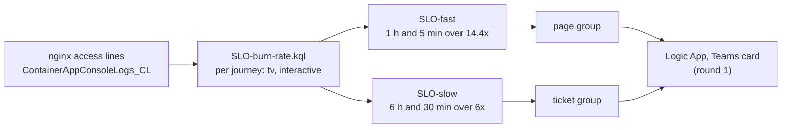
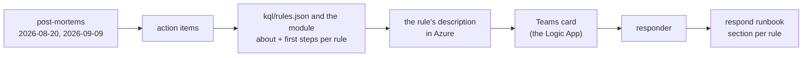

# Round 3: SLOs and incident response on stg

Round 3 of the [roadmap](../design.md#roadmap), stages S1 and S4 of the plan of 2026-11-08: an
availability SLO for stg's web app and two burn-rate alerts on it ([SLOs](#slos)), then what a person does when any of
the track's alerts fires ([incident response](#incident-response)); the SLOs are built on round 1's pieces (the alerts module, the action groups,
the Logic Apps) and the same proof ([D10](../design.md#decisions)): a backtest, a drill on dev, a preflight on stg.
Status: **approved by the owner with the plan of 2026-11-08 (2026-11-08)**, which runs each stage to its end in Auto mode; **live on
stg since 2026-11-08 12:35 UTC**, C1 to C5 passed; S4 live on stg since 14:06 UTC, C6 to C13 passed. The learn
pages: [slo](../learn/slo.md) (every term, one real request followed to the page, the backtest's episodes) and
[incident-response](../learn/incident-response.md) (severities, roles, first steps, blameless post-mortems).

**One idea: stg's users already leave one nginx line per request; counting the failed ones against an agreed budget
(0.5 % over 30 days, per journey) and paging only when that budget burns fast turns round 1's raw 5xx count into a
measure of what users felt.**

## SLOs

The SLI, the target and the two rules. The reasons, with the real numbers behind each, are in the
[learn page](../learn/slo.md); the query is [kql/SLO-burn-rate.kql](../../kql/SLO-burn-rate.kql) and the rules' values
are in [kql/rules.json](../../kql/rules.json) (`SLO-fast`, `SLO-slow`).

| Part | Decision | Why (REAL, measured 2026-11-08) |
|---|---|---|
| Service | stg's **web app** | The cron app's nginx lines are not access lines (9,416 lines since 2026-08-10, none with a status) |
| Valid requests | Every nginx access line, except status 499 (the client left), 101 and `/websocket` (long-lived upgrades) | A user waited for each counted request and got an answer to judge |
| Good | Status under 500 | 4xx are the server correctly refusing a wrong request |
| Journeys | `tv` (`/erp/tv/`, the factory TV dashboards' polling) and `interactive` (everything else), each its own SLI, budget and alert (a dimension) | The TVs make about 70 % of the requests (October: 402,831 of 572,561); measured together they would hide people's failures |
| Target and window | **99.5 % over 30 rolling days**, both journeys | August (the incident month) spent 174 % and 159 % of the budget; September and October 9 % to 23 % ([learn](../learn/slo.md#3-the-slo-picking-the-target-from-the-data)) |
| SLO-fast | **Page** when the burn rate is over **14.4** in the last **1 h** and the last **5 min**, with at least **10** bad requests in the hour; every 5 min | 2 % of the budget in an hour (SRE workbook); 12 episodes in 90 days, each on real failures |
| SLO-slow | **Ticket** when the burn rate is over **6** in the last **6 h** and the last **30 min**, at least 10 bad; every 15 min | 5 % of the budget in 6 h; a slow leak that SLO-fast misses (2026-08-21, 08-25: tickets only) |
| Not built | The workbook's third pair (3 days and 6 h at 1x) | An Azure log alert reads at most two days |
| Latency | **No latency SLO** in round 3 | The nginx lines have no request time and Odoo's config is not changed ([D2](../design.md#decisions)); Container Apps' `ResponseTime` is an average only ([learn](../learn/slo.md#why-there-is-no-latency-slo-yet)) |

The rules run on stg and are drilled on dev (dev's web app is the same Odoo with little traffic: its SLO alerts stay
off outside drills, [D1](../design.md#decisions)). The query serves both the alert and the backtest: the alert reports
the steps of its last `ReportWindow` (10 and 20 min), a backtest sets it to 1000 days and gets every step.

### The error budget policy

What the team does with the budget, in plain words. It guides the track only; it is not proposed to the ERP and platform
teams for now (owner, 2026-11-08: the track first):

| Budget left in the 30 days | What it means | What to do |
|---|---|---|
| Over 50 % | Normal | Changes and releases go out as planned |
| 0 to 50 % | Users are feeling failures | Each release names its risk; the incidents behind the spend get a post-mortem |
| Spent | The month's failures are beyond what was agreed | Reliability work first: releases of features wait until the budget recovers or the cause is fixed |

## Incident response

Stage S4: **one idea: every card already says what fired; S4 makes it say what it means and what to do first, gives each
rule a runbook section for the rest, and checks the whole system against two real incidents, written up as blameless
post-mortems whose action items change the rules.** The concepts: [incident-response](../learn/incident-response.md).

| Part | Decision | Why |
|---|---|---|
| Severity | Unchanged: **page** (Azure `Sev1`, looked at within the hour) and **ticket** (`Sev3`, the next working day), set per rule; in doubt, the higher | An Azure log rule has one severity; two speeds are enough for two small teams ([learn](../learn/incident-response.md#severity-chosen-from-the-impact)) |
| What the card says | Each rule's **description** (in Azure) is its meaning in one or two sentences with a real case, then **"First steps"**, three or four numbered steps; the card shows it under the title. Log rules: `about` and `first_steps` in [kql/rules.json](../../kql/rules.json); metric rules: the same fields in [the alerts module](../../terraform/modules/alerts/main.tf). "Round 1 rule" is gone | A responder acts in the first minutes without opening anything; the description is also what the portal's alert page shows |
| No link | The card links to nothing in the repo; the text names no repo path, server, app or person (the plan's repo-trace scan and the policies check every plan) | Nothing in Azure names the repo ([ground rules](../../AGENTS.md#ground-rules-of-the-track-owner-2026-11-07), owner 2026-11-08) |
| Length | Each description under Azure's limit: 4,096 characters for a log rule, 2,048 for a metric rule ([service limits](https://learn.microsoft.com/en-us/azure/azure-monitor/service-limits), 2026-11-08) | A rule over the limit fails its apply |
| The runbook | [respond.md](../runbooks/respond.md): one section per signal enabled on stg (16 sections, 21 rules), each: what it means, the card's first steps (linked, not copied), the queries that follow with real output, past cases, when to escalate and to whom | The card holds the first minutes; the runbook holds the rest |
| Roles | The first responder is incident commander until handing over; the owning teams act: the ERP team (Odoo: code, config, deploys, sessions), the platform team (Azure resources, Postgres servers, the VPN gateway), the on-prem team (SQL Server, the firewall). The track reads only, also during an incident | The client's teams are small; the [ground rules](../../AGENTS.md#ground-rules-of-the-track-owner-2026-11-07) hold during an incident too |
| Post-mortems | In `docs/postmortems/`, one page per incident on the method's post-mortem template (pushed to the lab): summary, impact, a timeline from the workspace, contributing causes (blameless), what rounds 1 to 3 would have caught and when, action items with an owner and a state. Two now: [2026-08-20](../postmortems/2026-08-20-stg-502-bursts.md) and [2026-09-09](../postmortems/2026-09-09-stg-cron-memory.md) | Plan v52; the two incidents with the most users hit and the least platform trace |
| Action item closed here | **L7 also pages on 2 or more `ProbeFailure` kills of one app in 15 min** ([round 1, L7](round-1.md#signals)); a single kill stays a ticket (M1, M2) | Both post-mortems found probe kills that no page counted; the backtest fires only on the real loops (July to September), none since 2026-10-01 |
| Game day | On dev, once: L1's real lock wait ([drills, step 3](../runbooks/drills.md#3-a-real-lock-wait-l1)) fired with the new card; the responder works from the card and the runbook alone; detect, notify, diagnose and resolve timed ([respond](../runbooks/respond.md#game-day-on-dev)) | A drill proves the path; a game day proves the response |
| Rollout | dev first: the card change on dev's Logic App alone (a targeted plan of the shared root), dev's rules (the game day); then stg's Logic App and stg's rules after a preflight of the changed L7 on stg's live data | [D1](../design.md#decisions) |

## Terraform

No module change: the alerts module creates a log rule for every entry of `kql/rules.json`, with its dimensions, in
every environment the entry lists (both, by default). On stg the two rules are created **disabled** through
`rule_overrides` in `terraform/envs/stg/deploy.auto.tfvars.json`, enabled after the preflight by removing the override
(round 2's pattern). On dev they stay off (`rules_enabled` false) except during the drill.

**The drill on dev:** dev's web app has too little traffic and no failures to make a real burn, so the drill overrides
dev's `SLO-fast` with `Factor = -1` and `MinBad = 0` (every journey with any traffic in the window "burns"), enables it,
and makes a few ordinary page loads on dev's web app; the card must reach dev's channel. The drill's values go in
`terraform/envs/dev/drill.auto.tfvars.json` and are removed after.

## Cost

Prices as round 1 ([round 1, cost](round-1.md#cost)); a month, for stg (dev's off):

| Piece | Count | A month |
|---|---|---|
| SLO-fast (5 min) | 1 rule, 2 time series (journeys) | $1.50 + $0.15 = $1.65 |
| SLO-slow (15 min) | 1 rule, 2 time series | $0.50 + $0.05 = $0.55 |
| New data | None: the nginx lines are already in the workspace | $0 |
| **Round 3** | | **about $2.20**, so rounds 1 to 3 about **$19** against $20 ([D8](../design.md#decisions)) |

## Acceptance

| ID | What | Passes when |
|---|---|---|
| C1 | Learn page and this spec | Written, with real values; approved with the plan of 2026-11-08. Passed 2026-11-08: [slo](../learn/slo.md), a diagram from the real 2026-08-27 series |
| C2 | Backtest | Over stg's history since 2026-08-09, SLO-fast fires on 2026-08-20, 08-24 and 08-27, and on no day of November so far; the episodes are listed and judged in the learn page. Passed 2026-11-08: 50 bins in 12 episodes (August 8, September 2, October 2, November 0) |
| C3 | Preflight on stg | Both rules, run once as the alert (`backtest.py --alert`), are quiet on stg's live data before they are enabled. Passed 2026-11-08 12:27 UTC: both `quiet` |
| C4 | Drill on dev | SLO-fast fires on dev with the drill's values; its card, with the journey, reaches dev's channel; the times are recorded. Passed 2026-11-08: applied 12:28:35, fired 12:32:47 UTC as two alerts (tv, interactive), the two cards 2 s later, each with its journey (seen by the owner, with both `Resolved` cards at 12:48:47) ([drills](../runbooks/drills.md#round-3s-rules-c4)) |
| C5 | stg live | Both rules enabled on stg; `obs.sh plan stg` then reads `No changes`; `obs.sh audit` clean. Passed 2026-11-08: enabled 12:35:37 UTC; `No changes`; audit clean over 55 resources |
| C6 | Teardown | The teardown preview lists the 4 new rows (2 rules in each environment). Passed 2026-11-08 14:14 UTC: `plan -destroy` 71 rows (shared 16, dev 27, stg 28), the 4 SLO rules among them |
| C7 | S4's learn page and this section | Written with real values and sources. Passed 2026-11-08: [incident-response](../learn/incident-response.md), Google's and PagerDuty's texts and Azure's limits checked live |
| C8 | The cards | Every enabled stg rule (21) has a description with its meaning and first steps, none says "Round 1 rule"; every plan passes the repo-trace scan and the policies; a card seen in dev's channel, then stg's (the owner). Passed 2026-11-08 for the descriptions (stg 21 of 21, dev 20 of 20, read back from Azure, at most 687 characters) and dev's card (the game day's, its text in the Logic App run's input; seen by the owner in dev's channel: the meaning, the numbered first steps, then the facts); stg's card at its next alert |
| C9 | The runbook | [respond.md](../runbooks/respond.md) has a section for every rule enabled on stg. Passed 2026-11-08: 16 sections for 21 rules, each query run once with its real output |
| C10 | Post-mortems | Two, from the workspace, on the template pushed to the lab, each with what the rules would have caught and when. Passed 2026-11-08: [2026-08-20](../postmortems/2026-08-20-stg-502-bursts.md), [2026-09-09](../postmortems/2026-09-09-stg-cron-memory.md); the template is the lab `90cff8d` |
| C11 | L7's action item | Backtested since 2026-07-11 and quiet on stg's live data (`backtest.py L7 --alert`) before stg's apply. Passed 2026-11-08: 204 new bins, all July to September; `quiet` at 13:58 UTC |
| C12 | Game day | Run on dev; the four times recorded in the runbook. Passed 2026-11-08: detect 2 min 54 s, notify 3 s, diagnose 30 s, resolve 18 min 54 s ([record](../runbooks/respond.md#the-game-day-of-2026-11-08)) |
| C13 | stg live | `obs.sh plan stg` and `plan shared` then read `No changes`; `obs.sh drift` 0; `obs.sh audit` clean. Passed 2026-11-08: applied 14:06:54 UTC; drift 0 at 14:17; audit clean over 55 resources |

## Teardown

Added to [round 1's inventory](round-1.md#teardown), removed by the same steps:

| What | Where | Removed by |
|---|---|---|
| `obs-stg-SLO-fast`, `obs-stg-SLO-slow`, `obs-dev-SLO-fast`, `obs-dev-SLO-slow` | Track resource group, `management-sub` | `terraform destroy` (stg, then dev) |

Nothing else: no new data, table, role or grant. S4 adds no resource: the descriptions and L7's condition change
existing rules, and the post-mortems and runbook are docs.
