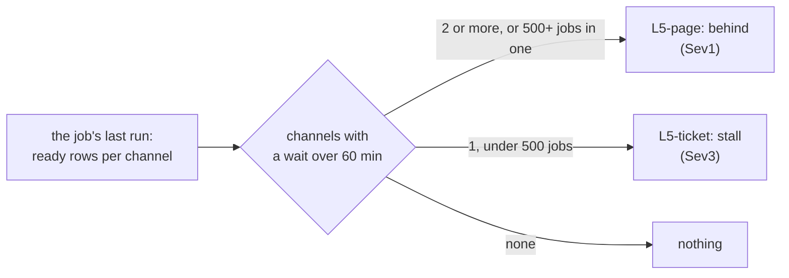

# Round 7: page when the queue is behind, ticket a channel that stopped

[D29](../design.md#decisions). A7's rerun passed on 2026-11-14, and the same reading showed L5-page paging one cause 14 times in 3
days ([round 6, I8](round-6.md#acceptance)). This round
makes L5 tell a queue behind from one channel stopped, and say why a channel stopped. How queue_job works and every
number below: [learn: odoo-queue-job](../learn/odoo-queue-job.md). Status: approved by the owner 2026-11-14, live on stg the same day ([review](../reviews/round-7.md)).

## What and why

**One idea: L5-page pages on the age of the oldest job, and age since creation is not waiting. It should page when the
queue as a whole is behind, ticket once when one channel stops, and count the jobs whose worker died, which is why the
channel stopped.**

| # | Item | Gap it closes | Source |
|---|---|---|---|
| 1 | **The job reads when a job could run, and how long it has run** | `oldest_age` takes `min(date_created)`: a job postponed to its `eta` counts as waiting, and a `started` row's age is its creation, not its start (a job "200 min started" had started 20 min before, 2026-11-14) | `queue_job` on each server, through the SQL job |
| 2 | **L5-page pages a queue behind** | One job late in one channel pages like 883 jobs late in 3 channels. From 2026-11-11 06:18 to 11-13 20:28, `root.endpoint` paged 14 times on 1 to 2 jobs | The same |
| 3 | **L5-ticket tickets a channel that stopped, and jobs found dead** | A stall is the ERP team's defect, not a page. Its cause is visible in the queue itself: jobs whose worker ended mid-run (`JobFoundDead`), 0 a day from 11-01 to 11-09, then 4 to 9 a day | The same |

Not changed, and why:
- **No new rule.** Rounds 1 to 6 cost about $19.50 of D8's $20; a new 15-min rule costs $0.50, an extra series of an
  existing one $0.05 (round 5's precedent: L1-burst). The two new checks are series of L5-ticket.
- **No new column.** The new measures are new `State` and `Check` values in `OdooQueue`'s existing columns, so neither
  the table nor the DCR changes ([tables.tf](../../terraform/envs/shared/tables.tf); round 2's DCR incident).
- **`pending` over 5,000** (L5-page), **`failed` and `size`** (L5-ticket) stay as they are.
- **Why the twin job waits, and a retry count of 101 against `max_retries` 5:** Odoo's code and configuration are the
  ERP team's.

## 1. What the job reads

[job/sql_job.py](../../job/sql_job.py) adds rows to `OdooQueue`, per channel, besides today's `backlog` rows by state:

| Row | `Check`, `State` | `Count` | `OldestAgeSec` | Which jobs |
|---|---|---|---|---|
| Ready | `backlog`, `ready` | Jobs that may run now | The longest wait since each could run: now minus the later of `date_created` and `eta` | `pending` or `enqueued` whose `eta` is empty or past |
| Running | `backlog`, `running` | Jobs running | The longest current attempt: now minus `date_started` | `started` |
| Dead | `dead_24h` (`Model`, `Method`) | Jobs found dead | (none) | `failed` with `exc_name` `JobFoundDead` whose last attempt started in the last 24 h |

Why each measure, on the real cases:

| Case (REAL) | Today's `oldest_age` | `ready` | `running` | `dead_24h` |
|---|---|---|---|---|
| The queue behind, 2026-11-10 18:58: 865 sync jobs waited 2 h 7 min for their first run (no `eta`) | 60 min | The same: the jobs had no `eta` | 1 job | 0 |
| `root.endpoint` stopped, 2026-11-11 06:18: one job died at each of its 7 attempts | 64 min, 2 jobs | 64 min, 2 jobs | Each attempt's own length | 1 and rising (6 that day) |
| A retry waiting for its `eta` (stg, the inventory report's warm-up job, up to 39 retries on 11-10) | Counted from creation | Not counted until its `eta` passes | | |

A job whose last attempt started more than 24 h before it was found dead is missed; with `LIMIT_TIME_REAL` 3600 on stg
an attempt lasts at most an hour, so none is. Queue_job records no time of failure, so the last start is the closest.

## 2. L5-page pages a queue behind

[kql/L5-job-queue.kql](../../kql/L5-job-queue.kql) replaces the check `oldest_age` with **`behind`**: on the job's last
run, the channels whose `ready` wait is over `MaxReadyAgeMin` (60) are late; the queue is behind when **`MinLateChannels`
(2) or more channels are late, or one late channel holds `MinLateJobs` (500) or more ready jobs**. The card's `Detail`
lists the late channels. `pending` over 5,000 stays.

The thresholds come from every run since the table began (2026-11-08 to 11-14, measured 2026-11-14 on `pending` rows; the job runs every 5 min, L5-page's bins are 10 min;
the history's stand-in for `ready`; those jobs had no `eta`):

| Episode | Runs | Late channels | Late jobs | Today | Round 7 |
|---|---|---|---|---|---|
| The queue behind, 11-10 18:55 to 11-11 04:30 | 116 | 2 to 5 | up to 911 | Page (18:58, resolved 05:04) | Page |
| Its tail, 11-11 04:35 to 04:45 | 3 | 1 (`mirror_inventory_report`) | 3 | Inside the page | Ticket: stall |
| `root.endpoint` stopped, 11-11 06:15 to 11-13 20:40 | 516 | 1 | 1 to 2 | 14 pages (11-11 06:18 to 11-13 20:28) | Ticket: stall, once |

| Choice | Why |
|---|---|
| `MinLateChannels` 2 | Every run of the one episode where the queue was behind had 2 or more; every run of the stall had 1 |
| `MinLateJobs` 500 | A whole queue behind can sit in one channel (`root` alone held 869 at 18:58). No run on record falls between 3 and 869, so 500 is a judgment inside that gap, revisited with O4 |
| The last run only | As today: a page says the queue is behind now |

## 3. L5-ticket: a stalled channel, and jobs found dead

Two checks join `failed` and `size`, each a series of the same rule (dimension `Check`):

| Check | Fires while | `Detail` | Why a 24 h memory |
|---|---|---|---|
| `stall` | A channel was late (as in item 2) at any run of the last 24 h, without the queue being behind | The channel, and its longest `running` attempt | A defect in one job stops its channel every few hours (`root.endpoint`: about every 6 h); one ticket stays open while it recurs and resolves a day after the last, instead of a card per stall |
| `dead` | Any job found dead in the last 24 h (`dead_24h` over 0) | The model and method | The same; a worker ending mid-job is a defect the ERP team must see even when no channel waits |

The rule's window grows to 24 h; `failed` and `size` still read the last run. Tickets post no resolve card
([round 6](round-6.md#4-tickets-post-no-resolve-card)).

On the record: `stall` would have fired once at 11-11 04:35 and stayed open through the `root.endpoint` stalls;
`dead` once on 2026-11-10 (the first `JobFoundDead`) and, by the day counts (4 to 9 a day), stayed open since.

## 4. The cards and the runbook

Each rule's card text ([kql/rules.json](../../kql/rules.json), `about` and `first_steps`) and the respond runbook's
[L5 step](../runbooks/respond.md#l5-page-and-l5-ticket-the-job-queue) say what `behind`, `stall` and `dead` mean and
what to look at first.

## 5. The queries tested on a real PostgreSQL

What `ready` leaves out is decided in SQL, so a test of the rows built in Python cannot show it. The pipeline gains a
step `sql` ([pipeline](pipeline.md#the-workflow)): it starts a throwaway PostgreSQL 17 container from an image pinned
by digest, writes a small `queue_job` table with jobs at known states, dates and `eta`, runs the job's own query strings
through `psql`, checks each count and age, and removes the container. It never reaches the client's servers. The job imports
its driver inside `main`, so the tests of the rows need no driver.

## Cost

About $0.10 a month: two more series on L5-ticket (every 15 min, $0.05 each). The job's extra queries read `queue_job`
by state, as today. Rounds 1 to 7 at about $19.60 against $20 ([D8](../design.md#decisions)).

## Acceptance

| ID | Check | Pass |
|---|---|---|
| N1 | The spec | Approved before the build |
| N2 | The job's rows | In CI: the rows built from each query (`unit`), and the queries on a throwaway PostgreSQL (`sql`): `ready` leaves out a job whose `eta` is in the future and counts from the later of creation and `eta`; `running` counts from `date_started`; `dead_24h` counts `JobFoundDead` in the last 24 h only |
| N3 | The queries on stg, read only, before the image | Their counts match a hand query on `queue_job` at the same minute; the run's database time stays under A2's 1 s |
| N4 | L5-page's backtest since 2026-11-08 (on `pending` rows) | `behind` fires only in the episode of 11-10 18:55 to 11-11 04:30; no row in the `root.endpoint` stall |
| N5 | L5-ticket's backtest, the same history | `stall` fires from 11-11 04:35 and stays open through 11-13 20:40 (one alert); `failed` and `size` unchanged. `dead` has no history in the workspace: N3 and N6 prove it |
| N6 | Drill on dev | The image on dev's job; `ready`, `running` and `dead_24h` rows in the workspace; `behind`, `stall` and `dead` fire with lowered values over dev's real queue, each card arrives; back to real values while enabled until each resolves (never closed by hand); dev idle |
| N7 | stg live | Applied after a plan read first: only L5-page, L5-ticket and the two jobs' image change; `obs.sh drift` 0; `obs.sh audit` clean; the teardown preview unchanged (73 rows) |
| N8 | 24 h on stg | From N7's apply, no false page, and a recurring `root.endpoint` stall a ticket, not a page; read in a later session |
| N9 | The cards and the runbook | Each new check's meaning and first steps on its card and in the respond runbook |

## Teardown

Nothing new to remove: the checks go with L5's rules and the rows with the SQL job, all in the existing
[teardown](round-1.md#teardown) rows.
